# AUTOSAR CAN Driver 规范 · 中文译文

**版本：AUTOSAR CP R22-11 · Document ID 11 · 原文 133 页**

> 本文件根据用户提供的 `AUTOSAR_SWS_CANDriver.pdf` 翻译，为非官方中文译文。保留 API、参数、类型、宏、需求编号、专业术语和图中英文。规范性用语 shall 译为“应”，shall not 译为“不得”；may 按许可语义译为“可”。各处原文页码用于追溯，不改变原文条款的效力。原图直接导出或由原 PDF 矢量图渲染，未重新绘制。

> 版式说明：原 PDF 的跨页表格已接续合并，并标注原文页码；合并单元格在 Markdown 中以空白延续。页眉页脚不重复，目录按原文书签重建。原文存在的接口拼写、版本历史及交叉引用问题见文末“译者核对说明”，不根据其他版本擅自改写。

## 目录

- [1 引言与功能概述](#page-14)（原文第 14 页）
- [2 缩略语](#page-15)（原文第 15 页）
  - [2.1 Priority Inversion](#page-16)（原文第 16 页）
  - [2.2 CAN Hardware Unit](#page-18)（原文第 18 页）
- [3 相关文档](#page-19)（原文第 19 页）
  - [3.1 输入文档](#page-19)（原文第 19 页）
  - [3.2 相关标准与规范](#page-20)（原文第 20 页）
  - [3.3 相关规范](#page-20)（原文第 20 页）
- [4 约束与假设](#page-21)（原文第 21 页）
  - [4.1 限制](#page-21)（原文第 21 页）
  - [4.2 对汽车领域的适用性](#page-21)（原文第 21 页）
- [5 对其他模块的依赖](#page-22)（原文第 22 页）
  - [5.1 Static Configuration](#page-22)（原文第 22 页）
  - [5.2 Driver Services](#page-22)（原文第 22 页）
  - [5.3 System Services](#page-22)（原文第 22 页）
  - [5.4 Can 模块的使用者](#page-23)（原文第 23 页）
  - [5.5 文件结构](#page-24)（原文第 24 页）
- [6 需求追溯](#page-25)（原文第 25 页）
- [7 功能规范](#page-33)（原文第 33 页）
  - [7.1 Driver 的范围](#page-33)（原文第 33 页）
  - [7.2 Driver State Machine](#page-34)（原文第 34 页）
  - [7.3 CAN Controller State Machine](#page-36)（原文第 36 页）
    - [7.3.1 CAN Controller 状态说明](#page-36)（原文第 36 页）
    - [7.3.2 CAN Controller 状态切换](#page-37)（原文第 37 页）
    - [7.3.3 Can_Init 引起的状态切换](#page-38)（原文第 38 页）
    - [7.3.4 Can_SetBaudrate 引起的状态切换](#page-39)（原文第 39 页）
    - [7.3.5 Can_SetControllerMode 引起的状态切换](#page-39)（原文第 39 页）
    - [7.3.6 Hardware Event 引起的状态切换](#page-42)（原文第 42 页）
    - [7.3.7 Can_DeInit 引起的状态切换](#page-43)（原文第 43 页）
  - [7.4 Can 模块 / Controller 初始化](#page-43)（原文第 43 页）
  - [7.5 L-PDU 发送](#page-44)（原文第 44 页）
    - [7.5.1 Priority Inversion](#page-45)（原文第 45 页）
    - [7.5.2 发送数据一致性](#page-47)（原文第 47 页）
  - [7.6 L-PDU 接收](#page-48)（原文第 48 页）
    - [7.6.1 接收数据一致性](#page-48)（原文第 48 页）
  - [7.7 Wakeup 机制](#page-50)（原文第 50 页）
  - [7.8 Notification 机制](#page-50)（原文第 50 页）
  - [7.9 Reentrancy 问题](#page-51)（原文第 51 页）
  - [7.10 Hardware Timestamping](#page-51)（原文第 51 页）
  - [7.11 错误分类](#page-52)（原文第 52 页）
    - [7.11.1 Development Errors](#page-52)（原文第 52 页）
    - [7.11.2 Runtime Errors](#page-53)（原文第 53 页）
    - [7.11.3 Transient Faults](#page-53)（原文第 53 页）
    - [7.11.4 Production Errors](#page-53)（原文第 53 页）
    - [7.11.5 Extended Production Errors](#page-53)（原文第 53 页）
    - [7.11.6 返回值](#page-54)（原文第 54 页）
  - [7.12 CAN FD 支持](#page-54)（原文第 54 页）
  - [7.13 CAN XL 扩展](#page-54)（原文第 54 页）
  - [7.14 CAN Error Types 上报](#page-55)（原文第 55 页）
- [8 API 规范](#page-56)（原文第 56 页）
  - [8.1 导入的类型](#page-56)（原文第 56 页）
  - [8.2 类型定义](#page-57)（原文第 57 页）
    - [8.2.1 Can_ConfigType](#page-57)（原文第 57 页）
    - [8.2.2 Can_PduType](#page-57)（原文第 57 页）
    - [8.2.3 Can_IdType](#page-58)（原文第 58 页）
    - [8.2.4 Can_HwHandleType](#page-58)（原文第 58 页）
    - [8.2.5 Can_HwType](#page-59)（原文第 59 页）
    - [8.2.6 对 Std_ReturnType 的扩展](#page-59)（原文第 59 页）
    - [8.2.7 Can_ErrorStateType](#page-60)（原文第 60 页）
    - [8.2.8 Can_ControllerStateType](#page-60)（原文第 60 页）
    - [8.2.9 Can_ErrorType](#page-61)（原文第 61 页）
    - [8.2.10 Can_TimeStampType](#page-62)（原文第 62 页）
  - [8.3 函数定义](#page-62)（原文第 62 页）
    - [8.3.1 影响整个 Hardware Unit 的服务](#page-62)（原文第 62 页）
      - [8.3.1.1 Can_Init](#page-62)（原文第 62 页）
      - [8.3.1.2 Can_GetVersionInfo](#page-63)（原文第 63 页）
      - [8.3.1.3 Can_DeInit](#page-64)（原文第 64 页）
    - [8.3.2 影响单个 CAN Controller 的服务](#page-65)（原文第 65 页）
      - [8.3.2.1 Can_SetBaudrate](#page-65)（原文第 65 页）
      - [8.3.2.2 Can_SetControllerMode](#page-66)（原文第 66 页）
      - [8.3.2.3 Can_DisableControllerInterrupts](#page-68)（原文第 68 页）
      - [8.3.2.4 Can_EnableControllerInterrupts](#page-69)（原文第 69 页）
      - [8.3.2.5 Can_CheckWakeup](#page-70)（原文第 70 页）
      - [8.3.2.6 Can_GetControllerErrorState](#page-71)（原文第 71 页）
      - [8.3.2.7 Can_GetControllerMode](#page-72)（原文第 72 页）
      - [8.3.2.8 Can_GetControllerRxErrorCounter](#page-73)（原文第 73 页）
      - [8.3.2.9 Can_GetControllerTxErrorCounter](#page-74)（原文第 74 页）
      - [8.3.2.10 Can_GetCurrentTime](#page-75)（原文第 75 页）
      - [8.3.2.11 Can_EnableEgressTimeStamp](#page-77)（原文第 77 页）
      - [8.3.2.12 Can_GetEgressTimeStamp](#page-78)（原文第 78 页）
      - [8.3.2.13 Can_GetIngressTimeStamp](#page-79)（原文第 79 页）
    - [8.3.3 影响 Hardware Handle 的服务](#page-80)（原文第 80 页）
      - [8.3.3.1 Can_Write](#page-80)（原文第 80 页）
  - [8.4 Callback 通知](#page-83)（原文第 83 页）
    - [8.4.1 Callout 函数](#page-83)（原文第 83 页）
    - [8.4.2 启用 / 禁用 Wakeup Notification](#page-84)（原文第 84 页）
  - [8.5 Scheduled Function](#page-84)（原文第 84 页）
    - [8.5.1.1 Can_MainFunction_Write](#page-84)（原文第 84 页）
    - [8.5.1.2 Can_MainFunction_Read](#page-85)（原文第 85 页）
    - [8.5.1.3 Can_MainFunction_BusOff](#page-86)（原文第 86 页）
    - [8.5.1.4 Can_MainFunction_Wakeup](#page-87)（原文第 87 页）
    - [8.5.1.5 Can_MainFunction_Mode](#page-87)（原文第 87 页）
  - [8.6 所需接口](#page-88)（原文第 88 页）
    - [8.6.1 必需接口](#page-88)（原文第 88 页）
    - [8.6.2 可选接口](#page-88)（原文第 88 页）
    - [8.6.3 可配置接口](#page-89)（原文第 89 页）
- [9 Sequence Diagram](#page-90)（原文第 90 页）
  - [9.1 Can 与 CanIf 模块的交互](#page-90)（原文第 90 页）
  - [9.2 Wakeup 流程](#page-90)（原文第 90 页）
- [10 配置规范](#page-91)（原文第 91 页）
  - [10.1 本章阅读说明](#page-91)（原文第 91 页）
  - [10.2 Container 与配置参数](#page-91)（原文第 91 页）
    - [10.2.1 Can](#page-98)（原文第 98 页）
    - [10.2.2 CanGeneral](#page-98)（原文第 98 页）
    - [10.2.3 CanController](#page-107)（原文第 107 页）
    - [10.2.4 CanControllerBaudrateConfig](#page-114)（原文第 114 页）
    - [10.2.5 CanControllerFdBaudrateConfig](#page-118)（原文第 118 页）
    - [10.2.6 CanHardwareObject](#page-122)（原文第 122 页）
    - [10.2.7 CanHwFilter](#page-129)（原文第 129 页）
    - [10.2.8 CanConfigSet](#page-131)（原文第 131 页）
    - [10.2.9 CanMainFunctionRWPeriods](#page-131)（原文第 131 页）
- [11 不适用的需求](#page-133)（原文第 133 页）

---

> 原文第 1 页

| 字段 | 内容 |
| --- | --- |
| 文档标题 | CAN Driver 规范 |
| 文档所有者 | AUTOSAR |
| 文档责任方 | AUTOSAR |
| 文档编号 | 11 |
| 文档状态 | 已发布 |
| 所属 AUTOSAR 标准 | Classic Platform |
| 所属标准版本 | R22-11 |

| 日期 | 版本 | 修改者 | 修改说明 |
| --- | --- | --- | --- |
| 2022-11-24 | R22-11 | AUTOSAR Release Management | • 新增 CanXL 需求。 • 小幅修正、澄清及编辑性修改。 |
| 2021-11-25 | R21-11 | AUTOSAR Release Management | • 新增 Timestamp 需求。 • 删除 SWS_Can_00485 和 ECUC_Can_00466。 • 将 CanIndex 的作用域由 local 改为 ECU global。 • 小幅修正、澄清及编辑性修改。 |
| 2020-11-30 | R20-11 | AUTOSAR Release Management | • 删除 Pretended Networking。 • 新增 CanDrv_CONSTR_00512。 • 更新 ECUC_Can_00471 的说明。 • 新增参数 CanObjectPayloadLength。 • 为 SWS_Can_00403 添加注释。 • 修改 SWS_Can_00222。 • 小幅修正、澄清及编辑性修改。 • 新增“CAN Error Types 上报”章节及需求 SWS_Can_91021。 • 新增 CanEnableSecurityEventReporting container。 |
| 2019-11-28 | R19-11 | AUTOSAR Release Management | • 小幅修正、澄清及编辑性修改。 • 将文档状态由 Final 改为 published。 |

> 原文第 2 页

| 日期 | 版本 | 修改者 | 修改说明 |
| --- | --- | --- | --- |
| 2018-10-31 | 4.4.0 | AUTOSAR Release Management | • 加入 MCALMulticoreDistribution（CONC_639），状态为 DRAFT。 • 加入 BusMirroring（CONC_634）。 • 清理 header file。 • 对多个 main function，以 ShortName 替代 ChannelId（[SWS_Can_00441] 和 [SWS_Can_00442]）。 • 小幅修正、澄清及编辑性修改；详情见 ChangeDocumentation。 |
| 2017-12-08 | 4.3.1 | AUTOSAR Release Management | • 新增每个 Controller 独立的 Tx/RxProcessing 支持。 • 将不兼容的返回类型修正为 E_NOT_OK 和 E_OK。 • 删除 Can_StateTransitionType。 • 新增 Runtime error，并将“default error”改称“development error”。 • 修改 SWS_CAN_00504 和 SWS_Can_00416。 |

> 原文第 3 页

| 日期 | 版本 | 修改者 | 修改说明 |
| --- | --- | --- | --- |
| 2016-11-30 | 4.3.0 | AUTOSAR Release Management | • 新增 API：Can_GetControllerErrorState、Can_DeInit、Can_GetControllerMode；新增类型 Can_ControllerStateType、Can_ErrorStateType，以及 Can_91002 至 SWS_Can_91018 的新需求。 • 修改 MainFunctionPeriod 参数范围的下限，并以“Data Length”替代“DLC”。 • 删除尚未解决的 BSW SRS 引用、“configuration variants”的定义、Can_StateTransitionType、WAKEUP 相关内容、Can_ChangeBaudrate API 支持、MISRA 引用，以及 scheduled function 的模块初始化检查相关需求。 • 小幅改进和问题修复。 |
| 2015-07-31 | 4.2.2 | AUTOSAR Release Management | • 将 CanHwObjectCount 参数的 multiplicity 改为 1。 • 修改 Error Classification。 • 改进 8.4.2“启用/禁用 wakeup notification”。 • 将 DET 的名称由“Development Error Tracer”改为“Default Error Tracer”。 • 小幅改进和问题修复。 |

> 原文第 4 页

| 日期 | 版本 | 修改者 | 修改说明 |
| --- | --- | --- | --- |
| 2014-10-31 | 4.2.1 | AUTOSAR Release Management | • 完整支持 CAN FD（包括 Trigger Transmit）。 • 删除 CanIf_CancelTxConfirmation。 • 处理 timeout 和 wakeup event。 • 小幅改进和问题修复。 |
| 2014-03-31 | 4.1.3 | AUTOSAR Release Management | • 新增需求 SWS_CAN_00497、SWS_CAN_00498、SWS_CAN_00499 和 SWS_CAN_00496。 • 修改需求 ECUC_Can_00445、SWS_CAN_00487、SWS_CAN_00469、SWS_CAN_00475 和 SWS_CAN_00479。 • 删除需求 SWS_CAN_00476 和 SWS_Can_00414。 |
| 2013-10-31 | 4.1.2 | AUTOSAR Release Management | • 删除“Scheduled Functions”章节 API 表中的“Timing”行。 • 修改 Can_IdType 的范围，并将 CAN_CHANGE_BAUDRATE_SUPPORT 改为 CAN_CHANGE_BAUDRATE_API。 • 编辑性修改。 • 删除修订说明相关章节。 |

> 原文第 5 页

| 日期 | 版本 | 修改者 | 修改说明 |
| --- | --- | --- | --- |
| 2013-03-15 | 4.1.1 | AUTOSAR Administration | • 新增 Pretended Networking 支持。 • 在错误分类表中加入 DET error CAN_E_PARAM_BAUDRATE。 • 修正 7.7 节中 EcuM_SetWakeupEvent 的调用顺序。 • 将 Can_CheckWakeup 更新为可配置 API。 • 支持一个 HRH 对应多个 CanMailbox，以接收背靠背到达的报文。 • 废弃 Can_ChangeBaudrate 和 Can_CheckBaudrate API，并将以 Can_SetBaudrate API 替代。 |

> 原文第 6 页

| 日期 | 版本 | 修改者 | 修改说明 |
| --- | --- | --- | --- |
| 2011-12-22 | 4.0.3 | AUTOSAR Administration | • 新增 SWS_Can_00461，用于检测由 CAN 通信引起的 Controller Power ON。 • 将 Can_InitController 改为 Can_ChangeBaudrate。 • 新增 Can_CheckBaudrate。 • 在 CanGeneral 下加入子 container CanMainFunctionRWPeriods。 • 修改 CanHardwareObject container。 • 更新 ECUC_Can_00321 的说明。 • 将 SWS_Can_00370 中的 Can_SetControllerMode 改为 Can_Mainfunction_Mode。 • 新增 CanControllerDefaultBaudrate 参数。 • 更新 SWS_Can_00279 和 CAN321 的说明。 • 新增 SWS_Can_00445、SWS_Can_00446、SWS_Can_00447，以描述 CAN Wakeup 可能丢失的情况。 • 将“Module Short Name”（MODULENAME）改为“Module Abbreviation”（MAB）。 |

> 原文第 7 页

| 日期 | 版本 | 修改者 | 修改说明 |
| --- | --- | --- | --- |
| 2009-12-18 | 4.0.1 | AUTOSAR Administration | • 修改 SWS_Can_00111，修正“Version Checking”信息。 • 新增 SWS_Can_00435 至 SWS_Can_00440，引入 Can_GeneralTypes.h。 • 新增 SWS_Can_00441 和 SWS_Can_00442，引入多个 polling cycle。 • 新增 SWS_Can_00443 和 SWS_Can_00444，以便在每次接收 LPDU 时提供可选 callback。 |
| 2010-02-02 | 3.1.4 | AUTOSAR Administration | • 为 CT 开发准备而对需求进行总体改进。 • 新增 Can_MainFunction_Mode，支持异步 Controller 状态切换。 • 移除对受支持 message object 数量的限制。 • 改进 CAN Controller 状态切换说明。 • 新增 Debugging 概念。 • 修订法律免责声明。 |
| 2008-08-13 | 3.1.1 | AUTOSAR Administration | • 修订法律免责声明。 |
| 2008-02-01 | 3.0.2 | AUTOSAR Administration | • 修正表格格式。 |

> 原文第 8 页

| 日期 | 版本 | 修改者 | 修改说明 |
| --- | --- | --- | --- |
| 2007-12-21 | 3.0.1 | AUTOSAR Administration | • 根据 UML model 生成表格。 • 为 CT 开发准备而对需求进行总体改进。 • 将 Can_MainFunction_Write、Can_MainFunction_Read、Can_MainFunction_BusOff、Can_MainFunction_WakeUp 改为 scheduled function。 • 为新增 scheduled function 加入周期参数。 • 新增 Wakeup 概念（原文交叉引用：REF _Ref395085489 \\r \\h）及 Can_Cbk_CheckWakeup 函数。 • 扩充文档元信息。 • 小幅调整版式。 |

> 原文第 9 页

| 日期 | 版本 | 修改者 | 修改说明 |
| --- | --- | --- | --- |
| 2007-01-24 | 2.1.15 | AUTOSAR Administration | • 重做文件结构（原文交叉引用：REF _Ref158085666 \\r \\h）。 • 删除 Can_SetControllerMode 的返回值 CAN_WAKEUP，以 CAN_NOT_OK 替代。 • 将 CanIf_ControllerWakeup 重命名为 CanIf_SetWakeupEvent。 • 重做 development error 相关内容（原文交叉引用：REF _Ref182101189 \\r \\h）。 • 删除 Can_Write 中依赖实现的说明。 • 将周期函数的时序改为“fixed cyclic”。 • 重做所有配置变量的 Scope（原文交叉引用：REF _Ref104709655 \\r \\h）。 • 修订法律免责声明。 • 新增 Release notes。 • 修订“Advice for users”。 • 新增“Revision Information”。 |
| 2006-05-16 | 2.0 | AUTOSAR Administration | • 按通用 Release 2.0 SWS Template 调整文档结构。 • 澄清 development error、production error 的处理及函数中止行为。 • 加入 multiplexed transmission 和 TX cancellation。 • 加入 version check。 • 按模板编写配置说明。 • 为 RX、TX 和状态提供独立 main function。 |
| 2005-05-31 | 1.0 | AUTOSAR Administration | • 初始版本。 |

> 原文第 10 页

免责声明

AUTOSAR 发布的本作品（规范和/或软件实现）及其所含资料仅用于提供信息。AUTOSAR 以及参与本作品的公司不对本作品的任何使用承担责任。

本作品所含资料受版权及其他知识产权保护。对这些资料进行商业利用，需要获得相应知识产权许可。

仅为提供信息之目的，可以任何形式或方式使用或复制本作品，但不得修改。用于其他任何目的时，未经出版方书面许可，不得以任何形式或方式使用或复制本作品的任何部分。

本作品仅针对汽车应用开发，既未针对非汽车应用开发，也未针对非汽车应用测试。

AUTOSAR 文字及 AUTOSAR 标识均为注册商标。

> 原文第 14 页

## 1 引言与功能概述

本规范规定 AUTOSAR Basic Software 模块 CAN Driver（本文称为“Can 模块”）的功能、API 和配置。

Can 模块位于最底层，执行硬件访问，并向上层提供与硬件无关的 API。能够访问 Can 模块的唯一上层是 CanIf 模块（另见 SRS_SPAL_12092）。

Can 模块提供发起发送的服务，并调用 CanIf 模块的 callback，以与硬件无关的方式通知事件。此外，它提供服务来控制属于同一 CAN Hardware Unit 的 CAN controller 的行为和状态。

只要属于同一 CAN Hardware Unit，多个 CAN controller 就可以由一个 Can 模块控制。

CAN controller 和 CAN Hardware Unit 的详细说明见“缩略语”章节及文献 [5] 中的图示。

> 原文第 15 页

## 2 缩略语

| 缩略语 | 说明 |
| --- | --- |
| CAN controller | 一个 CAN controller 恰好服务于一个 physical channel。 |
| CAN Hardware Unit | 一个 CAN Hardware Unit 可由一个或多个相同类型的 CAN controller，以及一个或多个 CAN RAM 区域组成。CAN Hardware Unit 可以位于片上，也可以是外部设备；它由一个 CAN driver 表示。 |
| CAN L-PDU | Data Link Layer Protocol Data Unit。由 Identifier、Data Length 和 Data（SDU）组成。参见 [20]。 |
| CAN L-SDU | Data Link Layer Service Data Unit，即在 L-PDU 内传输的数据。参见 [20]。 |
| DLC | Data Length Code，是 CAN message 中描述 SDU 长度的部分。 |
| Hardware Object | CAN hardware object 定义为 CAN hardware unit / CAN controller 的 CAN RAM 中的 PDU buffer。Hardware Object 定义为 CAN Hardware Unit 的 CAN RAM 内的 L-PDU buffer。 |
| Hardware Receive Handle (HRH) | Hardware Receive Handle（HRH）由 CAN Driver 定义并提供。每个 HRH 通常只表示一个 hardware object。HRH 可用于优化 software filtering。 |
| Hardware Transmit Handle (HTH) | Hardware Transmit Handle（HTH）由 CAN Driver 定义并提供。每个 HTH 通常表示一个或多个被配置为 hardware transmit buffer pool 的 hardware object。 |
| Inner Priority Inversion | 由于同一 transmit hardware object 中存在待发送的低优先级 L-PDU，高优先级 L-PDU 无法发送。 |
| ISR | Interrupt Service Routine |
| L-PDU Handle | L-PDU handle 在 CanIf 模块层内定义和设置。通常每个 handle 表示一个 L-PDU，即包含 Tx/Rx 处理信息的常量结构。 |
| MCAL | Microcontroller Abstraction Layer |
| Outer Priority Inversion | 两个连续发送的 L-PDU 之间出现时间间隙，此时其他节点的低优先级 L-PDU 可能阻止本节点的高优先级 L-PDU 发送。由于低优先级 L-PDU 已赢得 arbitration，高优先级 L-PDU 在访问网络时无法参与 arbitration。 |
| Physical Channel | physical channel 表示 CAN controller 到 CAN Network 的接口。同一 CAN hardware unit 的不同 physical channel 可以访问不同网络。 |
| Priority | CAN L-PDU 的 Priority 由 CAN Identifier 表示。Identifier 数值越小，优先级越高。 |
| SFR | Special Function Register，即控制 Controller 行为的硬件寄存器。 |
| SPAL | Standard Peripheral Abstraction Layer |

> 原文第 16 页

### 2.1 Priority Inversion

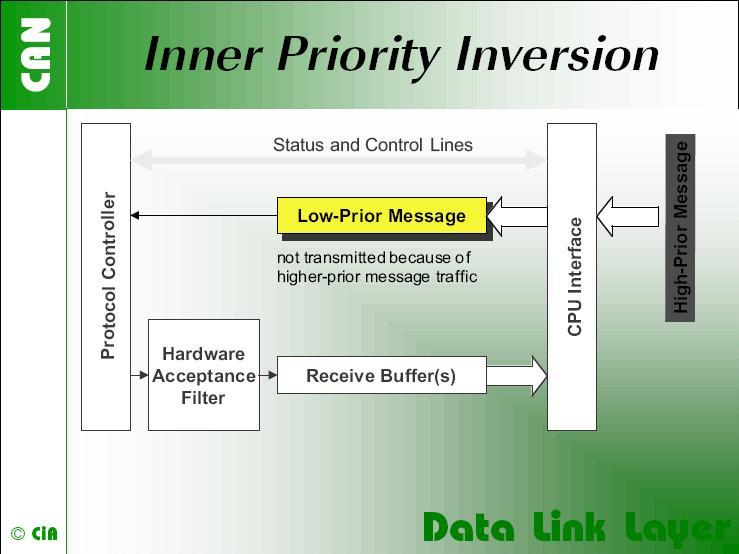

“如果只使用一个 transmit buffer，可能发生 Inner Priority Inversion。由于优先级较低，buffer 中的报文会一直等到总线通信负载降低。在等待期间，该报文可能阻止同一 microcontroller 产生的更高优先级报文通过总线发送。”¹

¹ 图片与文字由 CiA（CAN in Automation）提供。

> 原文第 17 页

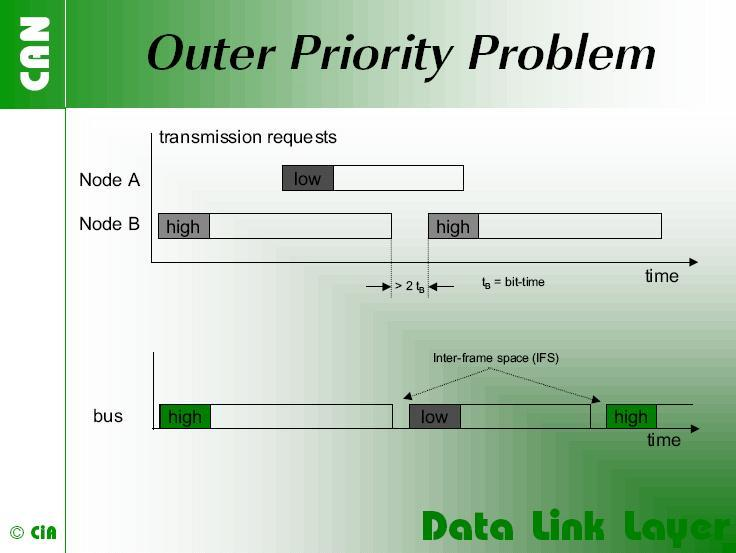

“某些 CAN 实现可能出现 Outer Priority Inversion。假设一个 CAN 节点要连续发送一组高优先级报文，这些报文存放于不同的 message buffer。如果这些报文在 CAN 网络上的 interframe space 大于 CAN 标准规定的最小间隔，第二个节点就能够开始发送一条较低优先级报文。最小 interframe space 由包含 3 个 recessive bit 的 Intermission field 决定。在其他报文发送期间等待发送的报文，会在 Bus Idle 期间开始发送，最早从 Intermission field 后的第一个 bit 开始。例外是：存在待发送报文的节点，会将 Intermission 第三个 bit 位置的 dominant bit 解释为 Start-of-Frame bit，并直接从第一个 Identifier bit 开始发送，而不先发送 SOF bit。CAN 模块的内部处理时间必须足够短，能够以最小 interframe space 连续发送报文，才能在上述所有情况下避免 Outer Priority Inversion。”²

² 文字与图片由 CiA（CAN in Automation）提供。

> 原文第 18 页

### 2.2 CAN Hardware Unit

CAN Hardware Unit 将一个或多个 CAN controller 组合起来。这些 Controller 可以位于片上，也可以是相同类型的外部独立设备，并使用共享或独立的 Hardware Object。下图给出由两个 CAN controller 组成、连接两个 Physical Channel 的 CAN Hardware Unit。

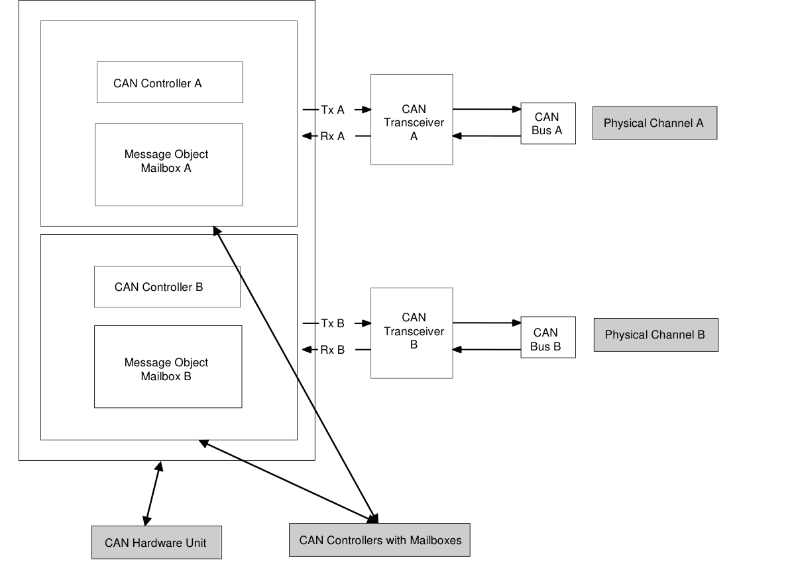

> 原文第 19 页

## 3 相关文档

### 3.1 输入文档

[1] Layered Software Architecture

AUTOSAR_EXP_LayeredSoftwareArchitecture.pdf

[2] Basic Software Modules 通用需求

AUTOSAR_SRS_BSWGeneral.pdf

[3] SPAL 通用需求

AUTOSAR_SRS_SPALGeneral.pdf

[4] CAN 需求

AUTOSAR_SRS_CAN.pdf

[5] CAN Interface 规范

AUTOSAR_SWS_CANInterface.pdf

[6] Default Error Tracer 规范

AUTOSAR_SWS_DefaultErrorTracer.pdf

[7] ECU State Manager 规范

AUTOSAR_SWS_ECUStateManager.pdf

[8] MCU Driver 规范

AUTOSAR_SWS_MCUDriver.pdf

[9] Operating System 规范

AUTOSAR_SWS_OS.pdf

[10] ECU Configuration 规范
AUTOSAR_TPS_ECUConfiguration.pdf

[11] SPI Handler/Driver 规范
AUTOSAR_SWS_SPIHandlerDriver.doc.pdf

[12] Memory Mapping 规范
AUTOSAR_SWS_MemoryMapping.pdf

[13] BSW Scheduler 规范
AUTOSAR_SWS_BSW_Scheduler.pdf

[14] Basic Software Module Description Template
AUTOSAR_TPS_BSWModuleDescriptionTemplate.pdf

> 原文第 20 页

[15] Basic Software Modules 列表
AUTOSAR_TR_BSWModuleList.pdf

[16] Basic Software Modules 通用规范
AUTOSAR_SWS_BSWGeneral.pdf

[17] Time Synchronization over CAN 规范
AUTOSAR_SWS_TimeSyncOverCAN.pdf

[18] CAN XL Driver 规范
AUTOSAR_SWS_CANXLDriver.pdf

### 3.2 相关标准与规范

[19] ISO11898 - 道路车辆 - Controller area network（CAN）

[20] ISO/IEC 7498-1 - OSI Basic Reference Model

[21] CiA601-2 节点与系统设计，第 2 部分：CAN controller interface 规范

[22] CiA603 - CAN Frame time-stamping

[23] CiA 610-1，Data link layer 与 physical coding sub-layer 需求，规范草案

[24] CiA 611-1，SDU types，规范提案草案

### 3.3 相关规范

AUTOSAR 提供了 Basic Software Modules 通用规范 [15]（SWS BSW General），该规范同样适用于 CAN Driver。因此，应将 SWS BSW General 视为 CAN Driver 的补充必需规范。

> 原文第 21 页

## 4 约束与假设

### 4.1 限制

一个 CAN controller 始终对应一个 physical channel。允许在总线侧连接 physical channel；无论如何，CanIf 模块都会分别处理相关 CAN controller。

少数 CAN hardware unit 支持利用 CAN RAM 组合多个 CAN controller，从而增加某个 CAN controller 的 message object 数量。Can 模块将这些组合后的 Controller 视为一个 Controller。

Can 模块不支持 CAN remote frame。

[SWS_Can_00237] ⌈ Can 模块不得发送由 remote transmission request 触发的报文。⌋ (SRS_Can_01147)

[SWS_Can_00236] ⌈ Can 模块应将 CAN HW 初始化为忽略所有 remote transmission request。⌋ (SRS_Can_01147)

### 4.2 对汽车领域的适用性

Can 模块可用于任何使用 CAN 协议的应用。

> 原文第 22 页

## 5 对其他模块的依赖

### 5.1 Static Configuration

其他 BSW 模块在进行配置时，可以引用第 10 章描述的配置元素。

### 5.2 Driver Services

[SWS_Can_00238] ⌈ 若 CAN controller 位于片上，Can 模块不得使用其他 driver 的任何服务。⌋ (SRS_BSW_00005)

[SWS_Can_00239] ⌈ Can_Init 应初始化 CAN controller 使用的全部片上硬件资源。唯一例外是 CAN 所用引脚的 digital I/O 配置，该配置由 Port Driver 完成。⌋ (SRS_BSW_00377)

[SWS_Can_00240] ⌈ Mcu 模块（SPAL，见 [8]）应配置与其他模块共享的寄存器设置。⌋ ()

实现提示：应先初始化 Mcu 模块，再初始化 Can 模块。

[SWS_Can_00242] ⌈ 使用片外 CAN controller 时³，Can 模块应使用其他 MCAL driver 的服务，例如 SPI。⌋ (SRS_BSW_00005)

实现提示：若 Can 模块使用其他 MCAL driver（如 SPI）的服务，必须确保这些 driver 在 Can 模块初始化前已经启动并正常运行。文献 [7] 部分规定了不同 driver 的初始化顺序。

[SWS_Can_00244] ⌈ Can 模块应使用底层 MCAL driver 的 synchronous API，且不得提供可由 MCAL driver 调用的 callback。⌋ ()

因此，µC 与 CAN Hardware Unit 的连接类型仅影响实现，不影响 API。

### 5.3 System Services

[SWS_Can_00280] ⌈ 对于特殊硬件情况，Can 模块应以 polling 方式检测硬件事件。⌋ ()

³ 此时 CAN driver 不再属于 µC abstraction layer，而属于 ECU abstraction layer。因此，理论上允许它使用所需的任何 µC abstraction layer driver。

> 原文第 23 页

[SWS_Can_00281] ⌈ 当硬件未在预期时间内响应（hardware malfunction）时，Can 模块应使用系统服务提供的 OsCounter 检测 timeout，以防止死循环。⌋ ()

实现提示：Can 模块函数等待硬件响应的阻塞时间，应短于 CAN main function（如 Can_MainFunction_Read）的触发周期，因为 CAN main function 不能用于此用途。

### 5.4 Can 模块的使用者

[SWS_Can_00058] ⌈ 除与其他模块（例如 Default Error Tracer（DET）、ECU State Manager（ECUM））交互之外，Can 模块还直接与 CanIf 模块交互。本文不规定请求的实际源头或通知的最终目的地；driver 仅将 CanIf 视为请求来源和通知目的地。⌋ (SRS_SPAL_12092)

> 原文第 24 页

### 5.5 文件结构

[SWS_Can_00436] ⌈ Can_GeneralTypes.h 应包含 AUTOSAR CAN 模块 Can、CanIf 和 CanTrcv 共享的全部类型与常量。⌋ ()

> 原文第 25 页

## 6 需求追溯

*下表跨原文第 25、26、27、28、29、30、31、32 页，已接续合并。*

| 需求 | 说明 | 由以下条款满足 |
| --- | --- | --- |
| RS_Ids_00810 | Basic SW security event。 | SWS_Can_91022, SWS_Can_91023, SWS_Can_91024 |
| SRS_BSW_00005 | µC Abstraction Layer（MCAL）的模块不得具有硬编码的横向接口。 | SWS_Can_00238, SWS_Can_00242 |
| SRS_BSW_00007 | 所有使用 C 语言编写的 Basic SW Module 均应符合 MISRA C 2012 标准。 | SWS_Can_00079 |
| SRS_BSW_00101 | Basic Software Module 应能够在独立的初始化函数中初始化变量和硬件。 | SWS_Can_00250 |
| SRS_BSW_00159 | 所有 AUTOSAR Basic Software Module 均应支持基于工具的配置。 | SWS_Can_00022 |
| SRS_BSW_00162 | AUTOSAR Basic Software 应提供 hardware abstraction layer。 | SWS_Can_NA_00999 |
| SRS_BSW_00164 | ISR 应由 Operating System、Complex Driver 或模块实现。 | SWS_Can_00033 |
| SRS_BSW_00167 | 所有 AUTOSAR Basic Software Module 均应提供配置规则与约束，以便进行合理性检查。 | SWS_Can_00024 |
| SRS_BSW_00168 | SW component 应通过 Basic SW 通用 API 中定义的函数进行测试。 | SWS_Can_NA_00999 |
| SRS_BSW_00170 | AUTOSAR SW Component 应提供其对故障、信号质量和 driver demand 的依赖信息。 | SWS_Can_NA_00999 |
| SRS_BSW_00306 | AUTOSAR Basic Software Module 应独立于 compiler 和 platform。 | SWS_Can_00079 |
| SRS_BSW_00307 | 全局变量命名约定。 | SWS_Can_NA_00999 |
| SRS_BSW_00308 | AUTOSAR Basic Software Module 不得在 header file 中定义全局数据，而应在 C 文件中定义。 | SWS_Can_00079 |
| SRS_BSW_00309 | 所有 AUTOSAR Basic Software Module 均应对全部全局只读数据显式使用 const 关键字进行标识。 | SWS_Can_00079 |
| SRS_BSW_00312 | 共享代码应可重入。 | SWS_Can_00214, SWS_Can_00231, SWS_Can_00232, SWS_Can_00233 |
| SRS_BSW_00323 | 所有 AUTOSAR Basic Software Module 均应检查传入 API 参数的有效性。 | SWS_Can_00026, SWS_Can_00513, SWS_Can_00514, SWS_Can_00518, SWS_Can_00519, SWS_Can_91006, SWS_Can_91007, SWS_Can_91017, SWS_Can_91018 |
| SRS_BSW_00325 | ISR 及在 interrupt context 中运行的函数，其运行时间应保持较短。 | SWS_Can_NA_00999 |
| SRS_BSW_00330 | 对于提供源代码且运行时间要求严格的情况，应允许使用 macro 替代函数。 | SWS_Can_00079 |
| SRS_BSW_00331 | 所有 Basic Software Module 均应严格区分错误信息与状态信息。 | SWS_Can_00039, SWS_Can_00104 |
| SRS_BSW_00336 | Basic SW module 应能够 shutdown。 | SWS_Can_91002, SWS_Can_NA_00999 |
| SRS_BSW_00337 | development error 分类。 | SWS_Can_00026, SWS_Can_00104 |
| SRS_BSW_00342 | 应允许使用以源代码形式提供的模块和以 object code 形式提供的模块构建 AUTOSAR ECU，也允许混合使用。 | SWS_Can_NA_00999 |
| SRS_BSW_00344 | BSW Module 应支持 link-time configuration。 | SWS_Can_00021 |
| SRS_BSW_00347 | BSW driver 的不同实例应通过命名加以区分。 | SWS_Can_00077 |
| SRS_BSW_00353 | 所有与目标平台及 compiler 相关的整数类型定义，应放置并组织在单一 type header 中。 | SWS_Can_NA_00999 |
| SRS_BSW_00357 | 应定义标准返回类型，表示 API 调用成功或失败。 | SWS_Can_00506 |
| SRS_BSW_00358 | AUTOSAR Basic Software Module 实现的 init() 函数应返回 void。 | SWS_Can_00223 |
| SRS_BSW_00359 | 所有 AUTOSAR Basic Software Module 的 callback 应尽可能避免使用 void 以外的返回类型。 | SWS_Can_NA_00999 |
| SRS_BSW_00369 | 所有 AUTOSAR Basic Software Module 均不得通过 API 返回特定的 development error code。 | SWS_Can_00089, SWS_Can_00506, SWS_Can_91011, SWS_Can_91012 |
| SRS_BSW_00373 | 每个 AUTOSAR Basic Software Module 的主处理函数，应按规定的约定命名。 | SWS_Can_00031 |
| SRS_BSW_00375 | Basic Software Module 应上报 wakeup reason。 | SWS_Can_00271, SWS_Can_00364 |
| SRS_BSW_00377 | Basic Software Module 可以返回模块特定类型。 | SWS_Can_00239 |
| SRS_BSW_00378 | AUTOSAR 应提供 boolean 类型。 | SWS_Can_NA_00999 |
| SRS_BSW_00383 | Basic Software Module 规范至少应在说明中指出，使用了其他模块的哪些配置文件。 | SWS_Can_NA_00999 |
| SRS_BSW_00385 | 列出可能的错误通知。 | SWS_Can_00104 |
| SRS_BSW_00386 | BSW 应规定错误检测的配置与条件。 | SWS_Can_00089 |
| SRS_BSW_00395 | Basic Software Module 规范应列出全部配置参数依赖关系。 | SWS_Can_NA_00999 |
| SRS_BSW_00397 | pre-compile time 配置参数在开始编译之前确定。 | SWS_Can_NA_00999 |
| SRS_BSW_00398 | link-time configuration 在编译之后、链接之前，以 object code 为基础实现。 | SWS_Can_NA_00999 |
| SRS_BSW_00399 | parameter-set 应位于独立的 segment，并在代码之后加载。 | SWS_Can_NA_00999 |
| SRS_BSW_00400 | 代码加载并启动后，应能从多组参数中选择参数。 | SWS_Can_NA_00999 |
| SRS_BSW_00404 | BSW Module 应支持 post-build configuration。 | SWS_Can_00021 |
| SRS_BSW_00405 | BSW Module 应支持多个 configuration set。 | SWS_Can_00021 |
| SRS_BSW_00406 | 用于表示 BSW module 是否已初始化的静态状态变量，应在该 BSW module 的任何 API被调用之前初始化为 0。 | SWS_Can_00103, SWS_Can_00512, SWS_Can_00517, SWS_Can_91005, SWS_Can_91016 |
| SRS_BSW_00409 | 全部 production code error ID 符号均由 Dem 模块定义，其他 BSW 模块应从 Dem 配置中获取。 | SWS_Can_NA_00999 |
| SRS_BSW_00413 | 应基于索引访问 BSW module 的实例。 | SWS_Can_NA_00999 |
| SRS_BSW_00414 | Init 函数应仅具有一个参数，即指向 configuration structure 的指针。 | SWS_Can_00223 |
| SRS_BSW_00415 | 仅供某个模块使用的接口，应单独放在专用 header file 中。 | SWS_Can_NA_00999 |
| SRS_BSW_00416 | 模块初始化顺序应可配置。 | SWS_Can_91005, SWS_Can_91016 |
| SRS_BSW_00417 | 不属于 SW-C 的软件，仅应在 Dem 完全可运行后上报 error event。 | SWS_Can_NA_00999 |
| SRS_BSW_00422 | error status 信息的 pre-debouncing 在 Dem 中完成。 | SWS_Can_NA_00999 |
| SRS_BSW_00423 | 具有 AUTOSAR 接口的 BSW module 应能够使用 SW-C Template 描述。 | SWS_Can_NA_00999 |
| SRS_BSW_00424 | 不得允许 BSW module 的 main processing function 进入等待状态。 | SWS_Can_NA_00999 |
| SRS_BSW_00425 | BSW module description template 应提供方法，对 schedulable object 已定义的触发条件建模。 | SWS_Can_NA_00999 |
| SRS_BSW_00426 | BSW Module 应保证模块之间共享数据的一致性。 | SWS_Can_NA_00999 |
| SRS_BSW_00427 | ISR 函数应在 BSW module description template 中定义并记录。 | SWS_Can_NA_00999 |
| SRS_BSW_00428 | BSW module 应说明其 main processing function 是否必须按特定顺序执行。 | SWS_Can_00110 |
| SRS_BSW_00429 | 限制对 OS 的访问。 | SWS_Can_NA_00999 |
| SRS_BSW_00432 | 模块应针对 read/receive 与 write/transmit 数据路径，分别提供 main processing function。 | SWS_Can_00031, SWS_Can_00108, SWS_Can_00112 |
| SRS_BSW_00433 | main processing function 仅允许从 BSW Scheduler 提供的 task body 中调用。 | SWS_Can_NA_00999 |
| SRS_BSW_00438 | configuration data 应定义在结构中。 | SWS_Can_00291 |
| SRS_BSW_00439 | 使 BSW module 能够处理 interrupt。 | SWS_Can_NA_00999 |
| SRS_BSW_00440 | BSW module 调用 callback 时，应遵循 RTE 为通过 Rte_Call API 调用 server 所提供的签名。 | SWS_Can_NA_00999 |
| SRS_BSW_00447 | 对实现 AUTOSAR Service 的 BSW Module 的 include file 结构进行标准化。 | SWS_Can_NA_00999 |
| SRS_BSW_00449 | AUTOSAR Application Software 使用的 BSW Service API 应返回 Std_ReturnType。 | SWS_Can_00506, SWS_Can_NA_00999 |
| SRS_BSW_00453 | BSW Module 应保持协调一致。 | SWS_Can_NA_00999 |
| SRS_Can_01005 | CAN Interface 应检查接收 PDU 的 DLC 是否正确。 | SWS_Can_00218 |
| SRS_Can_01041 | CAN Driver 应实现 initialization 接口。 | SWS_Can_00245, SWS_Can_00246 |
| SRS_Can_01042 | CAN Driver 应支持动态选择 configuration set。 | SWS_Can_00062 |
| SRS_Can_01043 | CAN Driver 应提供启用/禁用 CAN Controller interrupt 的服务。 | SWS_Can_00049, SWS_Can_00050 |
| SRS_Can_01045 | CAN Driver 应提供 reception indication 服务。 | SWS_Can_00279, SWS_Can_00396 |
| SRS_Can_01049 | CAN Driver 应提供动态 transmission request 服务。 | SWS_Can_00212, SWS_Can_00213, SWS_Can_00214 |
| SRS_Can_01051 | CAN Driver 应提供 transmission confirmation 服务。 | SWS_Can_00016 |
| SRS_Can_01053 | CAN Driver 应提供改变 CAN controller mode 的服务。 | SWS_Can_00017, SWS_Can_91010 |
| SRS_Can_01054 | CAN Driver 应提供 Controller wakeup event 通知。 | SWS_Can_00235, SWS_Can_00271, SWS_Can_00364 |
| SRS_Can_01055 | CAN Driver 应提供 bus-off 状态通知。 | SWS_Can_00020, SWS_Can_00234 |
| SRS_Can_01059 | CAN Driver 应保证接收到的 L-PDUs | SWS_Can_00011, SWS_Can_00012 |
| SRS_Can_01060 | CAN driver 不得自动从 bus-off 恢复。 | SWS_Can_00272, SWS_Can_00273, SWS_Can_00274 |
| SRS_Can_01062 | 每个 CAN Controller 的每种事件，均应可配置为通过 polling 或 interrupt 检测。 | SWS_Can_00007 |
| SRS_Can_01122 | CAN driver 应支持总线 wakeup 与进入 standby/sleep 的切换过程同时发生的情况。 | SWS_Can_00048 |
| SRS_Can_01125 | CAN stack 应保证接收方向不丢失报文。 | SWS_Can_NA_00999 |
| SRS_Can_01126 | CAN stack 应能够产生 100% bus load。 | SWS_Can_NA_00999 |
| SRS_Can_01130 | CAN Interface 的 Receive Status Interface。 | SWS_Can_00506 |
| SRS_Can_01132 | CAN driver 应能够针对 message object，通过 CAN interrupt 和 polling 检测通知事件。 | SWS_Can_00099 |
| SRS_Can_01134 | CAN Driver 应支持 multiplexed transmission。 | SWS_Can_00277, SWS_Can_00401, SWS_Can_00402, SWS_Can_00403 |
| SRS_Can_01135 | 应能够配置一个或多个 TX Hardware Object。 | SWS_Can_00100 |
| SRS_Can_01139 | CAN Interface 和 Driver 应提供针对特定 CAN Controller 的 initialization 接口。 | SWS_Can_00062 |
| SRS_Can_01147 | CAN Driver 不得支持 remote frame。 | SWS_Can_00236, SWS_Can_00237 |
| SRS_Can_01160 | 因 CAN FD DLC 为离散取值而进行字节 padding。 | SWS_Can_00502 |
| SRS_Can_01162 | CAN Interface 应支持 classic CAN 和 CAN FD frame。 | SWS_Can_00501 |
| SRS_Can_01166 | CAN Driver 应实现 de-initialization 接口。 | SWS_Can_91002, SWS_Can_91009, SWS_Can_91010 |
| SRS_Can_01167 | CAN Driver 应提供函数，返回当前 CAN controller error state。 | SWS_Can_91008 |
| SRS_Can_01170 | CAN Driver 应提供函数，返回当前 CAN controller 的 Rx 和 Tx error counter。 | SWS_Can_00515, SWS_Can_00520 |
| SRS_Can_01181 | 使用 partial networking 时，ECU 应确保总线上的第一条报文为 wakeup frame。 | SWS_CAN_91025, SWS_CAN_91026, SWS_CAN_91027, SWS_CAN_91028, SWS_CAN_91029 |
| SRS_SPAL_00157 | AUTOSAR Basic Software 的所有 driver 和 handler 均应实现 notification mechanism。 | SWS_Can_00026, SWS_Can_00031, SWS_Can_00108, SWS_Can_00112 |
| SRS_SPAL_12056 | 所有 driver module 均应允许静态配置 notification mechanism。 | SWS_Can_00235 |
| SRS_SPAL_12057 | 所有 driver module 均应实现 initialization 接口。 | SWS_Can_00245, SWS_Can_00246 |
| SRS_SPAL_12063 | 所有 driver module 均应仅支持 raw value mode。 | SWS_Can_00059, SWS_Can_00060 |
| SRS_SPAL_12064 | 若 operation mode 的改变会使正在运行的操作退化，所有 driver module 均应报错。 | SWS_Can_NA_00999 |
| SRS_SPAL_12067 | 所有 driver module 均应根据所选 operation mode 设置 wakeup condition。 | SWS_Can_00257 |
| SRS_SPAL_12068 | MCAL 模块应按规定顺序初始化。 | SWS_Can_NA_00999 |
| SRS_SPAL_12069 | 所有因 wakeup interrupt 而唤醒的 SPAL driver 均应上报 wakeup reason。 | SWS_Can_00271, SWS_Can_00364 |
| SRS_SPAL_12075 | 所有具有 random streaming 能力的 driver 均应使用 application buffer。 | SWS_Can_00011 |
| SRS_SPAL_12077 | 所有 driver 均应提供非阻塞实现。 | SWS_Can_00372 |
| SRS_SPAL_12092 | driver API 应由其 handler 或 manager 访问。 | SWS_Can_00058 |
| SRS_SPAL_12125 | 所有 driver module 均应只初始化已配置的资源。 | SWS_Can_00053 |
| SRS_SPAL_12129 | ISR 应负责复位 interrupt flag，并调用对应的 notification function。 | SWS_Can_00033 |
| SRS_SPAL_12163 | 所有 driver module 均应实现 de-initialization 接口。 | SWS_Can_NA_00999 |
| SRS_SPAL_12169 | 提供不同 operation mode 的所有 driver module，均应提供 mode selection 服务。 | SWS_Can_00017 |
| SRS_SPAL_12263 | 所有 driver module 的实现，均应允许在 link time 配置特定模块参数类型。 | SWS_Can_00021 |
| SRS_SPAL_12265 | configuration data 应保持为常量。 | SWS_Can_00021 |
| SRS_SPAL_12448 | 所有 driver module 在检测到 development error 后均应具有规定行为。 | SWS_Can_00089, SWS_Can_00091 |
| SRS_SPAL_12462 | 应公布 register initialization setting。 | SWS_Can_NA_00999 |
| SRS_SPAL_12463 | 应组合并传递 register initialization setting。 | SWS_Can_00024 |

> 原文第 26 页

> 原文第 27 页

> 原文第 28 页

> 原文第 29 页

> 原文第 30 页

> 原文第 31 页

> 原文第 32 页

> 原文第 33 页

## 7 功能规范

发送 L-PDU 时，Can 模块将 L-PDU 写入 CAN controller 硬件中合适的 buffer。L-PDU 发送的详细说明见 7.5 节。

接收 L-PDU 时，Can 模块调用 RX indication callback，参数包含 ID、Data Length 和指向 L-SDU 的指针。详细说明见 7.6 节。

Can 模块提供周期处理函数接口，必须由 Basic Software Scheduler 模块周期调用。它还提供控制 CAN controller 状态的服务，并通过 callback 通知 Bus-off 和 Wakeup event。

Can 模块是访问硬件资源的 Basic Software Module，因此其设计应满足 AUTOSAR_SRS_SPAL 中对 Basic Software Module 的要求（见 [3]）。

[SWS_Can_00033] ⌈ Can 模块应为所需的全部 CAN Hardware Unit interrupt 实现 ISR。⌋ (SRS_BSW_00164, SRS_SPAL_12129)

[SWS_Can_00419] ⌈ Can 模块应禁用 CAN controller 中所有未使用的 interrupt。⌋ ()

[SWS_Can_00420] ⌈ Can 模块应在 ISR 结束时复位 interrupt flag，除非硬件已自动完成。⌋ ()

实现提示：Can 模块不得设置 vector table entry 的配置（例如 priority）。

[SWS_Can_00079] ⌈ Can 模块应满足文献 [2] 所述全部设计与实现指南。⌋ (SRS_BSW_00007, SRS_BSW_00306, SRS_BSW_00308, SRS_BSW_00309, SRS_BSW_00330)

### 7.1 Driver 的范围

一个 Can 模块提供对一个 CAN Hardware Unit 的访问，该 Hardware Unit 可以包含多个 CAN controller。

[SWS_Can_00077] ⌈ 对不同类型的 CAN Hardware Unit，应实现不同的 Can 模块。⌋ (SRS_BSW_00347)

[SWS_Can_00284] ⌈ 若一个 ECU 中实现了多个 CAN Hardware Unit（来自相同或不同供应商），则 Can 模块的函数名和全局变量

> 原文第 34 页

应以不产生两个同名函数的方式实现。⌋ ()

命名约定如下：
`<Can module name>_<vendorID>_<Vendor specific API name><driver abbreviation>()`

SRS_BSW_00347 规定了该命名约定。

[SWS_Can_00385] ⌈ 仅在一个 ECU 必须支持多种不同 CAN controller 类型时，才应使用上述命名约定。⌋ ()

[SWS_Can_00386] ⌈ 若只使用一种 Controller 类型，则使用原始命名约定即可，无需任何 `<driver abbreviation>` 扩展。⌋ ()

CanIf 如何处理多个 Can 模块，参见 [5]。

### 7.2 Driver State Machine

Can 模块的 state machine 很简单，仅包含 CAN_UNINIT 和 CAN_READY 两个状态，如 Figure 7-1 所示。

[SWS_Can_00103] ⌈ power-up/reset 后，Can 模块应处于 CAN_UNINIT。⌋ (SRS_BSW_00406)

> 原文第 35 页

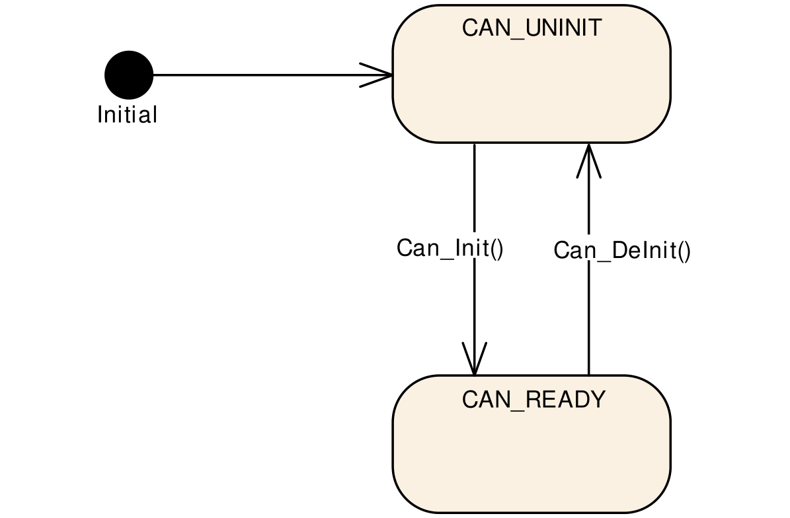

Figure 7-1

[SWS_Can_00246] ⌈ Can_Init 初始化 HW Unit 内所有 Controller 后，应将模块状态改为 CAN_READY。⌋ (SRS_SPAL_12057, SRS_Can_01041)

[SWS_Can_00245] ⌈ Can_Init 应按各自配置初始化全部 CAN controller。⌋ (SRS_SPAL_12057, SRS_Can_01041)

随后必须分别调用 Can_SetControllerMode(CAN_CS_STARTED)，启动每个 CAN controller。

实现提示：会影响 HW Unit 内所有 CAN controller 的硬件寄存器设置，只能在 Can_Init 中完成。

实现提示：ECU State Manager 模块在运行期间至多调用 Can_Init 一次。

[SWS_Can_91009] ⌈ Can_DeInit 应先将模块状态改为 CAN_UNINIT，再对 HW Unit 内全部 Controller 进行 de-initialization。⌋ (SRS_Can_01166)

参见 [SWS_Can_91010]。

> 原文第 36 页

### 7.3 CAN Controller State Machine

每个 CAN controller 的硬件中都实现了复杂的 state machine。为简化说明，本文将其归纳为 UNINIT、STOPPED、STARTED、SLEEP 四种基本状态。

全部 CAN 硬件访问均由 Can 模块的函数封装，但 Can 模块不记忆状态变化。Can 模块提供 Can_Init、Can_SetBaudrate 和 Can_SetControllerMode 服务，通过必要的寄存器设置使硬件 CAN controller 发生所需的状态变化。

外部事件可通过以下两种方式触发状态变化：

• Bus-off event。
• HW wakeup event。

这些事件通过 interrupt 指示，或通过由 Can_MainFunction_BusOff / Can_MainFunction_Wakeup 轮询的 status bit 指示。Can 模块执行满足规定行为所需的寄存器设置，例如 bus-off 时不进行硬件自动恢复。随后通过相应 callback 通知 CanIf，软件状态在 callback 内改变。

若启用了 development error 检测，而上层请求了不允许的状态切换，Can 模块应报告 CAN_E_TRANSITION。Can 模块在执行 Can_Write 或调用 callback 前不检查实际状态。

#### 7.3.1 CAN Controller 状态说明

本节描述不同 Controller 状态下要求的硬件行为。

**CAN controller 状态 UNINIT**

CAN controller 尚未初始化。属于 Can 模块的全部寄存器处于 reset 状态，CAN interrupt 被禁用；CAN Controller 不参与 CAN bus 通信。

**CAN controller 状态 STOPPED**

CAN Controller 已初始化，但不参与总线通信，也不得发送 error frame 和 ACK。

例如，许多 Controller 在进入 initialization mode 后停止运行。

> 原文第 37 页

**CAN controller 状态 STARTED**

Controller 处于功能完整的正常运行模式，即参与网络通信。对于许多 Controller，退出 initialization mode 即启动 Controller。

**CAN controller 状态 SLEEP**

仅对于支持 sleep mode 的 CAN 硬件，其硬件设置才与 STOPPED 不同；此类硬件直接支持通过 CAN bus 唤醒。

[SWS_Can_00257] ⌈ 当 CAN 硬件支持 sleep mode 且被触发进入 SLEEP 时，Can 模块应将 Controller 置于可通过 CAN Bus 唤醒的 SLEEP 状态。⌋ (SRS_SPAL_12067)

[SWS_Can_00258] ⌈ 当 CAN 硬件不支持 sleep mode 且被触发进入 SLEEP 时，Can 模块应模拟 logical SLEEP 状态；只有软件触发向 STOPPED 切换时才退出该状态。⌋ ()

[SWS_Can_00404] ⌈ logical SLEEP 状态有效期间，CAN 硬件应保持 STOPPED。⌋ ()

#### 7.3.2 CAN Controller 状态切换

软件通过调用 Can_SetControllerMode，并以所需的切换作为参数来触发状态切换。软件触发的切换成功后，通过 CanIf_ControllerModeIndication callback 通知。是否达到请求状态的监控属于上层模块，不属于 Can 模块。

某些切换由总线上的硬件事件触发，并通过 callback 通知。production code 对无效切换的行为未定义。Figure 7-2 给出全部有效切换。

> 原文第 38 页

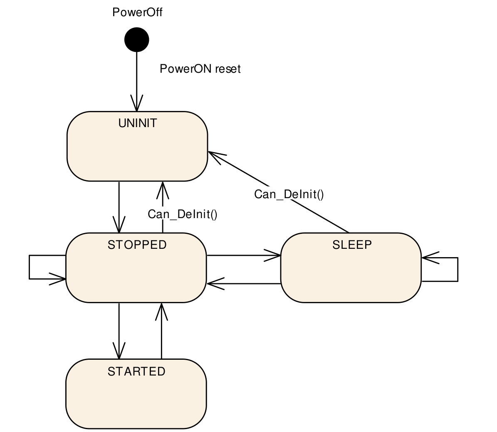

Figure 7-2

#### 7.3.3 Can_Init 引起的状态切换

• UNINIT → STOPPED，适用于 HW Unit 内所有 Controller。
• 由软件调用 Can_Init 触发。
• 配置 HW Unit 内所有 CAN controller。

全部 control register 按 static configuration 设置。

[SWS_Can_00259] ⌈ Can_Init 应将全部 CAN controller 置于 STOPPED。⌋ ()

> 原文第 39 页

进入 Can_Init 时，若 Can 模块不处于 CAN_UNINIT，或 CAN controller 不处于 UNINIT，则应报告 CAN_E_TRANSITION。参见 SWS_Can_00174 和 SWS_Can_00408。

#### 7.3.4 Can_SetBaudrate 引起的状态切换

• STOPPED → STOPPED；SLEEP → SLEEP；STARTED → STARTED。
• 由软件调用 Can_SetBaudrate 触发。
• 改变 CAN controller 配置。

CAN controller 寄存器按 static configuration 设置。

[SWS_Can_00256] ⌈ 若调用 Can_SetBaudrate() 会导致 CAN Controller 重新初始化，而 CAN Controller 不处于 STOPPED，则应返回 E_NOT_OK。⌋ ()

[SWS_Can_00260] ⌈ 若需要重新初始化，Can_SetBaudrate

应使 CAN controller 保持 STOPPED。⌋ ()

[SWS_Can_00422] ⌈ 若需要重新初始化，Can_SetBaudrate 应确保不设置任何会使 CAN controller 参与网络通信的配置。⌋ ()

#### 7.3.5 Can_SetControllerMode 引起的状态切换

软件可通过 Can_SetControllerMode 触发 CAN controller 状态切换。取决于 CAN 硬件，用于切换状态的寄存器修改可能延迟一段时间后才生效。状态切换成功后，Can 模块通过 CanIf_ControllerModeIndication 将新状态通知上层。是否达到请求状态的监控属于上层模块，不属于 Can 模块。

[SWS_Can_00370] ⌈ Can_Mainfunction_Mode 应轮询 CAN status register 中的 flag，直到该 flag 表示切换已生效；随后通过 CanIf_ControllerModeIndication 通知上层切换成功，并以抽象的 CanIf ControllerId 指明对应 CAN controller。⌋ ()

[SWS_Can_00398] ⌈ Can_SetControllerMode 应使用系统服务 GetCounterValue 监控 timeout，以避免函数阻塞。⌋ ()

> 原文第 40 页

[SWS_Can_00372] ⌈ 若 flag 表示切换尚未生效，且已达到最长时间 CanTimeoutDuration，则应退出 Can_SetControllerMode，并由 Can_Mainfunction_Mode 继续轮询 flag。⌋ (SRS_SPAL_12077)

[SWS_Can_00373] ⌈ 若状态切换由 Can_SetControllerMode 触发，Can_Mainfunction_Mode 应调用 CanIf_ControllerModeIndication，通知上层由抽象 CanIf ControllerId 标识的 CAN controller 已成功切换状态。⌋ ()

**Can_SetControllerMode(CAN_CS_STARTED) 引起的状态切换**

• STOPPED → STARTED。
• 由软件触发。

[SWS_Can_00261] ⌈ Can_SetControllerMode(CAN_CS_STARTED) 应设置硬件寄存器，使 CAN controller 参与网络通信。⌋ ()

[SWS_Can_00262] ⌈ Can_SetControllerMode(CAN_CS_STARTED) 应在有限时间内等待 CAN controller 完全可运行。参见 SWS_Can_00398。⌋ ()

CAN controller 可运行之前发起的 transmit request 会丢失。唯一能表明其可运行的迹象，是收到 TX confirmation 或 RX indication。发送实体可能遇到 confirmation timeout，必须能够处理。

[SWS_Can_00409] ⌈ 进入 Can_SetControllerMode(CAN_CS_STARTED) 时，若 CAN controller 不处于 STOPPED，应检测为无效状态切换。参见 SWS_Can_00200。⌋ ()

**Can_SetControllerMode(CAN_CS_STOPPED) 引起的状态切换**

• STARTED → STOPPED。
• SLEEP → STOPPED。
• 由软件触发。

[SWS_Can_00263] ⌈ Can_SetControllerMode(CAN_CS_STOPPED) 应设置 CAN 硬件内部的 bit，使 CAN controller 停止参与网络通信。⌋ ()

> 原文第 41 页

[SWS_Can_00264] ⌈ Can_SetControllerMode(CAN_CS_STOPPED) 应在有限时间内等待 CAN controller 真正关闭。参见 SWS_Can_00398。⌋ ()

[SWS_Can_00267] ⌈ 若 CAN HW 不支持 sleep mode，SLEEP → STOPPED 切换应退出 logical sleep mode，但不影响 CAN controller 的硬件状态，因为 Controller 已处于 stopped。⌋ ()

[SWS_Can_00268] ⌈ Can_SetControllerMode(CAN_CS_STOPPED) 应在有限时间内等待 CAN controller 进入 STOPPED。参见 SWS_Can_00398。⌋ ()

[SWS_Can_00282] ⌈ Can_SetControllerMode(CAN_CS_STOPPED) 应取消待发送报文。⌋ ()

**Can_SetControllerMode(CAN_CS_SLEEP) 引起的状态切换**

• STOPPED → SLEEP。
• 由软件触发。

[SWS_Can_00265] ⌈ Can_SetControllerMode(CAN_CS_SLEEP) 应将 Controller 置于 sleep mode。⌋ ()

[SWS_Can_00266] ⌈ 若 CAN HW 支持 sleep mode，Can_SetControllerMode(CAN_CS_SLEEP) 应在有限时间内等待 CAN controller 进入 SLEEP，并确保 CAN 硬件可以被唤醒。参见 SWS_Can_00398。⌋ ()

[SWS_Can_00290] ⌈ 若 CAN HW 不支持 sleep mode，Can_SetControllerMode(CAN_CS_SLEEP) 应将 CAN controller 置于 logical sleep mode。⌋ ()

[SWS_Can_00405] ⌈ 只有调用 Can_SetControllerMode(CAN_CS_STOPPED)，才应退出该 logical sleep mode。⌋ ()

[SWS_Can_00411] ⌈ 进入 Can_SetControllerMode(CAN_CS_SLEEP) 时，若 CAN controller 既不处于 STOPPED，也不处于 SLEEP，应检测为无效状态切换。参见 SWS_Can_00200。⌋ ()

> 原文第 42 页

#### 7.3.6 Hardware Event 引起的状态切换

**Hardware Wakeup 引起的状态切换，由 CAN bus 的 wakeup event 触发**

• SLEEP → STOPPED。
• 由到达的 L-PDU 触发。
• 通过以下函数通知 ECU State Manager：

EcuM_CheckWakeup。

只有硬件支持 sleep mode 时才会发生该切换。

[SWS_Can_00270] ⌈ 发生 hardware wakeup（由 CAN bus wakeup event 触发）时，CAN controller 应切换到 STOPPED。⌋ ()

[SWS_Can_00271] ⌈ 发生 hardware wakeup 时，Can 模块应在 interrupt context 或 Can_MainFunction_Wakeup 的执行上下文中调用 EcuM_CheckWakeup。⌋ (SRS_BSW_00375, SRS_SPAL_12069, SRS_Can_01054)

[SWS_Can_00269] ⌈ Can 模块不得继续处理导致 wakeup 的 L-PDU。⌋ ()

[SWS_Can_00048] ⌈ 若在进入 sleep 的切换期间发生 CAN bus wakeup，Can_SetControllerMode(CAN_CS_STOPPED) 应返回 E_NOT_OK。⌋ (SRS_Can_01122)

**Bus-Off 引起的状态切换，由 CAN controller 的状态变化触发**

[SWS_Can_00020] ⌈

• STARTED → STOPPED。
• CAN controller 达到 bus-off 状态时由硬件触发。
• 达到 STOPPED 后，通过 CanIf_ControllerBusOff 通知 CanIf，

并使用抽象的 CanIf ControllerId 指明对应 CAN controller。⌋ (SRS_Can_01055)

[SWS_Can_00272] ⌈ 检测到 bus-off 后，CAN controller 应切换至 STOPPED；Can 模块应确保它不再参与网络通信。⌋ (SRS_Can_01060)

[SWS_Can_00273] ⌈ 检测到 bus-off 后，Can 模块应取消仍在等待发送的报文。⌋ (SRS_Can_01060)

> 原文第 43 页

[SWS_Can_00274] ⌈ Can 模块应禁用或抑制 automatic bus-off recovery。⌋ (SRS_Can_01060)

#### 7.3.7 Can_DeInit 引起的状态切换

• STOPPED → UNINIT；SLEEP → UNINIT，适用于 HW Unit 内全部 Controller。
• 由软件调用 Can_DeInit 触发。
• 使 HW Unit 内全部 CAN controller 准备好重新配置。

[SWS_Can_91010] ⌈ Can_DeInit 应将全部 CAN controller 置于 UNINIT。⌋ (SRS_Can_01166, SRS_Can_01053)

进入 Can_DeInit 时，若 Can 模块不处于 CAN_READY，或任一 CAN controller 处于 STARTED，应报告 CAN_E_TRANSITION。参见 [SWS_Can_91011] 和 [SWS_Can_91012]。

### 7.4 Can 模块 / Controller 初始化

ECU State Manager 应在启动阶段调用 Can_Init 初始化 Can 模块，然后才能使用 Can 模块的其他函数。

[SWS_Can_00250] ⌈ Can_Init 应初始化：静态变量（包括 flag）、整个 CAN HW Unit 的公共设置，以及每个 CAN controller 的专用设置。⌋ (SRS_BSW_00101)

[SWS_Can_00053] ⌈ Can_Init 不得修改未使用的 CAN controller 硬件资源的寄存器。⌋ (SRS_SPAL_12125)

Can 模块初始化 Controller 寄存器时，应遵守以下规则：

• [SWS_Can_00407] ⌈ 若硬件只允许寄存器具有一种用途，

则实现该功能的 Can 模块负责初始化此寄存器。
• 若寄存器会影响多个硬件模块，且它是 I/O register，

则应由 PORT driver 初始化。
• 若寄存器会影响多个硬件模块，且它不是 I/O

register，则应由 MCU driver 初始化。
• 需要在 reset 后立即初始化的 one-time writable register，应

由 startup code 初始化。
• 所有其他寄存器均应由 startup code 初始化。⌋ (SRS_SPAL_12461)

> 原文第 44 页

[SWS_Can_00056] ⌈ 对第 10 章中标记为 multiple（“M”或“x”）的 Post-Build 配置元素，可以向模块 init 函数传入 Config 指针进行选择。⌋ ()

[SWS_Can_00062] ⌈ 若 Can_SetBaudrate 确定目标配置修改需要重新初始化，且 CAN Controller 处于 STOPPED，则该函数应重新初始化 CAN controller 及其专用设置。⌋ (SRS_Can_01139, SRS_Can_01042)

若需要重新初始化，必须先将 CAN Controller 切换至 STOPPED，才能执行 Can_SetBaudrate() 并应用新的 baudrate 配置。

[SWS_Can_00255] ⌈ Can_SetBaudrate 应仅影响包含单个 CAN controller 专用配置的寄存器区域。⌋ ()

[SWS_Can_00021] ⌈ 可以使用 Config 参数选择所需的 CAN controller 配置。⌋ (SRS_BSW_00344, SRS_BSW_00404, SRS_BSW_00405, SRS_SPAL_12263, SRS_SPAL_12265)

[SWS_Can_00291] ⌈ Config 是指向 ROM 内实现相关数据结构数组的指针。不同的 Controller configuration set 以数据结构形式位于 ROM 中。⌋ (SRS_BSW_00438)

Config 的可选值由配置说明给出，见第 10 章。Can 模块配置定义全局 CAN HW Unit 设置，以及对默认 CAN controller configuration set 的引用。

### 7.5 L-PDU 发送

发送 L-PDU 时，Can 模块在必要时将 ID 和 Data Length 转换为硬件专用格式，并触发发送。

[SWS_Can_00059] ⌈ CAN 数据与内存的映射定义为：最先发送的 CAN data byte 是数组元素 0，最后发送的 CAN data byte 是数组元素 7；CAN FD 时为 63。⌋ (SRS_SPAL_12063)

[SWS_Can_00427] ⌈ 若 CAN Hardware buffer 内的数据表示与 AUTOSAR 定义不同，Can 模块必须向上层提供经过适配的 SDU-Buffer。⌋ ()

> 原文第 45 页

[SWS_Can_00100] ⌈ 可配置多个具有唯一 HTH 的 TX hardware object。CanIf 在 TX request 中将 HTH 作为参数提供。一种可能的配置见 Figure 7-3。⌋ (SRS_Can_01135)

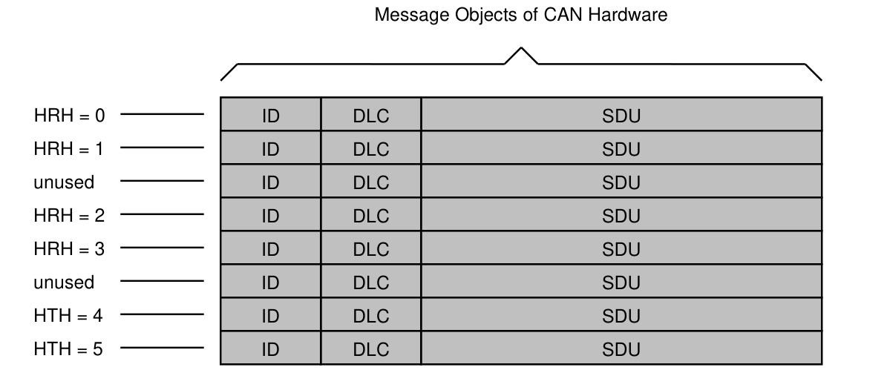

Figure 7-3：HTH、HRH 与 Hardware Object 的分配示例。HTH 和 HRH 的编号

取决于具体实现，图中编号仅为示例。

[SWS_Can_00276] ⌈ Can_Write 应保存 PduInfo 参数中给出的 swPduHandle，直到 Can 模块针对该请求调用 CanIf_TxConfirmation，并将 swPduHandle 作为参数传入。⌋ ()

SWS_Can_00276 的功能用于减少 CanIf 实现中的查找时间。

[SWS_Can_00016] ⌈ Can 模块应调用 CanIf_TxConfirmation 指示发送成功。应由对应硬件资源的 TX ISR 调用，或在 polling mode 下由 Can_MainFunction_Write 调用。⌋ (SRS_Can_01051)

#### 7.5.1 Priority Inversion

可使用 Multiplexed Transmission 避免 Outer/Inner Priority Inversion，见 2.1 节。

[SWS_Can_00277] ⌈ Can 模块应允许在 pre-compile time 静态配置 Multiplexed Transmission 功能为 ON 或 OFF。⌋ (SRS_Can_01134)

> 原文第 46 页

[SWS_Can_00401] ⌈ 应由一个 HTH 关联多个 transmit hardware object（数量由 CanHwObjectCount 定义），向上层表示一个 transmit entity。⌋ (SRS_Can_01134)

[SWS_Can_00402] ⌈ Can 模块应对满足下列任一条件的设备支持 multiplexed transmission：
• 多个 transmit hardware object 组成一个 transmit entity，可通过同一 register set 填充，microcontroller 自主将 L-PDU 存入空闲 buffer；或者
• 硬件提供寄存器或函数，以识别 transmit entity 内空闲的 transmit hardware object。⌋ (SRS_Can_01134)

[SWS_Can_00403] ⌈ Can 模块应支持按 L-PDU priority 顺序发送 L-PDU 的设备进行 multiplexed transmission。⌋ (SRS_Can_01134)

注：按 priority 排序，可以避免分配到已配置 multiplexed transmission 的 Basic-CAN 的 L-PDU 发生 Inner Priority Inversion。另一种避免方法是：若 CAN 硬件能在发送时根据 CAN ID 或相关 priority field 确定优先级，则将全部 HTH 配置为 Full-CAN。

注：应避免用软件模拟 priority handling，否则额外开销会抵消 multiplexed transmission 的优势。

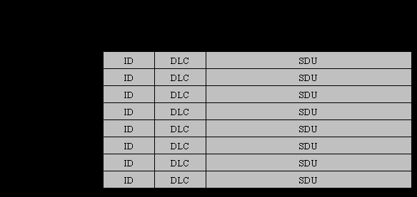

Figure 7-4：采用 multiplexed transmission 时 HTH、HRH 与 Hardware Object 的分配示例。HTH 和 HRH 的编号取决于具体实现；

图中编号仅为示例。

> 原文第 47 页

#### 7.5.2 发送数据一致性

[SWS_Can_00011] ⌈ Can 模块应直接从上层 buffer 复制数据。在 Can_Write 调用返回之前，上层负责保持 buffer 一致性。⌋ (SRS_SPAL_12075, SRS_Can_01059)

> 原文第 48 页

### 7.6 L-PDU 接收

[SWS_Can_00279] ⌈ 收到 L-PDU 时，Can 模块应调用 RX indication callback CanIf_RxIndication：Mailbox 参数包含 ID、Hoh 和抽象 CanIf ControllerId；PduInfoPtr 参数包含 Data Length 和指向 L-SDU buffer 的指针。⌋ (SRS_Can_01045)

[SWS_Can_00423] ⌈ 对 Extended CAN frame，Can 模块应将 ID 转换为标准化格式，因为上层 CANIF 不知道收到的是 Standard CAN frame 还是 Extended CAN frame。对于 Extended CAN frame，应将所接收 CAN frame ID 的 MSB 置 1，以标记该 frame 为 Extended。⌋ ()

[SWS_Can_00396] ⌈ 对应硬件资源的 RX ISR，或 polling mode 下的 Can_MainFunction_Read，应调用 CanIf_RxIndication。⌋ (SRS_Can_01045)

[SWS_Can_00060] ⌈ CAN 到内存的数据映射定义为：最先接收的 CAN data byte 是数组元素 0，最后接收的 CAN data byte 是数组元素 7；CAN FD 时为 63。若 CAN Hardware buffer 内的数据表示与 AUTOSAR 定义不同，Can 模块必须向上层提供经过适配的 SDU-Buffer。⌋ (SRS_SPAL_12063)

[SWS_Can_00501] ⌈ CanDrv 应按 Can_IdType 的说明，指示收到的报文是 conventional CAN frame 还是 CAN FD frame。⌋ (SRS_Can_01162)

#### 7.6.1 接收数据一致性

为避免接收报文丢失，一些 Controller 支持由一组 hardware object 构成 FIFO；另一些 Controller 则允许配置具有相同属性的其他 hardware object 作为 shadow buffer，在主 object 忙时接替工作。

[SWS_Can_00489] ⌈ CAN driver 应支持实现 hardware FIFO 的 Controller。FIFO 大小通过 CanHwObjectCount 配置。⌋ ()

[SWS_Can_00490] ⌈ 不支持 hardware FIFO 的 Controller 通常能够实现 shadow buffer mechanism：主 hardware object 忙时，由附加 hardware object 接替。hardware object 的数量

> 原文第 49 页

通过 CanHwObjectCount 配置。⌋ ()

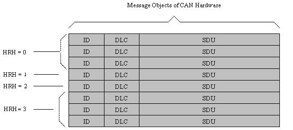

Figure 7-5：同一个 HRH 分配到多个 Hardware Object 的示例。图中所选

编号仅为示例。

[SWS_Can_00299] ⌈ 若 CAN Hardware 无法保护（锁定）RX buffer，防止其被新接收的报文覆盖，Can 模块应在接收后将 L-SDU 复制到 shadow buffer。⌋ ()

[SWS_Can_00300] ⌈ 若 CAN Hardware 无法被全局访问，Can 模块应将 L-SDU 复制到 shadow buffer。⌋ ()

完整 RX 处理（包括复制到目标层，如 COM）均在 RX interrupt 或 Can_MainFunction_Read 的执行上下文中完成。

[SWS_Can_00012] ⌈ Can 模块应保证 ISR 和 Can_MainFunction_Read 均不会被自身打断。CAN hardware buffer（或 shadow buffer）始终保持一致，因为它的写入和读取顺序地发生在同一个不会被自身打断的函数中。⌋ (SRS_Can_01059)

若 CAN 硬件不能配置为在接收后锁定 RX hardware object，hardware buffer 可能被新到达报文覆盖。若硬件支持，CAN controller 会检测到 overwrite event。

若 CAN 硬件能够配置为在接收后锁定 RX hardware object，新到达报文可能无法存入 hardware buffer。若硬件支持，CAN controller 会检测到 overrun event。

[SWS_Can_00395] ⌈ 检测到 overwrite 或 overrun event 时，Can 模块应报告 runtime error CAN_E_DATALOST。⌋ ()

> 原文第 50 页

实现提示：系统设计者应确保报文接收处理的运行时间（interrupt-driven 或 polling）能够适应系统中最快的可能接收速率。

### 7.7 Wakeup 机制

Can 模块处理由 CAN controller 自身检测的 wakeup，而非通过 CAN transceiver 检测的 wakeup。存在 interrupt wakeup 和 polling wakeup 两种情况。

采用 interrupt wakeup 时，硬件检测到 wakeup 后调用 Can 模块的 ISR。

[SWS_Can_00364] ⌈ 若 wakeup event 的 ISR 被调用，它应进一步调用 EcuM_CheckWakeup。传入的参数应为 CanWakeupSourceRef 配置参数所引用的 wakeup source ID。⌋ (SRS_BSW_00375, SRS_SPAL_12069, SRS_Can_01054)

随后 ECU State Manager 配置 MCU，并经 Can Interface 回调 Can 模块，最终调用 Can_CheckWakeup。

采用 polling 检测 wakeup 时，ECU State Manager 同样通过 Can Interface 周期调用 Can_CheckWakeup。两种情况下，Can_CheckWakeup 均检查 CAN controller 是否检测到 wakeup，并返回结果。随后 CAN driver 通过 EcuM_SetWakeupEvent 将 wakeup event 通知 ECU State Manager。

防止虚假 wakeup 的 wakeup validation，之后由 ECU State Manager 和 Can Interface 完成，不需要 Can 模块协助。

wakeup mechanism 的总体说明及 sequence diagram，参见 ECU State Manager 规范 [7]。

### 7.8 Notification 机制

Can 模块仅向 CanIf 提供事件触发的 notification interface，每种 notification 由一个 callback 表示。

[SWS_Can_00099] ⌈ 硬件事件可通过 interrupt，或轮询 hardware object 的 status flag 检测。polling 的配置能力取决于硬件，例如哪些事件能够或必须轮询；本标准不对此作限制。⌋ (SRS_Can_01132)

[SWS_Can_00007] ⌈ 应能够将 driver 配置为完全不使用 interrupt，即 complete polling。⌋ (SRS_Can_01062)

> 原文第 51 页

Can 模块对哪些事件进行 polling、哪些不进行的配置，属于 driver 内部内容，对模块外不可见。polling 在 CAN main function（Can_MainFunction_xxx）内执行；轮询检测到的事件也通过相应 callback 通知。此时调用上下文是 CAN main function，而非 ISR。所有 callback 的实现都应按其调用上下文为 ISR 的情况设计。

更多信息见 Can_MainFunction_Read、Can_MainFunction_Write、Can_MainFunction_BusOff 和 Can_MainFunction_Wakeup 的说明。

### 7.9 Reentrancy 问题

一个 routine 必须满足以下条件，才可重入：

• 以 atomic 方式使用全部共享变量，除非每个变量分别分配给函数的

特定实例。
• 不调用 non-reentrant function。
• 不以 non-atomic 方式使用硬件。

CanIf 在 CanIf_Transmit 中直接转发 transmit request。CanIf_Transmit 可重入，因此 Can_Write 必须实现为 thread-safe，例如使用 mutex。

若无法以可重入方式写入，进一步的抢占调用将返回 CAN_BUSY。例如，允许写入不同的 hardware TX Handle，但不允许同时写入同一个 TX Handle。

返回 CAN_BUSY 时，CanIf 将请求排队，其行为与全部 hardware object 均忙时相同。

Can_EnableCanInterrupts 和 Can_DisableCanInterrupts 可能在可重入函数内调用，因此也需要可重入。其他服务不必实现为可重入函数。

CAN main function（如 Can_MainFunction_Read）不得被自身打断，因此这些函数不可重入。

### 7.10 Hardware Timestamping

若 CAN controller 支持 hardware-based timestamping，可利用该功能提高 CAN 上 synchronized time-base 的精度。支持 hardware-based timestamping 时，提供以下 CAN driver API：

• Can_GetCurrentTime • Can_EnableEgressTimeStamp • Can_GetEgressTimeStamp • Can_GetIngressTimeStamp

> 原文第 52 页

这些 API 需要通过 CanGlobalTimeSupport 配置参数启用。

CAN controller 的 hardware-based timestamping 功能应提供 free-running counter，用于获取 CAN message 接收和发送的 timestamp。该 counter 递增计数，在达到规定最大值后溢出回零。CiA 603 规定它对 clock cycle 计数；原文规定 resolution 为至少 1 µs、至多 1 ns。强烈建议提供 32-bit timestamp register 和 32-bit counter。

在 CAN frame 被判定为有效时，捕获发送和接收 CAN message 的 timestamp。详情见 CiA 603。

### 7.11 错误分类

《General Specification of Basic Software Modules》的 7.11 节“Error Handling”详细描述 Basic Software 的错误处理，尤其定义了 BSW module 可能出现的五种错误类型。

基于该分类，以下各小节规定具体错误。

[SWS_Can_00104] ⌈ Can 模块应能够根据其配置（default/production）检测以下错误和异常。⌋ (SRS_BSW_00337, SRS_BSW_00385, SRS_BSW_00331)

#### 7.11.1 Development Errors

[SWS_Can_91019]⌈

*下表跨原文第 52、53 页，已接续合并。*

| 错误类型 | 对应 error code | 错误值 |
| --- | --- | --- |
| 调用 API Service 时参数错误。 | CAN_E_PARAM_POINTER | 0x01 |
| 调用 API Service 时参数错误。 | CAN_E_PARAM_HANDLE | 0x02 |
| 调用 API Service 时参数错误。 | CAN_E_PARAM_DATA_LENGTH | 0x03 |
| 调用 API Service 时参数错误。 | CAN_E_PARAM_CONTROLLER | 0x04 |
| 未初始化就使用 API Service。 | CAN_E_UNINIT | 0x05 |
| 对当前 mode 而言无效的切换。 | CAN_E_TRANSITION | 0x06 |
| Baudrate 参数值无效。 | CAN_E_PARAM_BAUDRATE | 0x07 |
| 选择了无效的 configuration set。 | CAN_E_INIT_FAILED | 0x09 |
| 调用 API service 时 PDU ID 无效。 | CAN_E_PARAM_LPDU | 0x0A |

> 原文第 53 页

⌋()

#### 7.11.2 Runtime Errors

[SWS_Can_91020]⌈

| 错误类型 | 对应 error code | 错误值 |
| --- | --- | --- |
| 收到的 CAN message 丢失。 | CAN_E_DATALOST | 0x01 |

⌋()

[SWS_Can_00026] ⌈ Can 模块应指示因错误使用其 API 而引起的错误，包括 API 参数检查及调用顺序错误。⌋ (SRS_BSW_00337, SRS_BSW_00323, SRS_SPAL_00157)

[SWS_Can_00091] ⌈ DET 返回后，报告 development error 的 Can 模块函数应立即返回。⌋ (SRS_SPAL_12448)

[SWS_Can_00089] ⌈ 仅在 DET 开启且 Can 模块函数提供返回值时，Can 模块环境才应通过该函数的返回值指示 development error；返回值为 E_NOT_OK。⌋ (SRS_BSW_00369, SRS_BSW_00386, SRS_SPAL_12448)

#### 7.11.3 Transient Faults

无 transient fault。

#### 7.11.4 Production Errors

无 production error。

#### 7.11.5 Extended Production Errors

无 extended production error。

> 原文第 54 页

#### 7.11.6 返回值

CAN_BUSY 通过 Can_Write 返回值上报；CanIf 根据其规范的 sequence diagram 作出响应。在进入 sleep mode 的切换过程中发生 wakeup 时，通过返回值报告 E_NOT_OK。Bus-off 和 Wakeup event 通过 notification callback 转发。

### 7.12 CAN FD 支持

为提高性能，某些 CAN controller 支持称为 CAN FD 的 Flexible Data-Rate 功能，见《CAN with Flexible Data-Rate》规范。通过 arbitration phase 的指示，可在 payload 和 CRC 阶段切换到更高 baudrate。必须以 CanControllerFdBaudrateConfig 扩展 CanControllerBaudrateConfig，配置第二个 baudrate。

若当前生效的 baudrate 具有 CAN FD 配置，则该 Controller 的 CAN FD 功能启用。第二个 baudrate 用于支持接收带 bit rate switch（BRS）的 CAN FD frame；发送是否使用该 baudrate，取决于 CanControllerTxBitRateSwitch。

支持 CAN FD 的网络可能仍需发送 conventional CAN 2.0 message，例如支持 CAN selective wakeup。因此需要支持 conventional CAN 与 CAN FD message 交错发送。可通过 Can_Write 传入的 CanId 的最高两个 bit，在 frame 层面指定 frame 类型，参见 Can_IdType 和 SWS_Can_00416。

CAN FD 还支持最长 64 byte 的扩展 payload，该功能也依赖 CAN FD 配置。因此，当 CAN Controller 处于 CAN FD mode（具有有效 CanControllerFdBaudrateConfig），且传入 Can_Write() 的 CanId 设置了 CAN FD flag 时，CanDrv 支持发送最长 64 byte 的 PDU。若请求发送 CAN FD frame，但 Controller 未处于 CAN FD mode（无 CanControllerFdBaudrateConfig），只要 PDU 长度 ≤ 8 byte，就按 conventional CAN frame 发送。

### 7.13 CAN XL 扩展

CAN/CAN-FD 是经过实践验证、成本适中且广泛使用的通信协议，AUTOSAR 已规定相应通信栈。

汽车行业持续提高通信带宽，以应对现代 E/E architecture 的复杂性。低成本、稳健且符合这一趋势的 bus system，将有益于 AUTOSAR 标准。因此引入 CAN XL，见 [23]、[24]。

> 原文第 55 页

CAN XL 的目标是在现有 CAN 实现和 100 Mbit Ethernet 方案之间填补空白。同一 network segment 上可共存 CAN 2.0/FD/XL 和 Ethernet traffic。baudrate 不像 10BASE-T1S 一样固定为 10 Mbit，而可灵活调整至 20 Mbit/s；payload 最长可达 2048 byte。

CAN XL 对现有 AUTOSAR Module 的影响很小，同时带来新特性的收益。使用新引入的 CAN XL Driver，仍可不作修改地发送 CAN 2.0 和 CAN FD frame。

CAN XL Driver 作为现有 CAN Driver 的扩展实现，并由新文档 [18] 规定，因此非 CAN XL 硬件继续使用基础 CAN Driver 实现。

CAN XL Driver 引入附加 API，以支持 CAN XL frame 和 Ethernet 通信。详情见 [18]。

### 7.14 CAN Error Types 上报

[SWS_Can_91022] ⌈ 若 CanEnableSecurityEventReporting=true，且 CanDrv 检测到 0x1～0xB 范围内的 CanErrorType，应调用 CanIf_ErrorNotification，传入 ControllerId 和 CanError。⌋ (RS_Ids_00810)

[SWS_Can_91024] ⌈ 若所有预定义 Can_ErrorType 值均不匹配 CAN 硬件提供的错误，CAN driver 不得向 CanIf 上报该错误。⌋ (RS_Ids_00810)

[SWS_Can_91023] ⌈ 若 CanEnableSecurityEventReporting=true，且 CanDrv 检测到切换至 error state passive，应调用 CanIf_ControllerErrorStatePassive，传入 ControllerId 以及 Rx、Tx error counter 的值。⌋ (RS_Ids_00810)

> 原文第 56 页

## 8 API 规范

当实现包含多个 Can 模块时，可按 [SWS_Can_00284] 修改函数名前缀。

### 8.1 导入的类型

本节列出从以下模块引入的全部类型：

[SWS_Can_00222] ⌈

| 模块 | Header File | 导入的类型 |
| --- | --- | --- |
| ComStack_Types | ComStack_Types.h | PduIdType |
|  | ComStack_Types.h | PduInfoType |
|  | ComStack_Types.h | PduLengthType |
| EcuM | EcuM.h | EcuM_WakeupSourceType |
| Icu | Icu.h | Icu_ChannelType |
| Os | Os.h | StatusType |
|  | Os.h | TickRefType |
|  | Os.h | TickType |
|  | Rte_Os_Type.h | CounterType |
| Std | Std_Types.h | Std_ReturnType |
|  | Std_Types.h | Std_VersionInfoType |

⌋()

> 原文第 57 页

### 8.2 类型定义

#### 8.2.1 Can_ConfigType

[SWS_Can_00413]⌈

| 字段 | 内容 |
| --- | --- |
| 名称 | Can_ConfigType |
| 种类 | Structure |
| 说明 | 外部数据结构类型，包含 CAN driver 的全部初始化数据，以及影响所有 Controller 的 SFR 设置；还包含指向 Controller configuration structure 的指针。初始化数据结构的内容取决于 CAN 硬件。 |
| 通过以下文件提供 | Can.h |

⌋()

#### 8.2.2 Can_PduType

[SWS_Can_00415]⌈

*下表跨原文第 57、58 页，已接续合并。*

| 字段 | 内容 |
| --- | --- |
| 名称 | Can_PduType |
| 种类 | Structure |
| 成员 | swPduHandle 类型 · PduIdType 注释 · -- length 类型 · uint8 注释 · -- id 类型 · Can_IdType 注释 · -- sdu 类型 · uint8* 注释 · -- |
| 说明 | 该类型针对任意 CAN L-SDU，将 PduId（swPduHandle）、SduLength（length）、SduData（sdu）和 Can Id（id）组合在一起。 |
| 通过以下文件提供 | Can_GeneralTypes.h |

> 原文第 58 页

⌋()

#### 8.2.3 Can_IdType

[SWS_Can_00416]⌈

| 字段 | 内容 |
| --- | --- |
| 名称 | Can_IdType |
| 种类 | 类型 |
| 派生自 | uint32 |
| 取值范围 | Standard32Bit · 0..0x400007FF · 0..0x400007FF Extended32Bit · 0..0xDFFFFFFF · 0..0xDFFFFFFF |
| 说明 | 表示 L-PDU 的 Identifier。最高两个 bit 指定 frame 类型： 00：具有 Standard CAN ID 的 CAN message。 01：具有 Standard CAN ID 的 CAN FD frame。 10：具有 Extended CAN ID 的 CAN message。 11：具有 Extended CAN ID 的 CAN FD frame。 |
| Variation | -- |
| 通过以下文件提供 | Can_GeneralTypes.h |

⌋()

#### 8.2.4 Can_HwHandleType

[SWS_Can_00429]⌈

*下表跨原文第 58、59 页，已接续合并。*

| 字段 | 内容 |
| --- | --- |
| 名称 | Can_HwHandleType |
| 种类 | 类型 |
| 派生自 | 基础类型 · Variation uint16 · -- uint8 · -- |
| 取值范围 | Standard · 0..0x0FF · 0..0x0FF Extended · 0..0xFFFF · 0..0xFFFF |
| 说明 | 表示 CAN hardware unit 的 hardware object handle。对于超过 255 个 HW object 的 CAN hardware unit，使用 extended range。 |
| 通过以下文件提供 | Can_GeneralTypes.h |

> 原文第 59 页

⌋()

#### 8.2.5 Can_HwType

[SWS_CAN_00496]⌈

| 字段 | 内容 |
| --- | --- |
| 名称 | Can_HwType |
| 种类 | Structure |
| 成员 | CanId 类型 · Can_IdType 注释 · CAN L-PDU 的 Standard/Extended CAN ID。 Hoh 类型 · Can_HwHandleType 注释 · 对应 Hardware Object Range 的 ID。 ControllerId 类型 · uint8 注释 · CanIf 提供的 ControllerId，唯一标识对应 Controller。 |
| 说明 | 该类型定义一个数据结构，明确提供 Hardware Object Handle、其对应的 CAN Controller（从而也标识 CanDrv）以及具体 CanId。 |
| 通过以下文件提供 | Can_GeneralTypes.h |

⌋()

#### 8.2.6 对 Std_ReturnType 的扩展

[SWS_Can_00039]⌈

*下表跨原文第 59、60 页，已接续合并。*

| 字段 | 内容 |
| --- | --- |
| 取值范围 | CAN_BUSY · 0x02 · 由于没有可用 transmit object，无法处理 transmit request。 |
| 说明 | 为 CAN driver API Can_Write() 在 Std_ReturnType 上定义的附加返回值。 |
| 通过以下文件提供 | Can_GeneralTypes.h |

> 原文第 60 页

⌋(SRS_BSW_00331)

#### 8.2.7 Can_ErrorStateType

[SWS_Can_91003]⌈

| 字段 | 内容 |
| --- | --- |
| 名称 | Can_ErrorStateType |
| 种类 | Enumeration |
| 取值范围 | CAN_ERRORSTATE_ACTIVE · -- · CAN controller 完整参与通信。 CAN_ERRORSTATE_PASSIVE · -- · CAN controller 参与通信，但不发送 active error frame。 CAN_ERRORSTATE_BUSOFF · -- · CAN controller 不参与通信。 |
| 说明 | CAN controller 的 error state。 |
| 通过以下文件提供 | Can_GeneralTypes.h |

⌋()

#### 8.2.8 Can_ControllerStateType

[SWS_Can_91013]⌈

| 字段 | 内容 |
| --- | --- |
| 名称 | Can_ControllerStateType |
| 种类 | Enumeration |
| 取值范围 | CAN_CS_UNINIT · 0x00 · CAN controller 处于 UNINIT。 CAN_CS_STARTED · 0x01 · CAN controller 处于 STARTED。 CAN_CS_STOPPED · 0x02 · CAN controller 处于 STOPPED。 CAN_CS_SLEEP · 0x03 · CAN controller 处于 SLEEP。 |
| 说明 | 多个 ControllerMode 函数使用的状态。 |
| 通过以下文件提供 | Can_GeneralTypes.h |

> 原文第 61 页

⌋()

#### 8.2.9 Can_ErrorType

[SWS_Can_91021]⌈

| 字段 | 内容 |
| --- | --- |
| 名称 | Can_ErrorType |
| 种类 | Enumeration |
| 取值范围 | CAN_ERROR_BIT_MONITORING1 · 0x01 · 发送了 0，但回读为 1。 CAN_ERROR_BIT_MONITORING0 · 0x02 · 发送了 1，但回读为 0。 CAN_ERROR_BIT · 0x03 · 硬件报告 CAN bit error，但无法区分 CAN_ERROR_BIT_MONITORING1 与 CAN_ERROR_BIT_MONITORING0。 CAN_ERROR_CHECK_ACK_FAILED · 0x04 · Acknowledgement 检查失败。 CAN_ERROR_ACK_DELIMITER · 0x05 · Acknowledgement delimiter 检查失败。 CAN_ERROR_ARBITRATION_LOST · 0x06 · sender 在 arbitration 中失败。 CAN_ERROR_OVERLOAD · 0x07 · 通过 overload frame 检测到 CAN overload，表示某个 receiver 的 receive buffer 已满。 CAN_ERROR_CHECK_FORM_FAILED · 0x08 · 违反固定 frame format。 CAN_ERROR_CHECK_STUFFING_FAILED · 0x09 · Stuffing bit 不符合预期。 CAN_ERROR_CHECK_CRC_FAILED · 0xA · CRC 检查失败。 CAN_ERROR_BUS_LOCK · 0xB · Bus lock：总线持续停留在 dominant level。 |
| 说明 | 该 enumeration 表示典型 CAN 硬件可报告的 CAN Error Types 的超集，即并非所有 CAN 硬件均支持全部类型。 |
| 通过以下文件提供 | Can_GeneralTypes.h |

> 原文第 62 页

⌋()

#### 8.2.10 Can_TimeStampType

[SWS_CAN_91029]{DRAFT} ⌈

| 字段 | 内容 |
| --- | --- |
| 名称 | Can_TimeStampType (draft) |
| 种类 | Structure |
| 成员 | nanoseconds 类型 · uint32 注释 · 时间的 nanoseconds 部分。 seconds 类型 · uint32 注释 · 时间的 seconds 部分。 |
| 说明 | 该类型的变量用于表示基于 relative time 的 timestamp。取值范围： • Seconds：0～4,294,967,295 s，约 136 年。 • Nanoseconds：0～999,999,999 ns。 Tags：atp.Status=draft。 |
| 通过以下文件提供 | Can_GeneralTypes.h |

⌋(SRS_Can_01181)

### 8.3 函数定义

本节列出向上层模块提供的函数。

#### 8.3.1 影响整个 Hardware Unit 的服务

##### 8.3.1.1 Can_Init

[SWS_Can_00223]⌈

*下表跨原文第 62、63 页，已接续合并。*

| 字段 | 内容 |
| --- | --- |
| 服务名称 | Can_Init |
| 函数原型 | void Can_Init ( const Can_ConfigType* Config ) |
| Service ID [hex] | 0x00 |
| 同步 / 异步 | 同步 |
| 可重入性 | 不可重入 |
| 输入参数 | Config · 指向 driver configuration 的指针。 |
| 输入 / 输出参数 | 无 |
| 输出参数 | 无 |
| 返回值 | 无 |
| 说明 | 该函数初始化模块。 |
| 通过以下文件提供 | Can.h |

> 原文第 63 页

⌋ (SRS_BSW_00358, SRS_BSW_00414)

可用 configuration set 的 symbolic name 由 Can 模块的配置说明提供，见第 10 章。

[SWS_Can_00174] ⌈ 若启用 Can 模块的 development error detection，且 driver 不处于 CAN_UNINIT，Can_Init 应报告 CAN_E_TRANSITION。⌋ ()

[SWS_Can_00408] ⌈ 若启用 Can 模块的 development error detection，且 CAN controller 不处于 UNINIT，Can_Init 应报告 CAN_E_TRANSITION。⌋ ()

##### 8.3.1.2 Can_GetVersionInfo

[SWS_Can_00224]⌈

*下表跨原文第 63、64 页，已接续合并。*

| 字段 | 内容 |
| --- | --- |
| 服务名称 | Can_GetVersionInfo |
| 函数原型 | void Can_GetVersionInfo ( Std_VersionInfoType* versioninfo ) |
| Service ID [hex] | 0x07 |
| 同步 / 异步 | 同步 |
| 可重入性 | 可重入 |
| 输入参数 | 无 |
| 输入 / 输出参数 | 无 |
| 输出参数 | versioninfo · 指向用于存储本模块版本信息的位置。 |
| 返回值 | 无 |
| 说明 | 返回本模块的版本信息。 |
| 通过以下文件提供 | Can.h |

> 原文第 64 页

⌋ ()

[SWS_Can_00177] ⌈ 若启用 Can 模块的 development error detection，且 versionInfo 参数为 null pointer，Can_GetVersionInfo 应报告 CAN_E_PARAM_POINTER。⌋ ()

##### 8.3.1.3 Can_DeInit

[SWS_Can_91002]⌈

| 字段 | 内容 |
| --- | --- |
| 服务名称 | Can_DeInit |
| 函数原型 | void Can_DeInit ( void ) |
| Service ID [hex] | 0x10 |
| 同步 / 异步 | 同步 |
| 可重入性 | 不可重入 |
| 输入参数 | 无 |
| 输入 / 输出参数 | 无 |
| 输出参数 | 无 |
| 返回值 | 无 |
| 说明 | 对模块执行 de-initialization。 |
| 通过以下文件提供 | Can.h |

⌋(SRS_Can_01166, SRS_BSW_00336)

注：de-initialization 函数的通用行为与约束由 [SWS_BSW_00152]、[SWS_BSW_00072]、[SWS_BSW_00232]、[SWS_BSW_00233] 规定。

> 原文第 65 页

注意：Can_DeInit 的调用者必须确保没有 CAN controller 处于 STARTED。

[SWS_Can_91011] ⌈ 若启用 Can 模块的 development error detection，且 driver 不处于 CAN_READY，Can_DeInit 应报告 CAN_E_TRANSITION。⌋ (SRS_BSW_00369)

[SWS_Can_91012] ⌈ 若启用 Can 模块的 development error detection，且任一 CAN controller 处于 STARTED，Can_DeInit 应报告 CAN_E_TRANSITION。⌋ (SRS_BSW_00369)

#### 8.3.2 影响单个 CAN Controller 的服务

##### 8.3.2.1 Can_SetBaudrate

[SWS_CAN_00491]⌈

| 字段 | 内容 |
| --- | --- |
| 服务名称 | Can_SetBaudrate |
| 函数原型 | Std_ReturnType Can_SetBaudrate ( uint8 Controller, uint16 BaudRateConfigID ) |
| Service ID [hex] | 0x0f |
| 同步 / 异步 | 同步 |
| 可重入性 | 对于不同 Controller 可重入；对于同一 Controller 不可重入。 |
| 输入参数 | Controller · 需要设置 baudrate 的 CAN controller。 BaudRateConfigID · 通过 ID 引用一个 baudrate configuration，参见 CanControllerBaudRateConfigID。 |
| 输入 / 输出参数 | 无 |
| 输出参数 | 无 |
| 返回值 | Std_ReturnType · E_OK：接受服务请求，已开始设置新的 baudrate。 E_NOT_OK：未接受服务请求。 |
| 说明 | 设置 CAN controller 的 baudrate configuration。根据所需的 baudrate 修改，可能需要 reset Controller。 |
| 通过以下文件提供 | Can.h |

⌋()

> 原文第 66 页

可能存在多组 baudrate configuration，可通过 Can_SetBaudrate 在其间切换。根据新旧配置，运行时可能只需修改部分参数，从而避免重新初始化 CAN Controller。若调用会导致重新初始化，则调用时 Controller 必须处于 STOPPED，见 SWS_Can_00256 和 SWS_Can_00260。（重新）初始化后 Controller 处于 STOPPED，见 SWS_Can_00259。

[SWS_Can_00492] ⌈ 若启用 development error detection，且 driver 尚未初始化，Can_SetBaudrate 应报告 CAN_E_UNINIT 并返回 E_NOT_OK。⌋ ()

[SWS_Can_00493] ⌈ 若启用 development error detection，且 BaudRateConfigID 无效，Can_SetBaudrate 应报告 CAN_E_PARAM_BAUDRATE 并返回 E_NOT_OK。⌋ ()

[SWS_Can_00494] ⌈ 若启用 development error detection，且 Controller 超出范围，Can_SetBaudrate 应报告 CAN_E_PARAM_CONTROLLER 并返回 E_NOT_OK。⌋ ()

[SWS_Can_00500] ⌈ 若请求的 baudrate 修改无法在不

重新初始化 CAN Controller 的情况下完成，应返回 E_NO_OK。⌋ ()

##### 8.3.2.2 Can_SetControllerMode

[SWS_Can_00230]⌈

*下表跨原文第 66、67 页，已接续合并。*

| 字段 | 内容 |
| --- | --- |
| 服务名称 | Can_SetControllerMode |
| 函数原型 | Std_ReturnType Can_SetControllerMode ( uint8 Controller, Can_ControllerStateType Transition ) |
| Service ID [hex] | 0x03 |
| 同步 / 异步 | 异步 |
| 可重入性 | 不可重入 |
| 输入参数 | Controller · 需要改变状态的 CAN controller。 Transition · 用于请求 CAN controller 新状态的 Transition 值。 |
| 输入 / 输出参数 | 无 |
| 输出参数 | 无 |
| 返回值 | Std_ReturnType · E_OK：接受请求。 E_NOT_OK：未接受请求，发生 development error。 |
| 说明 | 执行软件触发的 CAN controller state machine 状态切换。 |
| 通过以下文件提供 | Can.h |

> 原文第 67 页

⌋ ()

[SWS_Can_00017] ⌈ Can_SetControllerMode 应执行软件触发的 CAN controller state machine 状态切换。另见 [SRS_SPAL_12169]。⌋ (SRS_SPAL_12169, SRS_Can_01053)

[SWS_Can_00384] ⌈ 每次以 CAN_CS_STARTED 触发 CAN controller state machine 时，Can_SetControllerMode 应使用之前 Can_SetBaudrate 或 Can_Init 使用的同一 Controller configuration set，重新初始化 CAN controller。⌋ ()

进入 sleep 期间发生 CAN bus wakeup 的情况见 SWS_Can_00048。

[SWS_Can_00294] ⌈ Can_SetControllerMode 检查 wakeup status 时，应禁用 wakeup interrupt。⌋ ()

[SWS_Can_00196] ⌈ Can_SetControllerMode 应启用新状态所需的 interrupt。⌋ ()

[SWS_Can_00425] ⌈ 若已通过 Can_DisableControllerInterrupts 禁用 CAN interrupt，则不得执行启用 CAN interrupt 的操作。⌋ ()

[SWS_Can_00197] ⌈ Can_SetControllerMode 应禁用新状态下不允许的 interrupt。⌋ ()

[SWS_Can_00426] ⌈ 若已通过 Can_DisableControllerInterrupts 禁用 CAN interrupt，则不得再执行禁用 CAN interrupt 的操作。⌋ ()

[SWS_Can_00198] ⌈ 若启用 development error detection，且模块尚未初始化，Can_SetControllerMode 应报告 CAN_E_UNINIT 并返回 E_NOT_OK。⌋ ()

> 原文第 68 页

[SWS_Can_00199] ⌈ 若启用 development error detection，且 Controller 参数超出范围，Can_SetControllerMode 应报告 CAN_E_PARAM_CONTROLLER 并返回 E_NOT_OK。⌋ ()

[SWS_Can_00200] ⌈ 若启用 development error detection，且请求了无效状态切换，Can_SetControllerMode 应报告 CAN_E_TRANSITION 并返回 E_NOT_OK。⌋ ()

##### 8.3.2.3 Can_DisableControllerInterrupts

[SWS_Can_00231]⌈

| 字段 | 内容 |
| --- | --- |
| 服务名称 | Can_DisableControllerInterrupts |
| 函数原型 | void Can_DisableControllerInterrupts ( uint8 Controller ) |
| Service ID [hex] | 0x04 |
| 同步 / 异步 | 同步 |
| 可重入性 | 可重入 |
| 输入参数 | Controller · 需要禁用 interrupt 的 CAN controller。 |
| 输入 / 输出参数 | 无 |
| 输出参数 | 无 |
| 返回值 | 无 |
| 说明 | 禁用此 CAN controller 的全部 interrupt。 |
| 通过以下文件提供 | Can.h |

⌋(SRS_BSW_00312)

[SWS_Can_00049] ⌈ 仅当目标 CAN Controller 的 interrupt 已启用时，Can_DisableControllerInterrupts 才应访问其寄存器，禁用该 Controller 的全部 interrupt。⌋ (SRS_Can_01043)

[SWS_Can_00202] ⌈ 若多次调用 Can_DisableControllerInterrupts，必须调用相同次数的 Can_EnableControllerInterrupts，才可重新启用 interrupt。⌋ ()

实现说明：

> 原文第 69 页

Can_DisableControllerInterrupts 可在每次执行时递增 counter，表示重新启用 interrupt 前需要调用 Can_EnableControllerInterrupts 的次数，即 incremental disable。

[SWS_Can_00204] ⌈ Can 模块应跟踪其他函数（如 Can_SetControllerMode）中对各 interrupt 的启用和禁用，以便恢复正确的 interrupt enable state。⌋ ()

实现示例：
• 在 interrupts enabled mode 下，每次改变 interrupt 状态时，同时修改 interrupt enable bit 和 software flag。
• 在 interrupts disabled mode 下，只修改 software flag。
• Can_DisableControllerInterrupts 和 Can_EnableControllerInterrupts 不修改 software flag。
• Can_EnableControllerInterrupts 读取 software flag，重新启用正确的 interrupt。

[SWS_Can_00205] ⌈ 若启用 development error detection，且 driver 尚未初始化，Can_DisableControllerInterrupts 应报告 CAN_E_UNINIT。⌋ ()

[SWS_Can_00206] ⌈ 若启用 development error detection，且 Controller 参数超出范围，Can_DisableControllerInterrupts 应报告 CAN_E_PARAM_CONTROLLER。⌋ ()

##### 8.3.2.4 Can_EnableControllerInterrupts

[SWS_Can_00232]⌈

| 字段 | 内容 |
| --- | --- |
| 服务名称 | Can_EnableControllerInterrupts |
| 函数原型 | void Can_EnableControllerInterrupts ( uint8 Controller ) |
| Service ID [hex] | 0x05 |
| 同步 / 异步 | 同步 |
| 可重入性 | 可重入 |
| 输入参数 | Controller · 需要重新启用 interrupt 的 CAN controller。 |
| 输入 / 输出参数 | 无 |
| 输出参数 | 无 |
| 返回值 | 无 |
| 说明 | 启用全部允许的 interrupt。 |
| 通过以下文件提供 | Can.h |

> 原文第 70 页

⌋(SRS_BSW_00312)

[SWS_Can_00050] ⌈ Can_EnableControllerInterrupts 应启用当前软件状态要求启用的全部 interrupt。⌋ (SRS_Can_01043)

SWS_Can_00202 同样适用于此函数。

[SWS_Can_00208] ⌈ 若此前未调用 Can_DisableControllerInterrupts，Can_EnableControllerInterrupts 应不执行任何操作。⌋ ()

另见 Can_DisableControllerInterrupts 的实现示例。

[SWS_Can_00209] ⌈ 若启用 development error detection，且 driver 尚未初始化，Can_EnableControllerInterrupts 应报告 CAN_E_UNINIT。⌋ ()

[SWS_Can_00210] ⌈ 若启用 development error detection，且 Controller 参数超出范围，Can_EnableControllerInterrupts 应报告 CAN_E_PARAM_CONTROLLER。⌋ ()

##### 8.3.2.5 Can_CheckWakeup

[SWS_Can_00360]⌈

| 字段 | 内容 |
| --- | --- |
| 服务名称 | Can_CheckWakeup |
| 函数原型 | Std_ReturnType Can_CheckWakeup ( uint8 Controller ) |
| Service ID [hex] | 0x0b |
| 同步 / 异步 | 同步 |
| 可重入性 | 不可重入 |
| 输入参数 | Controller · 需要检查是否发生 wakeup 的 Controller。 |
| 输入 / 输出参数 | 无 |
| 输出参数 | 无 |
| 返回值 | Std_ReturnType · E_OK：已接受 API 调用。 E_NOT_OK：未接受 API 调用。 |
| 说明 | 检查指定 Controller 是否发生了 wakeup。 |
| 通过以下文件提供 | Can.h |

⌋()

> 原文第 71 页

[SWS_Can_00361] ⌈ Can_CheckWakeup 应检查指定 CAN controller 是否检测到 wakeup。成功检测到 wakeup event 时，应通过 EcuM_SetWakeupEvent 向 EcuM 上报。⌋ ()

[SWS_Can_00362] ⌈ 若启用 development error detection，且 driver 尚未初始化，Can_CheckWakeup 应报告 CAN_E_UNINIT。⌋ ()

[SWS_Can_00363] ⌈ 若启用 development error detection，且 Controller 参数超出范围，Can_CheckWakeup 应报告 CAN_E_PARAM_CONTROLLER。⌋ ()

##### 8.3.2.6 Can_GetControllerErrorState

[SWS_Can_91004]⌈

| 字段 | 内容 |
| --- | --- |
| 服务名称 | Can_GetControllerErrorState |
| 函数原型 | Std_ReturnType Can_GetControllerErrorState ( uint8 ControllerId, Can_ErrorStateType* ErrorStatePtr ) |
| Service ID [hex] | 0x11 |
| 同步 / 异步 | 同步 |
| 可重入性 | 对于同一 ControllerId 不可重入。 |
| 输入参数 | ControllerId · 分配给目标 CAN controller 的抽象 CanIf ControllerId，用于请求其 ErrorState。 |
| 输入 / 输出参数 | 无 |
| 输出参数 | ErrorStatePtr · 指向用于存储 CAN controller error state 的内存位置。 |
| 返回值 | Std_ReturnType · E_OK：接受 error state 请求。 E_NOT_OK：未接受 error state 请求。 |
| 说明 | 获取 CAN controller 的 error state。 |
| 通过以下文件提供 | Can.h |

⌋ ()

[SWS_Can_91005] ⌈ 若启用 development error detection，且模块尚未初始化，Can_GetControllerErrorState 应报告 CAN_E_UNINIT 并返回 E_NOT_OK。⌋ (SRS_BSW_00406, SRS_BSW_00416)

> 原文第 72 页

[SWS_Can_91006] ⌈ 若启用 development error detection，且 ControllerId 超出范围，Can_GetControllerErrorState 应报告 CAN_E_PARAM_CONTROLLER 并返回 E_NOT_OK。⌋ (SRS_BSW_00323)

[SWS_Can_91007] ⌈ 若启用 development error detection，且 ErrorStatePtr 为 null pointer，Can_GetControllerErrorState 应报告 CAN_E_PARAM_POINTER 并返回 E_NOT_OK。⌋ (SRS_BSW_00323)

[SWS_Can_91008] ⌈ 以 Controller Id 为输入参数调用 Can_GetControllerErrorState() 时，Can driver 应读取该 Controller 的 error state register，并将 error status 返回上层。⌋ (SRS_Can_01167)

##### 8.3.2.7 Can_GetControllerMode

[SWS_Can_91014]⌈

| 字段 | 内容 |
| --- | --- |
| 服务名称 | Can_GetControllerMode |
| 函数原型 | Std_ReturnType Can_GetControllerMode ( uint8 Controller, Can_ControllerStateType* ControllerModePtr ) |
| Service ID [hex] | 0x12 |
| 同步 / 异步 | 同步 |
| 可重入性 | 不可重入 |
| 输入参数 | Controller · 需要查询状态的 CAN controller。 |
| 输入 / 输出参数 | 无 |
| 输出参数 | ControllerModePtr · 指向用于存储 CAN controller 当前 mode 的内存位置。 |
| 返回值 | Std_ReturnType · E_OK：接受 Controller mode 请求。 E_NOT_OK：未接受 Controller mode 请求。 |
| 说明 | 报告指定 CAN controller 的当前状态。 |
| 通过以下文件提供 | Can.h |

⌋()

> 原文第 73 页

[SWS_Can_91015] ⌈ Can_GetControllerMode 应返回指定 CAN controller 的 mode。⌋

[SWS_Can_91016] ⌈ 若启用 development error detection，且 driver 尚未初始化，Can_GetControllerMode 应报告 CAN_E_UNINIT 并返回 E_NOT_OK。⌋ (SRS_BSW_00406, SRS_BSW_00416)

[SWS_Can_91017] ⌈ 若 Can_GetControllerMode() 的 Controller 参数无效，CanDrv 应向 DET 的 Det_ReportError 服务报告 CAN_E_PARAM_CONTROLLER。⌋ (SRS_BSW_00323)

[SWS_Can_91018] ⌈ 若 Can_GetControllerMode() 的 ControllerModePtr 为 null pointer，CanDrv 应向 DET 的 Det_ReportError 服务报告 CAN_E_PARAM_POINTER。⌋ (SRS_BSW_00323)

##### 8.3.2.8 Can_GetControllerRxErrorCounter

[SWS_Can_00511]⌈

*下表跨原文第 73、74 页，已接续合并。*

| 字段 | 内容 |
| --- | --- |
| 服务名称 | Can_GetControllerRxErrorCounter |
| 函数原型 | Std_ReturnType Can_GetControllerRxErrorCounter ( uint8 ControllerId, uint8* RxErrorCounterPtr ) |
| Service ID [hex] | 0x30 |
| 同步 / 异步 | 同步 |
| 可重入性 | 对于同一 ControllerId 不可重入。 |
| 输入参数 | ControllerId · 需要获取当前 Rx error counter 的 CAN controller。 |
| 输入 / 输出参数 | 无 |
| 输出参数 | RxErrorCounterPtr · 指向用于存储 CAN controller 当前 Rx error counter 的内存位置。 |
| 返回值 | Std_ReturnType · E_OK：Rx error counter 可用。 E_NOT_OK：ControllerId 错误，或 Rx error counter 不可用。 |
| 说明 | 返回 CAN controller 的 Rx error counter。并非所有 Controller 都能提供该值；不可用时返回 E_NOT_OK。由于 Rx counter 由硬件异步处理，API 返回时其值可能已不再准确。应用不应依据该值推断当前 bus state。 |
| 通过以下文件提供 | Can.h |

> 原文第 74 页

⌋ ()

[SWS_Can_00512] ⌈ 若启用 development error detection，且模块尚未初始化，Can_GetControllerRxErrorCounter 应报告 CAN_E_UNINIT 并返回 E_NOT_OK。⌋ (SRS_BSW_00406)

[SWS_Can_00513] ⌈ 若启用 development error detection，且 ControllerId 超出范围，Can_GetControllerRxErrorCounter 应报告 CAN_E_PARAM_CONTROLLER 并返回 E_NOT_OK。⌋ (SRS_BSW_00323)

[SWS_Can_00514] ⌈ 若启用 development error detection，且 RxErrorCounterPtr 为 null pointer，Can_GetControllerRxErrorCounter 应报告 CAN_E_PARAM_POINTER 并返回 E_NOT_OK。⌋ (SRS_BSW_00323)

[SWS_Can_00515] ⌈ 以 Controller Id 为输入参数调用 Can_GetControllerRxErrorCounter 时，Can driver 应读取对应 Controller 的 Rx error counter register，并将 Rx error count 返回上层。⌋ (SRS_Can_01170)

##### 8.3.2.9 Can_GetControllerTxErrorCounter

[SWS_Can_00516]⌈

*下表跨原文第 74、75 页，已接续合并。*

| 字段 | 内容 |
| --- | --- |
| 服务名称 | Can_GetControllerTxErrorCounter |
| 函数原型 | Std_ReturnType Can_GetControllerTxErrorCounter ( uint8 ControllerId, uint8* TxErrorCounterPtr ) |
| Service ID [hex] | 0x31 |
| 同步 / 异步 | 同步 |
| 可重入性 | 对于同一 ControllerId 不可重入。 |
| 输入参数 | ControllerId · 需要获取当前 Tx error counter 的 CAN controller。 |
| 输入 / 输出参数 | 无 |
| 输出参数 | TxErrorCounterPtr · 指向用于存储 CAN controller 当前 Tx error counter 的内存位置。 |
| 返回值 | Std_ReturnType · E_OK：Tx error counter 可用。 E_NOT_OK：ControllerId 错误，或 Tx error counter 不可用。 |
| 说明 | 返回 CAN controller 的 Tx error counter。并非所有 Controller 都能提供该值；不可用时返回 E_NOT_OK。由于 Tx counter 由硬件异步处理，API 返回时其值可能已不再准确。应用不应依据该值推断当前 bus state。 |
| 通过以下文件提供 | Can.h |

> 原文第 75 页

⌋ ()

[SWS_Can_00517] ⌈ 若启用 development error detection，且模块尚未初始化，Can_GetControllerTxErrorCounter 应报告 CAN_E_UNINIT 并返回 E_NOT_OK。⌋ (SRS_BSW_00406)

[SWS_Can_00518] ⌈ 若启用 development error detection，且 ControllerId 超出范围，Can_GetControllerTxErrorCounter 应报告 CAN_E_PARAM_CONTROLLER 并返回 E_NOT_OK。⌋ (SRS_BSW_00323)

[SWS_Can_00519] ⌈ 若启用 development error detection，且 TxErrorCounterPtr 为 null pointer，Can_GetControllerTxErrorCounter 应报告 CAN_E_PARAM_POINTER 并返回 E_NOT_OK。⌋ (SRS_BSW_00323)

[SWS_Can_00520] ⌈ 以 Controller Id 为输入参数调用 Can_GetControllerTxErrorCounter 时，Can driver 应读取对应 Controller 的 Tx error counter register，并将 Tx error count 返回上层。⌋ (SRS_Can_01170)

##### 8.3.2.10 Can_GetCurrentTime

[SWS_CAN_91026]{DRAFT} ⌈

> 原文第 76 页

| 字段 | 内容 |
| --- | --- |
| 服务名称 | Can_GetCurrentTime (draft) |
| 函数原型 | Std_ReturnType Can_GetCurrentTime ( uint8 ControllerId, Can_TimeStampType* timeStampPtr ) |
| Service ID [hex] | 0x32 |
| 同步 / 异步 | 同步 |
| 可重入性 | 不可重入 |
| 输入参数 | ControllerId · 目标 CAN controller 的索引。 |
| 输入 / 输出参数 | 无 |
| 输出参数 | timeStampPtr · 当前 timestamp。 |
| 返回值 | Std_ReturnType · E_OK: successful E_NOT_OK: failed |
| 说明 | 根据硬件能力，从硬件寄存器返回时间值。 重要说明：Can_GetCurrentTime 可能在 exclusive area 内调用。 Tags：atp.Status=draft。 |
| 通过以下文件提供 | Can.h |

⌋ (SRS_Can_01181)

[SWS_Can_00521] {DRAFT} ⌈ 若启用 development error detection，应检查此前是否调用过 Can_Init；检查失败时报告 CAN_E_UNINIT。⌋ ()

[SWS_CAN_00522] {DRAFT} ⌈ 若启用 development error detection，应检查 ControllerId 是否有效；检查失败时报告 CAN_E_PARAM_CONTROLLER。⌋ ()

[SWS_Can_00523] {DRAFT} ⌈ 若启用 development error detection，应检查 timeStampPtr 是否有效；检查失败时报告 CAN_E_PARAM_POINTER。⌋ ()

[SWS_Can_00524] {DRAFT} ⌈ 此函数应可通过 CanGlobalTimeSupport 在 pre-compile time 配置为 On/Off。⌋ ()

> 原文第 77 页

##### 8.3.2.11 Can_EnableEgressTimeStamp

[SWS_CAN_91025]{DRAFT} ⌈

| 字段 | 内容 |
| --- | --- |
| 服务名称 | Can_EnableEgressTimeStamp (draft) |
| 函数原型 | void Can_EnableEgressTimeStamp ( Can_HwHandleType Hth ) |
| Service ID [hex] | 0x33 |
| 同步 / 异步 | 同步 |
| 可重入性 | 不可重入 |
| 输入参数 | Hth · 指定启用 timestamp 所使用的 HW-transmit handle。注：在不影响性能的前提下，HTH 层级是启用 timestamp 所能采用的最小粒度。 |
| 输入 / 输出参数 | 无 |
| 输出参数 | 无 |
| 返回值 | 无 |
| 说明 | 在指定 HTH 上启用 egress timestamping。某些硬件只需保存一次 egress timestamp marker，另一些硬件则每次发送前都需要设置。由于网络设计中该报文类型始终需要 timestamp，因此不提供 disable 功能。 Tags：atp.Status=draft。 |
| 通过以下文件提供 | Can.h |

⌋ (SRS_Can_01181)

[SWS_Can_00525] {DRAFT} ⌈ 若启用 development error detection，应检查此前是否调用过 Can_Init；检查失败时报告 CAN_E_UNINIT。⌋ ()

[SWS_Can_00526] {DRAFT} ⌈ 若启用 Can 模块的 development error detection，且 Hth 不是已配置的 Hardware Transmit Handle，Can_Write 应报告 CAN_E_PARAM_HANDLE 并返回 E_NOT_OK。⌋ ()

[SWS_Can_00527] {DRAFT} ⌈

> 原文第 78 页

此函数应可通过 CanGlobalTimeSupport 在 pre-compile time 配置为 On/Off。⌋ ()

[SWS_Can_00528] {DRAFT} ⌈ 注意：调用前需要完成 Controller 初始化（Can_Init）。⌋ ()

##### 8.3.2.12 Can_GetEgressTimeStamp

[SWS_CAN_91027]{DRAFT} ⌈

| 字段 | 内容 |
| --- | --- |
| 服务名称 | Can_GetEgressTimeStamp (draft) |
| 函数原型 | Std_ReturnType Can_GetEgressTimeStamp ( PduIdType TxPduId, Can_HwHandleType Hth, Can_TimeStampType* timeStampPtr ) |
| Service ID [hex] | 0x34 |
| 同步 / 异步 | 同步 |
| 可重入性 | 对于同一 TxPduId 不可重入。 |
| 输入参数 | TxPduId · 需要返回 timestamp 的 CAN L-PDU 的 L-PDU handle。 Hth · 需要获取 egress timestamp 的 HW-transmit handle。 |
| 输入 / 输出参数 | 无 |
| 输出参数 | timeStampPtr · 当前 timestamp。 |
| 返回值 | Std_ReturnType · E_OK：成功。 E_NOT_OK：读取 timestamp 失败。 |
| 说明 | 读取指定 message object 的 egress timestamp。必须在 TxConfirmation() 函数内调用。 Tags：atp.Status=draft。 |
| 通过以下文件提供 | Can.h |

⌋ (SRS_Can_01181)

[SWS_Can_00529] {DRAFT} ⌈ 若启用 development error detection，应检查此前是否调用过 Can_Init；检查失败时报告 CAN_E_UNINIT。⌋ ()

> 原文第 79 页

[SWS_Can_00530] {DRAFT} ⌈ 若启用 development error detection，应检查 TxPduId 是否有效；检查失败时报告 CAN_E_PARAM_LPDU。⌋ ()

[SWS_Can_00531] {DRAFT} ⌈ 若启用 development error detection，且 Hth 不是已配置的 Hardware Transmit Handle，Can_GetEgressTimeStamp 应报告 CAN_E_PARAM_HANDLE 并返回 E_NOT_OK。⌋ ()

[SWS_Can_00532] {DRAFT} ⌈ 若启用 development error detection，应检查 timeStampPtr 是否有效；检查失败时报告 CAN_E_PARAM_POINTER。⌋ ()

[SWS_Can_00533] {DRAFT} ⌈ 此函数应可通过 CanGlobalTimeSupport 在 pre-compile time 配置为 On/Off。⌋ ()

[SWS_Can_00534] ⌈ 注意：调用前需要完成 Controller 初始化（Can_Init）。⌋ ()

##### 8.3.2.13 Can_GetIngressTimeStamp

[SWS_CAN_91028]{DRAFT} ⌈

*下表跨原文第 79、80 页，已接续合并。*

| 字段 | 内容 |
| --- | --- |
| 服务名称 | Can_GetIngressTimeStamp (draft) |
| 函数原型 | Std_ReturnType Can_GetIngressTimeStamp ( Can_HwHandleType Hrh, Can_TimeStampType* timeStampPtr ) |
| Service ID [hex] | 0x35 |
| 同步 / 异步 | 同步 |
| 可重入性 | 对于同一 Hrh 不可重入；对于不同 Hrh 可重入。 |
| 输入参数 | Hrh · 需要获取 ingress timestamp 的 HW-receive handle。 |
| 输入 / 输出参数 | 无 |
| 输出参数 | timeStampPtr · 当前 timestamp。 |
| 返回值 | Std_ReturnType · E_OK：成功。 E_NOT_OK：读取 timestamp 失败。 |
| 说明 | 读取指定 message object 的 ingress timestamp。必须在 RxIndication() 函数内调用。 Tags：atp.Status=draft。 |
| 通过以下文件提供 | Can.h |

> 原文第 80 页

⌋ (SRS_Can_01181)

[SWS_Can_00535] {DRAFT} ⌈ 若启用 development error detection，应检查此前是否调用过 Can_Init；检查失败时报告 CAN_E_UNINIT。⌋ ()

[SWS_Can_00536] {DRAFT} ⌈ 若启用 development error detection，且 Hrh 不是已配置的 Hardware Receive Handle，Can_GetIngressTimeStamp 应报告 CAN_E_PARAM_HANDLE 并返回 E_NOT_OK。⌋ ()

[SWS_Can_00537] {DRAFT} ⌈ 若启用 development error detection，应检查 timeStampPtr 是否有效；检查失败时报告 CAN_E_PARAM_POINTER。⌋ ()

[SWS_Can_00538] {DRAFT} ⌈ 此函数应可通过 CanGlobalTimeSupport 在 pre-compile time 配置为 On/Off。⌋ ()

[SWS_Can_00539] {DRAFT} ⌈ 注意：调用前需要完成 Controller 初始化（Can_Init）。⌋ ()

#### 8.3.3 影响 Hardware Handle 的服务

##### 8.3.3.1 Can_Write

[SWS_Can_00233]⌈

*下表跨原文第 80、81 页，已接续合并。*

| 字段 | 内容 |
| --- | --- |
| 服务名称 | Can_Write |
| 函数原型 | Std_ReturnType Can_Write ( Can_HwHandleType Hth, const Can_PduType* PduInfo ) |
| Service ID [hex] | 0x06 |
| 同步 / 异步 | 同步 |
| 可重入性 | 可重入（thread-safe） |
| 输入参数 | Hth · 指定发送所使用的 HW-transmit handle。由于 Hth 编号在一个 Hardware Unit 内唯一，该信息也隐含指定所使用的 Controller。 PduInfo · 指向 SDU 用户内存的指针，以及 Data Length 和 Identifier。 |
| 输入 / 输出参数 | 无 |
| 输出参数 | 无 |
| 返回值 | Std_- ReturnType · E_OK：接受 Write command。 E_NOT_OK：发生 development error。 CAN_BUSY：无可用 TX hardware buffer，或发生无法以可重入方式实现的 Can_Write 抢占调用，参见 Can_ReturnType。 |
| 说明 | CanIf 调用此函数，将待发送 CAN message 交给 CanDrv。 |
| 通过以下文件提供 | Can.h |

> 原文第 81 页

⌋(SRS_BSW_00312)

Can_Write 首先检查 HTH 标识的 hardware transmit object 是否空闲，以及同一 HTH 是否已有另一个 Can_Write 正在执行。

[SWS_Can_00212] ⌈ 若 hardware transmit object 空闲，Can_Write 应执行以下操作：

• 将该 HTH 的 mutex 设置为 signaled。
• 必要时将 ID、Data Length 和 SDU 转换为适合硬件的格式，

并复制到对应硬件寄存器/buffer。
• 完成发起发送所需的全部控制操作。
• 释放该 HTH 的 mutex。
• 返回 E_OK。⌋ (SRS_Can_01049)

[SWS_Can_00213] ⌈ 若 hardware transmit object 正忙于另一个 L-PDU 的 transmit request，Can_Write 不应执行任何操作：
1. 不得取消另一个 L-PDU 的发送，Can_Write 不执行任何操作即退出。
2. Can_Write 应返回 CAN_BUSY。⌋ (SRS_Can_01049)

[SWS_Can_00214] ⌈ 若发生无法以可重入方式处理的 Can_Write 抢占调用，例如使用同一 HTH 的调用，应返回 CAN_BUSY。⌋ (SRS_BSW_00312, SRS_Can_01049)

> 原文第 82 页

[SWS_Can_00275] ⌈ Can_Write 应为非阻塞函数。⌋ ()

[SWS_Can_00216] ⌈ 若启用 development error detection，且 driver 尚未初始化，Can_Write 应报告 CAN_E_UNINIT 并返回 E_NOT_OK。⌋ ()

[SWS_Can_00217] ⌈ 若启用 development error detection，且 Hth 不是已配置的 Hardware Transmit Handle，Can_Write 应报告 CAN_E_PARAM_HANDLE 并返回 E_NOT_OK。⌋ ()

[SWS_Can_00218] ⌈ 以下情况下，Can_Write 应返回 E_NOT_OK；若启用 development error detection，还应报告 CAN_E_PARAM_DATA_LENGTH：

• 长度超过 64 byte。
• 长度超过 8 byte，且 CAN controller 不处于 CAN FD

mode，即无 CanControllerFdBaudrateConfig。
• 长度超过 8 byte，且 CAN controller 处于 CAN FD mode，

即具有有效 CanControllerFdBaudrateConfig，但 Can_PduType->id 中未设置 CAN FD flag，参见 Can_IdType。⌋ (SRS_Can_01005)

[SWS_Can_00219] ⌈ 若启用 CanDrv 的 development error detection，且 PduInfo 为 null pointer，Can_Write() 应报告 CAN_E_PARAM_POINTER 并返回 E_NOT_OK。⌋ ()

[SWS_Can_00503] ⌈ 若此 hardware object 启用了 Trigger Transmit API（CanTriggerTransmitEnable=TRUE），Can_Write() 应接受 SDU 为 null pointer 的情况，即 Can_PduType.Can_SduPtrType=NULL。⌋ ()

[SWS_Can_00504] ⌈ 若 hardware object 启用了 Trigger Transmit API，Can_Write() 应将 SDU 为 null pointer 解释为请求使用 Trigger Transmit interface。此时若 hardware object 空闲，Can_Write() 应使用 message buffer 的最大大小调用 CanIf_TriggerTransmit()，以获取 PDU 数据。⌋ ()

注：使用 message buffer 大小允许 PDU 长度较晚发生改变，例如在调用 Can_Write() 与 CanIf_TriggerTransmit() 之间，container PDU 又接收了一个 contained PDU。

[SWS_Can_00505] ⌈ 若启用 development error detection，且此 hardware object 禁用了 Trigger Transmit API（CanTriggerTransmitEnable=FALSE），而 PduInfo 内的 SDU pointer 为 null pointer，Can_Write() 应报告 CAN_E_PARAM_POINTER 并返回 E_NOT_OK。⌋ ()

> 原文第 83 页

[SWS_Can_00506] ⌈ 若 Trigger Transmit API（CanIf_TriggerTransmit()）返回 E_NOT_OK，Can_Write() 应返回 E_NOT_OK。⌋ (SRS_BSW_00449, SRS_BSW_00357, SRS_BSW_00369, SRS_Can_01130)

[SWS_Can_00486] ⌈ 必须按 Can_PduType->id 的最高两个 bit 指定的类型发送 CAN Frame。仅在 CAN Controller 处于 CAN FD mode（具有有效 CanControllerFdBaudrateConfig）时，才评估 CAN FD frame bit。⌋ ()

[SWS_Can_00502] ⌈ 若 PduInfo->SduLength 不匹配可用 DLC 值，CanDrv 应使用下一个更大的有效 DLC 发送，并将未使用的 byte 初始化为对应 CanFdPaddingValue，见 ECUC_Can_00485。⌋ (SRS_Can_01160)

### 8.4 Callback 通知

本章列出 Can 模块向下层提供的全部函数。Can 的下层为 SPI 模块。属于 MCAL 的 SPI 可用于 microcontroller 与外部 CAN controller 之间交换数据。

Can 模块不向下层提供 callback。只能使用 synchronous MCAL API 访问外部 CAN controller。

#### 8.4.1 Callout 函数

AUTOSAR CAN 模块支持在每次接收 L-PDU 时调用可选的 L-PDU callout。

[SWS_Can_00443] ⌈

*下表跨原文第 83、84 页，已接续合并。*

| 字段 | 内容 |
| --- | --- |
| 服务名称 | &lt;LPDU_CalloutName&gt; |
| 函数原型 | boolean &lt;LPDU_CalloutName&gt; ( uint8 Hrh, Can_IdType CanId, uint8 CanDataLegth, const uint8* CanSduPtr ) |
| Service ID [hex] | 0x20 |
| 同步 / 异步 | 异步 |
| 可重入性 | 不可重入 |
| 输入参数 | Hrh · -- CanId · -- CanDataLegth · -- CanSduPtr · -- |
| 输入 / 输出参数 | 无 |
| 输出参数 | 无 |
| 返回值 | boolean · -- |
| 说明 | -- |
| 通过以下文件提供 | Can_Externals.h |

> 原文第 84 页

⌋ ()

其中 `<LPDU_CalloutName>` 必须替换为具体、可配置的 L-PDU callout 名称，见 ECUC_Can_00434。

[SWS_Can_00444] ⌈ 若 L-PDU callout 返回 false，则不得继续处理该 L-PDU。⌋ ()

#### 8.4.2 启用 / 禁用 Wakeup Notification

[SWS_Can_00445] ⌈ Can driver 应使用 Icu driver 提供的以下 API，启用和禁用 wakeup event notification：

• Icu_EnableNotification

• Icu_DisableNotification。⌋ ()

[SWS_Can_00446] ⌈ 外部 CAN controller 切换至 SLEEP 后，应调用 Icu_EnableNotification。⌋ ()

[SWS_Can_00447] ⌈ 外部 CAN controller 切换至 STOPPED 后，应调用 Icu_DisableNotification。⌋ ()

### 8.5 Scheduled Function

这些函数由 Basic Software Scheduler 直接调用，均应无返回值、无参数且不可重入。

[SWS_Can_00110] ⌈ 对 CAN main processing function 的执行顺序没有要求。⌋ (SRS_BSW_00428)

##### 8.5.1.1 Can_MainFunction_Write

[SWS_Can_00225]⌈

> 原文第 85 页

| 字段 | 内容 |
| --- | --- |
| 服务名称 | Can_MainFunction_Write |
| 函数原型 | void Can_MainFunction_Write ( void ) |
| Service ID [hex] | 0x01 |
| 说明 | 当 CAN_TX_PROCESSING 设置为 POLLING 时，轮询 TX confirmation。 |
| 通过以下文件提供 | SchM_Can.h |

⌋ ()

[SWS_Can_00031] ⌈ 当 CanTxProcessing 为 POLLING 或 MIXED 时，Can_MainFunction_Write 应轮询 TX confirmation。MIXED 模式下，只轮询 CanHardwareObjectUsesPolling=TRUE 的 hardware object。⌋ (SRS_BSW_00432, SRS_BSW_00373, SRS_SPAL_00157)

[SWS_Can_00178] ⌈ 完全不使用 polling 时，Can 模块可将 Can_MainFunction_Write 实现为空 define。⌋ ()

[SWS_Can_00441] ⌈ 若通过 CanMainFunctionRWPeriods 配置了多个 main function period（见 ECUC_Can_00437），则对每个至少被一个 TRANSMIT CanHardwareObject 引用的 CanMainFunctionRWPeriods（见 ECUC_Can_00438），对应函数应命名为 `Can_MainFunction_Write_<CanMainFunctionRWPeriods.ShortName>()`。⌋ ()

##### 8.5.1.2 Can_MainFunction_Read

[SWS_Can_00226]⌈

| 字段 | 内容 |
| --- | --- |
| 服务名称 | Can_MainFunction_Read |
| 函数原型 | void Can_MainFunction_Read ( void ) |
| Service ID [hex] | 0x08 |
| 说明 | 当 CAN_RX_PROCESSING 设置为 POLLING 时，轮询 RX indication。 |
| 通过以下文件提供 | SchM_Can.h |

> 原文第 86 页

⌋ ()

[SWS_Can_00108] ⌈ 当 CanRxProcessing 为 POLLING 或 MIXED 时，Can_MainFunction_Read 应轮询 RX indication。MIXED 模式下，只轮询 CanHardwareObjectUsesPolling=TRUE 的 hardware object。⌋ (SRS_BSW_00432, SRS_SPAL_00157)

[SWS_Can_00180] ⌈ 完全不使用 polling 时，Can 模块可将 Can_MainFunction_Read 实现为空 define。⌋ ()

[SWS_Can_00442] ⌈ 若通过 CanMainFunctionRWPeriods 配置了多个 main function period（见 ECUC_Can_00437），则对每个至少被一个 RECEIVE CanHardwareObject 引用的 CanMainFunctionRWPeriods（见 ECUC_Can_00438），对应函数应命名为 `Can_MainFunction_Read_<CanMainFunctionRWPeriods.ShortName>()`。⌋ ()

##### 8.5.1.3 Can_MainFunction_BusOff

[SWS_Can_00227]⌈

| 字段 | 内容 |
| --- | --- |
| 服务名称 | Can_MainFunction_BusOff |
| 函数原型 | void Can_MainFunction_BusOff ( void ) |
| Service ID [hex] | 0x09 |
| 说明 | 轮询静态配置为需要 polling 的 bus-off event。 |
| 通过以下文件提供 | SchM_Can.h |

⌋ ()

[SWS_Can_00109] ⌈ Can_MainFunction_BusOff 应轮询静态配置为需要 polling 的 bus-off event。⌋ () (SRS_BSW_00432, SRS_SPAL_00157)

[SWS_Can_00183] ⌈ 完全不使用 polling 时，Can 模块可将 Can_MainFunction_BusOff 实现为空 define。⌋ ()

> 原文第 87 页

##### 8.5.1.4 Can_MainFunction_Wakeup

[SWS_Can_00228]⌈

| 字段 | 内容 |
| --- | --- |
| 服务名称 | Can_MainFunction_Wakeup |
| 函数原型 | void Can_MainFunction_Wakeup ( void ) |
| Service ID [hex] | 0x0a |
| 说明 | 轮询静态配置为需要 polling 的 wakeup event。 |
| 通过以下文件提供 | SchM_Can.h |

⌋ ()

[SWS_Can_00112] ⌈ Can_MainFunction_Wakeup 应轮询静态配置为需要 polling 的 wakeup event。⌋ (SRS_BSW_00432, SRS_SPAL_00157)

[SWS_Can_00185] ⌈ 完全不使用 polling 时，Can 模块可将 Can_MainFunction_Wakeup 实现为空 define。⌋ ()

##### 8.5.1.5 Can_MainFunction_Mode

[SWS_Can_00368]⌈

| 字段 | 内容 |
| --- | --- |
| 服务名称 | Can_MainFunction_Mode |
| 函数原型 | void Can_MainFunction_Mode ( void ) |
| Service ID [hex] | 0x0c |
| 说明 | 轮询 CAN controller mode transition。 |
| 通过以下文件提供 | SchM_Can.h |

⌋ ()

[SWS_Can_00369] ⌈ Can_MainFunction_Mode 应轮询 CAN status register flag，以检测 CAN Controller 状态切换。参见 7.3.2 节。⌋ ()

> 原文第 88 页

### 8.6 所需接口

本章列出需要其他模块提供的全部接口。

#### 8.6.1 必需接口

本节定义实现模块核心功能所需的全部接口。Can 模块调用的全部 callback 均在 CanIf 模块实现，且不可配置。

[SWS_Can_00234] ⌈

| API 函数 | Header File | 说明 |
| --- | --- | --- |
| CanIf_ControllerBusOff | CanIf_Can.h | 指示 Controller BusOff event，并通过抽象 CanIf ControllerId 指明对应 CAN Controller。 |
| CanIf_ControllerModeIndication | CanIf_Can.h | 指示 Controller 状态切换，并通过抽象 CanIf ControllerId 指明对应 CAN controller。 |
| CanIf_RxIndication | CanIf_Can.h | 在通过全部 filter 和 validation check 后，向 CanIf 指示成功接收 CAN Rx L-PDU。 |
| CanIf_TxConfirmation | CanIf_Can.h | 确认先前已成功处理的 CAN TxPDU 发送。 |
| Det_ReportRuntimeError | Det.h | 上报 runtime error 的服务。若配置了 callout，则应调用该 callout。 |
| GetCounterValue | Os.h | 读取 counter 的当前计数值：若 counter 由硬件驱动，返回 hardware timer tick；若由用户驱动，则返回 software tick。 |

⌋(SRS_Can_01055)

#### 8.6.2 可选接口

本节定义实现模块可选功能所需的全部接口。

[SWS_Can_00235] ⌈

*下表跨原文第 88、89 页，已接续合并。*

| API 函数 | Header File | 说明 |
| --- | --- | --- |
| CanIf_ControllerErrorStatePassive | CanIf_Can.h | 根据 RxErrorCounter / TxErrorCounter 的值推导 ErrorCounterTreshold，并作为 security event CANIF_SEV_ERRORSTATE_PASSIVE 上报 IdsM；同时准备该 security event 的 context data。 |
| CanIf_ErrorNotification | CanIf_Can.h | 应根据 CanError 参数确定 bus error 来自 rx 还是 tx，并以 security event CANIF_SEV_TX_ERROR_DETECTED 或 CANIF_SEV_RX_ERROR_DETECTED 上报；同时准备对应 security event 的 context data。 |
| CanIf_TriggerTransmit | CanIf.h | 在此 API 内，上层被调用模块应检查可用数据是否能放入 PduInfoPtr->SduLength 指定的 buffer。若能，应将数据复制到 PduInfoPtr->SduDataPtr 提供的 buffer，并以实际复制长度更新 PduInfoPtr->SduLength；否则返回 E_NOT_OK，且不修改 PduInfoPtr。 |
| Det_ReportError | Det.h | 上报 development error 的服务。 |
| EcuM_CheckWakeup | EcuM.h | 可调用该函数检查指定 wakeup source。它将参数传给集成函数 EcuM_CheckWakeupHook。wakeup source 的 ISR 也可调用它，以设置 PLL，并检查可能连接到同一 interrupt 的其他 wakeup source。 |
| EcuM_SetWakeupEvent | EcuM.h | 设置 wakeup event。 |
| Icu_DisableNotification | Icu.h | 禁用某个 channel 的 notification。 |
| Icu_EnableNotification | Icu.h | 启用指定 channel 的 notification。 |

> 原文第 89 页

⌋(SRS_SPAL_12056, SRS_Can_01054)

#### 8.6.3 可配置接口

Can 模块没有可配置的上报目标；它始终向 CanIf 模块上报。

> 原文第 90 页

## 9 Sequence Diagram

### 9.1 Can 与 CanIf 模块的交互

Sequence diagram 见 CanIf 模块规范 [5]，其中描述发送、接收和错误处理流程。

### 9.2 Wakeup 流程

Wakeup sequence diagram 见 ECU State Manager 规范 [7]。

> 原文第 91 页

## 10 配置规范

本章定义配置参数及其 container 分组。10.1 节介绍基础知识，并规定编写参数规范应使用的表格模板。保留 10.1 节是为了保证可理解性。10.2 节规定 Can 模块的结构（container）和参数；10.3 节规定 Can 模块的 published information。

### 10.1 本章阅读说明

详见 SWS_BSWGeneral 的 10.1 节“Introduction to configuration specification”。

### 10.2 Container 与配置参数

以下各节汇总全部配置参数，其详细含义见第 7、8 章。这些参数是 Can 模块 configurator 的输入。

[SWS_Can_00022] ⌈ Can 模块的代码配置与 CAN controller 相关。若 Controller 位于片上，其 code generation tool 与 µController 相关；若 Controller 是外部设备，则 generation tool 不得依赖特定 µController。⌋ (SRS_BSW_00159)

[SWS_Can_00024] ⌈ 可配置的有效值依赖硬件，因此无法在标准中给出全部规则与约束。configuration tool 负责执行静态配置检查，包括模块间依赖关系，例如 Port driver、MCU driver 等。⌋ (SRS_BSW_00167, SRS_SPAL_12463)

[SWS_Can_00507] ⌈ Can Driver 模块应拒绝包含实现不支持的 partition

mapping 的配置。⌋ ()

> 原文第 92 页

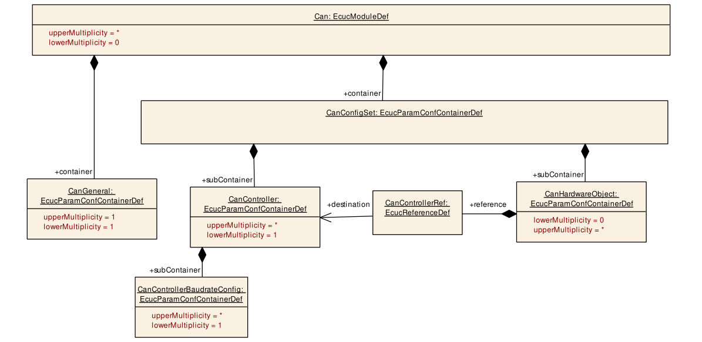

Figure 10-1：Can 模块配置结构

> 原文第 93 页

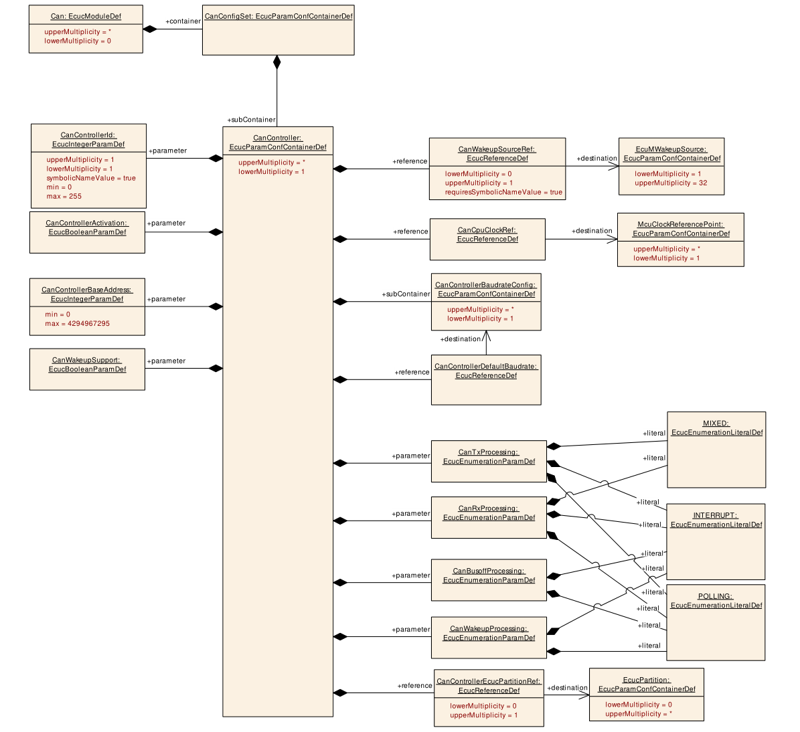

Figure 10-2：Can Controller 配置结构

> 原文第 94 页

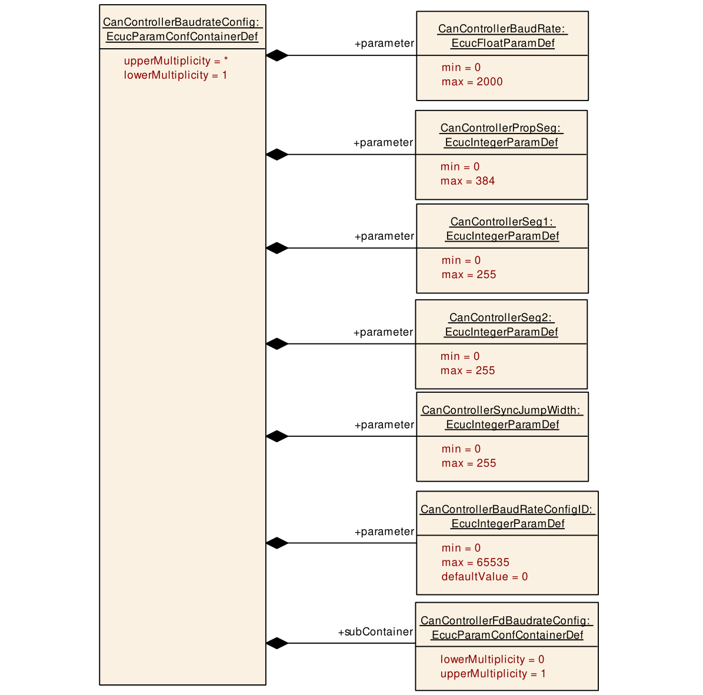

Figure 10-3：Can Controller Baudrate 配置结构

> 原文第 95 页

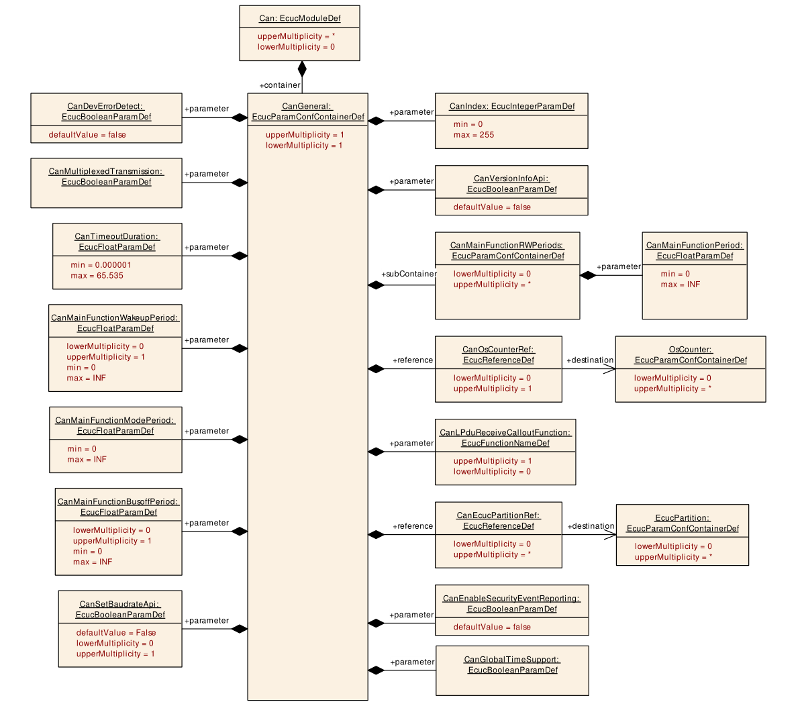

Figure 10-4：Can General 配置结构

> 原文第 96 页

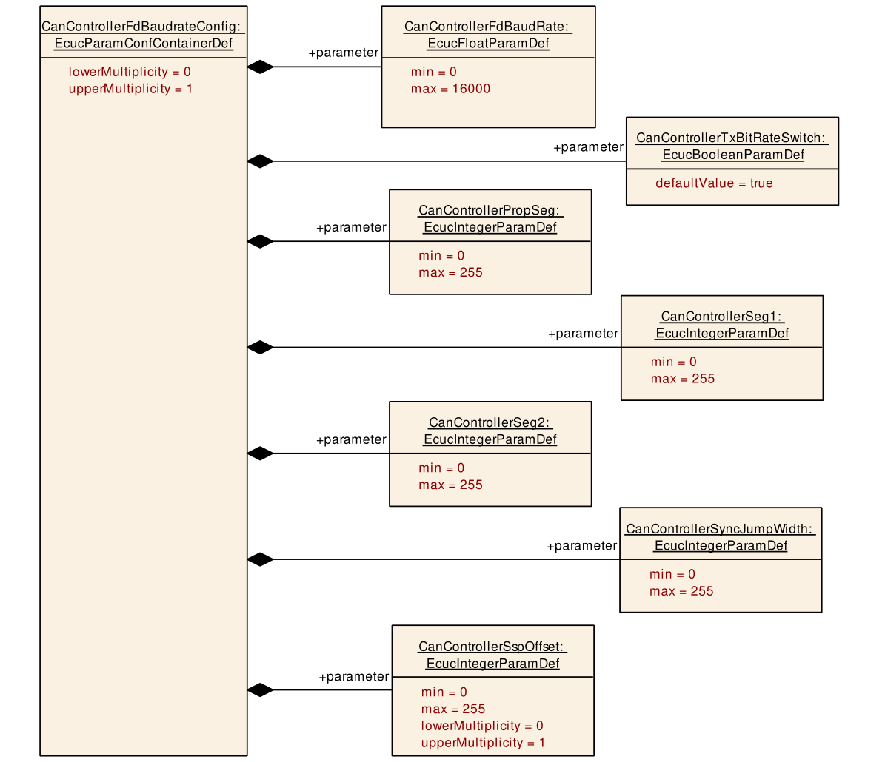

Figure 10-5: CanControllerFdBaudrateConfig

> 原文第 97 页

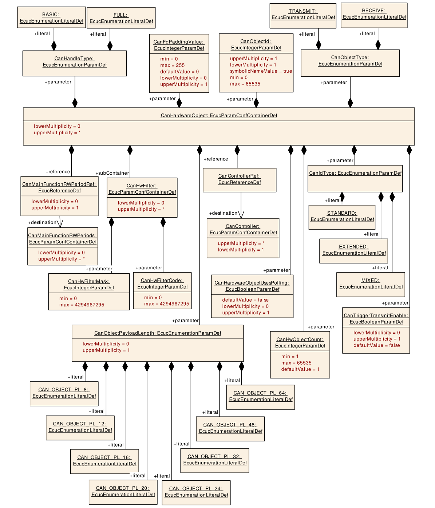

Figure 10-6：Can Hardware Object 配置结构

> 原文第 98 页

#### 10.2.1 Can

| 字段 | 内容 |
| --- | --- |
| SWS 条目 | [ECUC_Can_00489] |
| 模块名称 | Can |
| 说明 | 此 container 保存单个 CAN Driver 的配置。 |
| 是否支持 Post-Build Variant | true |
| 支持的 Config Variant | VARIANT-POST-BUILD, VARIANT-PRE-COMPILE |

| Container 名称 | Multiplicity | 作用域 / 依赖关系 |
| --- | --- | --- |
| CanConfigSet | 1 | 此 container 包含 AUTOSAR Can 模块的配置参数及子 container。 |
| CanGeneral | 1 | 此 container 包含各 CAN Driver Unit 的相关参数。 |

#### 10.2.2 CanGeneral

| 字段 | 内容 |
| --- | --- |
| SWS 条目 | [ECUC_Can_00497] |
| Container 名称 | CanGeneral |
| 父 Container | Can |
| 说明 | 此 container 包含各 CAN Driver Unit 的相关参数。 |
| 配置参数 |  |

*下表跨原文第 98、99 页，已接续合并。*

| 字段 | 内容 |
| --- | --- |
| SWS 条目 | [ECUC_Can_00064] |
| 参数名称 | CanDevErrorDetect |
| 父 Container | CanGeneral |
| 说明 | 开启或关闭 development error detection 和 notification。 • true：启用检测和通知。 • false：禁用检测和通知。 |
| Multiplicity | 1 |
| 类型 | EcucBooleanParamDef |
| 默认值 | false |
| Post-Build Variant Value | false |
| Value Configuration Class | Pre-compile time · X · 全部 Variant Link time · -- Post-build time · -- |
| 作用域 / 依赖关系 | 作用域：local。 |

> 原文第 99 页

| 字段 | 内容 |
| --- | --- |
| SWS 条目 | [ECUC_Can_00496] |
| 参数名称 | CanEnableSecurityEventReporting |
| 父 Container | CanGeneral |
| 说明 | 控制是否向 IdsM 上报 security event。 • true：启用上报。 • false：禁用上报。 Tags：atp.Status=draft。 |
| Multiplicity | 1 |
| 类型 | EcucBooleanParamDef |
| 默认值 | false |
| Post-Build Variant Value | false |
| Value Configuration Class | Pre-compile time · X · 全部 Variant Link time · -- Post-build time · -- |
| 作用域 / 依赖关系 | 作用域：ECU。 |

*下表跨原文第 99、100 页，已接续合并。*

| 字段 | 内容 |
| --- | --- |
| SWS 条目 | [ECUC_Can_00498] |
| 参数名称 | CanGlobalTimeSupport |
| 父 Container | CanGeneral |
| 说明 | 启用/禁用 CAN controller 支持 hardware timestamping 时使用的 Global Time API。 Tags：atp.Status=draft。 |
| Multiplicity | 1 |
| 类型 | EcucBooleanParamDef |
| 默认值 | -- |
| Post-Build Variant Value | false |
| Value Configuration Class | Pre-compile time · X · 全部 Variant Link time · -- Post-build time · -- |
| 作用域 / 依赖关系 | 作用域：local。 |

> 原文第 100 页

| 字段 | 内容 |
| --- | --- |
| SWS 条目 | [ECUC_Can_00320] |
| 参数名称 | CanIndex |
| 父 Container | CanGeneral |
| 说明 | 指定此模块实例的 InstanceId。若只有一个实例，其 Id 应为 0。 |
| Multiplicity | 1 |
| 类型 | EcucIntegerParamDef |
| 取值范围 | 0 .. 255 |
| 默认值 | -- |
| Post-Build Variant Value | false |
| Value Configuration Class | Pre-compile time · X · 全部 Variant Link time · -- Post-build time · -- |
| 作用域 / 依赖关系 | 作用域：ECU。 |

*下表跨原文第 100、101 页，已接续合并。*

| 字段 | 内容 |
| --- | --- |
| SWS 条目 | [ECUC_Can_00434] |
| 参数名称 | CanLPduReceiveCalloutFunction |
| 父 Container | CanGeneral |
| 说明 | 定义是否存在 callout 及其名称；该 callout 在成功接收 CAN Rx L-PDU 后调用。若省略此参数，则不应调用 callout。 |
| Multiplicity | 0..1 |
| 类型 | EcucFunctionNameDef |
| 默认值 | -- |
| 正则表达式 | -- |
| Post-Build Variant Multiplicity | false |
| Post-Build Variant Value | false |
| Multiplicity Configuration Class | Pre-compile time · X · 全部 Variant Link time · -- Post-build time · -- |
| Value Configuration Class | Pre-compile time · X · 全部 Variant Link time · -- Post-build time · -- |
| 作用域 / 依赖关系 | 作用域：local。 |

> 原文第 101 页

*下表跨原文第 101、102 页，已接续合并。*

| 字段 | 内容 |
| --- | --- |
| SWS 条目 | [ECUC_Can_00355] |
| 参数名称 | CanMainFunctionBusoffPeriod |
| 父 Container | CanGeneral |
| 说明 | 描述周期调用 Can_MainFunction_Busoff 的周期，单位为秒。 |
| Multiplicity | 0..1 |
| 类型 | EcucFloatParamDef |
| 取值范围 | ]0 .. INF[ |
| 默认值 | -- |
| Post-Build Variant Multiplicity | false |
| Post-Build Variant Value | false |
| Multiplicity Configuration Class | Pre-compile time · X · 全部 Variant Link time · -- Post-build time · -- |
| Value Configuration Class | Pre-compile time · X · 全部 Variant Link time · -- Post-build time · -- |
| 作用域 / 依赖关系 |  |

> 原文第 102 页

| 字段 | 内容 |
| --- | --- |
| SWS 条目 | [ECUC_Can_00376] |
| 参数名称 | CanMainFunctionModePeriod |
| 父 Container | CanGeneral |
| 说明 | 描述周期调用 Can_MainFunction_Mode 的周期，单位为秒。 |
| Multiplicity | 1 |
| 类型 | EcucFloatParamDef |
| 取值范围 | ]0 .. INF[ |
| 默认值 | -- |
| Post-Build Variant Value | false |
| Value Configuration Class | Pre-compile time · X · 全部 Variant Link time · -- Post-build time · -- |
| 作用域 / 依赖关系 |  |

*下表跨原文第 102、103 页，已接续合并。*

| 字段 | 内容 |
| --- | --- |
| SWS 条目 | [ECUC_Can_00357] |
| 参数名称 | CanMainFunctionWakeupPeriod |
| 父 Container | CanGeneral |
| 说明 | 描述周期调用 Can_MainFunction_Wakeup 的周期，单位为秒。 |
| Multiplicity | 0..1 |
| 类型 | EcucFloatParamDef |
| 取值范围 | ]0 .. INF[ |
| 默认值 | -- |
| Post-Build Variant Multiplicity | false |
| Post-Build Variant Value | false |
| Multiplicity Configuration Class | Pre-compile time · X · 全部 Variant Link time · -- Post-build time · -- |
| Value Configuration Class | Pre-compile time · X · 全部 Variant Link time · -- Post-build time · -- |
| 作用域 / 依赖关系 |  |

> 原文第 103 页

| 字段 | 内容 |
| --- | --- |
| SWS 条目 | [ECUC_Can_00095] |
| 参数名称 | CanMultiplexedTransmission |
| 父 Container | CanGeneral |
| 说明 | 指定是否支持 multiplexed transmission：ON 或 OFF。 |
| Multiplicity | 1 |
| 类型 | EcucBooleanParamDef |
| 默认值 | -- |
| Post-Build Variant Value | false |
| Value Configuration Class | Pre-compile time · X · 全部 Variant Link time · -- Post-build time · -- |
| 作用域 / 依赖关系 | 作用域：ECU。依赖：CAN Hardware Unit 支持 multiplexed transmission。 |

*下表跨原文第 103、104 页，已接续合并。*

| 字段 | 内容 |
| --- | --- |
| SWS 条目 | [ECUC_Can_00482] |
| 参数名称 | CanSetBaudrateApi |
| 父 Container | CanGeneral |
| 说明 | Can_SetBaudrate API 的支持是可选的。若此参数为 true，应支持该 API；否则不支持。 |
| Multiplicity | 0..1 |
| 类型 | EcucBooleanParamDef |
| 默认值 | false |
| Post-Build Variant Multiplicity | false |
| Post-Build Variant Value | false |
| Multiplicity Configuration Class | Pre-compile time · X · 全部 Variant Link time · -- Post-build time · -- |
| Value Configuration Class | Pre-compile time · X · 全部 Variant Link time · -- Post-build time · -- |
| 作用域 / 依赖关系 | 作用域：ECU。 |

> 原文第 104 页

| 字段 | 内容 |
| --- | --- |
| SWS 条目 | [ECUC_Can_00113] |
| 参数名称 | CanTimeoutDuration |
| 父 Container | CanGeneral |
| 说明 | 指定阻塞函数在检测到 timeout 前允许等待的最长时间，单位为秒。 |
| Multiplicity | 1 |
| 类型 | EcucFloatParamDef |
| 取值范围 | [1E-6 .. 65.535] |
| 默认值 | -- |
| Post-Build Variant Value | false |
| Value Configuration Class | Pre-compile time · X · 全部 Variant Link time · -- Post-build time · -- |
| 作用域 / 依赖关系 | 作用域：local。 |

*下表跨原文第 104、105 页，已接续合并。*

| 字段 | 内容 |
| --- | --- |
| SWS 条目 | [ECUC_Can_00106] |
| 参数名称 | CanVersionInfoApi |
| 父 Container | CanGeneral |
| 说明 | 将 Can_GetVersionInfo() API 设置为 ON 或 OFF。 |
| Multiplicity | 1 |
| 类型 | EcucBooleanParamDef |
| 默认值 | false |
| Post-Build Variant Value | false |
| Value Configuration Class | Pre-compile time · X · 全部 Variant Link time · -- Post-build time · -- |
| 作用域 / 依赖关系 | 作用域：local。 |

> 原文第 105 页

| 字段 | 内容 |
| --- | --- |
| SWS 条目 | [ECUC_Can_00491] |
| 参数名称 | CanEcucPartitionRef |
| 父 Container | CanGeneral |
| 说明 | 将 CAN driver 映射到零个或多个 ECUC partition，使模块 API 在相应 partition 中可用。CAN driver 在每个 partition 中作为独立实例运行。 |
| Multiplicity | 0..* |
| 类型 | 引用 EcucPartition。 |
| Post-Build Variant Multiplicity | true |
| Post-Build Variant Value | true |
| Multiplicity Configuration Class | Pre-compile time · X · 全部 Variant Link time · -- Post-build time · -- |
| Value Configuration Class | Pre-compile time · X · 全部 Variant Link time · -- Post-build time · -- |
| 作用域 / 依赖关系 | 作用域：ECU。 |

*下表跨原文第 105、106 页，已接续合并。*

| 字段 | 内容 |
| --- | --- |
| SWS 条目 | [ECUC_Can_00431] |
| 参数名称 | CanOsCounterRef |
| 父 Container | CanGeneral |
| 说明 | 引用 CAN driver 使用的 OsCounter。 |
| Multiplicity | 0..1 |
| 类型 | 引用 OsCounter。 |
| Post-Build Variant Multiplicity | false |
| Post-Build Variant Value | false |
| Multiplicity Configuration Class | Pre-compile time · X · 全部 Variant Link time · -- Post-build time · -- |
| Value Configuration Class | Pre-compile time · X · 全部 Variant Link time · -- Post-build time · -- |
| 作用域 / 依赖关系 | 作用域：local。 |

> 原文第 106 页

| 字段 | 内容 |
| --- | --- |
| SWS 条目 | [ECUC_Can_00430] |
| 参数名称 | CanSupportTTCANRef |
| 父 Container | CanGeneral |
| 说明 | 引用 CAN Interface 模块配置中的 CanIfSupportTTCAN 参数，该参数定义是否支持 TTCAN。 |
| Multiplicity | 1 |
| 类型 | 引用 CanIfPrivateCfg。 |
| Post-Build Variant Value | false |
| Value Configuration Class | Pre-compile time · X · 全部 Variant Link time · -- Post-build time · -- |
| 作用域 / 依赖关系 | 作用域：ECU。 |

*下表跨原文第 106、107 页，已接续合并。*

| Container 名称 | Multiplicity | 作用域 / 依赖关系 |
| --- | --- | --- |
| CanMainFunctionRWPeriods | 0..* | 此 container 包含周期配置参数；根据引用方，配置 Can_MainFunction_Read 或 Can_MainFunction_Write 的周期调用间隔。 |
| CanXLGeneral | 0..1 | 此 container 由 SWS CAN XL Driver 规定，包含 CAN XL Driver 的全局参数。 |

> 原文第 107 页

[SWS_Can_CONSTR_00508] ⌈ 模块将在每个 partition 内作为独立实例运行，即被调用 API 只作用于调用发生的 partition。⌋ ()

#### 10.2.3 CanController

| 字段 | 内容 |
| --- | --- |
| SWS 条目 | [ECUC_Can_00354] |
| Container 名称 | CanController |
| 父 Container | CanConfigSet |
| 说明 | 此 container 包含 CAN controller 的配置参数。 |
| Post-Build Variant Multiplicity | false |
| Multiplicity Configuration Class | Pre-compile time · X · 全部 Variant Link time · -- Post-build time · -- |
| 配置参数 |  |

*下表跨原文第 107、108 页，已接续合并。*

| 字段 | 内容 |
| --- | --- |
| SWS 条目 | [ECUC_Can_00314] |
| 参数名称 | CanBusoffProcessing |
| 父 Container | CanController |
| 说明 | 启用/禁用 Can_MainFunction_BusOff() API，用于在 polling mode 下处理 bus-off event。 |
| Multiplicity | 1 |
| 类型 | EcucEnumerationParamDef |
| 取值范围 | INTERRUPT · 以 Interrupt Mode 运行。 POLLING · 以 Polling Mode 运行。 |
| Post-Build Variant Value | false |
| Value Configuration Class | Pre-compile time · X · 全部 Variant Link time · -- Post-build time · -- |
| 作用域 / 依赖关系 | 作用域：local。 |

> 原文第 108 页

| 字段 | 内容 |
| --- | --- |
| SWS 条目 | [ECUC_Can_00315] |
| 参数名称 | CanControllerActivation |
| 父 Container | CanController |
| 说明 | 定义配置中是否使用某个 CAN controller。 |
| Multiplicity | 1 |
| 类型 | EcucBooleanParamDef |
| 默认值 | -- |
| Post-Build Variant Value | false |
| Value Configuration Class | Pre-compile time · X · 全部 Variant Link time · -- Post-build time · -- |
| 作用域 / 依赖关系 | 作用域：local。 |

*下表跨原文第 108、109 页，已接续合并。*

| 字段 | 内容 |
| --- | --- |
| SWS 条目 | [ECUC_Can_00382] |
| 参数名称 | CanControllerBaseAddress |
| 父 Container | CanController |
| 说明 | 指定 CAN controller 的 base address。 |
| Multiplicity | 1 |
| 类型 | EcucIntegerParamDef |
| 取值范围 | 0 .. 4294967295 |
| 默认值 | -- |
| Post-Build Variant Value | false |
| Value Configuration Class | Pre-compile time · X · 全部 Variant Link time · -- Post-build time · -- |
| 作用域 / 依赖关系 | 作用域：local。 |

> 原文第 109 页

| 字段 | 内容 |
| --- | --- |
| SWS 条目 | [ECUC_Can_00316] |
| 参数名称 | CanControllerId |
| 父 Container | CanController |
| 说明 | 提供在给定 CAN Driver 内唯一的 Controller ID。参数值从 0 开始，连续编号，不得有间隙。 |
| Multiplicity | 1 |
| 类型 | EcucIntegerParamDef（为此参数生成 Symbolic Name）。 |
| 取值范围 | 0 .. 255 |
| 默认值 | -- |
| Post-Build Variant Value | false |
| Value Configuration Class | Pre-compile time · X · 全部 Variant Link time · -- Post-build time · -- |
| 作用域 / 依赖关系 | 作用域：ECU。 |

*下表跨原文第 109、110 页，已接续合并。*

| 字段 | 内容 |
| --- | --- |
| SWS 条目 | [ECUC_Can_00317] |
| 参数名称 | CanRxProcessing |
| 父 Container | CanController |
| 说明 | 启用/禁用 Can_MainFunction_Read() API，用于在 polling mode 下处理 PDU reception event。 |
| Multiplicity | 1 |
| 类型 | EcucEnumerationParamDef |
| 取值范围 | INTERRUPT · 以 Interrupt Mode 运行。 MIXED · 以 Mixed Mode 运行。 POLLING · 以 Polling Mode 运行。 |
| Post-Build Variant Value | false |
| Value Configuration Class | Pre-compile time · X · 全部 Variant Link time · -- Post-build time · -- |
| 作用域 / 依赖关系 | 作用域：local。 |

> 原文第 110 页

| 字段 | 内容 |
| --- | --- |
| SWS 条目 | [ECUC_Can_00318] |
| 参数名称 | CanTxProcessing |
| 父 Container | CanController |
| 说明 | 启用/禁用 Can_MainFunction_Write() API，用于在 polling mode 下处理 PDU transmission event。 |
| Multiplicity | 1 |
| 类型 | EcucEnumerationParamDef |
| 取值范围 | INTERRUPT · 以 Interrupt Mode 运行。 MIXED · 以 Mixed Mode 运行。 POLLING · 以 Polling Mode 运行。 |
| Post-Build Variant Value | false |
| Value Configuration Class | Pre-compile time · X · 全部 Variant Link time · -- Post-build time · -- |
| 作用域 / 依赖关系 | 作用域：local。 |

*下表跨原文第 110、111 页，已接续合并。*

| 字段 | 内容 |
| --- | --- |
| SWS 条目 | [ECUC_Can_00319] |
| 参数名称 | CanWakeupProcessing |
| 父 Container | CanController |
| 说明 | 启用/禁用 Can_MainFunction_Wakeup() API，用于在 polling mode 下处理 wakeup event。 |
| Multiplicity | 1 |
| 类型 | EcucEnumerationParamDef |
| 取值范围 | INTERRUPT · 以 Interrupt Mode 运行。 POLLING · 以 Polling Mode 运行。 |
| Post-Build Variant Value | false |
| Value Configuration Class | Pre-compile time · X · 全部 Variant Link time · -- Post-build time · -- |
| 作用域 / 依赖关系 | 作用域：local。 |

> 原文第 111 页

| 字段 | 内容 |
| --- | --- |
| SWS 条目 | [ECUC_Can_00330] |
| 参数名称 | CanWakeupSupport |
| 父 Container | CanController |
| 说明 | CAN driver 是否支持通过 CAN Bus 唤醒。 |
| Multiplicity | 1 |
| 类型 | EcucBooleanParamDef |
| 默认值 | -- |
| Post-Build Variant Value | false |
| Value Configuration Class | Pre-compile time · X · 全部 Variant Link time · -- Post-build time · -- |
| 作用域 / 依赖关系 |  |

*下表跨原文第 111、112 页，已接续合并。*

| 字段 | 内容 |
| --- | --- |
| SWS 条目 | [ECUC_Can_00435] |
| 参数名称 | CanControllerDefaultBaudrate |
| 父 Container | CanController |
| 说明 | 引用为此 Can Controller 配置的 baudrate configuration container。 |
| Multiplicity | 1 |
| 类型 | 引用 CanControllerBaudrateConfig。 |
| Post-Build Variant Value | true |
| Value Configuration Class | Pre-compile time · X · VARIANT-PRE-COMPILE Link time · -- Post-build time · X · VARIANT-POST-BUILD |
| 作用域 / 依赖关系 | 作用域：local。 |

> 原文第 112 页

| 字段 | 内容 |
| --- | --- |
| SWS 条目 | [ECUC_Can_00492] |
| 参数名称 | CanControllerEcucPartitionRef |
| 父 Container | CanController |
| 说明 | 将 CAN controller 映射到零个或一个 ECUC partition。所引用 partition 必须属于 CAN driver 已映射的 ECUC partition 集合。 |
| Multiplicity | 0..1 |
| 类型 | 引用 EcucPartition。 |
| Post-Build Variant Multiplicity | true |
| Post-Build Variant Value | true |
| Multiplicity Configuration Class | Pre-compile time · X · 全部 Variant Link time · -- Post-build time · -- |
| Value Configuration Class | Pre-compile time · X · 全部 Variant Link time · -- Post-build time · -- |
| 作用域 / 依赖关系 | 作用域：ECU。 |

*下表跨原文第 112、113 页，已接续合并。*

| 字段 | 内容 |
| --- | --- |
| SWS 条目 | [ECUC_Can_00313] |
| 参数名称 | CanCpuClockRef |
| 父 Container | CanController |
| 说明 | 引用 MCU driver 配置中设置的 CPU clock configuration。 |
| Multiplicity | 1 |
| 类型 | 引用 McuClockReferencePoint。 |
| Post-Build Variant Value | false |
| Value Configuration Class | Pre-compile time · X · 全部 Variant Link time · -- Post-build time · -- |
| 作用域 / 依赖关系 | 作用域：local。 |

> 原文第 113 页

| 字段 | 内容 |
| --- | --- |
| SWS 条目 | [ECUC_Can_00359] |
| 参数名称 | CanWakeupSourceRef |
| 父 Container | CanController |
| 说明 | 引用 ECU State Manager 中为此 Controller 定义的 Wakeup Source。Implementation Type：对 EcuM_WakeupSourceType 的引用。 |
| Multiplicity | 0..1 |
| 类型 | 通过 Symbolic Name 引用 EcuMWakeupSource。 |
| Post-Build Variant Multiplicity | false |
| Post-Build Variant Value | false |
| Multiplicity Configuration Class | Pre-compile time · X · 全部 Variant Link time · -- Post-build time · -- |
| Value Configuration Class | Pre-compile time · X · 全部 Variant Link time · -- Post-build time · -- |
| 作用域 / 依赖关系 | 作用域：local。 |

*下表跨原文第 113、114 页，已接续合并。*

| Container 名称 | Multiplicity | 作用域 / 依赖关系 |
| --- | --- | --- |
| CanControllerBaudrateConfig | 1..* | 此 container 包含 CAN controller 的 bit timing 相关配置参数。 |
| CanTTController | 0..1 | CanTTController 由 SWS TTCAN 规定，包含 TTCAN controller 在 CAN controller 配置之外所需的附加配置参数。只有 Controller 支持 TTCAN、已启用 TTCAN（见 CanSupportTTCANRef、ECUC_Can_00430），且实际使用 TTCAN 时，才包含此 container，且该 container 才有效。 |
| CanXLController | 0..1 | 此 container 由 SWS CAN XL Driver 规定，表示一个 CAN XL channel。存在该 container 时，CAN driver 提供扩展的 CanXL API。 |

> 原文第 114 页

[SWS_Can_CONSTR_00509] ⌈ CanControllerEcucPartitionRef 引用的 ECUC partition，应为 CanEcucPartitionRef 所引用 partition 集合的子集。⌋ ()

[SWS_Can_CONSTR_00510] ⌈ 同一 communication channel 的 CanController 和 CanTrcvChannel，应全部引用同一个 ECUC partition。⌋ ()

[SWS_Can_CONSTR_00511] ⌈ 若 CanEcucPartitionRef 引用了一个或多个 ECUC partition，则 CanControllerEcucPartitionRef 的 multiplicity 应为 1，并引用其中一个 partition。⌋ ()

#### 10.2.4 CanControllerBaudrateConfig

| 字段 | 内容 |
| --- | --- |
| SWS 条目 | [ECUC_Can_00387] |
| Container 名称 | CanControllerBaudrateConfig |
| 父 Container | CanController |
| 说明 | 此 container 包含 CAN controller 的 bit timing 相关配置参数。 |
| Post-Build Variant Multiplicity | true |
| Multiplicity Configuration Class | Pre-compile time · X · VARIANT-PRE-COMPILE Link time · -- Post-build time · X · VARIANT-POST-BUILD |
| 配置参数 |  |

*下表跨原文第 114、115 页，已接续合并。*

| 字段 | 内容 |
| --- | --- |
| SWS 条目 | [ECUC_Can_00005] |
| 参数名称 | CanControllerBaudRate |
| 父 Container | CanControllerBaudrateConfig |
| 说明 | 指定 Controller 的 baudrate，单位为 kbps。 |
| Multiplicity | 1 |
| 类型 | EcucFloatParamDef |
| 取值范围 | [0 .. 2000] |
| 默认值 | -- |
| Post-Build Variant Value | true |
| Value Configuration Class | Pre-compile time · X · VARIANT-PRE-COMPILE Link time · -- Post-build time · X · VARIANT-POST-BUILD |
| 作用域 / 依赖关系 | 作用域：local。 |

> 原文第 115 页

| 字段 | 内容 |
| --- | --- |
| SWS 条目 | [ECUC_Can_00471] |
| 参数名称 | CanControllerBaudRateConfigID |
| 父 Container | CanControllerBaudrateConfig |
| 说明 | SetBaudrate API 使用该 ID，在某个 Controller configuration 内唯一标识一组 baudrate configuration。 |
| Multiplicity | 1 |
| 类型 | EcucIntegerParamDef |
| 取值范围 | 0 .. 65535 |
| 默认值 | 0 |
| Post-Build Variant Value | true |
| Value Configuration Class | Pre-compile time · X · VARIANT-PRE-COMPILE Link time · -- Post-build time · X · VARIANT-POST-BUILD |
| 作用域 / 依赖关系 | 作用域：ECU。依赖：CanSetBaudrateApi。 |

*下表跨原文第 115、116 页，已接续合并。*

| 字段 | 内容 |
| --- | --- |
| SWS 条目 | [ECUC_Can_00073] |
| 参数名称 | CanControllerPropSeg |
| 父 Container | CanControllerBaudrateConfig |
| 说明 | 以 time quantum 为单位指定 propagation delay。 |
| Multiplicity | 1 |
| 类型 | EcucIntegerParamDef |
| 取值范围 | 0 .. 384 |
| 默认值 | -- |
| Post-Build Variant Value | true |
| Value Configuration Class | Pre-compile time · X · VARIANT-PRE-COMPILE Link time · -- Post-build time · X · VARIANT-POST-BUILD |
| 作用域 / 依赖关系 | 作用域：local。 |

> 原文第 116 页

| 字段 | 内容 |
| --- | --- |
| SWS 条目 | [ECUC_Can_00074] |
| 参数名称 | CanControllerSeg1 |
| 父 Container | CanControllerBaudrateConfig |
| 说明 | 以 time quantum 为单位指定 phase segment 1。 |
| Multiplicity | 1 |
| 类型 | EcucIntegerParamDef |
| 取值范围 | 0 .. 255 |
| 默认值 | -- |
| Post-Build Variant Value | true |
| Value Configuration Class | Pre-compile time · X · VARIANT-PRE-COMPILE Link time · -- Post-build time · X · VARIANT-POST-BUILD |
| 作用域 / 依赖关系 | 作用域：local。 |

*下表跨原文第 116、117 页，已接续合并。*

| 字段 | 内容 |
| --- | --- |
| SWS 条目 | [ECUC_Can_00075] |
| 参数名称 | CanControllerSeg2 |
| 父 Container | CanControllerBaudrateConfig |
| 说明 | 以 time quantum 为单位指定 phase segment 2。 |
| Multiplicity | 1 |
| 类型 | EcucIntegerParamDef |
| 取值范围 | 0 .. 255 |
| 默认值 | -- |
| Post-Build Variant Value | true |
| Value Configuration Class | Pre-compile time · X · VARIANT-PRE-COMPILE Link time · -- Post-build time · X · VARIANT-POST-BUILD |
| 作用域 / 依赖关系 | 作用域：local。 |

> 原文第 117 页

| 字段 | 内容 |
| --- | --- |
| SWS 条目 | [ECUC_Can_00383] |
| 参数名称 | CanControllerSyncJumpWidth |
| 父 Container | CanControllerBaudrateConfig |
| 说明 | 以 time quantum 为单位指定 Controller 的 synchronization jump width。 |
| Multiplicity | 1 |
| 类型 | EcucIntegerParamDef |
| 取值范围 | 0 .. 255 |
| 默认值 | -- |
| Post-Build Variant Value | true |
| Value Configuration Class | Pre-compile time · X · VARIANT-PRE-COMPILE Link time · -- Post-build time · X · VARIANT-POST-BUILD |
| 作用域 / 依赖关系 | 作用域：local。 |

| Container 名称 | Multiplicity | 作用域 / 依赖关系 |
| --- | --- | --- |
| CanControllerFdBaudrateConfig | 0..1 | 此可选 container 包含 CAN controller 用于 CAN FD frame 的 payload 和 CRC 阶段的 bit timing 配置参数。存在此 container 即表示 Controller 支持 CAN FD frame。 |
| CanXLBaudrateConfig | 0..1 | 此 container 由 SWS CAN XL Driver 规定，包含 CAN controller 用于 CAN XL frame 的 payload 和 CRC 阶段的 bit timing 配置参数。 |

> 原文第 118 页

#### 10.2.5 CanControllerFdBaudrateConfig

| 字段 | 内容 |
| --- | --- |
| SWS 条目 | [ECUC_Can_00473] |
| Container 名称 | CanControllerFdBaudrateConfig |
| 父 Container | CanControllerBaudrateConfig |
| 说明 | 此可选 container 包含 CAN controller 用于 CAN FD frame 的 payload 和 CRC 阶段的 bit timing 配置参数。存在此 container 即表示 Controller 支持 CAN FD frame。 |
| 配置参数 |  |

| 字段 | 内容 |
| --- | --- |
| SWS 条目 | [ECUC_Can_00481] |
| 参数名称 | CanControllerFdBaudRate |
| 父 Container | CanControllerFdBaudrateConfig |
| 说明 | 指定 Controller 的 data segment baudrate，单位为 kbps。 |
| Multiplicity | 1 |
| 类型 | EcucFloatParamDef |
| 取值范围 | [0 .. 16000] |
| 默认值 | -- |
| Post-Build Variant Value | true |
| Value Configuration Class | Pre-compile time · X · VARIANT-PRE-COMPILE Link time · -- Post-build time · X · VARIANT-POST-BUILD |
| 作用域 / 依赖关系 | 作用域：local。 |

*下表跨原文第 118、119 页，已接续合并。*

| 字段 | 内容 |
| --- | --- |
| SWS 条目 | [ECUC_Can_00476] |
| 参数名称 | CanControllerPropSeg |
| 父 Container | CanControllerFdBaudrateConfig |
| 说明 | 以 time quantum 为单位指定 propagation delay。 |
| Multiplicity | 1 |
| 类型 | EcucIntegerParamDef |
| 取值范围 | 0 .. 255 |
| 默认值 | -- |
| Post-Build Variant Value | true |
| Value Configuration Class | Pre-compile time · X · VARIANT-PRE-COMPILE Link time · -- Post-build time · X · VARIANT-POST-BUILD |
| 作用域 / 依赖关系 | 作用域：local。 |

> 原文第 119 页

| 字段 | 内容 |
| --- | --- |
| SWS 条目 | [ECUC_Can_00477] |
| 参数名称 | CanControllerSeg1 |
| 父 Container | CanControllerFdBaudrateConfig |
| 说明 | 以 time quantum 为单位指定 phase segment 1。 |
| Multiplicity | 1 |
| 类型 | EcucIntegerParamDef |
| 取值范围 | 0 .. 255 |
| 默认值 | -- |
| Post-Build Variant Value | true |
| Value Configuration Class | Pre-compile time · X · VARIANT-PRE-COMPILE Link time · -- Post-build time · X · VARIANT-POST-BUILD |
| 作用域 / 依赖关系 | 作用域：local。 |

*下表跨原文第 119、120 页，已接续合并。*

| 字段 | 内容 |
| --- | --- |
| SWS 条目 | [ECUC_Can_00478] |
| 参数名称 | CanControllerSeg2 |
| 父 Container | CanControllerFdBaudrateConfig |
| 说明 | 以 time quantum 为单位指定 phase segment 2。 |
| Multiplicity | 1 |
| 类型 | EcucIntegerParamDef |
| 取值范围 | 0 .. 255 |
| 默认值 | -- |
| Post-Build Variant Value | true |
| Value Configuration Class | Pre-compile time · X · VARIANT-PRE-COMPILE Link time · -- Post-build time · X · VARIANT-POST-BUILD |
| 作用域 / 依赖关系 | 作用域：local。 |

> 原文第 120 页

*下表跨原文第 120、121 页，已接续合并。*

| 字段 | 内容 |
| --- | --- |
| SWS 条目 | [ECUC_Can_00494] |
| 参数名称 | CanControllerSspOffset |
| 父 Container | CanControllerFdBaudrateConfig |
| 说明 | 以 minimum time quantum 为单位指定 Transmitter Delay Compensation Offset，见 [17]。此 Offset 用于相对于接收 bit 的起点，调整 Secondary Sample Point（SSP）的位置。若配置此参数，则 CAN controller 通过测量完成 Transmitter Delay Compensation；若未指定，则禁用该功能。  注：MTQ = 以秒计的 Minimum Time Quantum = 1 / CAN controller clock frequency。 以秒计的 Secondary Sample Point Offset = CanControllerSspOffset × MTQ。  示例： CAN controller clock frequency = 20 MHz ⇒ MTQ = (1/20) × 10^(-6) s = 0.05 µs = 50 ns。 Baudrate = 1 Mbit/s ⇒ BitTime = 1/(1 × 10^6) s/bit = 1 µs/bit。 SSP = 75% ⇒ SSP = 0.75 × 1 µs = 750 ns。 以 MTQ 计的 CanControllerSspOffset = 750 ns / 50 ns = 15。  注：请考虑 [17] 指定的最小范围 0..63，以及 [19] 使用的范围定义 0..127。 |
| Multiplicity | 0..1 |
| 类型 | EcucIntegerParamDef |
| 取值范围 | 0 .. 255 |
| 默认值 | -- |
| Post-Build Variant Multiplicity | true |
| Post-Build Variant Value | true |
| Multiplicity Configuration Class | Pre-compile time · X · VARIANT-PRE-COMPILE Link time · -- Post-build time · X · VARIANT-POST-BUILD |
| 值 Configuration Class | Pre-compile time · X · VARIANT-PRE-COMPILE Link time · -- Post-build time · X · VARIANT-POST-BUILD |
| 作用域 / 依赖关系 | 作用域：local。 |

> 原文第 121 页

| 字段 | 内容 |
| --- | --- |
| SWS 条目 | [ECUC_Can_00479] |
| 参数名称 | CanControllerSyncJumpWidth |
| 父 Container | CanControllerFdBaudrateConfig |
| 说明 | 以 time quantum 为单位指定 Controller 的 synchronization jump width。 |
| Multiplicity | 1 |
| 类型 | EcucIntegerParamDef |
| 取值范围 | 0 .. 255 |
| 默认值 | -- |
| Post-Build Variant Value | true |
| Value Configuration Class | Pre-compile time · X · VARIANT-PRE-COMPILE Link time · -- Post-build time · X · VARIANT-POST-BUILD |
| 作用域 / 依赖关系 | 作用域：local。 |

*下表跨原文第 121、122 页，已接续合并。*

| 字段 | 内容 |
| --- | --- |
| SWS 条目 | [ECUC_Can_00475] |
| 参数名称 | CanControllerTxBitRateSwitch |
| 父 Container | CanControllerFdBaudrateConfig |
| 说明 | 指定发送时是否使用 bit rate switching。若为 FALSE，CAN FD frame 应在不切换 bit rate 的情况下发送。 |
| Multiplicity | 1 |
| 类型 | EcucBooleanParamDef |
| 默认值 | true |
| Post-Build Variant Value | true |
| Value Configuration Class | Pre-compile time · X · VARIANT-PRE-COMPILE Link time · -- Post-build time · X · VARIANT-POST-BUILD |
| 作用域 / 依赖关系 | 作用域：local。 |

> 原文第 122 页

无包含的 Container

#### 10.2.6 CanHardwareObject

| 字段 | 内容 |
| --- | --- |
| SWS 条目 | [ECUC_Can_00324] |
| Container 名称 | CanHardwareObject |
| 父 Container | CanConfigSet |
| 说明 | 此 container 包含 CAN Hardware Object 的配置参数。 |
| Post-Build Variant Multiplicity | true |
| Multiplicity Configuration Class | Pre-compile time · X · VARIANT-PRE-COMPILE Link time · -- Post-build time · X · VARIANT-POST-BUILD |
| 配置参数 |  |

*下表跨原文第 122、123 页，已接续合并。*

| 字段 | 内容 |
| --- | --- |
| SWS 条目 | [ECUC_Can_00485] |
| 参数名称 | CanFdPaddingValue |
| 父 Container | CanHardwareObject |
| 说明 | 指定发送长度大于 8 byte 的 CAN FD frame 时，对未指定数据进行 padding 所使用的值。由于大于 8 byte 时 DLC 只有离散的可用取值，因此需要 padding。若请求发送的 PDU 长度不匹配允许的 DLC 值，应使用此值填充剩余 byte，直到达到下一个允许的长度。 |
| Multiplicity | 0..1 |
| 类型 | EcucIntegerParamDef |
| 取值范围 | 0 .. 255 |
| 默认值 | 0 |
| Post-Build Variant Multiplicity | true |
| Post-Build Variant Value | true |
| Multiplicity Configuration Class | Pre-compile time · X · VARIANT-PRE-COMPILE Link time · -- Post-build time · X · VARIANT-POST-BUILD |
| Value Configuration Class | Pre-compile time · X · VARIANT-PRE-COMPILE Link time · -- Post-build time · X · VARIANT-POST-BUILD |
| 作用域 / 依赖关系 | 作用域：ECU。 |

> 原文第 123 页

| 字段 | 内容 |
| --- | --- |
| SWS 条目 | [ECUC_Can_00323] |
| 参数名称 | CanHandleType |
| 父 Container | CanHardwareObject |
| 说明 | 指定 hardware object 的类型：Full-CAN 或 Basic-CAN。 |
| Multiplicity | 1 |
| 类型 | EcucEnumerationParamDef |
| 取值范围 | BASIC · hardware object 处理多个 L-PDU。 FULL · hardware object 仅处理一个 L-PDU（Identifier）。 |
| Post-Build Variant Value | true |
| Value Configuration Class | Pre-compile time · X · VARIANT-PRE-COMPILE Link time · -- Post-build time · X · VARIANT-POST-BUILD |
| 作用域 / 依赖关系 | 作用域：ECU。依赖：该配置元素只作为 CAN Interface 的信息。相关 CAN driver 配置通过 filter mask 和 Identifier 完成。 |

*下表跨原文第 123、124 页，已接续合并。*

| 字段 | 内容 |
| --- | --- |
| SWS 条目 | [ECUC_Can_00490] |
| 参数名称 | CanHardwareObjectUsesPolling |
| 父 Container | CanHardwareObject |
| 说明 | 启用此 hardware object 的 polling。 |
| Multiplicity | 0..1 |
| 类型 | EcucBooleanParamDef |
| 默认值 | false |
| 作用域 / 依赖关系 | 依赖：若 CanRxProcessing / CanTxProcessing 设置为 Mixed，此参数应存在。 |

> 原文第 124 页

| 字段 | 内容 |
| --- | --- |
| SWS 条目 | [ECUC_Can_00467] |
| 参数名称 | CanHwObjectCount |
| 父 Container | CanHardwareObject |
| 说明 | 实现一个 HOH 所使用的 hardware object 数量。对 HRH，表示 hardware FIFO 的元素数量或 shadow buffer 数量；对 HTH，表示用于 multiplexed transmission 的 hardware object 数量，或 FullCAN HTH 所用 hardware FIFO 的硬件对象数量。 |
| Multiplicity | 1 |
| 类型 | EcucIntegerParamDef |
| 取值范围 | 1 .. 65535 |
| 默认值 | 1 |
| Post-Build Variant Multiplicity | true |
| Post-Build Variant Value | true |
| Multiplicity Configuration Class | Pre-compile time · X · VARIANT-PRE-COMPILE Link time · -- Post-build time · X · VARIANT-POST-BUILD |
| Value Configuration Class | Pre-compile time · X · VARIANT-PRE-COMPILE Link time · -- Post-build time · X · VARIANT-POST-BUILD |
| 作用域 / 依赖关系 | 作用域：ECU。 |

> 原文第 125 页

| 字段 | 内容 |
| --- | --- |
| SWS 条目 | [ECUC_Can_00065] |
| 参数名称 | CanIdType |
| 父 Container | CanHardwareObject |
| 说明 | 指定 IdValue 使用 standard identifier、extended identifier 还是 mixed mode。ImplementationType：Can_IdType。 |
| Multiplicity | 1 |
| 类型 | EcucEnumerationParamDef |
| 取值范围 | EXTENDED · 全部 CAN ID 均仅为 Extended 类型，29 bit。 MIXED · CAN ID 可为 Standard 或 Extended 类型。 STANDARD · 全部 CAN ID 均仅为 Standard 类型，11 bit。 |
| Post-Build Variant Value | true |
| Value Configuration Class | Pre-compile time · X · VARIANT-PRE-COMPILE Link time · -- Post-build time · X · VARIANT-POST-BUILD |
| 作用域 / 依赖关系 | 作用域：ECU。 |

*下表跨原文第 125、126 页，已接续合并。*

| 字段 | 内容 |
| --- | --- |
| SWS 条目 | [ECUC_Can_00326] |
| 参数名称 | CanObjectId |
| 父 Container | CanHardwareObject |
| 说明 | 保存 HRH 或 HTH 的 handle ID。该值在给定 CAN Driver 内唯一，应从 0 开始连续编号，不留间隙。HRH 和 HTH 共用一个 ID 范围。示例：HRH0-0、HRH1-1、HTH0-2、HTH1-3。 |
| Multiplicity | 1 |
| 类型 | EcucIntegerParamDef（为此参数生成 Symbolic Name）。 |
| 取值范围 | 0 .. 65535 |
| 默认值 | -- |
| Post-Build Variant Value | false |
| Value Configuration Class | Pre-compile time · X · 全部 Variant Link time · -- Post-build time · -- |
| 作用域 / 依赖关系 | 作用域：ECU。 |

> 原文第 126 页

| 字段 | 内容 |
| --- | --- |
| SWS 条目 | [ECUC_Can_00495] |
| 参数名称 | CanObjectPayloadLength |
| 父 Container | CanHardwareObject |
| 说明 | 指定 hardware object 能存储的最大 L-PDU payload 长度，单位为 byte。若未提供，Can driver configuration generator 必须采用底层 CAN derivative 的最大长度，例如 CAN 为 8 byte，CAN FD 为 64 byte。 |
| Multiplicity | 0..1 |
| 类型 | EcucEnumerationParamDef |
| 取值范围 | CAN_OBJECT_PL_12 · Payload 长度为 12 byte。 CAN_OBJECT_PL_16 · Payload 长度为 16 byte。 CAN_OBJECT_PL_20 · Payload 长度为 20 byte。 CAN_OBJECT_PL_24 · Payload 长度为 24 byte。 CAN_OBJECT_PL_32 · Payload 长度为 32 byte。 CAN_OBJECT_PL_48 · Payload 长度为 48 byte。 CAN_OBJECT_PL_64 · Payload 长度为 64 byte。 CAN_OBJECT_PL_8 · Payload 长度为 8 byte。 |
| Post-Build Variant Value | true |
| Value Configuration Class | Pre-compile time · X · VARIANT-PRE-COMPILE Link time · -- Post-build time · X · VARIANT-POST-BUILD |
| 作用域 / 依赖关系 | 作用域：ECU。 |

*下表跨原文第 126、127 页，已接续合并。*

| 字段 | 内容 |
| --- | --- |
| SWS 条目 | [ECUC_Can_00327] |
| 参数名称 | CanObjectType |
| 父 Container | CanHardwareObject |
| 说明 | 指定 HardwareObject 用作 Transmit object 还是 Receive object。 |
| Multiplicity | 1 |
| 类型 | EcucEnumerationParamDef |
| 取值范围 | RECEIVE · 接收 HOH。 TRANSMIT · 发送 HOH。 |
| Post-Build Variant Value | true |
| Value Configuration Class | Pre-compile time · X · VARIANT-PRE-COMPILE Link time · -- Post-build time · X · VARIANT-POST-BUILD |
| 作用域 / 依赖关系 | 作用域：local。 |

> 原文第 127 页

| 字段 | 内容 |
| --- | --- |
| SWS 条目 | [ECUC_Can_00486] |
| 参数名称 | CanTriggerTransmitEnable |
| 父 Container | CanHardwareObject |
| 说明 | 定义 Can 是否为此 handle 支持 Trigger Transmit API。 |
| Multiplicity | 0..1 |
| 类型 | EcucBooleanParamDef |
| 默认值 | false |
| Value Configuration Class | Pre-compile time · X · 全部 Variant Link time · -- Post-build time · -- |
| 作用域 / 依赖关系 | 作用域：ECU。 |

*下表跨原文第 127、128 页，已接续合并。*

| 字段 | 内容 |
| --- | --- |
| SWS 条目 | [ECUC_Can_00322] |
| 参数名称 | CanControllerRef |
| 父 Container | CanHardwareObject |
| 说明 | 引用此 HOH 所关联的 CAN Controller。 |
| Multiplicity | 1 |
| 类型 | 引用 CanController。 |
| Post-Build Variant Value | true |
| Value Configuration Class | Pre-compile time · X · VARIANT-PRE-COMPILE Link time · -- Post-build time · X · VARIANT-POST-BUILD |
| 作用域 / 依赖关系 | 作用域：local。依赖：所引用 CanController 必须包含 CanXLController。 |

> 原文第 128 页

| 字段 | 内容 |
| --- | --- |
| SWS 条目 | [ECUC_Can_00438] |
| 参数名称 | CanMainFunctionRWPeriodRef |
| 父 Container | CanHardwareObject |
| 说明 | 引用 CanMainFunctionPeriod。配置此引用后，将对此 hardware object 进行 polling。 |
| Multiplicity | 0..1 |
| 类型 | 引用 CanMainFunctionRWPeriods。 |
| Post-Build Variant Multiplicity | true |
| Post-Build Variant Value | true |
| Multiplicity Configuration Class | Pre-compile time · X · VARIANT-PRE-COMPILE Link time · -- Post-build time · X · VARIANT-POST-BUILD |
| Value Configuration Class | Pre-compile time · X · VARIANT-PRE-COMPILE Link time · -- Post-build time · X · VARIANT-POST-BUILD |
| 作用域 / 依赖关系 | 作用域：local。 |

*下表跨原文第 128、129 页，已接续合并。*

| Container 名称 | Multiplicity | 作用域 / 依赖关系 |
| --- | --- | --- |
| CanHwFilter | 0..* | 此 container 仅对 HRH 有效，包含一个 hardware filter 的配置参数。 |
| CanTTHardwareObjectTrigger | 0..* | CanTTHardwareObjectTrigger 由 SWS TTCAN 规定，包含在 CAN Hardware Object 配置之外的、面向 Hardware Object 的 TTCAN trigger 配置参数。只有 Controller 支持 TTCAN、已启用 TTCAN（见 CanSupportTTCANRef、ECUC_Can_00430），且实际使用 TTCAN 时，才包含此 container，且该 container 才有效。 |

> 原文第 129 页

[SWS_Can_CONSTR_00512] ⌈ 若配置了可选参数 CanObjectPayloadLength，应使其足够容纳通过该 HOH 接收或发送的每个 PDU。因此，其值应不小于 EcuCPduCollection 中全部相关 PDU 的最大 PduLength。⌋ ()

注：对于已配置 CanObjectPayloadLength 的 A_HOH，以及它发送/接收的任意 PDU A_PDU_Of_A_HOH，必须满足：
`Can/CanConfigSet/A_HOH/CanObjectPayloadLength >= EcuC/EcuCPduCollection/A_PDU_Of_A_HOH/PduLength`。

#### 10.2.7 CanHwFilter

| 字段 | 内容 |
| --- | --- |
| SWS 条目 | [ECUC_Can_00468] |
| Container 名称 | CanHwFilter |
| 父 Container | CanHardwareObject |
| 说明 | 此 container 仅对 HRH 有效，包含一个 hardware filter 的配置参数。 |
| 配置参数 |  |

*下表跨原文第 129、130 页，已接续合并。*

| 字段 | 内容 |
| --- | --- |
| SWS 条目 | [ECUC_Can_00469] |
| 参数名称 | CanHwFilterCode |
| 父 Container | CanHwFilter |
| 说明 | 与 filter mask 共同指定能够通过 hardware filter 的 Identifier 范围。 |
| Multiplicity | 1 |
| 类型 | EcucIntegerParamDef |
| 取值范围 | 0 .. 4294967295 |
| 默认值 | -- |
| Post-Build Variant Value | true |
| Value Configuration Class | Pre-compile time · X · VARIANT-PRE-COMPILE Link time · -- Post-build time · X · VARIANT-POST-BUILD |
| 作用域 / 依赖关系 |  |

> 原文第 130 页

| 字段 | 内容 |
| --- | --- |
| SWS 条目 | [ECUC_Can_00470] |
| 参数名称 | CanHwFilterMask |
| 父 Container | CanHwFilter |
| 说明 | 描述 CAN Identifier 的 hardware-based filtering mask。对收到报文的 CAN Identifier 使用相应 CanFilterMask 进行掩码处理。值为 0 的 bit 表示 don't care，即不比较 Identifier 的对应 bit。mask 应以前导 0 填充构建。CanIdType 为 EXTENDED 或 MIXED 时，应构建 29-bit mask；为 STANDARD 时，应构建 11-bit mask。 |
| Multiplicity | 1 |
| 类型 | EcucIntegerParamDef |
| 取值范围 | 0 .. 4294967295 |
| 默认值 | -- |
| Post-Build Variant Value | true |
| Value Configuration Class | Pre-compile time · X · VARIANT-PRE-COMPILE Link time · -- Post-build time · X · VARIANT-POST-BUILD |
| 作用域 / 依赖关系 | 依赖：CanIf 配置必须知道 filter mask 设置，以优化 SW filter。 |

无包含的 Container

> 原文第 131 页

#### 10.2.8 CanConfigSet

| 字段 | 内容 |
| --- | --- |
| SWS 条目 | [ECUC_Can_00343] |
| Container 名称 | CanConfigSet |
| 父 Container | Can |
| 说明 | 此 container 包含 AUTOSAR Can 模块的配置参数及子 container。 |
| 配置参数 |  |

| Container 名称 | Multiplicity | 作用域 / 依赖关系 |
| --- | --- | --- |
| CanController | 1..* | 此 container 包含 CAN controller 的配置参数。 |
| CanHardwareObject | 0..* | 此 container 包含 CAN Hardware Object 的配置参数。 |
| CanXLHardwareObject | 0..* | 此 container 由 SWS CAN XL Driver 规定，包含 CAN XL Hardware Object 的配置参数。 |

#### 10.2.9 CanMainFunctionRWPeriods

| 字段 | 内容 |
| --- | --- |
| SWS 条目 | [ECUC_Can_00437] |
| Container 名称 | CanMainFunctionRWPeriods |
| 父 Container | CanGeneral |
| 说明 | 此 container 包含周期配置参数；根据引用方，配置 Can_MainFunction_Read 或 Can_MainFunction_Write 的周期调用间隔。 |
| Post-Build Variant Multiplicity | false |
| Multiplicity Configuration Class | Pre-compile time · X · 全部 Variant Link time · -- Post-build time · -- |

> 原文第 132 页

配置参数

| 字段 | 内容 |
| --- | --- |
| SWS 条目 | [ECUC_Can_00484] |
| 参数名称 | CanMainFunctionPeriod |
| 父 Container | CanMainFunctionRWPeriods |
| 说明 | 根据引用方，描述周期调用 Can_MainFunction_Read 或 Can_MainFunction_Write 的周期，单位为秒。若配置多个 CanMainFunctionPeriod，则可配置不同 poll cycle，此时 CAN Driver 模块将提供多个 Can_MainFunction_Read() 或 Can_MainFunction_Write()。 |
| Multiplicity | 1 |
| 类型 | EcucFloatParamDef |
| 取值范围 | ]0 .. INF[ |
| 默认值 | -- |
| Post-Build Variant Value | false |
| Value Configuration Class | Pre-compile time · X · 全部 Variant Link time · -- Post-build time · -- |
| 作用域 / 依赖关系 | 作用域：local。 |

无包含的 Container

> 原文第 133 页

## 11 不适用的需求

[SWS_Can_NA_00999] ⌈ 以下需求不适用于本规范。⌋ (SRS_BSW_00170, SRS_BSW_00383, SRS_BSW_00395, SRS_BSW_00397, SRS_BSW_00398, SRS_BSW_00399, SRS_BSW_00400, SRS_BSW_00168, SRS_BSW_00423, SRS_BSW_00424, SRS_BSW_00425, SRS_BSW_00426, SRS_BSW_00427, SRS_BSW_00429, SRS_BSW_00433, SRS_BSW_00336, SRS_BSW_00422, SRS_BSW_00417, SRS_BSW_00409, SRS_BSW_00162, SRS_BSW_00415, SRS_BSW_00325, SRS_BSW_00342, SRS_BSW_00453, SRS_BSW_00413, SRS_BSW_00307, SRS_BSW_00447, SRS_BSW_00353, SRS_BSW_00439, SRS_BSW_00449, SRS_BSW_00378, SRS_BSW_00359, SRS_BSW_00440, SRS_SPAL_12163, SRS_SPAL_12462, SRS_SPAL_12068, SRS_SPAL_12064, SRS_Can_01125, SRS_Can_01126)

---

## 译者核对说明（不属于 AUTOSAR 原文）

- 本译文只依据所提供的 R22-11 文件，不将其他版本的要求合并进来。
- 原文第 20 页的 3.3 节以 [15] 引用 BSW General，但其文献表中通用规范列为 [16]；译文保留原引用编号。
- 原文第 42 页 [SWS_Can_00048] 在 sleep transition 描述中使用 `Can_SetControllerMode(CAN_CS_STOPPED)`；译文保留原文参数。
- 原文第 51 页出现 `Can_EnableCanInterrupts` / `Can_DisableCanInterrupts`，而第 8 章 API 名为 `Can_EnableControllerInterrupts` / `Can_DisableControllerInterrupts`；译文未静默替换前者。
- 原文第 52 页对 timestamp resolution 的表述为“at least 1 µs and at most 1 ns”；译文保留其数值与表述，具体实现应结合原文所引用 CiA 603 核对。
- 原文第 66 页 [SWS_Can_00500] 的返回值写作 `E_NO_OK`；译文保留该拼写，不擅自改为 `E_NOT_OK`。
- 原文第 77 页 [SWS_Can_00526] 在 `Can_EnableEgressTimeStamp` 章节中提到 `Can_Write`；译文保留原文函数名。
- 原文第 83 页 callout 原型中的 `CanDataLegth`、第 88 页的 `ErrorCounterTreshold` 等拼写按原文保留。PDF 排版造成的标识符内部换行空格、断字横线已合并，以便检索。
- 原文第 91 页提及 10.3 节，但本文件目录和正文未提供该节；译文不补写不存在的内容。
- 原文历史中的 Word 域交叉引用 `REF _Ref...` 按原样保留，并明确标注为原文交叉引用。
