# AUTOSAR CAN Interface 规范 · 中文译文

**AUTOSAR CP R22-11 · Document ID 12 · 原文 224 页**

> 本文为基于用户提供的原版 PDF 制作的非官方中文译文。保留专业术语、API、参数、类型、配置值、需求编号和原图中的英文。shall 译为“应”，shall not 译为“不得”，may 按许可语义译为“可”。译者说明与规范正文分开。

> Markdown 保留章节层级、表格内容、图片和原文页码；PDF 的固定分页和合并单元格以适合连续阅读的形式表达。目录由原文书签重建。

## 目录

- [1 引言与功能概述](#page-11)（原文第 11 页）
- [2 缩略语与术语](#page-14)（原文第 14 页）
- [3 相关文档](#page-16)（原文第 16 页）
  - [3.1 输入文档及相关标准与规范](#page-16)（原文第 16 页）
  - [3.2 相关规范](#page-17)（原文第 17 页）
- [4 约束与假设](#page-18)（原文第 18 页）
  - [4.1 限制](#page-18)（原文第 18 页）
  - [4.2 对汽车领域的适用性](#page-18)（原文第 18 页）
- [5 对其他模块的依赖](#page-19)（原文第 19 页）
  - [5.1 上层协议模块](#page-20)（原文第 20 页）
  - [5.2 初始化：Ecu State Manager](#page-20)（原文第 20 页）
  - [5.3 模式控制：CAN State Manager](#page-20)（原文第 20 页）
  - [5.4 下层：CAN Driver](#page-20)（原文第 20 页）
  - [5.5 下层：CAN Transceiver Driver](#page-21)（原文第 21 页）
  - [5.6 配置](#page-22)（原文第 22 页）
  - [5.7 文件结构](#page-23)（原文第 23 页）
    - [5.7.1 代码文件结构](#page-23)（原文第 23 页）
    - [5.7.2 头文件结构](#page-23)（原文第 23 页）
- [6 需求追溯](#page-24)（原文第 24 页）
- [7 功能规范](#page-31)（原文第 31 页）
  - [7.1 通用功能](#page-31)（原文第 31 页）
  - [7.2 Hardware object handle](#page-32)（原文第 32 页）
  - [7.3 静态 L-PDU](#page-34)（原文第 34 页）
  - [7.4 动态 L-PDU](#page-35)（原文第 35 页）
    - [7.4.1 动态 Transmit L-PDU](#page-36)（原文第 36 页）
    - [7.4.2 动态 Receive L-PDU](#page-37)（原文第 37 页）
  - [7.5 Physical channel 视角](#page-37)（原文第 37 页）
  - [7.6 CAN Hardware Unit](#page-39)（原文第 39 页）
  - [7.7 BasicCAN 与 FullCAN 接收](#page-40)（原文第 40 页）
  - [7.8 初始化](#page-42)（原文第 42 页）
  - [7.9 发送请求](#page-42)（原文第 42 页）
  - [7.10 发送数据流](#page-43)（原文第 43 页）
  - [7.11 发送缓冲](#page-44)（原文第 44 页）
    - [7.11.1 通用行为](#page-45)（原文第 45 页）
    - [7.11.2 Buffer 特性](#page-46)（原文第 46 页）
      - [7.11.2.1 在发送 L-PDU buffer 中存储 L-PDU](#page-46)（原文第 46 页）
      - [7.11.2.2 清理发送 L-PDU buffer](#page-48)（原文第 48 页）
      - [7.11.2.3 初始化发送 L-PDU buffer](#page-48)（原文第 48 页）
    - [7.11.3 发送 L-PDU buffer 的数据完整性](#page-48)（原文第 48 页）
  - [7.12 发送确认](#page-49)（原文第 49 页）
  - [7.13 接收数据流](#page-49)（原文第 49 页）
  - [7.14 接收通知](#page-51)（原文第 51 页）
  - [7.15 读取接收数据](#page-53)（原文第 53 页）
  - [7.16 读取 Tx/Rx 通知状态](#page-54)（原文第 54 页）
  - [7.17 数据完整性](#page-54)（原文第 54 页）
  - [7.18 CAN Controller 模式](#page-55)（原文第 55 页）
    - [7.18.1 通用功能](#page-55)（原文第 55 页）
    - [7.18.2 CAN Controller 运行模式](#page-56)（原文第 56 页）
    - [7.18.3 Controller 模式切换](#page-57)（原文第 57 页）
    - [7.18.4 Wakeup](#page-57)（原文第 57 页）
      - [7.18.4.1 Wakeup 检测](#page-58)（原文第 58 页）
      - [7.18.4.2 Wakeup validation](#page-58)（原文第 58 页）
  - [7.19 PDU channel 模式控制](#page-59)（原文第 59 页）
    - [7.19.1 PDU channel group](#page-59)（原文第 59 页）
    - [7.19.2 PDU channel mode](#page-60)（原文第 60 页）
      - [7.19.2.1 CANIF_OFFLINE](#page-61)（原文第 61 页）
      - [7.19.2.2 CANIF_ONLINE](#page-62)（原文第 62 页）
      - [7.19.2.3 CANIF_OFFLINE_ACTIVE](#page-63)（原文第 63 页）
  - [7.20 Software receive filter](#page-63)（原文第 63 页）
    - [7.20.1 Software filtering 概念](#page-64)（原文第 64 页）
    - [7.20.2 Software filter 算法](#page-66)（原文第 66 页）
  - [7.21 Data Length Check](#page-66)（原文第 66 页）
  - [7.22 面向上层的 L-SDU dispatcher](#page-67)（原文第 67 页）
  - [7.23 Polling mode](#page-67)（原文第 67 页）
  - [7.24 多个 CAN Driver 的支持](#page-67)（原文第 67 页）
    - [7.24.1 使用多个 CAN Driver 时的发送请求](#page-68)（原文第 68 页）
    - [7.24.2 使用多个 CAN Driver 时的通知机制](#page-69)（原文第 69 页）
  - [7.25 Partial Networking](#page-71)（原文第 71 页）
  - [7.26 CAN FD 支持](#page-72)（原文第 72 页）
  - [7.27 CAN XL 支持](#page-73)（原文第 73 页）
    - [7.27.1 CAN XL 属性的动态控制](#page-74)（原文第 74 页）
  - [7.28 Security Event](#page-74)（原文第 74 页）
  - [7.29 错误分类](#page-76)（原文第 76 页）
    - [7.29.1 Development Error](#page-76)（原文第 76 页）
    - [7.29.2 Runtime Error](#page-77)（原文第 77 页）
    - [7.29.3 Transient Fault](#page-77)（原文第 77 页）
    - [7.29.4 Production Error](#page-77)（原文第 77 页）
    - [7.29.5 Extended Production Error](#page-77)（原文第 77 页）
- [8 API 规范](#page-78)（原文第 78 页）
  - [8.1 导入的类型](#page-78)（原文第 78 页）
  - [8.2 类型定义](#page-78)（原文第 78 页）
    - [8.2.1 CanIf_ConfigType](#page-78)（原文第 78 页）
    - [8.2.2 CanIf_PduModeType](#page-79)（原文第 79 页）
    - [8.2.3 CanIf_NotifStatusType](#page-80)（原文第 80 页）
  - [8.3 函数定义](#page-80)（原文第 80 页）
    - [8.3.1 CanIf_Init](#page-80)（原文第 80 页）
    - [8.3.2 CanIf_DeInit](#page-81)（原文第 81 页）
    - [8.3.3 CanIf_SetControllerMode](#page-81)（原文第 81 页）
    - [8.3.4 CanIf_GetControllerMode](#page-82)（原文第 82 页）
    - [8.3.5 CanIf_GetControllerErrorState](#page-83)（原文第 83 页）
    - [8.3.6 CanIf_Transmit](#page-84)（原文第 84 页）
    - [8.3.7 CanIf_ReadRxPduData](#page-87)（原文第 87 页）
    - [8.3.8 CanIf_ReadTxNotifStatus](#page-88)（原文第 88 页）
    - [8.3.9 CanIf_ReadRxNotifStatus](#page-89)（原文第 89 页）
    - [8.3.10 CanIf_SetPduMode](#page-90)（原文第 90 页）
    - [8.3.11 CanIf_GetPduMode](#page-91)（原文第 91 页）
    - [8.3.12 CanIf_GetVersionInfo](#page-91)（原文第 91 页）
    - [8.3.13 CanIf_SetDynamicTxId](#page-92)（原文第 92 页）
    - [8.3.14 CanIf_SetTrcvMode](#page-93)（原文第 93 页）
    - [8.3.15 CanIf_GetTrcvMode](#page-94)（原文第 94 页）
    - [8.3.16 CanIf_GetTrcvWakeupReason](#page-95)（原文第 95 页）
    - [8.3.17 CanIf_SetTrcvWakeupMode](#page-97)（原文第 97 页）
    - [8.3.18 CanIf_CheckWakeup](#page-98)（原文第 98 页）
    - [8.3.19 CanIf_CheckValidation](#page-99)（原文第 99 页）
    - [8.3.20 CanIf_GetTxConfirmationState](#page-100)（原文第 100 页）
    - [8.3.21 CanIf_ClearTrcvWufFlag](#page-101)（原文第 101 页）
    - [8.3.22 CanIf_CheckTrcvWakeFlag](#page-101)（原文第 101 页）
    - [8.3.23 CanIf_SetBaudrate](#page-102)（原文第 102 页）
    - [8.3.24 CanIf_GetControllerRxErrorCounter](#page-103)（原文第 103 页）
    - [8.3.25 CanIf_GetControllerTxErrorCounter](#page-104)（原文第 104 页）
    - [8.3.26 CanIf_EnableBusMirroring](#page-104)（原文第 104 页）
    - [8.3.27 CanIf_GetCurrentTime](#page-105)（原文第 105 页）
    - [8.3.28 CanIf_EnableEgressTimeStamp](#page-106)（原文第 106 页）
    - [8.3.29 CanIf_GetEgressTimeStamp](#page-107)（原文第 107 页）
    - [8.3.30 CanIf_GetIngressTimeStamp](#page-107)（原文第 107 页）
  - [8.4 Callback notification](#page-108)（原文第 108 页）
    - [8.4.1 CanIf_TriggerTransmit](#page-108)（原文第 108 页）
    - [8.4.2 CanIf_TxConfirmation](#page-109)（原文第 109 页）
    - [8.4.3 CanIf_RxIndication](#page-110)（原文第 110 页）
    - [8.4.4 CanIf_XLRxIndication](#page-112)（原文第 112 页）
    - [8.4.5 CanIf_ControllerBusOff](#page-113)（原文第 113 页）
    - [8.4.6 CanIf_ConfirmPnAvailability](#page-114)（原文第 114 页）
    - [8.4.7 CanIf_ClearTrcvWufFlagIndication](#page-115)（原文第 115 页）
    - [8.4.8 CanIf_CheckTrcvWakeFlagIndication](#page-116)（原文第 116 页）
    - [8.4.9 CanIf_ControllerModeIndication](#page-117)（原文第 117 页）
    - [8.4.10 CanIf_TrcvModeIndication](#page-117)（原文第 117 页）
    - [8.4.11 CanIf_ControllerErrorStatePassive](#page-119)（原文第 119 页）
    - [8.4.12 CanIf_ErrorNotification](#page-119)（原文第 119 页）
  - [8.5 Scheduled Function](#page-120)（原文第 120 页）
  - [8.6 所需接口](#page-120)（原文第 120 页）
    - [8.6.1 必需接口](#page-120)（原文第 120 页）
    - [8.6.2 可选接口](#page-121)（原文第 121 页）
    - [8.6.3 可配置接口](#page-123)（原文第 123 页）
      - [8.6.3.1 &lt;User_TriggerTransmit&gt;](#page-124)（原文第 124 页）
      - [8.6.3.2 &lt;User_TxConfirmation&gt;](#page-125)（原文第 125 页）
      - [8.6.3.3 &lt;User_RxIndication&gt;](#page-127)（原文第 127 页）
      - [8.6.3.4 &lt;User_ValidateWakeupEvent&gt;](#page-128)（原文第 128 页）
      - [8.6.3.5 &lt;User_ControllerBusOff&gt;](#page-130)（原文第 130 页）
      - [8.6.3.6 &lt;User_ConfirmPnAvailability&gt;](#page-131)（原文第 131 页）
      - [8.6.3.7 &lt;User_ClearTrcvWufFlagIndication&gt;](#page-132)（原文第 132 页）
      - [8.6.3.8 &lt;User_CheckTrcvWakeFlagIndication&gt;](#page-133)（原文第 133 页）
      - [8.6.3.9 &lt;User_ControllerModeIndication&gt;](#page-134)（原文第 134 页）
      - [8.6.3.10 &lt;User_TrcvModeIndication&gt;](#page-135)（原文第 135 页）
- [9 Sequence Diagram](#page-138)（原文第 138 页）
  - [9.1 发送请求（单个 CAN Driver）](#page-138)（原文第 138 页）
  - [9.2 发送请求（多个 CAN Driver）](#page-139)（原文第 139 页）
  - [9.3 发送确认（Interrupt mode）](#page-141)（原文第 141 页）
  - [9.4 发送确认（Polling mode）](#page-142)（原文第 142 页）
  - [9.5 发送确认（启用缓冲）](#page-143)（原文第 143 页）
  - [9.6 Trigger Transmit Request](#page-144)（原文第 144 页）
  - [9.7 接收通知（Interrupt mode）](#page-146)（原文第 146 页）
  - [9.8 接收通知（Polling mode）](#page-148)（原文第 148 页）
  - [9.9 读取接收数据](#page-150)（原文第 150 页）
  - [9.10 启动 CAN network](#page-152)（原文第 152 页）
  - [9.11 BusOff notification](#page-154)（原文第 154 页）
  - [9.12 BusOff recovery](#page-155)（原文第 155 页）
- [10 配置规范](#page-157)（原文第 157 页）
  - [10.1 Container 与配置参数](#page-157)（原文第 157 页）
    - [10.1.1 CanIf](#page-158)（原文第 158 页）
    - [10.1.2 CanIfPrivateCfg](#page-160)（原文第 160 页）
    - [10.1.3 CanIfPublicCfg](#page-162)（原文第 162 页）
    - [10.1.4 CanIfInitCfg](#page-172)（原文第 172 页）
    - [10.1.5 CanIfTxPduCfg](#page-175)（原文第 175 页）
    - [10.1.6 CanIfTxPduXLParams](#page-183)（原文第 183 页）
    - [10.1.7 CanIfRxPduCfg](#page-185)（原文第 185 页）
    - [10.1.8 CanIfRxPduXLParams](#page-192)（原文第 192 页）
    - [10.1.9 CanIfRxPduCanIdRange](#page-194)（原文第 194 页）
    - [10.1.10 CanIfDispatchCfg](#page-195)（原文第 195 页）
    - [10.1.11 CanIfCtrlCfg](#page-204)（原文第 204 页）
    - [10.1.12 CanIfCtrlDrvCfg](#page-206)（原文第 206 页）
    - [10.1.13 CanIfTrcvDrvCfg](#page-207)（原文第 207 页）
    - [10.1.14 CanIfTrcvCfg](#page-208)（原文第 208 页）
    - [10.1.15 CanIfInitHohCfg](#page-210)（原文第 210 页）
    - [10.1.16 CanIfHthCfg](#page-211)（原文第 211 页）
    - [10.1.17 CanIfHrhCfg](#page-212)（原文第 212 页）
    - [10.1.18 CanIfHrhRangeCfg](#page-214)（原文第 214 页）
    - [10.1.19 CanIfBufferCfg](#page-217)（原文第 217 页）
    - [10.1.20 CanIfSecurityEventRefs](#page-219)（原文第 219 页）
  - [10.2 配置约束](#page-221)（原文第 221 页）
- [A 不适用的需求](#page-224)（原文第 224 页）

> 原文第 1 页

| 字段 | 内容 |
| --- | --- |
| 文档标题 | CAN Interface 规范 |
| 文档标题 / 文档所有者 | AUTOSAR |
| 文档责任方 | AUTOSAR |
| 文档编号 | 12 |

| 字段 | 内容 |
| --- | --- |
| 文档状态 | 已发布 |
| 所属 AUTOSAR 标准 | Classic Platform |
| 所属标准版本 | R22-11 |

| 文档修订记录 |  |  |  |
| --- | --- | --- | --- |
| 日期 | 版本 | 修改者 | 说明 |
| 2022-11-24 | R22-11 | AUTOSAR Release Management | • 支持 CAN XL。• 编辑性修改。 |
| 2021-11-25 | R21-11 | AUTOSAR Release Management | • 支持基于硬件的 timestamping。• 少量修正与澄清。• 编辑性修改。 |
| 2020-11-30 | R20-11 | AUTOSAR Release Management | • 引入 Security Events。• 重构错误分类章节。• 移除 Pretended Networking。• 少量修正与澄清。 |
| 2019-11-28 | R19-11 | AUTOSAR Release Management | • 更新对 ISO 11898-1:2015 的引用。• 少量修正。• 编辑性修改。• 文档状态由 Final 改为 published。 |
| 2018-10-31 | 4.4.0 | AUTOSAR Release Management | • BusMirroring（CONC_634）。• 按 PDU 配置接收数据长度检查。• 移除 Cancel Transmit API 的空实现。• 清理头文件。 |

> 原文第 2 页

| 2017-12-08 | 4.3.1 | AUTOSAR Release Management | • 引入 Runtime error。• 将 Can_ReturnType 替换为 Std_ReturnType 扩展。• 少量修正。• 编辑性修改。 |
| --- | --- | --- | --- |
| 2016-11-30 | 4.3.0 | AUTOSAR Release Management | • 移除 CCMSM。• 重构 MetaData 处理。• 可靠的 TxConfirmation。• Error Active/Passive State API。 |
| 2015-07-31 | 4.2.2 | AUTOSAR Release Management | • 澄清 wakeup、缓冲、发送与配置变体。• 移除已弃用的 API。• 编辑性修改。 |
| 2014-10-31 | 4.2.1 | AUTOSAR Release Management | • 完整支持 CAN FD。• Global Time Synchronization over CAN。• 移除 CanIf_CancelTxConfirmation。• 少量改进。 |
| 2014-03-31 | 4.1.3 | AUTOSAR Release Management | • 移除 BSW Exclusive Area。• 将 ICOM 支持设为可选。• Can_IdType 处理。• 少量改进。 |
| 2013-10-31 | 4.1.2 | AUTOSAR Release Management | • 限制 PDU mode 的切换。• 移除第 9 章中有关临界区处理的描述。• 将 CanIfInitRefCfgSet 标记为废弃。• 增加 Pretended Networking 章节。• 少量改进。 |
| 2013-03-15 | 4.1.1 | AUTOSAR Administration | • CAN FD（不含 DLC 扩展）。• Pretended Networking（ICOM）。• 支持 Heavy Duty Vehicle（J1939）。• 用于清晰唤醒流程的 PduMode 和 PnTxFilter。• PDU 与 HOH 的关系。• Post-build loadable 概念。 |
| 2011-12-22 | 4.0.3 | AUTOSAR Administration | • 支持 Partial Networking。• 改进发送缓冲。• 改进错误检测。 |

> 原文第 3 页

| 2009-12-18 | 4.0.1 | AUTOSAR Administration | • 更新“Version Checking”和“Published Information”章节。• 可选地将多个 CAN ID 分配给一个 I-PDU。• 可选地仅通过 NM PDU 进行 wakeup validation。• 用异步 mode indication callback 取代同步模式切换。• CC mode 改变时，不自动改变 PDU channel mode。• 为 BusOff Recovery 引入 TxConfirmation 状态。• WakeupSourceRefIn 和 WakeupSourceRefOut。• 用 PduInfoPtr 取代 SduDataPtr。• 引入 Can_GeneralTypes.h 和 Can_HwHandleType。• 将第 8 章的 Transceiver 类型移至 Transceiver SWS。 |
| --- | --- | --- | --- |
| 2010-02-02 | 3.1.4 | AUTOSAR Administration | • HOH 定义。• 抽象的 ControllerId 和 TransceiverId。• 不再通过 CanIf 和 CanIf_ControllerInit 修改 baudrate。• 为 CDD 调整 Dispatcher。• TxBuffering：每个 L-PDU 仅使用一个 buffer。• 根据环境行为调整 wakeup 机制（network → controller/transceiver；wakeupSource）。• 模式切换改为异步。• CanIf 不维护完整状态机，仅缓存每个 Controller 的状态。• 修订法律免责声明。 |
| 2008-08-13 | 3.1.1 | AUTOSAR Administration | 修订法律免责声明。 |
| 2008-02-01 | 3.0.2 | AUTOSAR Administration | • 将第 10 章替换为依据 AUTOSAR MetaModel 生成的表格。 |

> 原文第 4 页

| 2008-02-01 | 3.0.2 | AUTOSAR Administration | • 接口抽象：将面向 network 的接口改为面向 Controller。• 全面重构 wakeup 机制，新增和修改 Wakeup API。• 修改初始化方式（flat initialization）。• 因 BSW Scheduler 的职责变化，取消周期 main function。• 扩充文档元信息。• 少量版式调整。 |
| --- | --- | --- | --- |
| 2007-12-21 | 3.0.1 | AUTOSAR Administration | • 修改头文件结构。• 支持 mixed mode（同一 network 上并行使用 Standard CAN 与 Extended CAN）。• 删除 CAN Transceiver API &lt;User&gt;_DlcErrorNotification 的支持。• 部分修改配置参数的 Pre-compile / Link-Time / Post-Build 定义。• 允许部分 API 重入调用。• 支持 AUTOSAR BSW Scheduler。• 支持 memory mapping。• 重构配置 container。• 多项澄清、扩展及修正。 |
| 2006-05-16 | 2.0.0 | AUTOSAR Administration | 第二次发布 |
| 2005-05-31 | 1.0.0 | AUTOSAR Administration | 首次发布 |

> 原文第 5 页

Disclaimer

AUTOSAR 发布的本作品（规范和/或软件实现）及其中的资料仅供参考。AUTOSAR 及参与本作品编制的公司，对本作品的任何使用均不承担责任。

本作品所含资料受著作权及其他知识产权保护。对这些资料进行商业利用，需要获得相关知识产权许可。

本作品可在不作修改的情况下，以任何形式或方式使用或复制，但仅限参考用途。未经出版方书面许可，不得为其他目的以任何形式或方式使用或复制本作品的任何部分。

本作品仅针对汽车应用开发，未针对非汽车应用进行开发或测试。

AUTOSAR 字样及 AUTOSAR logo 均为注册商标。

> 原文第 11 页

## 1 引言与功能概述

本规范描述 AUTOSAR Basic Software 模块 CAN Interface 的功能、API 和配置。

如 Figure 1.1 所示，CAN Interface 位于底层 CAN 设备驱动（CAN Driver [1] 和 Transceiver Driver [2]）与上层通信服务（如 CAN State Manager [3]、CAN Network Management [4]、CAN Transport Protocol [5]、PDU Router [6]）之间，为上层通信模块提供访问 CAN Driver 服务的接口。

CAN Interface 提供统一接口，用于管理 ECU 硬件布局中不同类型的 CAN 设备，例如 CAN Controller 和 CAN Transceiver。因此，CAN State Manager 能以物理 CAN channel 为视角，控制多个底层内部或外部 CAN Controller / CAN Transceiver。

> 原文第 12 页

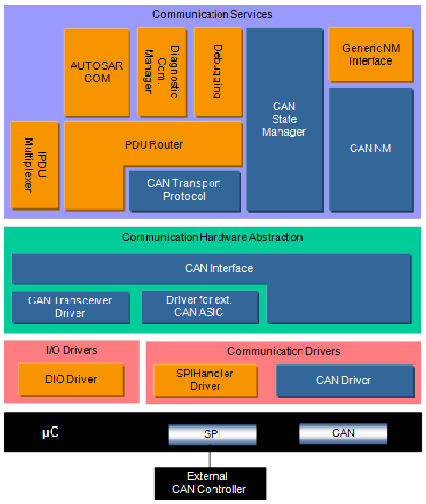

Figure 1.1：AUTOSAR CAN 分层模型（见 [7]）

CAN Interface 集中了对应 ECU 的 CAN 通信设备驱动中与具体 CAN 硬件无关的任务。这些功能在 CAN Interface 中统一实现，使底层 CAN 设备驱动只需专注于对应硬件的访问和控制。

CanIf 满足 AUTOSAR COM stack 中 PDU Router 及上层通信模块的主要控制流和数据流需求，包括处理 transmit request，提供 transmit confirmation、receive indication、error notification，以及启动/停止 CAN Controller，从而实现网络唤醒和参与网络通信。数据处理与通知 API 基于 CAN L-SDU；控制及模式管理 API 则以 CAN Controller 为对象。

处理 Transmit Request 时，CanIf 补齐 L-PDU 发送所需的参数，并经相应 CanDrv 将 CAN L-PDU 转交给

> 原文第 13 页

CAN Controller。接收时，CanIf 将收到的 L-PDU 以 L-SDU 的形式分发给上层。Receive L-SDU 与上层模块之间的对应关系通过静态配置确定。发送确认时，CanIf 负责将成功发送的结果通知上层。

CAN Interface 对 CAN 通信进行抽象，为 CAN network 的控制和监督提供对 CAN Driver、CAN Transceiver Driver 服务的访问。CAN Interface 向下将 CAN State Manager 的状态切换请求转发给 CAN 设备驱动，向上将 CAN Driver / CAN Transceiver Driver 的事件转发给相应的 NM 等模块。

> 原文第 14 页

## 2 缩略语与术语

以下术语表列出与 CAN Interface 相关、但未包含在 [8, AUTOSAR glossary] 中的缩略语和术语。

| 缩略语 | 说明 |
| --- | --- |
| CAN L-PDU | CAN Protocol Data Unit，由 identifier、Data Length 和数据（SDU）组成，对 CAN Driver 可见。 |
| CAN L-SDU | CAN Service Data Unit，即 CAN L-PDU 中承载的数据，对 CAN Interface 的上层模块（如 PDU Router）可见。 |
| CanDrv | CAN Driver 模块 |
| CAN FD | CAN with Flexible Data-Rate |
| CanId | CAN Identifier |
| CanIf | CAN Interface 模块 |
| CanNm | CAN Network Management 模块 |
| CanSm | CAN State Manager 模块 |
| CanTp | CAN Transport Layer 模块 |
| CanTrcv | CAN Transceiver Driver 模块 |
| CanTSyn | Global Time Synchronization over CAN |
| ComM | Communication Manager 模块 |
| DCM | Diagnostic Communication Manager 模块 |
| EcuM | ECU State Manager 模块 |
| HOH | CAN hardware object handle |
| HRH | CAN hardware receive handle |
| HTH | CAN hardware transmit handle |
| J1939Nm | J1939 Network Management 模块 |
| J1939Tp | J1939 Transport Layer 模块 |
| LLC | logical link control |
| PduR | PDU Router 模块 |
| PN | Partial Networking |
| SchM | Scheduler Module |
| SDT | SDU 类型 |
| SDU | service data unit |
| VCID | Virtual CAN network ID |
| XLFF | XL Frame Format |

| 缩略语 | 说明 |
| --- | --- |
| Buffer | 位于 RAM 固定地址、大小固定的存储区域，用于存放单个数据单元，例如 CAN ID、Data Length、SDU 等。 |
| CAN communication matrix | 描述完整的 CAN network：• 参与通信的节点。• 所有 CAN PDU 的定义（Identifier、Data Length）。• PDU 的源和接收方。 |
| CAN Controller | CAN Controller 是 CPU 片上或外部独立的硬件设备。一个 CAN Controller 连接一个 physical channel。 |
| CAN Device Driver | CAN Driver 和 CAN Transceiver Driver 的统称。 |

> 原文第 15 页

| CAN Hardware Unit | 一个 CAN Hardware Unit 可由一个或多个同类型 CAN Controller，以及一个、两个或多个 CAN RAM 区域组成。它可以位于芯片内部，也可以是外部设备。一个 CAN Hardware Unit 由一个 CAN Driver 表示。 |
| --- | --- |
| CanIf Controller mode state machine | 它并非可由发送请求驱动的真正状态机，而是相应 CAN Controller 当前抽象状态的映像。状态切换只能由 CanSm 等上层模块，或 BusOff 等外部事件触发。 |
| CanIf Receive L-PDU / CanIf Rx L-PDU | 方向设为“从下层到上层”的 L-PDU。 |
| CanIf Receive L-PDU buffer / CanIfRxBuffer | 位于 CAN Interface 中、用于存储完整接收 L-PDU 的单元素 RAM buffer。 |
| CanIf Transmit L-PDU / CanIf Tx L-PDU | 方向设为“从上层到下层”的 L-PDU。 |
| CanIf Transmit L-PDU buffer / CanIfTxBuffer | 位于 CanIf 中的单个 CanIfTxBuffer 元素，用于存储一个或多个 CanIf Tx L-PDU。若某个 CanIfTxBuffer 元素的 buffersize 为 0，则该元素仅用于引用一个 HTH。 |
| Hardware object / HW object | CAN hardware object 是 CAN Hardware Unit / CAN Controller 的 CAN RAM 内的一个 PDU buffer。 |
| Hardware Receive Handle（HRH） | Hardware Receive Handle（HRH）由 CAN Driver 定义并提供。每个 HRH 通常表示一个 hardware object。CAN Interface 使用 HRH 作为参数，例如用于 software filtering。 |
| Hardware Transmit Handle（HTH） | Hardware Transmit Handle（HTH）由 CAN Driver 定义并提供。每个 HTH 通常表示一个或多个 CAN hardware object，这些对象被配置成 CAN hardware transmit buffer pool。 |
| Inner priority inversion | 由于同一 transmit hardware object 中存在待发送的低优先级 L-PDU，高优先级 L-PDU 无法发送。 |
| Integration Code | Integrator 为适配非标准化功能而需要向 AUTOSAR 系统添加的代码，例如 ECU State Manager 的 callout 和其他 BSW 模块的 callback。I/O Hardware Abstraction 也称为 Integration Code。 |
| Lowest In - First Out / LOFO | 一种数据存储处理方式，总是优先取出数值最小的元素。 |
| L-PDU channel group | 仅属于同一底层 network 的一组 CAN L-PDU，通常由同一个上层模块处理。 |
| Outer priority inversion | 两个连续发送的 L-PDU 之间存在时间间隙时，其他节点的低优先级 L-PDU 可能阻止本节点的高优先级 L-PDU 发送。由于低优先级 L-PDU 已赢得仲裁，此时高优先级 L-PDU 无法参与总线访问仲裁。 |
| Physical channel | Physical channel 表示 CAN Controller 与 CAN network 之间的接口。同一 CAN Hardware Unit 的不同 physical channel 可以访问不同 network。 |
| Tx request | CanIf 上层模块向 CAN Interface 发出的发送请求。 |

> 原文第 16 页

## 3 相关文档

### 3.1 输入文档及相关标准与规范

References

[1] CAN Driver 规范

AUTOSAR_SWS_CANDriver

[2] CAN Transceiver Driver 规范

AUTOSAR_SWS_CANTransceiverDriver

[3] CAN State Manager 规范

AUTOSAR_SWS_CANStateManager

[4] CAN Network Management 规范

AUTOSAR_SWS_CANNetworkManagement

[5] CAN Transport Layer 规范

AUTOSAR_SWS_CANTransportLayer

[6] PDU Router 规范

AUTOSAR_SWS_PDURouter

[7] 分层软件架构

AUTOSAR_EXP_LayeredSoftwareArchitecture

[8] 术语表

AUTOSAR_TR_Glossary

[9] Basic Software 模块通用规范

AUTOSAR_SWS_BSWGeneral

[10] Basic Software 模块通用需求

AUTOSAR_SRS_BSWGeneral

[11] CAN 需求

AUTOSAR_SRS_CAN

[12] ISO 11898-1:2015 — 道路车辆 — Controller area network（CAN）

[13] ECU State Manager 规范

AUTOSAR_SWS_ECUStateManager

[14] CiA 610-1 version 1.0.0（DSP）— CAN XL 规范与测试计划 — 第 1 部分：

Data link layer 与 physical coding sub-layer 需求。http://www.can-cia.org

[15] CiA 611-1 version 1.0.0（DSP）— CAN XL 上层功能 — 第 1 部分：

service data unit 类型的定义。http://www.can-cia.org

> 原文第 17 页

[16] ECU Configuration 规范

AUTOSAR_TPS_ECUConfiguration

### 3.2 相关规范

AUTOSAR 提供的 Basic Software 模块通用规范 [9, SWS BSW General] 同样适用于 CAN Interface。

因此，SWS BSW General 应作为 CAN Interface 的补充规范，并且是必须遵循的规范。

> 原文第 18 页

## 4 约束与假设

### 4.1 限制

CAN Interface 仅用于 CAN 通信，专门面向一个或多个底层 CAN Driver 和 CAN Transceiver Driver。负责不同 CAN Hardware Unit 的多个 CAN Driver 模块，通过 CAN Driver 规范 [1] 定义的统一通用接口表示。同样，负责不同 CAN Transceiver 设备的多个 CAN Transceiver Driver 模块，通过 CAN Transceiver Driver 规范 [2] 定义的统一接口表示。不支持 LIN、FlexRay 等其他协议。

请注意，启用 PnTxFilter 可确保总线上的首批消息为 CanIfTxPduPnFilterPdu。若 CanIfTxPduPnFilterPdu 是 NM-PDU，则 COM stack 启动流程会在该 PDU 成功发送前保持 PduGroup 禁用。不过，其他 PDU（例如初始启动的 PDU、TP-PDU、XCP-PDU）的发送请求也会被拒绝，直到配置的 PDU 已发送。只有触发 network wakeup 的第一条 PDU 必须是 CanIfTxPduPnFilterPdu。若通信已在进行，且启用 PnTxFilter 时成功接收到 frame，则应禁用 PnTxFilter；此时已有活动节点提供 Ack，不再需要该过滤器。

### 4.2 对汽车领域的适用性

只要使用 CAN 协议，CAN Interface 就可用于所有汽车应用域。

> 原文第 19 页

## 5 对其他模块的依赖

本节说明 CAN Interface 与 AUTOSAR Basic Software 架构中其他模块的关系，简述它所需的外部配置信息和服务（见 Figure 5.1）。

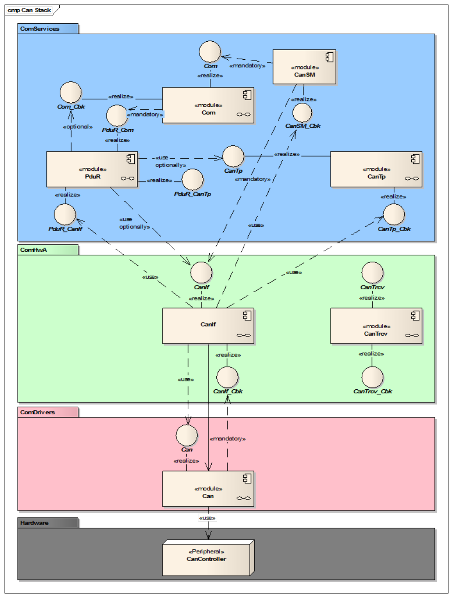

Figure 5.1：CANIF 在 AUTOSAR BSW 中的依赖关系

> 原文第 20 页

### 5.1 上层协议模块

在 AUTOSAR BSW 架构中，CAN Interface（CanIf）的上层包括 PDU Router（PduR）、CAN Network Management（CanNm）、CAN Transport Layer（CanTp）、CAN State Manager（CanSm）、ECU State Manager（EcuM）、Complex Driver（CDD）、Universal Calibration Protocol（XCP）、Global Time Synchronization over CAN（CanTSyn）、J1939 Transport Layer（J1939Tp）以及 J1939 Network Management（J1939Nm）。

AUTOSAR BSW 架构规定，应用数据 buffer 位于其所属上层模块中，禁止直接访问这些 buffer。发送和接收过程中，CanIf 向 CAN Driver（CanDrv）传递 buffer 地址，或从其接收地址；这些地址在相应发送/接收通知服务执行期间传递。每次访问 buffer 时使用锁定机制保证数据完整性，见 7.17“数据完整性”。

CanIf 使用的 API 包括 notification service，作为向目标上层传递 CAN 相关数据（如 Data Length）的基本手段。这些服务的调用参数指向 CanDrv 内缓存的信息，或直接引用 CAN hardware。

此外，CanIf 支持面向 Bus Mirroring 模块的 callout，用于报告已接收和已发送 frame 的内容。

### 5.2 初始化：Ecu State Manager

EcuM 负责初始化 CanIf（参见 [3, Specification of ECU State Manager]）。

### 5.3 模式控制：CAN State Manager

CanSm 负责管理所有受支持 CAN Controller 和 CAN Transceiver 的模式控制。

### 5.4 下层：CAN Driver

主要的底层 CAN 设备驱动是 CanDrv（见 [1, Specification of CAN Driver]）。由于 CanIf 在 AUTOSAR Basic Software 架构中的位置，它与 CanDrv 密切相关。

CanDrv 仅提供对 CAN Controller 的硬件抽象访问，运行模式的控制由 CanSm 负责。

> 原文第 21 页

CanDrv 检测并处理 CAN Controller 事件，再将事件通知 CanIf。

CanIf 将 CanSm 的运行模式请求传递给相应的底层 CAN Controller。

CanDrv 提供标准化表示的 L-PDU，以保证 CanIf 与硬件无关。指向该 L-PDU 的指针可指向临时 buffer（例如用于数据标准化），或指向依赖 CAN 硬件的 CanDrv 存储区域。CanIf 无需感知 L-PDU buffer 的具体形式。

CanIf 为 CanDrv 的各种通知场景提供服务，例如 transmit confirmation（CanIf_TxConfirmation()）、receive indication（CAN 2.0/FD 使用 CanIf_RxIndication()，CAN XL 使用 CanIf_XLRxIndication()）以及 Controller 模式变化通知 CanIf_ControllerModeIndication()。

若使用多个对应不同 interrupt vector 的 CanDrv，上述 callback service 必须可重入，见 7.24“多个 CAN Driver 的支持”。callback function 的可重入性规定见 8.4。

CanDrv 调用的 callback service 在 CanIf 内声明并实现；CanIf 调用的 callback service 则在相应的上层通信服务模块（如 PduR、CanNm、CanTp）中声明和实现。CanIf 的文件结构见 5.7。

配置的 CAN Controller 数量不一定等于 CAN Transceiver 数量。若多个不同类型的 CAN Controller 工作在同一 CAN network 上，一个 CAN Transceiver 及其 CanTrcv 即可满足需要；而根据 Controller 的类型，可能需要一个或两个不同的 CanDrv（见 7.5“Physical channel 视角”）。

### 5.5 下层：CAN Transceiver Driver

另一类底层 CAN 设备驱动是 CanTrcv（见 [2, Specification of CAN Transceiver Driver]）。

每个 CanTrcv 自行控制对应 CAN Transceiver 的运行模式。CanIf 仅将多个底层 CanTrcv 的 API 映射为统一接口，使 CanSm 可以请求对应 Transceiver 切换模式。属于 CanTrcv 的控制或处理功能不在 CanIf 中实现。

CanIf 将各底层 CanTrcv 的下列服务映射为统一接口，详细规定见 CAN Transceiver Driver SWS [2]：

• 统一的 CanTrcv 模式请求和读取服务，用于管理各底层 CAN Transceiver 的运行模式。

> 原文第 22 页

• 读取 CAN Transceiver wakeup reason 的服务。

• 为各 CAN Transceiver 启用、禁用或清除 wakeup event 状态的模式请求服务（CanIf_SetTrcvMode()，见 [SWS_CANIF_00287]）。

### 5.6 配置

CanIf 的设计针对 CAN 协议特性及底层 CAN Controller 的管理进行了优化。

CanIf 支持在不重新构建软件的情况下更换 CAN 配置。因此，CanIf_Init()（见 [SWS_CANIF_00001]）从第 10 章规定的 configuration container 和 parameter 中取得所需 CAN 配置信息，包括引用关系及附加参数，见 Figure 10.1。

本节汇总需要获取的信息，例如：

• CAN Controller 数量。用于分发发送与接收 L-PDU，以及控制可用 CAN Driver 的状态（见 CanIfCtrlDrvCfg）。

• Hardware Object Handle 数量。为管理发送请求，CAN Interface 需要知道 HTH 的数量及每个 HTH 对应的 CAN Controller（见 CanIfHthCanCtrlIdRef、CanIfHthIdSymRef）。

• 每个 hardware object 经 hardware acceptance filter 放行的接收 CAN ID 范围。CAN Interface 利用 HRH 与对应 hardware object 所接收 L-PDU 之间的固定映射执行查找算法（见 7.20“Software receive filter”，以及 CanIfHrhSoftwareFilter、CanIfHrhCanCtrlIdRef、CanIfHrhIdSymRef）。

CanIf 需要了解所有使用的上层通信服务及待分发 L-SDU。将 CanIf 集成到 AUTOSAR COM stack 时，应在配置阶段确定以下信息：

• 每个发送 L-SDU 对应的发送上层模块与 transmit I-PDU，用于分发 transmit confirmation（见 CanIfTxPduId）。

• 每个接收 L-SDU 对应的接收上层模块与 receive I-PDU，用于 receive indication 期间的 L-SDU 分发（见 CanIfRxPduId）。

CanIf 需要了解本 ECU 及其连接一个或多个 CAN network 的 Controller。以下信息因此取自 AUTOSAR system configuration 中的 CAN communication matrix（见 CanIfTxPduCfg、CanIfRxPduCfg）：

> 原文第 23 页

• 本 ECU 每个 physical channel 接收的所有 L-PDU，用于软件过滤及接收 L-SDU 分发。

• 本 ECU 每个 physical channel 应发送的所有 L-SDU，用于发送请求及 Transmit L-PDU 分发。

• 这些 L-PDU 的属性（ID、Data Length），用于软件过滤、receive indication 和 Data Length Check。

• 每个发送 L-SDU 的发送模块（如 PduR、CanNm、CanTp），用于 transmit confirmation。

• 每个接收 L-SDU 的接收模块（如 PduR、CanNm、CanTp），用于 L-PDU 分发。

• L-PDU / L-SDU 的符号名称，用于表示 Rx/Tx 数据 buffer 地址。

### 5.7 文件结构

#### 5.7.1 代码文件结构

[SWS_CANIF_00378] ⌈ 对于 link-time 配置，CanIf 应通过为每个 CanDrv 提供的一组函数指针，访问所有底层 CanDrv 的 API。⌋ ()

每个 CanDrv 的函数指针值在 link time 确定。

#### 5.7.2 头文件结构

[SWS_CANIF_00672] ⌈ CanIf.h 仅包含 CanIf 规范中定义的常量、全局数据和服务的 extern 声明。⌋ ()

仅供 CanIf 内部使用的常量、全局数据类型和函数在 CanIf.c 中声明。

[SWS_CANIF_00903] ⌈ 若启用 Bus Mirroring（见 CanIfBusMirroringSupport），CanIf 应包含 Mirror.h。⌋ (SRS_Can_01172)

> 原文第 24 页

## 6 需求追溯

下表引用 [10] 和 [11] 中的需求，并关联满足这些需求的规范条款。若某项需求的“Satisfied by”列为空，表示本文档未满足该需求。

| 需求 | 说明 | 由以下条款满足 |
| --- | --- | --- |
| [RS_Ids_00810] | Basic SW security event。 | [SWS_CANIF_00913] [SWS_CANIF_00915] [SWS_CANIF_00916] [SWS_CANIF_00917] [SWS_CANIF_00918] [SWS_CANIF_00919] [SWS_CANIF_00920] [SWS_CANIF_00921] [SWS_CANIF_91008] [SWS_CANIF_91009] [SWS_CANIF_91010] |
| [SRS_BSW_00007] | 所有使用 C 语言编写的 Basic SW Module 均应符合 MISRA C 2012 标准。 | [SWS_CANIF_NA_00999] |
| [SRS_BSW_00010] | 所有 Basic Software 模块都应针对各受支持平台，在指定配置下记录其内存占用。 | [SWS_CANIF_NA_00999] |
| [SRS_BSW_00101] | Basic Software Module 应能够在独立的初始化函数中初始化变量和硬件。 | [SWS_CANIF_00001] |
| [SRS_BSW_00159] | 所有 AUTOSAR Basic Software Module 均应支持基于工具的配置。 | [SWS_CANIF_NA_00999] |
| [SRS_BSW_00164] | ISR 应由 Operating System、Complex Driver 或模块实现。 | [SWS_CANIF_NA_00999] |
| [SRS_BSW_00167] | 所有 AUTOSAR Basic Software Module 均应提供配置规则与约束，以便进行合理性检查。 | [SWS_CANIF_NA_00999] |
| [SRS_BSW_00168] | SW component 应通过 Basic SW 通用 API 中定义的函数进行测试。 | [SWS_CANIF_NA_00999] |
| [SRS_BSW_00170] | AUTOSAR SW Component 应提供其对故障、信号质量和 driver demand 的依赖信息。 | [SWS_CANIF_NA_00999] |
| [SRS_BSW_00172] | Basic Software 模块内部采用的调度策略应与系统调度策略兼容。 | [SWS_CANIF_NA_00999] |

> 原文第 25 页

| [SRS_BSW_00306] | AUTOSAR Basic Software Module 应独立于 compiler 和 platform。 | [SWS_CANIF_NA_00999] |
| --- | --- | --- |
| [SRS_BSW_00307] | 全局变量命名约定。 | [SWS_CANIF_NA_00999] |
| [SRS_BSW_00308] | AUTOSAR Basic Software Module 不得在 header file 中定义全局数据，而应在 C 文件中定义。 | [SWS_CANIF_NA_00999] |
| [SRS_BSW_00309] | 所有 AUTOSAR Basic Software 模块都应显式使用 const 关键字标识只读的全局数据。 | [SWS_CANIF_NA_00999] |
| [SRS_BSW_00312] | 共享代码应可重入。 | [SWS_CANIF_00064] |
| [SRS_BSW_00323] | 所有 AUTOSAR Basic Software Module 均应检查传入 API 参数的有效性。 | [SWS_CANIF_00311] [SWS_CANIF_00313] [SWS_CANIF_00319] [SWS_CANIF_00320] [SWS_CANIF_00325] [SWS_CANIF_00326] [SWS_CANIF_00331] [SWS_CANIF_00336] [SWS_CANIF_00341] [SWS_CANIF_00346] [SWS_CANIF_00352] [SWS_CANIF_00353] [SWS_CANIF_00364] [SWS_CANIF_00398] [SWS_CANIF_00404] [SWS_CANIF_00410] [SWS_CANIF_00416] [SWS_CANIF_00417] [SWS_CANIF_00419] [SWS_CANIF_00429] [SWS_CANIF_00535] [SWS_CANIF_00536] [SWS_CANIF_00537] [SWS_CANIF_00538] [SWS_CANIF_00648] [SWS_CANIF_00649] [SWS_CANIF_00650] [SWS_CANIF_00656] [SWS_CANIF_00657] [SWS_CANIF_00774] [SWS_CANIF_00860] [SWS_CANIF_00869] [SWS_CANIF_00898] [SWS_CANIF_00899] [SWS_CANIF_00907] [SWS_CANIF_00908] [SWS_CANIF_00909] [SWS_CANIF_00910] [SWS_CANIF_00912] |

> 原文第 26 页

| [SRS_BSW_00325] | ISR 及在 interrupt context 中运行的函数，其运行时间应保持较短。 | [SWS_CANIF_00135] |
| --- | --- | --- |
| [SRS_BSW_00328] | 所有 AUTOSAR Basic Software 模块都应避免代码重复。 | [SWS_CANIF_NA_00999] |
| [SRS_BSW_00330] | 对于提供源代码且运行时间要求严格的情况，应允许使用 macro 替代函数。 | [SWS_CANIF_NA_00999] |
| [SRS_BSW_00334] | 所有 Basic Software 模块都应提供包含元数据的 XML 文件。 | [SWS_CANIF_NA_00999] |
| [SRS_BSW_00336] | Basic SW module 应能够 shutdown。 | [SWS_CANIF_91002] [SWS_CANIF_NA_00999] |
| [SRS_BSW_00341] | 模块文档应包含所有必需信息。 | [SWS_CANIF_NA_00999] |
| [SRS_BSW_00348] | 所有 AUTOSAR 标准类型和常量都应置于标准类型头文件中，并在其中组织。 | [SWS_CANIF_00142] |
| [SRS_BSW_00353] | 所有与目标平台及 compiler 相关的整数类型定义，应放置并组织在单一 type header 中。 | [SWS_CANIF_00142] |
| [SRS_BSW_00358] | AUTOSAR Basic Software Module 实现的 init() 函数应返回 void。 | [SWS_CANIF_00001] |
| [SRS_BSW_00361] | 无描述 | [SWS_CANIF_00142] |
| [SRS_BSW_00373] | 每个 AUTOSAR Basic Software Module 的主处理函数，应按规定的约定命名。 | [SWS_CANIF_NA_00999] |
| [SRS_BSW_00378] | AUTOSAR 应提供 boolean 类型。 | [SWS_CANIF_NA_00999] |
| [SRS_BSW_00405] | BSW Module 应支持多个 configuration set。 | [SWS_CANIF_00001] |
| [SRS_BSW_00407] | 每个 BSW 模块都应提供函数，用于读取特定模块实现的版本信息。 | [SWS_CANIF_00158] |
| [SRS_BSW_00411] | 所有 AUTOSAR Basic Software 模块都应遵循统一命名规则，以启用或禁用 API 的存在。 | [SWS_CANIF_00158] |
| [SRS_BSW_00414] | Init 函数应仅具有一个参数，即指向 configuration structure 的指针。 | [SWS_CANIF_00001] |
| [SRS_BSW_00416] | 模块初始化顺序应可配置。 | [SWS_CANIF_NA_00999] |
| [SRS_BSW_00417] | 不属于 SW-C 的软件，仅应在 Dem 完全可运行后上报 error event。 | [SWS_CANIF_NA_00999] |

> 原文第 27 页

| [SRS_BSW_00423] | 具有 AUTOSAR 接口的 BSW module 应能够使用 SW-C Template 描述。 | [SWS_CANIF_NA_00999] |
| --- | --- | --- |
| [SRS_BSW_00424] | 不得允许 BSW module 的 main processing function 进入等待状态。 | [SWS_CANIF_NA_00999] |
| [SRS_BSW_00425] | BSW module description template 应提供方法，对 schedulable object 已定义的触发条件建模。 | [SWS_CANIF_NA_00999] |
| [SRS_BSW_00426] | BSW Module 应保证模块之间共享数据的一致性。 | [SWS_CANIF_NA_00999] |
| [SRS_BSW_00427] | ISR 函数应在 BSW module description template 中定义并记录。 | [SWS_CANIF_NA_00999] |
| [SRS_BSW_00428] | BSW module 应说明其 main processing function 是否必须按特定顺序执行。 | [SWS_CANIF_NA_00999] |
| [SRS_BSW_00429] | 限制对 OS 的访问。 | [SWS_CANIF_NA_00999] |
| [SRS_BSW_00432] | 模块应针对 read/receive 与 write/transmit 数据路径，分别提供 main processing function。 | [SWS_CANIF_NA_00999] |
| [SRS_BSW_00433] | main processing function 仅允许从 BSW Scheduler 提供的 task body 中调用。 | [SWS_CANIF_NA_00999] |
| [SRS_Can_01001] | CAN Interface 的实现及接口应独立于底层 CAN Controller 和 CAN Transceiver。 | [SWS_CANIF_00023] |
| [SRS_Can_01003] | CAN Interface 应将发生的接收事件通知相应上层通信栈。 | [SWS_CANIF_00012] |
| [SRS_Can_01005] | CAN Interface 应检查接收 PDU 的 DLC 是否正确。 | [SWS_CANIF_00026] |
| [SRS_Can_01008] | CAN Interface 应提供发送请求服务。 | [SWS_CANIF_00005] |
| [SRS_Can_01009] | CAN Interface 应提供发送确认分发功能。 | [SWS_CANIF_00007] |
| [SRS_Can_01011] | CAN Interface 应提供 transmit buffer。 | [SWS_CANIF_00068] |
| [SRS_Can_01014] | CAN State Manager 应为上层提供与 network 配置无关的接口。 | [SWS_CANIF_NA_00999] |

> 原文第 28 页

| [SRS_Can_01018] | CAN Interface 应支持在 Pre-Compile-Time、Link-Time 和 Post-Build-Time 配置 software reception filter。 | [SWS_CANIF_00030] |
| --- | --- | --- |
| [SRS_Can_01020] | TX-Buffer 应可静态配置。 | [SWS_CANIF_00063] |
| [SRS_Can_01021] | CAN：CAN Interface 应实现初始化接口。 | [SWS_CANIF_00001] |
| [SRS_Can_01022] | CAN Interface 应支持 configuration set 的选择。 | [SWS_CANIF_00001] |
| [SRS_Can_01027] | CAN Interface 应提供切换 CAN Controller 模式的服务。 | [SWS_CANIF_00003] |
| [SRS_Can_01028] | CAN Interface 应提供查询 CAN Controller 状态的服务。 | [SWS_CANIF_00229] |
| [SRS_Can_01029] | CAN Interface 应将设备的 bus-off 状态报告给上层。 | [SWS_CANIF_00014] |
| [SRS_Can_01114] | 应保证待发送 L-PDU 的数据一致性。 | [SWS_CANIF_00033] |
| [SRS_Can_01125] | CAN stack 应保证接收方向不丢失报文。 | [SWS_CANIF_00194] |
| [SRS_Can_01126] | CAN stack 应能够产生 100% bus load。 | [SWS_CANIF_00381] [SWS_CANIF_00382] [SWS_CANIF_00881] |
| [SRS_Can_01129] | CAN Interface 应提供过程式接口，使上层能够读取单个 CAN message 的数据（Polling 机制）。 | [SWS_CANIF_00194] |
| [SRS_Can_01130] | CAN Interface 的 Receive Status Interface。 | [SWS_CANIF_00202] [SWS_CANIF_00230] |
| [SRS_Can_01131] | CAN Interface 应支持同时使用 Polling 和 callback notification 机制。 | [SWS_CANIF_00230] |
| [SRS_Can_01136] | CAN Interface 应提供检查 CAN wakeup event 有效性的服务。 | [SWS_CANIF_00179] |
| [SRS_Can_01139] | CAN Interface 和 Driver 应提供针对特定 CAN Controller 的 initialization 接口。 | [SWS_CANIF_NA_00999] |
| [SRS_Can_01140] | CAN Interface 应支持 Standard（11 bit）和 Extended（29 bit）Identifier。 | [SWS_CANIF_00281] [SWS_CANIF_00877] |
| [SRS_Can_01141] | CAN Interface 应支持同一 network 上同时使用 Standard（11 bit）和 Extended（29 bit）Identifier。 | [SWS_CANIF_00243] [SWS_CANIF_00877] |

> 原文第 29 页

| [SRS_Can_01151] | CAN Interface 应提供检查 CAN Wakeup event 的服务。 | [SWS_CANIF_00286] |
| --- | --- | --- |
| [SRS_Can_01162] | CAN Interface 应支持 classic CAN 和 CAN FD frame。 | [SWS_CANIF_00162] [SWS_CANIF_00677] [SWS_CANIF_00877] [SWS_CANIF_00893] [SWS_CANIF_00939] |
| [SRS_Can_01168] | CAN Interface 应实现 de-initialization 接口。 | [SWS_CANIF_91002] |
| [SRS_Can_01169] | CAN Interface 应提供返回当前 CAN Controller error state 的函数。 | [SWS_CANIF_91001] |
| [SRS_Can_01172] | CAN Interface 应提供函数，将接收和发送的 frame 提供给 Bus Mirroring。 | [SWS_CANIF_00903] [SWS_CANIF_00904] [SWS_CANIF_00905] [SWS_CANIF_00906] [SWS_CANIF_00911] |
| [SRS_Can_01173] | 无描述 | [SWS_CANIF_00750] |
| [SRS_Can_01174] | 无描述 | [SWS_CANIF_00747] [SWS_CANIF_00748] [SWS_CANIF_00750] |
| [SRS_Can_01175] | 无描述 | [SWS_CANIF_00290] |
| [SRS_Can_01181] | 若使用 Partial Networking，ECU 应保证总线上的首条消息为 wakeup frame。 | [SWS_CANIF_91011] [SWS_CANIF_91012] [SWS_CANIF_91013] [SWS_CANIF_91014] |
| [SRS_Can_02003] | CAN Interface 应支持 CAN XL frame。 | [SWS_CANIF_00162] [SWS_CANIF_00677] [SWS_CANIF_00893] [SWS_CANIF_00937] [SWS_CANIF_00938] [SWS_CANIF_00939] [SWS_CANIF_00940] [SWS_CANIF_00941] [SWS_CANIF_00942] [SWS_CANIF_00943] [SWS_CANIF_00944] [SWS_CANIF_00945] [SWS_CANIF_00946] [SWS_CANIF_00947] [SWS_CANIF_00948] [SWS_CANIF_00949] [SWS_CANIF_00950] [SWS_CANIF_00951] [SWS_CANIF_00952] [SWS_CANIF_00953] [SWS_CANIF_00954] [SWS_CANIF_00955] [SWS_CANIF_00956] [SWS_CANIF_00957] |

> 原文第 30 页

[SWS_CANIF_CONSTR_00001] [SWS_CANIF_CONSTR_00002] [SWS_CANIF_CONSTR_00003] [SWS_CANIF_CONSTR_00004] [SWS_CANIF_CONSTR_00005] [SWS_CANIF_CONSTR_00006] [SWS_CANIF_CONSTR_00007] [SWS_CANIF_CONSTR_00008] [SWS_CANIF_CONSTR_00009] [SWS_CANIF_CONSTR_00010] [SWS_CANIF_CONSTR_00011] [SWS_CANIF_CONSTR_00012] [SWS_CANIF_CONSTR_00013] [SWS_CANIF_CONSTR_00014]

> 原文第 31 页

## 7 功能规范

### 7.1 通用功能

CanIf 的服务可分为以下主要类别：

• 初始化

• Transmit request 服务。

• Transmit confirmation 服务。

• Reception indication 服务。

• Controller mode control 服务。

• PDU mode control 服务。

CanIf 的运行方式包括：

i. Interrupt Mode

CanDrv 处理 CAN Controller 触发的中断。CanIf 采用事件驱动方式，在事件发生时收到通知；相关 CanIf 服务由 CanDrv 对应的 ISR 调用。

ii. Polling Mode

CanDrv 由 SchM 触发并执行后续处理（Polling Mode）。此时必须以规定的时间间隔周期调用 Can_MainFunction_&lt;Write/Read/BusOff/Wakeup/Transceiver&gt;()。与中断方式一样，CanDrv 将 Controller 中发生的 Reception、Transmission、BusOff、Timeout 等事件通知 CanIf。CanDrv 负责更新与事件相关的信息，例如接收 L-PDU 的信息。

iii. Mixed Mode：CanDrv 同时采用中断和 Polling

根据所使用的 CAN Controller，可将不同功能分配给中断方式和 Polling 方式。例如：FullCAN 接收采用 Polling，BasicCAN 接收采用中断；发送采用 Polling，接收采用中断等。

本规范定义适用于上述三种运行方式的统一接口。无论事件在中断、Task 或混合上下文中处理，CanIf 的工作方式相同；区别仅在调用上下文，以及通知过程可能采用抢占式或协作式中断方式。所有服务均按配置执行。

以下各节说明 CanIf 的功能。

> 原文第 32 页

### 7.2 Hardware object handle

发送用 Hardware Transmit Handle（HTH）和接收用 Hardware Receive Handle（HRH）统称 Hardware Object Handle（HOH），是对 CAN mailbox 结构的抽象引用；该结构包含 CanId、DLC、数据等 CAN 参数。通过对 CAN hardware buffer 的抽象，CanIf 可以不依赖 buffer 的实际布局来引用 hardware object。HOH 在调用 CanDrv 服务时作为参数传递，由 CanDrv 的配置提供，并被 CanDrv 用于标识 CAN mailbox 中的通信 buffer。

CanIf 仅使用 Hardware Object Handle，不根据硬件专有信息解释它，因此保持硬件无关性。

[SWS_CANIF_00023] ⌈ CanIf 应避免直接访问硬件专有的通信 buffer，只能通过 CanDrv 接口服务访问。⌋ (SRS_Can_01001)

[SWS_CANIF_00023] 的理由：CanDrv 接口通过 HOH 参数屏蔽具体 CAN hardware buffer 的属性，使 CanIf 保持硬件无关性。

每个 CAN Controller 可在 CAN mailbox 中提供多个 Transmit Hardware Object。这些对象可在逻辑上组成一个完整的资源池（multiplexed Hardware Object），并通过一个 HTH 寻址。

[SWS_CANIF_00662] ⌈ CanIf 应使用以下两类 HOH 访问 CanDrv：

• Hardware Transmit Handle（HTH）；

• Hardware Receive Handle（HRH）。

⌋()

[SWS_CANIF_00291] ⌈ HRH 定义：HRH 应是引用 CAN Controller mailbox 中某个逻辑 Hardware Receive Object 的 handle。⌋ ()

[SWS_CANIF_00665] ⌈ HRH 应使 CanIf 能够使用被引用接收单元的 BasicCAN 或 FullCAN 接收方式，并向目标上层模块通知收到的 L-SDU。⌋ ()

[SWS_CANIF_00663] ⌈ 若 HRH 引用配置为 BasicCAN 接收的单元，则应在 CanIf 中启用 software filtering。⌋ ()

[SWS_CANIF_00664] ⌈ 使用多个 HRH 时，每个 HRH 至少应对应单个或固定一组 Rx L-SDU（CanRxPduId）。⌋ ()

> 原文第 33 页

HRH 可配置为接收：

• 单个 CanId（FullCAN）；

• 一组独立的 CanId（BasicCAN）；

• 一个范围/区域内的 CanId（BasicCAN）；或

• 所有 CanId。

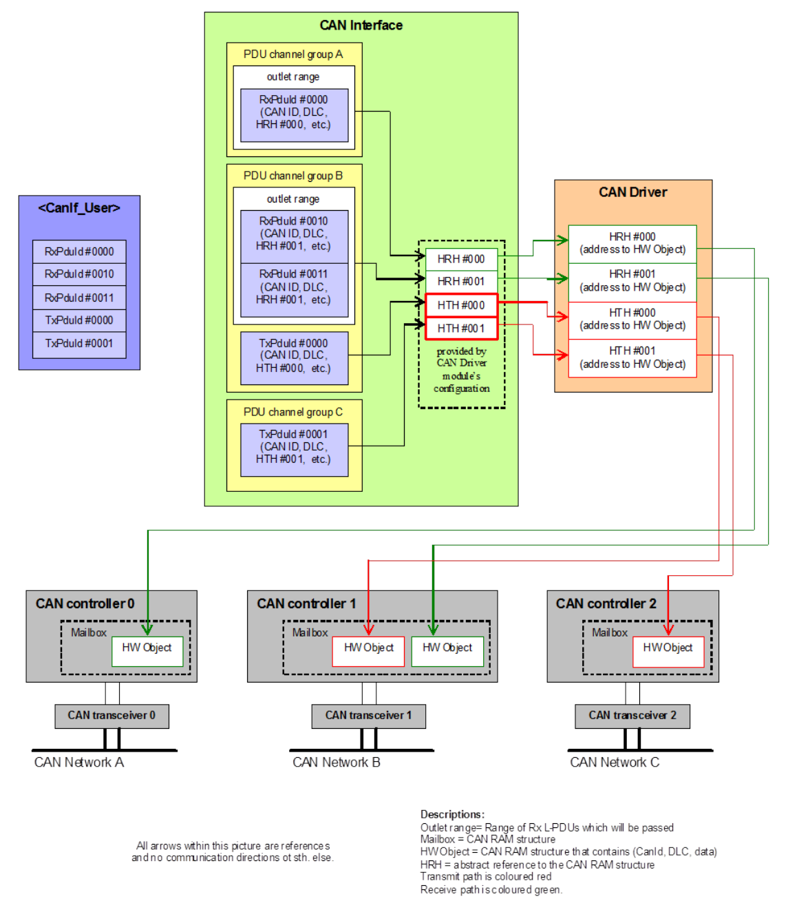

Figure 7.1：PDU ID 与 HW object handle 的映射

> 原文第 34 页

[SWS_CANIF_00292] ⌈ HTH 定义：HTH 应是引用 CAN Controller mailbox 中某个逻辑 Hardware Transmit Object 的 handle。⌋ ()

[SWS_CANIF_00666] ⌈ HTH 应使 CanIf 能够使用被引用发送单元的 BasicCAN 或 FullCAN 发送方式，并向目标上层模块确认某个 L-SDU 已发送。⌋ ()

[SWS_CANIF_00466] ⌈ 每个 CanIf Tx L-PDU 都应在配置阶段静态分配给一个 CanIfBufferCfg container（见 CanIfTxPduBufferRef）。⌋ ()

[SWS_CANIF_00466] 的理由：CanIf Tx L-PDU 不直接引用 HTH，而是引用 CanIfBufferCfg，再由后者引用 HTH。

[SWS_CANIF_00667] ⌈ 使用多个 HTH 时，每个 HTH 应对应单个或固定一组 Tx L-PDU（CanTxPduId）。⌋ ()

[SWS_CANIF_00115] ⌈ CanIf 应能将一个 CanDrv 的全部 HRH 和 HTH 作为从 0 开始的统一编号空间使用。⌋ ()

具体 HRH 和 HTH 来自 CanDrv 的 configuration set。编号空间内 HTH / HRH 与 Hardware Object 的定义由 CanDrv 决定。

### 7.3 静态 L-PDU

CanIf 为上层提供对 CAN L-SDU 相关数据的通用访问。下表中的属性以配置参数表示，详细定义见第 10 章。

| CAN Interface 专有属性 | CAN Protocol Control Information（PCI） |
| --- | --- |
| SW filtering 方法：CanIfPrivateSoftwareFilterType | CAN Identifier（CanId）：CanIfTxPduCanId、每个 PDU 的 CanId 范围（见 CanIfRxPduCanIdRange）、CanIfRxPduCanId、CanIfRxPduCanIdMask |
| L-PDU 方向（Tx、Rx）：CanIfTxPduId、CanIfRxPduId | CAN Identifier 类型（StandardCAN、ExtendedCAN）：通过 CanIfHthIdSymRef、CanIfHrhIdSymRef 从 CanDrv 引用 |
| CAN Controller 的 HTH / HRH | Data Length 和 Data Length Code（DLC）：CanIfRxPduDataLength |
| 对应上层的目标 ID：CanIfTxPduUserTxConfirmationUL、CanIfRxPduUserRxIndicationUL | PDU 数据引用（见 [1, Specification of CAN Driver]） |
| Transmit L-PDU 类型（STATIC、DYNAMIC）：CanIfTxPduType |  |
| Tx/Rx L-PDU 类型（FullCAN、BasicCAN）：CanIfHthIdSymRef、CanIfHrhIdSymRef |  |

> 原文第 35 页

CanIf 支持启用或禁用同一 CAN Controller 所属的全部发送及接收 L-PDU（见 7.19.2、CanIf_SetPduMode() 和 [SWS_CANIF_00008]）。L-PDU 模式控制见 7.19。

每个 L-PDU 都关联一个上层模块，以保证接收、发送确认和数据访问时正确分发。每个上层模块可以同时使用不同 CAN Controller 对应的 L-PDU。

根据 AUTOSAR 通信栈的 PDU 架构（见 [7, Layered Software Architecture]），L-PDU 的使用分为两种情况：

• 发送请求及发送/接收 Polling API：上层模块以 CanIf 定义的 L-SDU ID（CanTxPduId / CanRxPduId）作为参数。

• CanIf 调用上层的所有 callback API：CanIf 以各上层模块定义的目标 PduId 作为参数。

原则是：调用者必须使用被调用者定义的目标 L-PDU / L-SDU ID。

若尚未执行上电初始化，上层就向 CanIf 发起发送请求，则不得向下层发送任何 L-SDU，并应调用 DET，防止未初始化数据被发送到 network。发送函数的详细行为见 8.3.6。

### 7.4 动态 L-PDU

CanIf 应支持使用 CanIfRxPduCanIdMask 过滤接收消息：对收到的 CanId 和保存的 CanIfRxPduCanId 分别应用该 mask，再进行比较。这项过滤应在不带 mask 的普通 CanId 过滤之后执行，以便对 mask 范围或 CanId 范围内的部分 CanId 单独处理。

此外，应支持 CanId 位于 L-SDU MetaData 中的 DYNAMIC Tx 和 Rx L-SDU。

发送动态 L-SDU 时，若定义了 CanIfTxPduCanIdMask，则必须用该 mask 将 MetaData 提供的 CanId 可变部分与配置的 CanId 合并。若既未配置 CanIfTxPduCanIdMask，也未配置 CanIfTxPduCanId，则应直接将 MetaData 作为 CanId。

接收动态 L-SDU 时，应将收到的 CanId 放入 L-SDU MetaData。MetaData 的内容不受 CanIfRxPduCanIdMask 参数影响。

> 原文第 36 页

[SWS_CANIF_00844] ⌈ CanIf 应支持动态 L-PDU，其 CanId 或 CanId 的相关部分放在 L-SDU 的 MetaData 中。⌋ ()

#### 7.4.1 动态 Transmit L-PDU

动态 Transmit L-PDU 定义：允许在运行时重新配置 CanId（CanIfTxPduType），或通过 L-SDU MetaData 提供完整/部分 ID 的 L-PDU。

其余 L-PDU 元素的用法与普通静态 Transmit L-PDU 相同：

• CanIfTxPduUserTxConfirmationUL 属于 L-PDU，因此不能重新配置。

• Data Length 和数据 buffer 指针均由上层在调用 CanIf_Transmit() 时确定。

CanIf_SetDynamicTxId()（见 [SWS_CANIF_00189]）可重新配置由 CanIfTxPduType 指定的动态 L-PDU 的 CanId。

[SWS_CANIF_00188] ⌈ CanIf 应处理 CanId 的最高两位（见 [1, Specification of CAN Driver] 中 Can_IdType 定义 [SWS_Can_00416]），以确定 CanId 类型以及动态 Transmit L-PDU 的发送方式。⌋ ()

[SWS_CANIF_00673] ⌈ 执行 CanIf_SetDynamicTxId() 时，CanIf 应保证 CanId 的数据一致性。该服务可能被作用于同一 L-PDU 的 CanIf_Transmit() 抢占，见 [SWS_CANIF_00064]。⌋ ()

[SWS_CANIF_00855] ⌈ 若省略 CanIfTxPduCanIdMask 和 CanIfTxPduCanId，则直接从 MetaData 获取 CanId。⌋ ()

[SWS_CANIF_00856] ⌈ 若该 L-SDU 的 MetaData 配置不包含 CAN_ID_32，则应忽略 CanIfTxPduCanIdMask。⌋ ()

[SWS_CANIF_00854] ⌈ 若 MetaDataItem CAN_ID_32、CanIfTxPduCanIdMask 和 CanIfTxPduCanId 均存在，CanIfTxPduCanIdMask 指定实际 CanId 中哪些位取自 CanIfTxPduCanId 及由 CanIfTxPduCanIdType 派生的 Can_IdType；其余位取自 MetaData。⌋ ()

注：最终 ID 可按以下方式计算：(CanIfTxPduCanId &amp; CanIfTxPduCanIdMask) &#124; (&lt;dynamic ID parts&gt; &amp; ∼CanIfTxPduCanIdMask)

[SWS_CANIF_00857] ⌈ CanIf_Init()（见 [SWS_CANIF_00085]）应将由 CanIfTxPduType 指定的动态 Transmit L-PDU 的 CanId 初始化为 CanIfTxPduCanId 配置的值。⌋ ()

> 原文第 37 页

#### 7.4.2 动态 Receive L-PDU

动态 Receive L-PDU 定义：对应一组 CanId 的 L-PDU；实际收到的 CanId 作为 PDU 数据的一部分提供给上层。

[SWS_CANIF_00847] ⌈ 配置应保证动态 Receive L-PDU 使用 ID range 或 mask，并为其 L-SDU 配置 MetaDataItem CAN_ID_32。此外，必须为这些 L-SDU 启用 software filtering。⌋ ()

[SWS_CANIF_00848] ⌈ 接收动态 L-SDU 时，CanIf 应将 CanId 放入类型为 CAN_ID_32 的 MetaDataItem。⌋ ()

### 7.5 Physical channel 视角

一个 physical channel 关联一个 CAN Controller 和一个 CAN Transceiver；一个或多个 physical channel 可连接同一 network。

CanIf 提供服务，控制 ECU 所有受支持 CAN channel 上的 Controller、Transceiver 等设备。CanSm 利用这些 API 向 ComM 提供 network 视角（见 [3]），以对连接同一 network 的全部 physical channel 执行 wakeup 和 sleep 请求。

CanIf 按 physical channel 分别将 CanDrv 和 CanTrcv 提供的状态信息传递给 CanSm（&lt;User_ControllerBusOff&gt;()，见 [SWS_CANIF_00014]）。

[SWS_CANIF_00653] ⌈ CanIf 应提供 ControllerId，对不同 CanDrv 实例中的 Controller 进行统一抽象。CanIf 内的 ControllerId 应从 0 开始编号，并通过 CanIfCtrlId 配置。⌋ ()

Example:

CanIf CanDrv A CanDrv B

ControllerId 0 Controller 0

ControllerId 1 Controller 1

ControllerId 2 Controller 0

[SWS_CANIF_00655] ⌈ CanIf 应提供 TransceiverId，对不同 CanTrcv 实例中的 Transceiver 进行统一抽象。CanIf 内的 TransceiverId 应从 0 开始编号，并通过 CanIfTrcvId 配置。⌋ ()

Example:

CanIf CanDrv A CanDrv B

TransceiverId 0 Transceiver 0

TransceiverId 1 Transceiver 1

TransceiverId 2 Transceiver 0

> 原文第 38 页

通知过程中，CanIf 将 Driver 原有的 Controller / Transceiver 参数映射后传给 CanSm。该映射依据相应设备参数与 CanIf 抽象 ControllerId / TransceiverId 之间的配置关系完成。

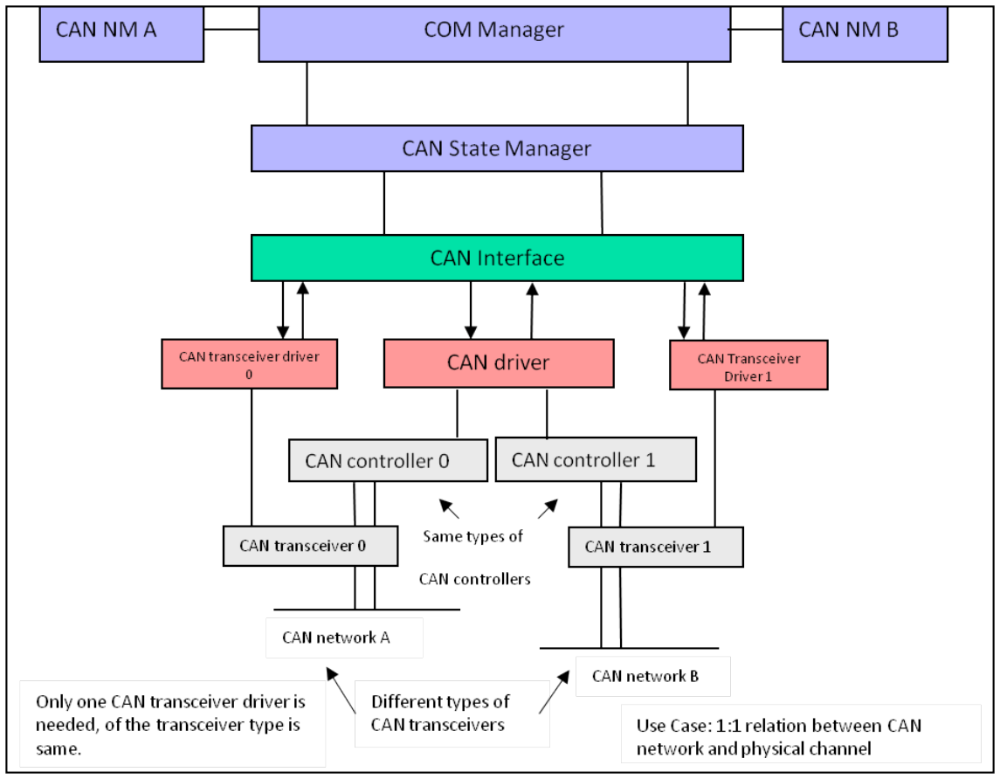

Figure 7.2：Physical channel 视角定义示例 A

CanIf 支持多个 physical CAN channel，CanSm 必须区分这些 channel 以控制 network。CanIf API 提供对多个底层 physical CAN channel 的控制请求及状态读取。

此外，CanIf 不区分一个或多个 Controller 所连接的具体 CAN physical layer 类型，例如 Low-Speed CAN 或 High-Speed CAN。

> 原文第 39 页

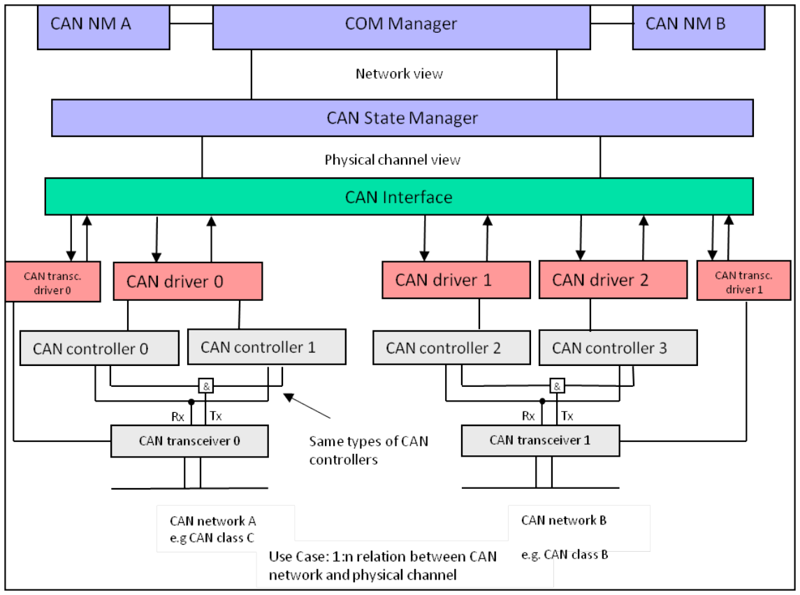

Figure 7.3：Physical channel 视角定义示例 B

### 7.6 CAN Hardware Unit

CAN Hardware Unit 由一个或多个同类型 CAN Controller 组成，可位于片上或作为外部独立设备。每个 CAN Hardware Unit 由对应的 CanDrv 管理。

若使用不同类型的 CAN Controller，也必须使用相应类型的 CanDrv，并向 CanIf 提供统一 API。CanIf 在配置阶段获取 Controller 及其 Hardware Object 的数量和类型，从而使上层可通过 HOH 透明且硬件无关地访问 Controller（见 7.2 和 7.24）。

Figure 7.4 展示一个 CAN Hardware Unit，其中两个同类型 Controller 分别连接两个 physical channel：

> 原文第 40 页

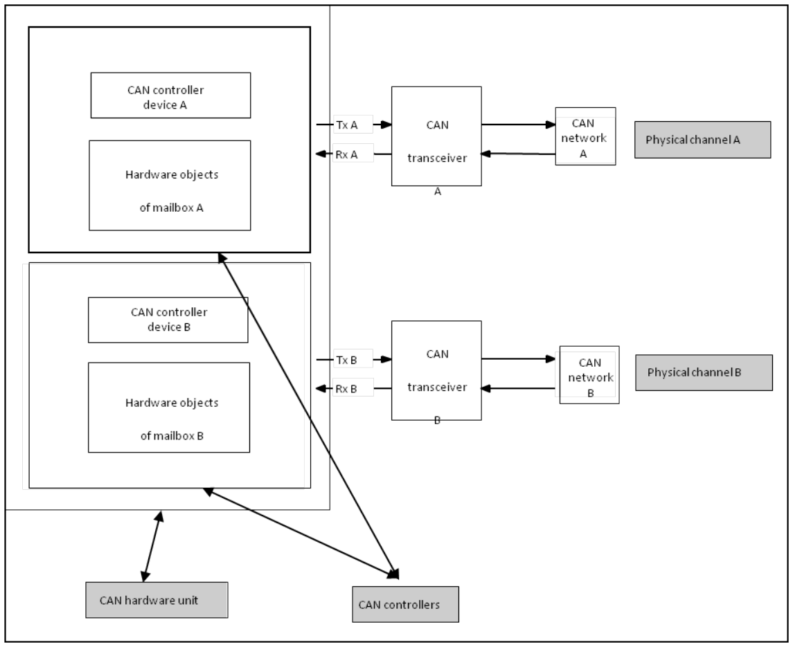

Figure 7.4：典型 CAN Hardware Unit

### 7.7 BasicCAN 与 FullCAN 接收

本章仅适用于 CAN 2.0 和 CAN FD。

CAN XL 硬件采用完全不同的 frame 访问方式，通过 descriptor 和 queue 工作，与 Ethernet 类似。

CanIf 区分 BasicCAN 与 FullCAN，以决定是否启用 software acceptance filtering。

FullCAN 方式的 CAN mailbox（Hardware Object）仅用于发送或接收单个 CanId；BasicCAN 方式的一个 Hardware Object 则可发送或接收一组/一个范围内的 CanId。

配置为 BasicCAN 接收的 Hardware Receive Object 可接收通过其 hardware acceptance filter 的一组 CanId，该范围可能大于该 HRH 预定义的 Rx L-PDU 列表。因此，CanIf 后续应执行软件过滤，仅将预定义列表中的 Rx L-PDU

> 原文第 41 页

交给对应上层模块。详细内容见 7.20“Software receive filter”。

[SWS_CANIF_00467] ⌈ CanIf 应对由 CanIfHthCfg 和 CanIfHrhCfg 派生的全部 HOH，配置并保存 HTH / HRH 的排列顺序。⌋ ()

[SWS_CANIF_00468] ⌈ CanIf 应为每个 HOH 引用 hardware acceptance filter，该信息来自 CanIfHthIdSymRef 和 CanIfHrhIdSymRef。⌋ ()

BasicCAN 与 FullCAN 的主要区别，在于是否需要 software acceptance filtering 机制（见 7.20）。

[SWS_CANIF_00469] ⌈ 对每个 BasicCAN 类型的 HRH，CanIf 应支持通过 CanIfHrhSoftwareFilter 配置并保存 software acceptance filter。⌋ ()

[SWS_CANIF_00211] ⌈ CanIf 应针对 CanIf_RxIndication() 传入的 HRH，执行 [SWS_CANIF_00469] 定义的 software acceptance filter。⌋ ()

BasicCAN 与 FullCAN 对象可共存于同一配置中。若底层 CAN Controller 支持，可使用多个 BasicCAN 和 FullCAN 接收对象。

[SWS_CANIF_00877] ⌈ CanIf 收到 L-PDU 时（见 CanIf_RxIndication()），应执行以下比较，以选择 CanIfRxPduCfg 中配置的正确接收 L-SDU：

• 比较 CanIfRxPduCanId 与传入的 Mailbox-&gt;CanId（Can_IdType），忽略最高两位；

• 比较 CanIfRxPduCanIdType 与传入 Mailbox-&gt;CanId（Can_IdType）的最高两位。

⌋(SRS_Can_01140, SRS_Can_01141, SRS_Can_01162)

CanIf 通过 CanIfTxPduCanIdType 和 CanIfRxPduCanIdType，支持在一个 Physical CAN Channel 上接收 Standard 或 Extended CAN ID。

[SWS_CANIF_00281] ⌈ CanIf 应在同一 Physical Channel 上接受并处理 StandardCAN ID 和 ExtendedCAN ID，即 mixed mode operation。⌋ (SRS_Can_01140)

Mixed mode 允许同一 CAN network 同时混用 Standard 与 Extended CAN ID。通过 CanIfTxPduCanIdType 和 CanIfRxPduCanIdType 将 BasicCAN / FullCAN Hardware Object 分别配置为 StandardCAN 或 ExtendedCAN，即可实现该方式。在 mixed

> 原文第 42 页

mode 下，software acceptance filter 算法（见 7.20）必须能够处理两种 CanId。

[SWS_CANIF_00281] 是可选功能，可通过不同实现变体提供，没有对应配置选项。

### 7.8 初始化

EcuM 调用 CanIf_Init() 初始化整个 CanIf（见 [SWS_CANIF_00001]），初始化所有全局变量和数据结构，包括 flag 和 buffer。EcuM 另行调用各自初始化服务来初始化 CanDrv 和 CanTrcv（见 [1] 和 [2]）。

CanIf 要求初始化完成后，CAN Controller 保持 STOPPED 模式，与上电复位后相同。在该模式下，CanIf 和 CanDrv 均不能发送或接收 CAN L-PDU（见 [SWS_CANIF_00001]）。

若运行时需要重新初始化整个 CAN 模块体系，EcuM 应调用 CanSm（见 [3]），由其通过 CanIf_SetControllerMode() 发起所需的 Controller 状态切换。CanIf 将 CanSm 的调用映射为对应 CanDrv 的调用（见 8.6.3）。

### 7.9 发送请求

CanIf_Transmit()（[SWS_CANIF_00005]）是上层在 CAN network 上发送 L-PDU 的统一接口。上层只能通过 CanIf 服务发起发送，不得直接访问 CanDrv。当 CanDrv 能够将 L-PDU 数据写入 CAN hardware transmit object 时，所发起的 Transmit Request 才算成功完成。

上层模块通过 CanIf_Transmit() 发起发送请求（见 8.3.6）。

调用 CanIf_Transmit() 时，CanIf 为发送 L-PDU 执行以下操作：

• 检查 CanIf 初始化状态。

• 识别 CanDrv（仅适用于多个 CanDrv 的情况）。

• 确定用于访问 CAN hardware transmit object 的 HTH。

• 调用 CanDrv 的 Can_Write() 或 CanXL_Write()。

> 原文第 43 页

若发送请求服务 CanIf_Transmit() 返回 E_OK，则发送成功完成。

[SWS_CANIF_00382] ⌈ 若请求通过处于 CANIF_OFFLINE 的 PDU channel 发送 L-PDU，CanIf 应调用 DET 的 Det_ReportRuntimeError() 报告 CANIF_E_STOPPED，且 CanIf_Transmit() 应返回 E_NOT_OK。⌋ (SRS_Can_01126)

[SWS_CANIF_00382] 注：见 7.19.2“PDU channel mode”。

若 Can_Write() 返回 CAN_BUSY，详细处理见 7.12“发送确认”。

### 7.10 发送数据流

CanIf_Transmit() 基于 L-PDU，通过以下参数访问 L-SDU 专有数据：

• Transmit L-PDU → L-SDU ID。

• 指向 L-SDU 数据结构的引用；该结构包含 L-SDU 指针、MetaData 指针和 L-SDU 长度。

多个 CanIf API 使用 L-SDU 数据结构引用作为参数，例如 CanIf_Transmit() 和 &lt;User_RxIndication&gt;()。若 L-PDU 配置为 triggered transmission，L-SDU 指针为空指针。

> 原文第 44 页

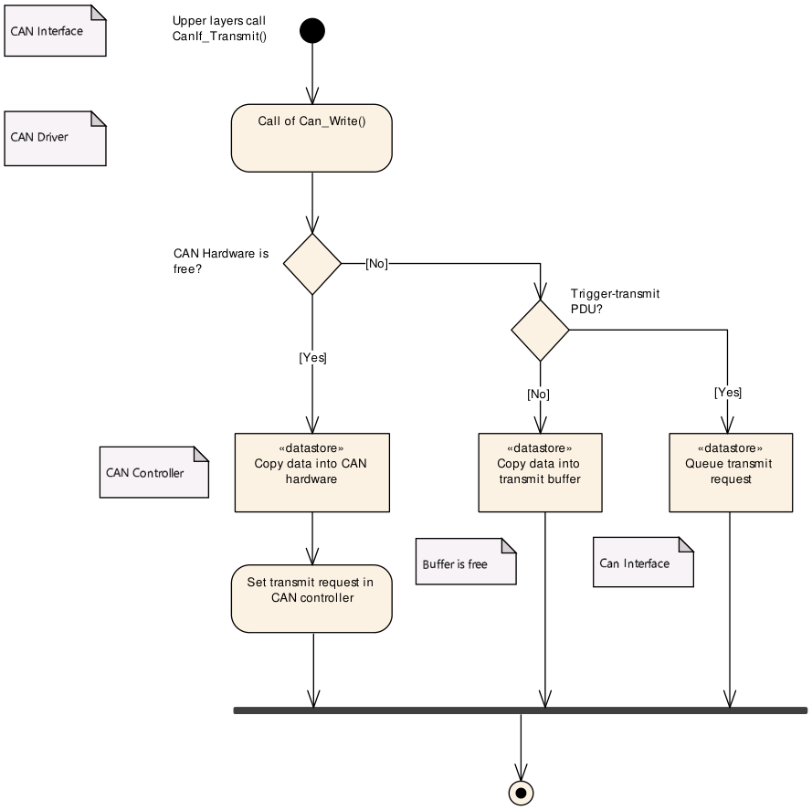

CanIf_Transmit() 返回 E_OK

Figure 7.5：发送数据流

CanIf 保存配置为发送用途的可用 hardware object 信息。CanIf_Transmit() 将 CanTxPduId 映射到对应 HTH，并调用 Can_Write() 或 CanXL_Write()。

[SWS_CANIF_00904] ⌈ 若全局启用 Bus Mirroring（见 CanIfBusMirroringSupport），且通过 CanIf_EnableBusMirroring() 为某 Controller 激活该功能，CanIf 应在通过 Can_Write() 向该 Controller 提交每个 frame 之前保存其内容。⌋ (SRS_Can_01172)

注：仅在 frame 实际发送后，才应将其内容提供给 Bus Mirroring。因此需要先保存内容，以便在 CanIf_TxConfirmation() 中提交给 Bus Mirroring。

### 7.11 发送缓冲

本章仅适用于 CAN 2.0 和 CAN FD。CanIf 不支持对 CAN XL 进行发送缓冲。

> 原文第 45 页

注：若硬件提供的 buffer 不足，CAN XL Driver 可以实现 software buffer。

#### 7.11.1 通用行为

在 CanIf 范围内，发送过程始于 CanIf_Transmit() 的调用，

终于上层 &lt;User_TxConfirmation&gt;() 的调用。在此过程中，CanIf、CanDrv 和 CAN mailbox 合计只应在一个位置保存一份待发送 L-PDU。根据发送方式，该位置为：

• CAN hardware transmit object；或

• 启用发送缓冲时，CanIf 内的 Transmit L-PDU Buffer。

对于 triggered transmission，CanIf 只需保存指定 L-PDU 的发送请求，无需保存数据。HTH 空闲或再次空闲时，通过 trigger transmit function 即时获取数据。单个待发送 Tx L-PDU 不得重复存储。该行为符合 CAN network 常用的周期通信方式。

若启用发送缓冲，且 CanDrv 在 Transmit Request 时拒绝该 Tx L-PDU，CanIf 会将其保存到 CanIf Transmit L-PDU Buffer（CanIfBufferCfg）。

CanIf 的整体 Tx L-PDU 缓冲由一个或多个 CanIfBufferCfg 组成。每个 CanIfBufferCfg 分配到一个或多个专用 CanIfBufferHthRef，并可配置为缓存一个或多个 Tx L-PDU。但在所有 CanIfBufferCfg 合计范围内，每个 Tx L-PDU 只能缓存一个实例。

CanIf 的发送行为取决于是否为对应 Tx L-PDU 启用缓冲。若未启用，且向 CanDrv 的请求失败（BasicCAN mailbox 正被占用），L-PDU 不会复制到 mailbox，CanIf_Transmit() 返回 E_NOT_OK。若启用缓冲，则请求失败时可根据 CanIfTxBuffer 配置保存 L-PDU；此时即使尚未实际发送，CanIf_Transmit() 也返回 E_OK。CanIf 随后通过 CanIf_TxConfirmation() callback 处理尚未完成的发送，上层无需重试该发送请求。

CanIf Tx L-PDU Buffer 的数量可独立于本 ECU 的 CAN network 描述文件所定义的 Transmit L-PDU 数量配置。

> 原文第 46 页

依据 [SWS_CANIF_00835]，Tx L-PDU 通过 CanIfBufferCfg 引用 HTH。即使无需发送缓冲，也采用这一关系；此时应将 CanIfBufferSize 设为 0，CanIfBufferCfg 仅用于引用 HTH。

#### 7.11.2 Buffer 特性

CanIfTxPduBufferRef、CanIfBufferCfg、CanIfBufferHthRef 和 CanIfBufferSize 描述可采用的 CanIfBufferCfg 配置。

##### 7.11.2.1 在发送 L-PDU buffer 中存储 L-PDU

只有 Can_Write() 调用返回 CAN_BUSY 时，CanIf 才尝试将新的 Transmit L-PDU 或其 Transmit Request 保存到 buffer（见 [SWS_CANIF_00381]）。

[SWS_CANIF_00063] ⌈ 若启用 CanIfPublicTxBuffering，CanIf 应支持为 BasicCAN 发送缓存 CAN L-PDU。⌋ (SRS_Can_01020)

[SWS_CANIF_00849] ⌈ 对于动态 Transmit L-PDU，还必须在 CanIfTxBuffer 中保存 CanId。⌋ ()

[SWS_CANIF_00381] ⌈ 若启用发送缓冲（见 [SWS_CANIF_00063]），且 direct transmission PDU 的 Can_Write() 调用返回 CAN_BUSY，则 CanIf 应检查能否在 CanIfTxBuffer 中缓存此次请求发送的 CanIf Tx L-PDU。⌋ (SRS_Can_01126)

Can_Write() 返回 CAN_BUSY 表示 CanDrv 拒绝本次 L-PDU 发送请求（见 [1]），因为发起请求时没有空闲 hardware object。

[SWS_CANIF_00895] ⌈ 若被拒绝的数据长度超过配置大小，CanIf 应：

• 仅缓存配置长度的数据，丢弃其余部分；

• 调用 DET 的 Det_ReportRuntimeError() 报告 CANIF_E_DATA_LENGTH_MISMATCH。

⌋()

[SWS_CANIF_00881] ⌈ 若启用发送缓冲（见 [SWS_CANIF_00063]），且 triggered transmission PDU 的 Can_Write() 返回 CAN_BUSY，CanIf 应检查能否在 CanIfTxBuffer 中缓存该 Transmit Request，

> 原文第 47 页

即此次通过 Can_Write() 请求发送的请求。⌋ (SRS_Can_01126)

[SWS_CANIF_00835] ⌈ 检查能否缓存 CanIf Tx L-PDU 或 Transmit Request 时（见 [SWS_CANIF_00381]、[SWS_CANIF_00881]），只有该 Tx L-PDU 通过 CanIfTxPduBufferRef 分配到的 CanIfBufferCfg，其 CanIfBufferSize 大于 0，才允许缓存。⌋ ()

只有启用发送缓冲，CanIfTxBuffer 的大小才能配置为大于 0；此外，该 CanIfTxBuffer 还必须未分配给 FullCAN HTH（见 CanIfBufferSize）。

[SWS_CANIF_00836] ⌈ 若所分配 CanIfTxBuffer 的大小大于 0，允许缓存（见 [SWS_CANIF_00835]），且对应 CanIf Tx L-PDU 或 Transmit Request 尚未缓存，则 CanIf 应将其存入该 CanIfTxBuffer 的空闲 buffer element。⌋ ()

[SWS_CANIF_00068] ⌈ 若所分配 CanIfTxBuffer 的大小大于 0，允许缓存（见 [SWS_CANIF_00835]），且 Can_Write() 返回 CAN_BUSY 时该 Tx L-PDU 已在 buffer 中，则 CanIf 应覆盖其中采用 direct transmission 的 CanIf Tx L-PDU。⌋ (SRS_Can_01011)

注：对于已经保存的 Transmit Request（见 [SWS_CANIF_00068]），无需额外处理，因为 CanDrv 会通过 CanIf_TriggerTransmit() 直接获取数据，从而自动发送最新数据。

若需要保持不同 L-PDU 的发送请求顺序，上层必须将后续发送请求与前一请求的发送确认关联：只有 CanIf 已通知前一 L-PDU 的发送确认，上层才能请求发送下一 L-PDU。

注：配置的 hardware transmit object 数量也可能影响发送请求的顺序。

[SWS_CANIF_00837] ⌈ 若 buffer 大小大于 0，但所有元素均被占用，且 CanIf_Transmit() 收到一个 buffer 内尚无同类实例的新 L-PDU，则不得保存该 L-PDU 或其 Transmit Request，并应返回 E_NOT_OK。⌋ ()

> 原文第 48 页

##### 7.11.2.2 清理发送 L-PDU buffer

[SWS_CANIF_00386] ⌈ 在 transmit confirmation 处理中（见 [SWS_CANIF_00007]），CanIf 应检查：与刚释放的 Hardware Transmit Object 关联的 CanIfTxBuffer 内，是否存在待发送的 Tx L-PDU 或 Transmit Request（见 [SWS_CANIF_00466]）。⌋ ()

[SWS_CANIF_00668] ⌈ 若按 [SWS_CANIF_00386] 找到待发送项，则 CanIf 应从关联到新空闲 Hardware Transmit Object 的候选项中，选择优先级最高的 Tx L-PDU 或 Transmit Request 调用 Can_Write()（见 [SWS_CANIF_00070]）。⌋ ()

[SWS_CANIF_00070] ⌈ CanIf 应按每个 HTH 内的优先级顺序（见 [12, ISO 11898-1:2015]）发送 buffer 中的 L-PDU 或 Transmit Request，不得区别对待两类项目。⌋ ()

[SWS_CANIF_00183] ⌈ CanIf 对 buffer 中按优先级选出的 L-PDU 或 Transmit Request 调用 Can_Write()，且返回 E_OK 时，应立即将该项从 buffer 移除，不等待 transmit confirmation 返回。⌋ ()

[SWS_CANIF_00183] 的行为简化了从 buffer 选择下一条 Transmit L-PDU 的过程。

##### 7.11.2.3 初始化发送 L-PDU buffer

[SWS_CANIF_00387] ⌈ 调用 CanIf_Init() 时，CanIf 应初始化分配给它的每个 Transmit L-PDU Buffer。⌋ ()

[SWS_CANIF_00387] 用于防止 Controller 重启后发送旧数据。

#### 7.11.3 发送 L-PDU buffer 的数据完整性

[SWS_CANIF_00033] ⌈ CanIf 应防护对 Transmit L-PDU Buffer 中 L-PDU 和 Transmit Request 的并发访问。⌋ (SRS_Can_01114)

可通过 BSW Scheduler 定义的 exclusive area 实现。例如，将其配置为进入期间禁用所有中断。对应服务为 SchM_Enter_CanIf() 和 SchM_Exit_CanIf()。

> 原文第 49 页

[SWS_CANIF_00033] 的理由：无法总是避免对 buffer 的抢占式访问，例如保存新 L-PDU 或移除已发送 L-PDU 时可能发生抢占。

### 7.12 发送确认

前一次发送请求成功完成后，CanDrv 调用 CanIf_TxConfirmation()（[SWS_CANIF_00007]）通知 CanIf。

[SWS_CANIF_00905] ⌈ 若全局启用 Bus Mirroring，且通过 CanIf_EnableBusMirroring() 为某 Controller 激活该功能，则每次通过 CanIf_TxConfirmation() 确认该 Controller 已发送 frame 时，CanIf 应调用 Mirror_ReportCanFrame()，提供保存的 frame 内容及实际 CAN ID。⌋ (SRS_Can_01172)

[SWS_CANIF_00383] ⌈ 调用 CanIf_TxConfirmation() 时，CanIf 应识别成功发送的 L-PDU 所关联的上层通信模块（见 [SWS_CANIF_00414]），并调用 &lt;User_TxConfirmation&gt;(E_OK) 通知发送完成。⌋ ()

[SWS_CANIF_00383] 注：见 7.12“发送确认”。

&lt;User_TxConfirmation&gt;() 由接收通知的上层模块实现。

上层通信模块可设计或配置为：对不同 L-PDU 或 L-PDU 组使用一个或多个 callback service 处理发送确认。CanIf 在对应请求得到确认时调用这些服务。Transmit L-PDU 用于分发到目标上层对应的确认服务，这种映射在配置时静态确定。

一个 Transmit L-PDU 只能分配给一个 transmit confirmation callback，见 8.6.3.2“&lt;User_TxConfirmation&gt;”。

[SWS_CANIF_00740] ⌈ 若启用 CanIfPublicTxConfirmPollingSupport，且 Controller 处于 CAN_CS_STARTED，CanIf 应按 CAN Controller 缓存已收到 TxConfirmation 的信息。⌋ ()

### 7.13 接收数据流

根据 AUTOSAR Basic Software 架构，接收数据由上层通信栈（如 AUTOSAR COM、CanNm、CanTp、DCM）分析和处理。上层不得操作或修改 CanDrv 的 Rx buffer，也不能访问 CanIf 的 Tx buffer。

> 原文第 50 页

仅当 CanIfPublicReadRxPduDataApi 为 TRUE 时，CanIf 才在接收路径提供内部缓冲（见 7.15）。发送缓冲见 7.11，动态 L-PDU 见 7.4。

收到新的 L-PDU 时，CanDrv 调用 CanIf_RxIndication()（见 [SWS_CANIF_00006]），通过以下参数访问 L-PDU 数据：

• Hardware Receive Handle（HRH）。

• 收到的 CAN Identifier（CanId）。

• 收到的 Data Length。

• 收到的 L-PDU 引用。

接收 L-PDU 的形式依赖硬件（nibble/byte 顺序及访问类型），归属于通信系统最底层 CanDrv。HRH 连接 CanDrv 与使用该 L-PDU 的上层模块，标识收到新 CAN L-PDU 的 hardware receive object。

CanDrv 调用 CanIf_RxIndication() 后，CanIf 应按 7.14 继续处理。CanIf 无法区分 CanDrv 使用临时 buffer 还是直接访问硬件，它要求收到的是标准化表示的 L-PDU 数据。

在数据复制到临时或上层 buffer 完成前，CAN hardware receive object 保持锁定。CanIf_RxIndication() 返回后，应立即释放该对象，以避免数据丢失。

CanDrv、CanIf 及接收 L-PDU 所属的上层模块访问同一个临时中间 buffer；它可以位于 Controller 的 hardware receive object 中，也可以是 CanDrv 内的临时 buffer。

> 原文第 51 页

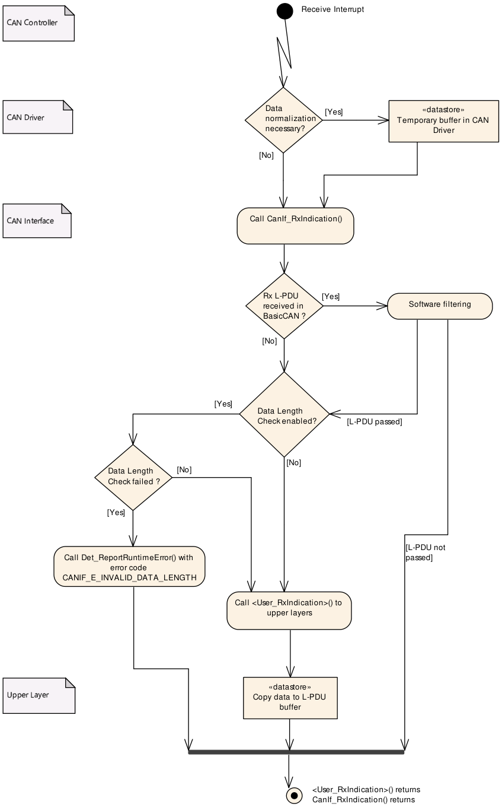

Figure 7.6：接收数据流

### 7.14 接收通知

CanIf_RxIndication()（见 [SWS_CANIF_00006]）通过参数引用新收到的 CAN L-PDU。调用该函数时，

> 原文第 52 页

CanIf 判断是否接受该 L-PDU，并准备 L-SDU 供上层访问。若配置了通知，且该 L-PDU 已成功识别并被接受用于后续处理，CanIf 通过 &lt;User_RxIndication&gt;() 向上层报告这一异步事件（见 8.6.3.3 和 [SWS_CANIF_00012]）。详细要求如下。

[SWS_CANIF_00906] ⌈ 若全局启用 Bus Mirroring，且通过 CanIf_EnableBusMirroring() 为某 Controller 激活该功能，则每次 CanIf_RxIndication() 指示该 Controller 收到 frame 时，CanIf 应调用 Mirror_ReportCanFrame()。⌋ (SRS_Can_01172)

[SWS_CANIF_00389] ⌈ 调用 CanIf_RxIndication() 时，若已配置 Software Filtering（CanIfHrhRangeCfg 的 multiplicity 为 0..∗），CanIf 应对收到的 L-PDU 执行过滤。若过滤拒绝该 L-PDU，应结束本次 receive indication 处理。⌋ ()

[SWS_CANIF_00389] 注：见 7.20。

[SWS_CANIF_00390] ⌈ L-PDU 通过 Software Filtering（见 [SWS_CANIF_00389]）后，若配置了 Data Length Check，CanIf 应继续检查长度（见 CanIfPrivateDataLengthCheck、CanIfRxPduDataLengthCheck）。⌋ ()

详细内容见 7.21“Data Length Check”。

[SWS_CANIF_00297] ⌈ L-PDU 通过 Data Length Check（见 [SWS_CANIF_00390]）后，若为其配置了静态接收 buffer（见 [SWS_CANIF_00198]、ECUC_CanIf_00600），CanIf 应按配置的 Data Length（ECUC_CanIf_00599）复制相应字节数到该 buffer。⌋ ()

[SWS_CANIF_00851] ⌈ 若为接收 L-SDU 配置了 MetaDataItem CAN_ID_32，CanIf 应将 PDU payload 复制到静态接收 buffer，将 CAN ID 复制到类型为 CAN_ID_32 的 MetaDataItem。⌋ ()

[SWS_CANIF_00056] ⌈ L-PDU 通过 Data Length Check（见 [SWS_CANIF_00390]、[SWS_CANIF_00026]）后，CanIf 应确定是否配置了目标上层模块，需调用该模块的 receive indication service 通知此 L-SDU（见 [SWS_CANIF_00012]、CanIfRxPduUserRxIndicationUL、CanIfRxPduUserRxIndicationName）。⌋ ()

[SWS_CANIF_00135] ⌈ 若已配置应调用 receive indication service 的目标上层模块（见 [SWS_CANIF_00056]），CanIf 应调用配置的 callback（见 CanIfRxPduUserRxIndicationName），并根据 CanIf_RxIndication() 的参数，提供上层 notification

> 原文第 53 页

callback 所需的参数（见 [SWS_CANIF_00012]）。⌋ (SRS_BSW_00325)

注：一个 Receive L-PDU 只能分配给一个 receive indication callback（见 CanIfRxPduUserRxIndicationName 的 multiplicity）。

概览：调用 CanIf_RxIndication() 时，CanIf 执行以下步骤：

• 若已配置，执行 Software Filtering（仅 BasicCAN）。

• 若已配置，执行 Data Length Check。

• 若已配置，缓存收到的 L-SDU。

• 若已配置，调用上层 receive indication callback。

### 7.15 读取接收数据

CanIf_ReadRxPduData()（见 [SWS_CANIF_00194]）是上层读取最近从 CAN network 收到的 L-SDU 的统一接口。上层只能通过 CanIf 发起读取，不得直接访问 CanDrv。CanIf 将接收 L-SDU 写入上层 I-PDU buffer 后，本次读取请求成功完成。

CanIf_ReadRxPduData() 支持不依赖 RxIndication 事件读取数据。配置时启用该功能（CanIfPublicReadRxPduDataApi）后，不必为同一 L-SDU 配置 receive indication（CanIfRxPduUserRxIndicationUL）；如有需要，也可同时启用。

因此，可在配置阶段根据对应上层的需求，通过 CanIfRxPduUserRxIndicationUL 和 CanIfRxPduReadData 选择 L-SDU 接收机制，见 9.9“读取接收数据”。

[SWS_CANIF_00198] ⌈ 若 CanIfPublicReadRxPduDataApi 为 TRUE，CanIf 应将每个启用 CanIfRxPduReadData 的接收 L-SDU 保存到 receive L-SDU buffer。即 CanIfRxPduReadData 为 TRUE 时，必须为该接收 L-SDU 分配 buffer。⌋ ()

[SWS_CANIF_00199] ⌈ 调用 CanIf_RxIndication() 且通过 software filtering 和 Data Length Check 后，CanIf 应将 L-SDU 保存到对应接收 buffer。CanIf_ReadRxPduData() 读取保存最近接收 L-SDU 的 buffer 时，应防止对该 buffer 的抢占式访问（见 [SWS_CANIF_00064]）。⌋ ()

> 原文第 54 页

### 7.16 读取 Tx/Rx 通知状态

除 notification callback 外，CanIf 还提供 CanIf_ReadTxNotifStatus()（见 [SWS_CANIF_00202]）读取发送 L-SDU 的确认状态，以及 CanIf_ReadRxNotifStatus() 读取接收 L-SDU 的通知状态。

可在 pre-compile 配置阶段，通过 CanIfPublicReadTxPduNotifyStatusApi、CanIfPublicReadRxPduNotifyStatusApi、CanIfTxPduReadNotifyStatus 和 CanIfRxPduReadNotifyStatus，全局或按 L-SDU 启用/禁用 CanIf_ReadTxNotifStatus()（[SWS_CANIF_00202]）及 CanIf_ReadRxNotifStatus()（[SWS_CANIF_00230]）。

[SWS_CANIF_00472] ⌈ 若 CanIfPublicReadTxPduNotifyStatusApi 为 TRUE，CanIf 应保存每个发送 L-SDU 的当前通知状态。⌋ ()

[SWS_CANIF_00473] ⌈ 若 CanIfPublicReadRxPduNotifyStatusApi 为 TRUE，CanIf 应保存每个接收 L-SDU 的当前通知状态。⌋ ()

[SWS_CANIF_00391]、[SWS_CANIF_00393] 及 [SWS_CANIF_00392]、[SWS_CANIF_00394] 的理由：这种“读取即消费”的行为，可用于确认自上次调用该服务以来，至少发生过一次成功发送或接收事件。

### 7.17 数据完整性

[SWS_CANIF_00064] 共享代码应可重入。⌈ 对会访问共享资源的抢占式事件，CanIf 应提供相互防护，防止事件处理期间资源变化导致冲突。⌋ (SRS_BSW_00312)

理由：更新上层 buffer 或 CanIf 内部 buffer 时，必须考虑 ISR 或其他抢占事件可能修改这些数据。抢占来源可能是 Task、多个 physical channel（如 gateway）产生的多个 CAN interrupt，或其他有 CAN L-PDU 收发需求的外设/网络系统中断。

共享收发 L-PDU / L-SDU buffer 的处理是 CanIf 实现中的关键问题。CanIf 应使用适当机制保护这些共享资源并保证数据完整性；其他 Controller 的收发事件等抢占源可能写入同一 buffer，破坏数据一致性。

> 原文第 55 页

例如，可在临界区进入/退出时，按 Controller 使用 CanDrv 的 Can_EnableControllerInterrupts() 和 Can_Disable-ControllerInterrupts() 启用/禁用 CAN interrupt 及通知。若多个 Controller 共用资源，则必须锁定全部 CAN interrupt。临界区不应持续过久，以免严重降低性能；数据复制、静态变量、counter 和 semaphore 的更新应在这些临界区中完成。实现应自行选择合适机制，兼顾数据完整性、中断响应和可重入性。

CanIf_Transmit() 必须可重入，以支持不同抢占事件对不同 L-PDU / L-SDU 发起多个发送请求。CanDrv 的 Can_Write() 或 CanXL_Write() 也以可重入方式运行。

### 7.18 CAN Controller 模式

#### 7.18.1 通用功能

CanIf 提供服务，控制底层 CanDrv 所代表的所有 CAN Controller 的通信模式。通过对应 API，可请求模式切换并读取当前 Controller mode。

上层调用 CanIf_SetControllerMode() 请求改变 Controller 状态，CanIf 经 CanDrv API 将请求传给目标 Controller。

同一 CAN network 上所有 Controller 的一致性管理由 CanSm 负责；它依次使这些 Controller 进入 sleep 或将其唤醒。

通过 CanIf_SetControllerMode() 或 CanIf_ControllerBusOff() 发起的状态切换均由 CanIf 接收。CanIf 不判断请求的 Controller 模式切换是否合法，只与 CanDrv 交互以获取当前模式并执行切换请求。

面向 network 的状态机位于 CanSm（见 [3]）。CanIf 只保存请求的模式并执行切换。

提示：为减少内部处理对 CanDrv 的频繁查询，可按 Controller 缓存最近由 CanIf_ControllerModeIndication() 和 Can_GetControllerMode() 指示的状态。

提示：应注意，不仅 CanSm 可以请求改变 CAN Controller mode。

> 原文第 56 页

#### 7.18.2 CAN Controller 运行模式

CanIf 将 CanSm 请求的运行模式转发给 CanDrv。

[SWS_CANIF_00677] ⌈ 若 ControllerId 对应的 Controller 处于 CAN_CS_STOPPED，且 CanIf_Transmit() 的 PduIdType 参数属于该 Controller，则此次调用不得调用 Can_Write() 或 CanXL_Write()，并返回 E_NOT_OK。⌋ (SRS_Can_01162, SRS_Can_02003)

[SWS_CANIF_00485] ⌈ ControllerId 对应的 Controller 进入 CAN_CS_STOPPED 时，CanIf 应清空其关联的发送 buffer。⌋ ()

[SWS_CANIF_00739] ⌈ ControllerId 对应的 Controller 进入 CAN_CS_STOPPED 时，CanIf 应针对其每个尚未完成的 TxConfirmation 调用 &lt;User_TxConfirmation&gt;(id, E_NOT_OK)，向相应上层报告发送失败。若启用 CanIfPublicTxConfirmPollingSupport，还应清除 TxConfirmation 信息（见 [SWS_CANIF_00740]）。⌋ ()

注：这可确保每个通过 CanIf_Transmit() 请求发送的 PDU，都会得到成功或失败的 &lt;User_TxConfirmation&gt;()。

[SWS_CANIF_00724] ⌈ 调用 CanIf_ControllerBusOff(ControllerId) 时，CanIf 应调用 CanSm 或 CDD 的 CanSM_ControllerBusOff(ControllerId)（见 [SWS_CANIF_00559]、[SWS_CANIF_00560]）。⌋ ()

[SWS_CANIF_00724] 注：见 8.6.3.9“&lt;User_ControllerModeIndication&gt;”。

[SWS_CANIF_00711] ⌈ 调用 CanIf_ControllerModeIndication(ControllerId, ControllerMode) 时，CanIf 应调用 CanSm 或 CDD 的 CanSm_ControllerModeIndication(ControllerId, ControllerMode)（见 [SWS_CANIF_00691]、[SWS_CANIF_00692]）。⌋ ()

[SWS_CANIF_00711] 注：见 8.6.3.9“&lt;User_ControllerModeIndication&gt;”。

[SWS_CANIF_00712] ⌈ 调用 CanIf_TrcvModeIndication(Transceiver, TransceiverMode) 时，CanIf 应调用 CanSm 或 CDD 的 CanSM_TransceiverModeIndication(TransceiverId, TransceiverMode)（见 [SWS_CANIF_00697]、[SWS_CANIF_00698]）。⌋ ()

[SWS_CANIF_00712] 注：见 8.6.3.9“&lt;User_ControllerModeIndication&gt;”。

> 原文第 57 页

#### 7.18.3 Controller 模式切换

Controller 状态切换请求 API 采用异步方式，通过 callback service 异步通知结果。

向 Controller 硬件设置切换请求（例如 CAN_CS_SLEEP）后，实际切换异步发生。成功进入目标模式后，CanDrv 调用 CanIf_ControllerModeIndication()，再由 CanIf 调用 &lt;User_ControllerModeIndication&gt;()。若硬件切换很快，CanIf_ControllerModeIndication() 可能在 CanIf_SetControllerMode() 执行期间被调用，具体取决于实现。

上层负责跟踪 Controller 模式切换失败或未发生的情况。CAN_CS_STARTED 和 CAN_CS_STOPPED 的切换处理类似。

CanIf 上层可通过 CanIf_GetControllerMode() 轮询当前 Controller mode。

并非所有 Controller 都支持 Sleep 和 Wake-Up Mode。CanDrv 通过接口提供硬件无关的运行模式，对此差异进行封装，供 CanIf 管理。

注：从 CAN_CS_STOPPED 向 CAN_CS_SLEEP 切换期间，Controller 可能向 ECU Integration Code 指示 wakeup interrupt。

CanIf 区分内部发起的 Controller wakeup request 和来自 network 的外部 wakeup request。内部请求通过 CanIf_SetControllerMode(ControllerId, CAN_CS_STARTED) 发起，是内部异步请求。外部请求是 Controller 事件，由 CanDrv 或 CanTrcv 通知 ECU Integration Code。详细时序见 [13]“CAN Wakeup Sequences”中的 UML 图。

#### 7.18.4 Wakeup

无论通过 CAN Controller 还是 CAN Transceiver 唤醒，只有两者都处于某种“监听 wakeup”模式，ECU 才支持 CAN network wakeup。通常该模式为禁用正常通信的 Sleep Mode。只有这种模式能保证 Controller 已停止，从而可以启用 wakeup interrupt。

> 原文第 58 页

##### 7.18.4.1 Wakeup 检测

若启用 wakeup 支持（见 ECUC_CanIf_00843），Integration Code 通过 CanIf_CheckWakeup() 向 CanIf 通知检测到的 CAN wakeup（见 [13] 的 CAN Wakeup Sequences）。

发生 CAN bus wakeup 时，可在 EcuM_CheckWakeup(WakeupSource) 执行期间调用 CanIf_CheckWakeup(WakeupSource)。CanIf 根据 CanDrv 中配置的 EcuMWakeupSource 输入引用，确定需要检查的 CanDrv；这些信息通过 CanIfCtrlCanCtrlRef 获取。

实际调用的 Communication Service 由配置确定（见 CanIfDispatchCfg）。EcuM 和 CanSm 可据此改变 Controller 状态，控制 BusOff recovery 或 wakeup 流程中的系统行为。

[SWS_CANIF_00395] ⌈ 调用 CanIf_CheckWakeup(EcuM_WakeupSourceType WakeupSource) 时，CanIf 应通过 CanTrcv_CheckWakeup() 或 Can_CheckWakeup() 查询 CanTrcv / CanDrv，确定导致 bus wakeup 的具体 CAN 硬件设备。⌋ ()

注：查询哪些 Controller 和 Transceiver 由实现决定，CanIf 只需确定具体的唤醒设备。

[SWS_CANIF_00720] ⌈ 只要至少一次 Can_CheckWakeup() 或 CanTrcv_CheckWakeup() 返回 E_OK，CanIf_CheckWakeup() 就应返回 E_OK。⌋ ()

[SWS_CANIF_00678] ⌈ 若所有 Can_CheckWakeup() 或 CanTrcv_CheckWakeup() 调用均返回 E_NOT_OK，CanIf_CheckWakeup() 应返回 E_NOT_OK。⌋ ()

##### 7.18.4.2 Wakeup validation

注：Controller / Transceiver 检测到 bus wakeup 后，会直接通知 EcuM。若需要验证该事件，EcuM 或 CDD 会通过 CanIf_SetControllerMode() 和 CanIf_SetTrcvMode() 启动相应 Controller 和 Transceiver（详见 [13] 第 9 章）。

注意：PDU Channel Mode 设为 CANIF_ONLINE 或 CANIF_TX_OFFLINE 后，CanIf 会向上层通知收到的消息。因此，若需要 wakeup validation，不应将 PDU Channel Mode 设为上述模式。

注：依据 [SWS_CAN_00411] 及 CAN Controller 状态图（见 [1]），不允许直接从 CAN_CS_SLEEP 转入 CAN_CS_STARTED。

> 原文第 59 页

[SWS_CANIF_00286] ⌈ 若 CanIfPublicWakeupCheckValidSupport 为 TRUE，CanIf 启用 CAN wakeup validation 检测，并保存已设为 CAN_CS_STARTED 的 Controller 第一次有效 CanIf_RxIndication() 调用事件。有效条件为：

• CanIfPublicWakeupCheckValidByNM 为 TRUE 时，仅接收的 NM message 有效；

• 为 FALSE 时，所有对应已配置 Rx PDU 的接收消息均有效。

⌋(SRS_Can_01151)

[SWS_CANIF_00179] ⌈ 执行 CanIf_CheckValidation(WakeupSource) 时，应调用 &lt;User_ValidateWakeupEvent&gt;(sources)；若对应 Controller 已保存首次 CanIf_RxIndication() 事件，则 sources 设为 WakeupSource。⌋ (SRS_Can_01136)

注：&lt;User_ValidateWakeupEvent&gt;() 的参数类型为：

• sources：EcuM_WakeupSourceType（见 [13]）

[SWS_CANIF_00756] ⌈ Controller mode 设为 CAN_CS_SLEEP 时，应清除前次 wakeup 保存的首次 CanIf_RxIndication 事件（见 [SWS_CANIF_00179]）。⌋ ()

### 7.19 PDU channel 模式控制

#### 7.19.1 PDU channel group

每个 L-PDU 分配给一个专用 physical CAN channel，该 channel 连接一个 Controller 和一个 CAN network。因此，可将同一 Physical Channel 的全部 L-PDU 作为一个逻辑 L-PDU channel group 控制。该逻辑组表示 ECU 连接某一底层 CAN network 的全部 L-PDU。

下方 Figure 7.7 展示 L-PDU channel group 的一种用法，以及它与上层和 network 的关系。

一个 L-PDU 只能属于一个 channel group。

PduR、Network Management 等典型用户负责控制 PDU 运行模式。

> 原文第 60 页

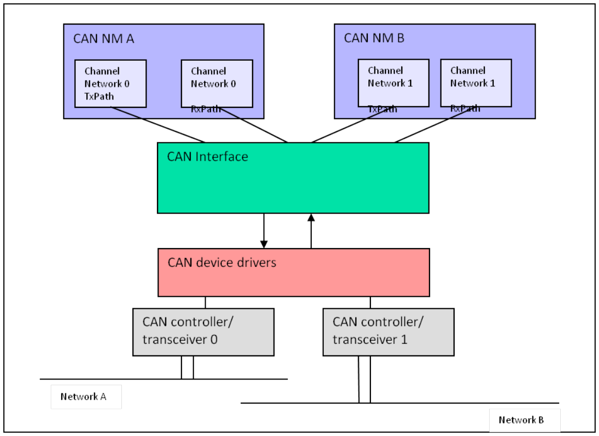

Figure 7.7：Channel PDU group

#### 7.19.2 PDU channel mode

CanIf 提供 CanIf_SetPduMode() 和 CanIf_GetPduMode()，用于阻止处理：

• 同一逻辑 channel 的全部 Transmit L-PDU；

• 同一逻辑 channel 的全部 Transmit 和 Receive L-PDU。

仅当对应 Controller mode 为 CAN_CS_STARTED 时，才允许改变 PDU channel mode（见 [SWS_CANIF_00874]）。

CANIF_ONLINE 和 CANIF_OFFLINE 作用于整个通信；CANIF_TX_OFFLINE 和 CANIF_TX_OFFLINE_ACTIVE 则分别控制发送路径。

CanIf_GetPduMode() 提供当前 PDU channel mode。

> 原文第 61 页

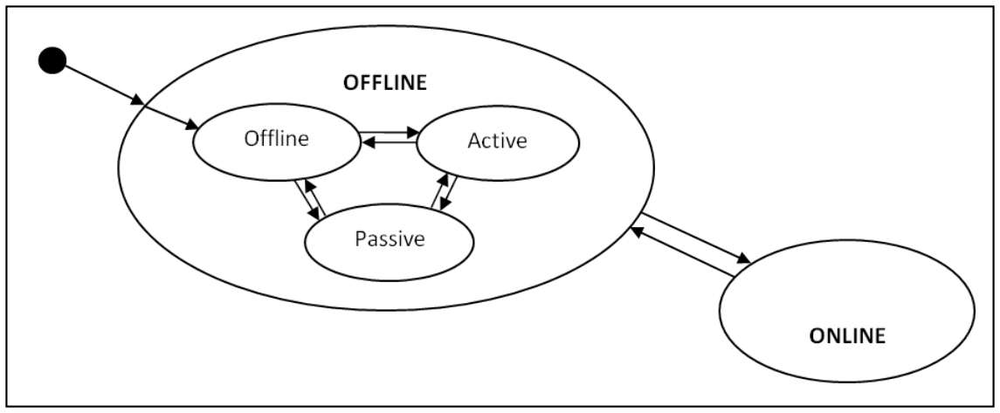

Figure 7.8：PDU channel 模式控制

Figure 7.8 展示各 PDU channel mode：CANIF_OFFLINE（无通信）、CANIF_TX_OFFLINE（被动模式，只监听不发送）、CANIF_TX_OFFLINE_ACTIVE（监听并模拟发送）以及 CANIF_ONLINE（完整通信）。默认模式为 CANIF_OFFLINE。

##### 7.19.2.1 CANIF_OFFLINE

[SWS_CANIF_00864] ⌈ 初始化时，CanIf 应将每个 channel 设为 CANIF_OFFLINE。⌋ ()

[SWS_CANIF_00865] ⌈ 调用 CanIf_SetControllerMode(ControllerId, CAN_CS_SLEEP) 时，CanIf 应将对应 PDU channel mode 设为 CANIF_OFFLINE。⌋ ()

[SWS_CANIF_00073] ⌈ Physical Channel 切换到 CANIF_OFFLINE 时，CanIf 应：

• 阻止将关联 L-PDU 的 CanIf_Transmit() 请求转发给 CanDrv，向上层返回 E_NOT_OK；

• 清空对应 CanIf 发送 buffer；

• 阻止调用上层 receive indication callback；

• 阻止调用上层 transmit confirmation callback。

⌋()

[SWS_CANIF_00866] ⌈ 调用 CanIf_SetControllerMode(ControllerId, CAN_CS_STOPPED) 或 CanIf_ControllerBusOff(ControllerId) 时，CanIf

> 原文第 62 页

应将对应 PDU channel mode 设为 CANIF_TX_OFFLINE。⌋ ()

[SWS_CANIF_00489] ⌈ Physical Channel 切换到 CANIF_TX_OFFLINE 时，CanIf 应：

• 阻止将关联 L-PDU 的 CanIf_Transmit() 请求转发给 CanDrv，向上层返回 E_NOT_OK；

• 清空对应 CanIf 发送 buffer；

• 阻止调用上层 transmit confirmation callback。

• 允许调用上层 receive indication callback。

⌋()

在 CANIF_OFFLINE 和 CANIF_TX_OFFLINE 下，BusOff notification 被隐式抑制：由于不能发送新的 L-PDU，Controller 不会因新的发送请求而进入 BusOff。

[SWS_CANIF_00118] ⌈ 若切换至 CANIF_TX_OFFLINE 或 CANIF_OFFLINE 后，原已在 Hardware Transmit Object 中等待的 L-PDU 随即发送并导致 BusOff，CanIf 不得阻止 &lt;User_ControllerBusOff&gt;(ControllerId) 通知。⌋ ()

Wakeup notification 不受 PDU channel mode 切换影响。

##### 7.19.2.2 CANIF_ONLINE

[SWS_CANIF_00075] ⌈ Physical Channel 切换到 CANIF_ONLINE 时，CanIf 应：

• 允许将关联 L-PDU 的 CanIf_Transmit() 请求转发给 CanDrv；

• 允许调用上层 receive indication callback；

• 允许调用上层 transmit confirmation callback。

⌋()

> 原文第 63 页

##### 7.19.2.3 CANIF_OFFLINE_ACTIVE

若 CanIfTxOfflineActiveSupport = TRUE，CanIf 通过 CANIF_TX_OFFLINE_ACTIVE 模式模拟发送成功。调用 CanIf_SetPduMode(ControllerId, CANIF_TX_OFFLINE_ACTIVE) 启用此模式，它仅影响发送路径。

[SWS_CANIF_00072] ⌈ 对分配到 CANIF_TX_OFFLINE_ACTIVE channel 的每个 L-PDU，CanIf 应在 CanIf_Transmit() 中立即调用上层 transmit confirmation callback，不缓存该 L-PDU，也不转发给 CanDrv。⌋ ()

注：CANIF_TX_OFFLINE_ACTIVE 期间，上层必须能处理立即执行的发送确认；确认处理在发送请求结束时立即进行（见 [SWS_CANIF_00072]）。

理由：此功能可实现诊断被动模式等特殊运行模式，在不影响通知机制的前提下避免产生总线流量，通常用于诊断。

### 7.20 Software receive filter

通过 hardware acceptance filter 并被 BasicCAN Hardware Object 接收的 L-PDU，并不一定都是本 ECU 所需的已定义 Receive L-PDU。CanIf 可通过过滤丢弃不需要的 L-PDU，阻止进一步软件处理。

为优化执行时间，可采用不同的软件过滤算法。其目标是根据当前 HRH 和 CanId 查找对应 L-PDU；找到后，CanIf 接受该接收，使上层能够直接访问 L-SDU 信息。

以下各节仅适用于 CAN 2.0 和 CAN FD frame，也包括通过 CAN XL 中 tunneled CAN 2.0/CAN FD frame（SDU Type 03h）接收的 frame。

提示：对于 content-based CAN XL frame（SDU Type 01h），可用 Acceptance Field 中的 PDUN identifier 过滤，不得使用 Priority ID 过滤。

[SWS_CANIF_00951] ⌈ 接收到 SDU Type 非 03h 的 CAN XL frame 时，CanIf 应将 Acceptance Field、Priority ID、SDU Type 和 VCID 与所有 CanIfRxPduCfg 的 CanIfRxPduXLParams 中配置的 CanIfXLAcceptanceField、CanIfXLPriorityId、CanIfXLSduType 和 CanIfXLVcid 比较。未配置的参数匹配任意接收值。⌋ (SRS_Can_02003)

[SWS_CANIF_00952] ⌈ 接收到 SDU Type 为 03h 的 CAN XL frame 时，CanIf 应将 Priority ID 和 VCID 与所有 CanIfXLSduType = 03h 的 CanIfRxPduCfg 中，CanIfRxPduXLParams 所配置的 CanIfXLPriorityId

> 原文第 64 页

及 CanIfXLVcid 比较。未在 CanIfRxPduXLParams 中配置的参数匹配任意接收值。⌋ (SRS_Can_02003)

[SWS_CANIF_00953] ⌈ 接收的非 03h SDU Type frame 的 CAN XL Params 与某 CanIfRxPduCfg 的 CanIfRxPduXLParams 匹配时，应将对应 N-PDU 转发给上层。⌋ (SRS_Can_02003)

[SWS_CANIF_00954] ⌈ SDU Type 为 03h 的接收 frame，其 CAN XL Params 与某 CanIfRxPduCfg 的 CanIfRxPduXLParams 匹配时，应按后续各节对 CAN ID 进行过滤。⌋ (SRS_Can_02003)

[SWS_CANIF_00955] ⌈ 若接收 frame 的 CAN XL Params 不匹配任何 CanIfRxPduCfg 的 CanIfRxPduXLParams，应丢弃该 frame。⌋ (SRS_Can_02003)

[SWS_CANIF_00956] ⌈ 若按 [SWS_CANIF_00951] 和 [SWS_CANIF_00952] 有多个 CanIfRxPduCfg 匹配接收 frame，则已配置且匹配的 CanIfRxPduXLParams 参数始终优先于未配置的参数。匹配应按以下顺序执行：

1. SDU Type

2. Acceptance Field

3. VCID

4. Priority ID

此列表中较前元素的匹配始终优先于较后元素的匹配，即查找应基于按此顺序排列的有序列表执行。⌋ (SRS_Can_02003)

该方式保证接收 frame 到 L-SDU（N-PDU）的映射行为稳定：SDU Type 匹配的 CanIfRxPduCfg 排在前，未配置 SDU Type 的排在后；各组内部再按 Acceptance Field 已匹配/未配置分组，依此类推，直至 Priority ID。

#### 7.20.1 Software filtering 概念

配置工具处理 hardware acceptance filter 的设置信息，其中最重要的是 L-PDU hardware object 的数量及其接收范围。放行范围决定每个 Hardware Receive Object 对应哪些 Receive L-PDU，可定义为：

• 单个 Receive L-PDU（FullCAN 接收）；

• 一组 Receive L-PDU；或

> 原文第 65 页

• 将一个或多个 Receive L-PDU 范围关联到 Hardware Receive Object（BasicCAN 接收）。

定义范围接收时，至少需要定义一个 Rx L-PDU，其 CanId 或完整 ID range 位于该范围内。

[SWS_CANIF_00645] ⌈ 应通过 software receive filter 的 CanId 范围，可以由上限 CanIfHrhRangeRxPduUpperCanId 和下限 CanIfHrhRangeRxPduLowerCanId 定义，也可由 base ID（CanIfHrhRangeBaseId）及指定相关位的 mask（CanIfHrhRangeMask）定义。⌋ ()

注：Software receive filtering 是可选功能（CanIfHrhRangeCfg 的 multiplicity 为 0..∗）。

[SWS_CANIF_00646] ⌈ 每个应通过 software receive filter 的可配置 CanId 范围（见 [SWS_CANIF_00645]），都应能通过 CanIfHrhRangeRxPduRangeCanIdType 配置为 Standard 或 Extended CAN ID。⌋ ()

Receive L-PDU 以从 communication matrix 静态生成的常量结构提供，并按对应 hardware acceptance filter 排列，使每个 HRH 都有一份接收 CanId 列表。使用多个 BasicCAN 对象时，可通过 HRH 确定列表。后续过滤在该列表中比较新收到的 CanId；命中后，根据匹配 CanId 确定 Receive L-PDU。

[SWS_CANIF_00030] ⌈ 若 HRH 收到的 L-PDU 的 CanId 已配置为应接收，CanIf 应接受该 L-PDU，并由 software filtering 算法根据匹配 CanId 确定对应 Receive L-PDU。⌋ (SRS_Can_01018)

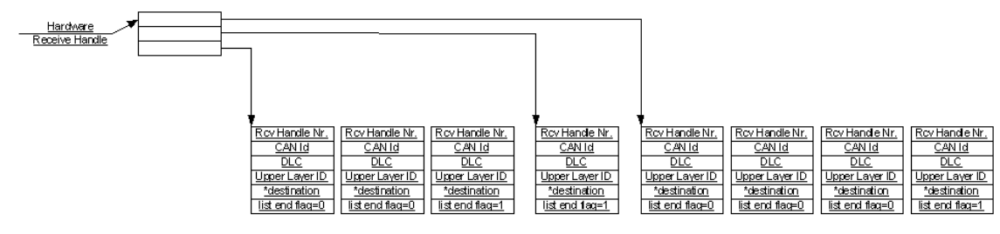

Figure 7.9：Software filtering 示例

[SWS_CANIF_00852] ⌈ 若某范围被另一范围部分或全部包含，或单个 CanId 位于某范围内，software filter 应按以下规则选择 L-PDU：

• 单个 CanId 始终优先于范围；

• 较小范围优先于较大范围。

> 原文第 66 页

⌋()

#### 7.20.2 Software filter 算法

具体查找算法由 CanIf 实现选择。考虑到 Controller 提供的 BasicCAN 接收方式多样，建议支持 linear search、table search 和/或 hash search 等算法变体，以适应多数使用场景。

### 7.21 Data Length Check

将接收 Data Length 与对应 L-PDU 配置的 Data Length 比较。配置长度应根据本 L-PDU 中实际使用的字节范围确定，不一定等于 communication matrix 中定义、并由发送方使用的 Data Length。

[SWS_CANIF_00026] ⌈ CanIf 应接受所有 Data Length 大于或等于配置值 CanIfRxPduDataLength 的接收 L-PDU（见 [SWS_CANIF_00390]）。⌋ (SRS_Can_01005)

[SWS_CANIF_00902] ⌈ 若全局启用 Data Length Check（CanIfPrivateDataLengthCheck），且未通过 CanIfRxPduDataLengthCheck 对该 PDU 单独禁用，则应执行检查。⌋ ()

提示：若全局禁用 Data Length Check，不能再对单个 PDU 启用。

[SWS_CANIF_00168] ⌈ 若 Data Length Check 拒绝接收 L-PDU（见 [SWS_CANIF_00026]），CanIf 应通过 DET 的 Det_ReportRuntimeError() 报告 CANIF_E_INVALID_DATA_LENGTH。⌋ ()

[SWS_CANIF_00829] ⌈ Data Length Check 通过后，CanIf 应将收到的长度值（见 [SWS_CANIF_00006]）传递给目标上层（见 [SWS_CANIF_00135]）。⌋ ()

[SWS_CANIF_00830] ⌈ 若未配置 Data Length Check（见 CanIfPrivateDataLengthCheck、CanIfRxPduDataLengthCheck），CanIf 应将收到的长度值（见 [SWS_CANIF_00006]）传递给目标上层（见 [SWS_CANIF_00135]）。⌋ ()

> 原文第 67 页

### 7.22 面向上层的 L-SDU dispatcher

理由：发送方向，L-SDU dispatcher 需找到目标上层的 Tx confirmation callback；接收方向，每个 L-SDU 仅对应一个目标上层，关联在配置时静态确定。CanIf 内的 dispatcher 查找接收 L-SDU 的使用者并向其分发通知。发送确认和接收通知服务可在不同上层以不同名称存在多个实例，并根据所服务模块静态配置。

### 7.23 Polling mode

Polling mode 无需硬件中断，即可处理 CAN 硬件中的发送、接收和错误事件。CanIf 和 CanDrv 为这些事件提供相应检测与处理通知。在 Polling mode 下，CanIf notification service 的行为不变，上层无需感知硬件事件检测策略。使用不同 CanDrv 时，应在配置与系统集成阶段协调调用频率。

这些服务能检测上次执行以来 CAN hardware object 中发生的新事件。CanIf 用于转发 CanDrv 所检测事件的 notification service 与中断方式相同（见 8.4“Callback notification”）。

使用者应保证 CanIf 既可在 interrupt level 执行中断触发的通知，也可在 Task level 执行相应通知。若 Controller mailbox 的访问被阻止，则后续进行发送缓冲（见 7.11）。

可为每个底层 Controller 配置 Polling 或 Interrupt mode。

### 7.24 多个 CAN Driver 的支持

CanIf 通过专门映射为多个 CanDrv 提供统一上层接口。向下需要将操作分发到对应 CanDrv 及其 Controller 的 API；向上则通过合适的 callback notification 区分各 CanDrv。

每个 CanDrv 支持一定数量的 Controller 和固定数量的 HTH / HRH，拥有独立编号空间，其中 Controller 与 HTH 均从 0 开始。CanIf 必须根据 API 传入的 L-SDU 确定对应

> 原文第 68 页

CanDrv，并转换相关参数，例如 L-SDU → HTH / HRH、CanId、Data Length。

可通过 CanIfPublicMultipleDrvSupport 启用或禁用多个 CanDrv 支持。

#### 7.24.1 使用多个 CAN Driver 时的发送请求

每个 Transmit L-PDU 都使 CanIf 能确定对应 Controller，进而确定其 Hardware Unit 的 CanDrv。CAN Controller Handle 同时关联 CanDrv Handle 和 Hardware Unit 内的 Controller，因此能够解析这些依赖关系。

配置时为每个 Controller 映射一个 CAN Controller Handle。Figure 7.10 展示向不同 CanDrv 发出的两个发送请求；CanIf 只需选择对应 CanDrv 即可调用正确 API。

注：Figure 7.10 及下表仅为示例，如何访问底层 CanDrv 的正确 API 由实现决定。

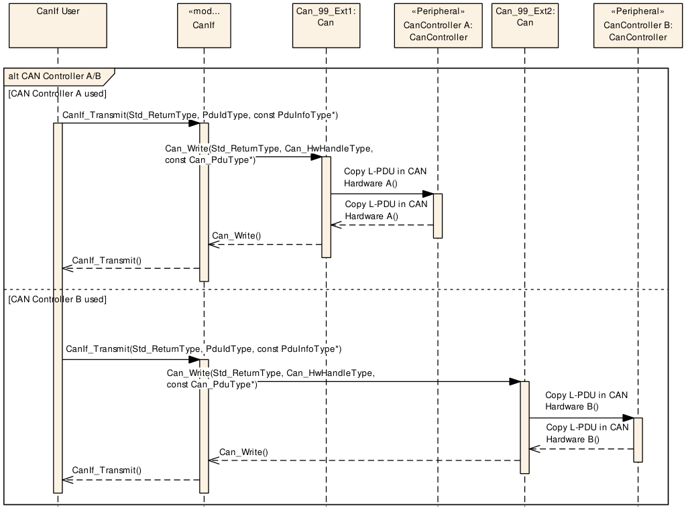

Figure 7.10：多个 CAN Driver 的发送请求（简化）

> 原文第 69 页

| 调用的操作 | 说明 |
| --- | --- |
| CanIf_Transmit (PduId_1, PduInfoPtr_1) | 上层发起发送请求。根据 PduId 查找目标 Controller 及其 Hardware Unit；Hardware Unit 编号用于索引函数指针数组。先从 PduId_1 提取 PDU channel group 编号，再由该组确定 CAN channel、Hardware Unit 编号和 Controller 编号。Hardware Unit 编号指向一个 CanDrv 实例及其配置的全部 API，其中包含所请求的发送服务。 |
| Can_Write (Hth, PduInfoPtr) | 向相应 CAN_Driver 发出发送请求，例如由它管理 Hardware Unit A 的 Controller #0。 |
| 硬件请求 | 将全部 L-PDU 数据写入相应硬件，例如 Hardware Unit A 的 Controller #0，并激活发送请求。 |
| CanIf_Transmit (PduId_2, PduInfoPtr_2) | 上层发起另一发送请求。PduId 指向另一 Controller 和 Hardware Unit，其编号用于索引函数指针数组。先从 PduId_2 提取 PDU channel group 编号，再确定 CAN channel、Hardware Unit 编号和 Controller 编号。Hardware Unit 编号指向相应 CanDrv 实例及其 API，其中包括目标发送服务。 |
| Can_Write (Hth, PduInfoPtr_2) | 向相应 CAN_Driver 发出发送请求，例如由它管理 Hardware Unit B 的 Controller #1。 |
| 硬件请求 | 将全部 L-PDU 数据写入相应硬件，例如 Hardware Unit B 的 Controller #1，并激活发送请求。 |

#### 7.24.2 使用多个 CAN Driver 时的通知机制

即使 ECU 使用多个 CanDrv，CanIf 中供其调用的每种 notification callback 仍只有一个实例。因此，CanIf 必须根据参数识别调用方 CanDrv，具体使用 Mailbox（Can_HwType）结构内的 ControllerId。

> 原文第 70 页

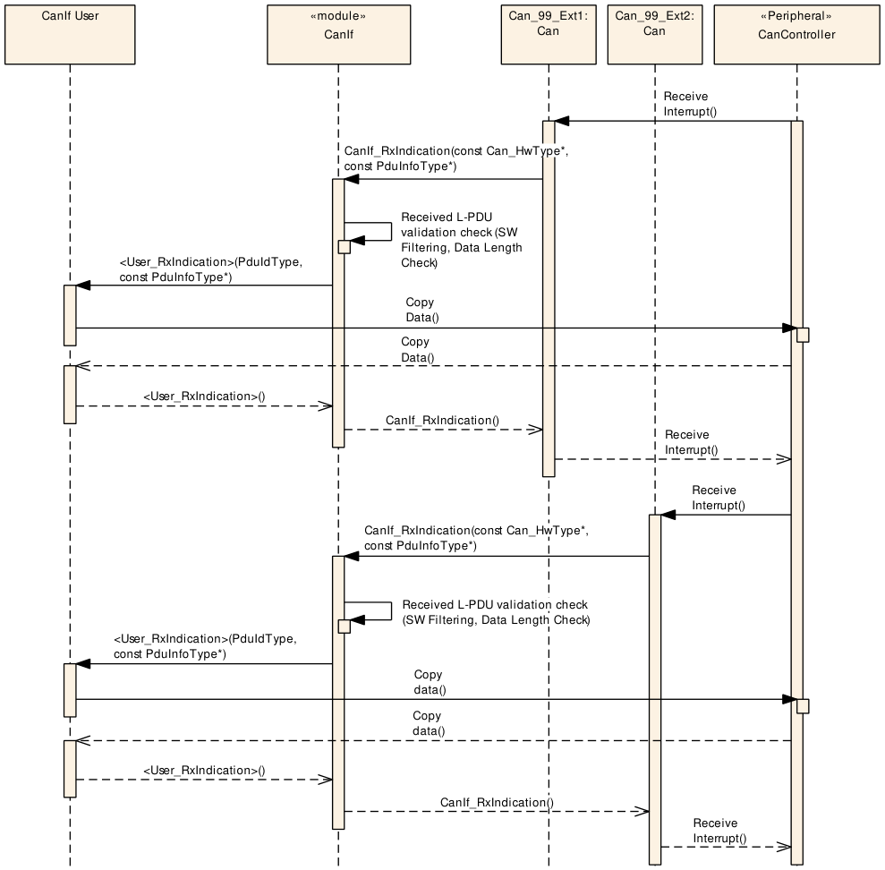

图 7.11：多个 CanDrv 的接收中断——简化视图

| 调用的操作 | 说明 |
| --- | --- |
| Receive Interrupt | CAN Controller 1 指示接收成功并触发接收中断，随后调用 CanDrv A 的 ISR。 |
| CanIf_RxIndication (Mailbox_1, PduInfoPtr_1) | 通过调用 CanIf_RxIndication()，将接收事件通知给 CanIf。指针 Mailbox_1 标识 HRH 及其所属的 CAN Controller；该硬件接收对象中保存着由 PduInfoPtr_1 描述的已接收 L-PDU。 |
| 有效性检查（SW Filtering、Data Length Check） | Software Filtering 判断本 ECU 是否需要处理收到的 L-PDU；若不需要，则不通知上层并终止处理。若匹配成功，则比较接收 Data Length 与该 L-PDU 静态配置的预期值。 |
| &lt;User_RxIndication&gt; (CanRxPduId_1, CanPduInfoPtr_1) | 调用对应上层的 receive indication service，通知成功接收。CanRxPduId_1 标识收到的 L-SDU，第二个参数引用 PduInfoType，以访问保存该 L-SDU 的 buffer。 |

> 原文第 71 页

| Receive Interrupt | CAN Controller 2 指示成功接收并触发中断，执行 CanDrv B 的 ISR。 |
| --- | --- |
| CanIf_RxIndication (Mailbox_2, PduInfoPtr_2) | 通过 CanIf_RxIndication() 通知接收。Mailbox_2 标识 HRH 及其 Controller，其中包含 PduInfoPtr_2 指定的 L-PDU。 |
| 有效性检查（SW Filtering、Data Length Check） | Software Filtering 判断本 ECU 是否需要处理收到的 L-PDU；若不需要，则不通知上层并终止处理。若匹配成功，则比较接收 Data Length 与该 L-PDU 静态配置的预期值。 |
| &lt;User_RxIndication&gt; (CanRxPduId_2, CanPduInfoPtr_2) | 调用目标上层 receive indication service，通知成功接收。CanRxPduId_2 标识收到的 L-SDU，第二个参数引用 PduInfoType，以访问 L-SDU buffer。 |

### 7.25 Partial Networking

[SWS_CANIF_00747] ⌈ 若启用 Partial Networking（CanIfPublicPnSupport），CanIf 应为每个 Controller 支持一个叠加于 PDU channel mode 之上的 PnTxFilter。⌋ (SRS_Can_01174)

[SWS_CANIF_00748] ⌈ 只有 Controller 至少配置一个 CanIfTxPduPnFilterPdu，才允许 [SWS_CANIF_00747] 的 PnTxFilter 生效并切换 enabled/disabled 状态。⌋ (SRS_Can_01174)

[SWS_CANIF_00863] ⌈ 初始化期间应启用 PnTxFilter（见 [SWS_CANIF_00747]、[SWS_CANIF_00748]）。⌋ ()

[SWS_CANIF_00749] ⌈ 调用 CanIf_SetControllerMode(ControllerId, CAN_CS_SLEEP) 时，应启用对应 Controller 的 PnTxFilter（见 [SWS_CANIF_00748]、[SWS_CANIF_00747]）。⌋ ()

[SWS_CANIF_00750] ⌈ Controller 的 PnTxFilter 启用时，CanIf 应阻止该 Controller 的全部 Tx request（CanIf_Transmit() 返回 E_NOT_OK），但配置为 CanIfTxPduPnFilterPdu 的 Tx L-PDU 除外；这些 PDU 应始终传递给对应 CAN Driver。⌋ (SRS_Can_01173, SRS_Can_01174)

[SWS_CANIF_00751] ⌈ 调用 CanIf_TxConfirmation() 时，应禁用对应 PnTxFilter（见 [SWS_CANIF_00747]、[SWS_CANIF_00748]）。⌋ ()

> 原文第 72 页

[SWS_CANIF_00896] ⌈ 调用 CanIf_RxIndication() 且 PnTxFilter 已启用时，应禁用对应 PnTxFilter（见 [SWS_CANIF_00747]、[SWS_CANIF_00748]）。⌋ ()

[SWS_CANIF_00752] ⌈ Controller 的 PnTxFilter 禁用时，CanIf 应按 CanIf_SetPduMode() 请求的行为工作（见 [SWS_CANIF_00008]）。⌋ ()

[SWS_CANIF_00878] ⌈ 若调用 CanIf_SetPduMode(ControllerId, CANIF_TX_OFFLINE)，且启用 Partial Networking（CanIfPublicPnSupport），则应启用对应 Controller 的 PnTxFilter（见 [SWS_CANIF_00748]、[SWS_CANIF_00747]）。⌋ ()

### 7.26 CAN FD 支持

部分 Controller 为提升性能而支持 Flexible Data-Rate（CAN FD，见 [12, ISO 11898-1:2015]）。除提高 payload 传输 baudrate 外，CAN FD 还支持最长 64 字节 payload。能否使用取决于 Controller 是否支持 CAN FD，以及是否处于 CAN FD mode（有效的 CanControllerFdBaudrateConfig）。

L-SDU 采用 CAN FD 还是传统 CAN 2.0 frame 发送，取决于 CanIfTxPduCanIdType。CanIf 调用 Can_Write() 时，通过 PduInfo-&gt;id（Can_IdType）的次高位向 CanDrv 指示。

注：若 CanDrv 未处于 CAN FD mode（没有 CanControllerFdBaudrateConfig），只要 SduLength &lt;= 8 字节，L-PDU 就以传统 CAN 2.0 frame 发送。

注：使用相同 CanId 时，传统 CAN 2.0 与 CAN FD frame 的 arbitration phase 没有区别。因此，即使使用 CAN FD，也不得重复使用同一 CanId。

CanDrv 通过 CanIf_RxIndication() 传入的 Mailbox-&gt;CanId（Can_IdType）次高位指示接收 frame 类型。CanIf 据此按 [SWS_CANIF_00877] 映射到配置的 L-SDU（CanIfRxPduCfg）。

注：若上层不区分 CAN 2.0 与 CAN FD 接收，可为两者仅配置一个 CanIfRxPduCfg（见 CanIfRxPduCanIdType），以实现局部优化。但从系统角度，每个 frame 的格式仍需配置，否则发送方无法确定应发送的类型。

> 原文第 73 页

### 7.27 CAN XL 支持

CAN XL（见 [14, CiA610-1]）是在 CAN 2.0 和 CAN FD 基础上的演进，不仅将 baudrate 提升至最高 20 MBit/s、payload 扩大至 2048 字节，还引入其他特性。

AUTOSAR 主要引用 [14, CiA610-1] 和 [15, CiA611-1]。为完整了解 CAN XL，还应参阅以下 CiA 系列：

• CiA 610：CAN XL 规范与测试计划。

• CiA 611：CAN XL higher-layer service。

• CiA 612：CAN XL 指南与应用说明。

• CiA 613：CAN XL add-on service。

CAN XL 引入了以下 CAN 新特性：

• Priority ID 实现完全基于优先级的总线访问。不同于 CAN 2.0 / CAN FD 的 CAN ID，frame 优先级与内容标识解耦，Priority ID 仅编码优先级，不再包含其他信息。

• SDU Type 指示 data field 中封装的协议类型，允许同一总线传输 content-based CAN XL message、隧道封装的 CAN 2.0 / CAN FD，以及 Ethernet frame。支持的类型见 [15, CiA 611-1]。

• Virtual CAN Network ID 将总线流量划分为虚拟网络，有助于职责隔离及 ECU 分组，也使低算力 ECU 能尽早过滤掉不属于自身 VCID 的消息。

• Acceptance Field 的含义取决于 SDU Type。例如在 content-based addressing 中，它表示 Message ID，类似 CAN 2.0 / CAN FD 的 CAN ID，也可用于增强 ingress filtering。

• Transceiver mode switching 支持高于 8 Mbit/s 的 baudrate：在 XL Data phase 切换为 PWM coding，最高支持 20 MBit/s。此时不能与同总线上的传统 CAN 2.0 / CAN FD 节点互操作；此外，当前还必须关闭 error signaling。

仅当 Controller 支持 CAN XL 且已启用 CAN XL mode（存在 CanControllerXLBaudrateConfig）时，才可使用 CAN XL。

Constraints:

• 同一总线上的所有其他节点至少应支持 CAN FD。

> 原文第 74 页

• CAN XL buffer 可能很大且大小差异显著，需要不同处理方式，因此 CanIf 内的 L-PDU 发送缓冲（见 7.11）不适用于 CAN XL frame。

#### 7.27.1 CAN XL 属性的动态控制

CAN XL frame 的部分参数可通过 MetaData 传递，无需全部静态配置。

接收时，仅比较对应 CanIfRxPdu 已配置的参数，未配置的参数应作为 MetaData 传给上层。

发送时，将传入的 MetaData item 与 CanIfTxPdu 已配置参数组合，得到实际参数。

[SWS_CANIF_00937] ⌈ 接收 CAN XL frame 时，应从传入的 CanXL_Params 提取 global PDU 中配置为 PRIORITYID_16、VLAN_16、SDUTYPE_8 和 ACCEPTANCEFIELD_32 MetaData item 的 CAN XL 参数，并组合到传给上层的 PDU MetaData 中。⌋ (SRS_Can_02003)

[SWS_CANIF_00938] ⌈ 发送 CAN XL frame 时，应将上层通过 PRIORITYID_16、VLAN_16、SDUTYPE_8、ACCEPTANCEFIELD_32 MetaData item 传入的 CAN XL 参数，与配置的 CanIfTxPduXLParams 组合为 CanXL_Params。⌋ (SRS_Can_02003)

注意：配置必须保证每个收发 CAN XL frame 的每项参数，要么静态配置，要么通过 MetaData 传入，不能同时采用两种方式。另见 10.2。

### 7.28 Security Event

[SWS_CANIF_91010] CanIf 的 Security Event ⌈

| 字段 | 内容 |
| --- | --- |
| 名称 | 说明 · ID |
| CANIF_SEV_TX_ERROR_DETECTED | 检测到发送相关错误；根据 context data，可能表示可疑 CAN 活动。 · 19 |
| CANIF_SEV_RX_ERROR_DETECTED | 检测到接收相关错误；根据 context data，可能表示可疑 CAN 活动。 · 20 |
| CANIF_SEV_ERRORSTATE_PASSIVE | CAN Controller 转入 passive 状态。 · 21 |
| CANIF_SEV_ERRORSTATE_BUSOFF | CAN Controller 转入 busoff 状态。 · 22 |

⌋(RS_Ids_00810)

[SWS_CANIF_00913] ⌈ 若 CanIfEnableSecurityEventReporting = true，启用 CanIf security event reporting，则相关 security

> 原文第 75 页

event 应通过 AUTOSAR_SWS_BSWGeneral 定义的接口报告给 IdsM。⌋ (RS_Ids_00810)

[SWS_CANIF_00915] ⌈ CanDrv 调用 CanIf_ErrorNotification() 时，应判断是否检测到 Tx 相关错误；若是，CanIf 应报告 CANIF_SEV_TX_ERROR_DETECTED。Context Data 结构如下（2 Byte）：

• ControllerID (1 Byte)

• CanError (1 Byte)

– CAN_ERROR_BIT_MONITORING1 (0x1)

– CAN_ERROR_BIT_MONITORING0 (0x2)

– CAN_ERROR_BIT (0x3)

– CAN_ERROR_CHECK_ACK_FAILED (0x4)

– CAN_ERROR_ACK_DELIMITER (0x5)

– CAN_ERROR_ARBITRATION_LOST (0x6)

– CAN_ERROR_OVERLOAD (0x7)

⌋(RS_Ids_00810)

[SWS_CANIF_00916] ⌈ CanDrv 调用 CanIf_ErrorNotification() 时，应判断是否检测到 Rx 相关错误；若是，CanIf 应报告 CANIF_SEV_RX_ERROR_DETECTED。Context Data 结构如下（2 Byte）：

• ControllerID (1 Byte)

• CanError (1 Byte)

– CAN_ERROR_CHECK_FORM_FAILED (0x8)

– CAN_ERROR_CHECK_STUFFING_FAILED (0x9)

– CAN_ERROR_CHECK_CRC_FAILED (0xA)

– CAN_ERROR_BUS_LOCK (0xB)

⌋(RS_Ids_00810)

[SWS_CANIF_00917] ⌈ CanDrv 调用 CanIf_ControllerErrorStatePassive() 时，以下情况应报告 CANIF_SEV_ERRORSTATE_PASSIVE：

• TxErrorCounter &gt; 127 且 TxErrorCounter &lt;= 255。

• RxErrorCounter &gt; 127 且 TxErrorCounter &lt;= 255。

> 原文第 76 页

Context Data 结构如下（2 Byte）：

• ControllerID (1 Byte)

• ErrorCounterThreshold (1 Byte)

– TxErrorCounter &gt; 127 且 RxErrorCounter &gt; 127（0x0）。

– TxErrorCounter &gt; 127 且 RxErrorCounter &lt; 127（0x1）。

– RxErrorCounter &gt; 127 且 TxErrorCounter &lt; 127（0x2）。

⌋(RS_Ids_00810)

[SWS_CANIF_00918] ⌈ CanDrv 调用 CanIf_ControllerBusOff 时，CanIf 应报告 CANIF_SEV_ERRORSTATE_BUSOFF。Context Data 结构如下（1 Byte）：

• Controller ID（1 Byte）。

⌋(RS_Ids_00810)

### 7.29 错误分类

#### 7.29.1 Development Error

[SWS_CANIF_91006] ⌈

| 错误类型 | 对应 error code | 错误值 |
| --- | --- | --- |
| 调用 API 时使用了无效 CAN ID。 | CANIF_E_PARAM_CANID | 10 |
| 调用 API 时使用了无效 hardware object。 | CANIF_E_PARAM_HOH | 12 |
| 调用 API service 时 PDU ID 无效。 | CANIF_E_PARAM_LPDU | 13 |
| 调用 API 时使用了无效 Controller ID。 | CANIF_E_PARAM_CONTROLLERID | 15 |
| 调用 API 时使用了无效 wakeup source。 | CANIF_E_PARAM_WAKEUPSOURCE | 16 |
| 调用 API 时使用了无效 Transceiver ID。 | CANIF_E_PARAM_TRCV | 17 |
| 调用 API 时使用了无效 Transceiver mode。 | CANIF_E_PARAM_TRCVMODE | 18 |
| 调用 API 时使用了无效 Transceiver wakeup mode。 | CANIF_E_PARAM_TRCVWAKEUPMODE | 19 |
| 调用 API 时使用了无效指针。 | CANIF_E_PARAM_POINTER | 20 |
| 调用 API 时使用了无效 Controller mode。 | CANIF_E_PARAM_CTRLMODE | 21 |
| 调用 API 时使用了无效 PDU mode。 | CANIF_E_PARAM_PDU_MODE | 22 |
| 调用 API 时使用了无效参数。 | CANIF_E_PARAM_CAN_ERROR | 23 |
| 模块未初始化就调用 API。 | CANIF_E_UNINIT | 30 |
| 无效的 Transmit PDU ID。 | CANIF_E_INVALID_TXPDUID | 50 |
| 无效的 Receive PDU ID。 | CANIF_E_INVALID_RXPDUID | 60 |
| CAN Interface 初始化失败。 | CANIF_E_INIT_FAILED | 80 |

⌋()

> 原文第 77 页

#### 7.29.2 Runtime Error

[SWS_CANIF_91007] ⌈

| 错误类型 | 对应 error code | 错误值 |
| --- | --- | --- |
| Data Length Check 失败。 | CANIF_E_INVALID_DATA_LENGTH | 61 |
| Data Length | CANIF_E_DATA_LENGTH_MISMATCH | 62 |
| 在 offline PDU channel 上请求发送。 | CANIF_E_STOPPED | 70 |
| 消息长度超过最大长度。 | CANIF_E_TXPDU_LENGTH_EXCEEDED | 90 |

⌋()

#### 7.29.3 Transient Fault

无 transient fault。

#### 7.29.4 Production Error

没有 Production Error。

#### 7.29.5 Extended Production Error

无 extended production error。

> 原文第 78 页

## 8 API 规范

### 8.1 导入的类型

本章列出从以下模块引入的全部类型。

[SWS_CANIF_00142] ⌈

| 模块 | Header File | 导入的类型 |
| --- | --- | --- |
| Can | Can_GeneralTypes.h | Can_ControllerStateType |
|  | Can_GeneralTypes.h | Can_ErrorStateType |
|  | Can_GeneralTypes.h | Can_ErrorType |
|  | Can_GeneralTypes.h | Can_HwHandleType |
|  | Can_GeneralTypes.h | Can_HwType |
|  | Can_GeneralTypes.h | Can_IdType |
|  | Can_GeneralTypes.h | Can_PduType |
|  | Can_GeneralTypes.h | Can_TimeStampType (draft) |
| CanTrcv | Can_GeneralTypes.h | CanTrcv_TrcvModeType |
|  | Can_GeneralTypes.h | CanTrcv_TrcvWakeupModeType |
|  | Can_GeneralTypes.h | CanTrcv_TrcvWakeupReasonType |
| CanXL | Can_GeneralTypes.h | CanXL_HwType |
|  | Can_GeneralTypes.h | CanXL_Params |
|  | Can_GeneralTypes.h | CanXL_PduType |
| ComStack_Types | ComStack_Types.h | PduIdType |
|  | ComStack_Types.h | PduInfoType |
|  | ComStack_Types.h | PduLengthType |
| EcuM | EcuM.h | EcuM_WakeupSourceType |
| IdsM | IdsM_Types.h | IdsM_SecurityEventIdType |
| Std | Std_Types.h | Std_ReturnType |
|  | Std_Types.h | Std_VersionInfoType |

⌋(SRS_BSW_00348, SRS_BSW_00353, SRS_BSW_00361)

### 8.2 类型定义

#### 8.2.1 CanIf_ConfigType

[SWS_CANIF_00144] ⌈

| 字段 | 内容 |
| --- | --- |
| 名称 | CanIf_ConfigType |
| 种类 | Structure |
| 成员 | 由实现决定 类型 · – |

> 原文第 79 页

|  | 注释 | 初始化数据结构的内容由 CAN Interface 决定。 |
| --- | --- | --- |
| 说明 | 此类型定义 CAN Interface 面向所有底层 CAN Driver 的 post-build 参数结构。初始化时，CanIf 获取指向该结构的指针，以访问初始化所需的配置数据。 |  |
| 通过以下文件提供 | CanIf.h |  |

⌋()

[SWS_CANIF_00523] ⌈ 特定 CanIf_ConfigType 的初始化数据结构应包含 CanIf public parameter 定义，以及每个 L-PDU / L-SDU 的定义。⌋ ()

注：CanIf public parameter 和各 L-PDU / L-SDU 的定义见第 10 章。

#### 8.2.2 CanIf_PduModeType

[SWS_CANIF_00137] ⌈

| 字段 | 内容 |
| --- | --- |
| 名称 | CanIf_PduModeType |
| 种类 | Enumeration |
| 取值范围 | CANIF_OFFLINE · 0x00 · = 0。对应 channel 的发送和接收路径均禁用，即无通信模式。 CANIF_TX_OFFLINE · 0x01 · 对应 channel 的发送路径禁用，接收路径启用。 CANIF_TX_OFFLINE_ACTIVE · 0x02 · 对应 channel 的发送路径处于 offline active mode（见 SWS_CANIF_00072），接收路径启用。此模式要求 CanIfTxOfflineActiveSupport = TRUE。 CANIF_ONLINE · 0x03 · 对应 channel 的发送和接收路径均启用，即完整运行模式。 |
| 说明 | Channel 的 PduMode 定义其发送或接收活动。上层可分别或同时控制 channel 的发送与接收方向。 |
| 通过以下文件提供 | CanIf.h |

⌋()

> 原文第 80 页

#### 8.2.3 CanIf_NotifStatusType

[SWS_CANIF_00201] ⌈

| 字段 | 内容 |
| --- | --- |
| 名称 | CanIf_NotifStatusType |
| 种类 | Enumeration |
| 取值范围 | CANIF_TX_RX_NOTIFICATION · – · 所查询的 Rx/Tx CAN L-PDU 已成功发送或接收。 CANIF_NO_NOTIFICATION · 0x00 · 所查询的 L-PDU 未发生发送或接收事件。 |
| 说明 | CAN L-PDU notification status 的返回值。 |
| 通过以下文件提供 | CanIf.h |

⌋()

### 8.3 函数定义

[SWS_CANIF_00661] ⌈ 除 CanIf_Init() 和 CanIf_GetVersionInfo() 外，所有 CanIf API 在此前尚未通过 CanIf_Init() 完成初始化时，不得执行正常操作，并应返回 E_NOT_OK。⌋ ()

#### 8.3.1 CanIf_Init

[SWS_CANIF_00001] ⌈

| 字段 | 内容 |
| --- | --- |
| 服务名称 | CanIf_Init |
| 函数原型 | void CanIf_Init ( const CanIf_ConfigType* ConfigPtr ) |
| Service ID [hex] | 0x01 |
| 同步 / 异步 | 同步 |
| 可重入性 | 不可重入 |
| 输入参数 | ConfigPtr · 指向 configuration parameter set 的指针，例如用于 post-build 参数。 |
| 输入 / 输出参数 | 无 |
| 输出参数 | 无 |
| 返回值 | 无 |
| 说明 | 初始化 CAN Interface 的内部和外部接口，为后续处理做准备。 |
| 通过以下文件提供 | CanIf.h |

⌋(SRS_BSW_00405, SRS_BSW_00101, SRS_BSW_00358, SRS_BSW_00414, SRS_Can_01021, SRS_Can_01022)

注：所有底层 CAN Controller 和 Transceiver 此时仍不可运行。

注：CanIf_Init() 仅由 EcuM 调用。

> 原文第 81 页

[SWS_CANIF_00085] ⌈ CanIf_Init() 应初始化 CanIf 的全局变量和数据结构，包括 flag 和 buffer。⌋ ()

#### 8.3.2 CanIf_DeInit

[SWS_CANIF_91002] ⌈

| 字段 | 内容 |
| --- | --- |
| 服务名称 | CanIf_DeInit |
| 函数原型 | void CanIf_DeInit ( void ) |
| Service ID [hex] | 0x02 |
| 同步 / 异步 | 同步 |
| 可重入性 | 不可重入 |
| 输入参数 | 无 |
| 输入 / 输出参数 | 无 |
| 输出参数 | 无 |
| 返回值 | 无 |
| 说明 | 对 CanIf 模块执行 de-initialization。 |
| 通过以下文件提供 | CanIf.h |

⌋(SRS_Can_01168, SRS_BSW_00336)

注：de-initialization 函数的通用行为和约束由 [SWS_BSW_00152]、[SWS_BSW_00072]、[SWS_BSW_00232] 和 [SWS_BSW_00233] 规定。

注意：CanIf_DeInit() 的调用者必须保证没有正在进行的发送/接收，也没有待处理的 transmission confirmation。

#### 8.3.3 CanIf_SetControllerMode

[SWS_CANIF_00003] ⌈

| 字段 | 内容 |
| --- | --- |
| 服务名称 | CanIf_SetControllerMode |
| 函数原型 | Std_ReturnType CanIf_SetControllerMode ( uint8 ControllerId, Can_ControllerStateType ControllerMode ) |
| Service ID [hex] | 0x03 |
| 同步 / 异步 | 异步 |
| 可重入性 | 可重入，但同一 Controller 不可重入。 |
| 输入参数 | ControllerId · 请求模式切换的 CAN Controller 对应的抽象 CanIf ControllerId。 ControllerMode · 请求的模式切换。 |
| 输入 / 输出参数 | 无 |
| 输出参数 | 无 |

> 原文第 82 页

| 字段 | 内容 |
| --- | --- |
| 返回值 | Std_ReturnType · E_OK：Controller mode 请求已接受。E_NOT_OK：请求未接受。 |
| 说明 | 调用对应 CAN Driver 服务，改变 CAN Controller mode。 |
| 通过以下文件提供 | CanIf.h |

⌋(SRS_Can_01027)

注：CanIf_SetControllerMode() 请求将 ControllerId 指定的 Controller 切换到 ControllerMode。

[SWS_CANIF_00308] ⌈ CanIf_SetControllerMode() 应为目标 Controller 调用 Can_SetControllerMode(Controller, Transition)。⌋ ()

[SWS_CANIF_00311] ⌈ 调用 CanIf_SetControllerMode() 时，若 ControllerId 无效，CanIf 应通过 DET 的 Det_ReportError 报告 CANIF_E_PARAM_CONTROLLERID。⌋ (SRS_BSW_00323)

[SWS_CANIF_00774] ⌈ 调用 CanIf_SetControllerMode() 时，若 ControllerMode 无效（不是 CAN_CS_STARTED、CAN_CS_SLEEP 或 CAN_CS_STOPPED），CanIf 应通过 DET 的 Det_ReportError 报告 CANIF_E_PARAM_CTRLMODE。⌋ (SRS_BSW_00323)

注：Controller ID 发布在 CanIf configuration description 中。

#### 8.3.4 CanIf_GetControllerMode

[SWS_CANIF_00229] ⌈

| 字段 | 内容 |
| --- | --- |
| 服务名称 | CanIf_GetControllerMode |
| 函数原型 | Std_ReturnType CanIf_GetControllerMode ( uint8 ControllerId, Can_ControllerStateType* ControllerModePtr ) |
| Service ID [hex] | 0x04 |
| 同步 / 异步 | 同步 |
| 可重入性 | 不可重入 |
| 输入参数 | ControllerId · 请求查询当前运行模式的 Controller 对应的抽象 CanIf ControllerId。 |
| 输入 / 输出参数 | 无 |
| 输出参数 | ControllerModePtr · 指向存储区的指针，用于保存 Controller 当前模式。 |

> 原文第 83 页

| 字段 | 内容 |
| --- | --- |
| 返回值 | Std_ReturnType · E_OK：接受 Controller mode 请求。&lt;br&gt;E_NOT_OK：未接受 Controller mode 请求。 |
| 说明 | 调用对应 CAN Driver 服务，获取 Controller 当前状态。 |
| 通过以下文件提供 | CanIf.h |

⌋(SRS_Can_01028)

[SWS_CANIF_00313] ⌈ 调用 CanIf_GetControllerMode() 时，若 ControllerId 无效，CanIf 应通过 DET 的 Det_ReportError 报告 CANIF_E_PARAM_CONTROLLERID。⌋ (SRS_BSW_00323)

[SWS_CANIF_00656] ⌈ 调用 CanIf_GetControllerMode() 时，若 ControllerModePtr 无效，CanIf 应通过 DET 的 Det_ReportError 报告 CANIF_E_PARAM_POINTER。⌋ (SRS_BSW_00323)

注：Controller 模块的 ID 发布在 CanIf configuration description 中。

#### 8.3.5 CanIf_GetControllerErrorState

[SWS_CANIF_91001] ⌈

| 字段 | 内容 |
| --- | --- |
| 服务名称 | CanIf_GetControllerErrorState |
| 函数原型 | Std_ReturnType CanIf_GetControllerErrorState ( uint8 ControllerId, Can_ErrorStateType* ErrorStatePtr ) |
| Service ID [hex] | 0x4b |
| 同步 / 异步 | 同步 |
| 可重入性 | 对于同一 ControllerId 不可重入。 |
| 输入参数 | ControllerId · 分配给目标 CAN controller 的抽象 CanIf ControllerId，用于请求其 ErrorState。 |
| 输入 / 输出参数 | 无 |
| 输出参数 | ErrorStatePtr · 指向用于存储 CAN controller error state 的内存位置。 |
| 返回值 | Std_ReturnType · E_OK：接受 error state 请求。&lt;br&gt;E_NOT_OK：未接受 error state 请求。 |
| 说明 | 调用对应 CAN Driver 服务，获取 Controller error state。 |
| 通过以下文件提供 | CanIf.h |

⌋(SRS_Can_01169)

[SWS_CANIF_00898] ⌈ 调用 CanIf_GetControllerErrorState() 时，若 ControllerId 无效，CanIf 应通过 DET 的 Det_ReportError 报告 CANIF_E_PARAM_CONTROLLERID。⌋ (SRS_BSW_00323)

> 原文第 84 页

[SWS_CANIF_00899] ⌈ 调用 CanIf_GetControllerErrorState() 时，若 ErrorStatePtr 为空指针，CanIf 应通过 DET 的 Det_ReportError 报告 CANIF_E_PARAM_POINTER。⌋ (SRS_BSW_00323)

#### 8.3.6 CanIf_Transmit

[SWS_CANIF_00005] ⌈

| 字段 | 内容 |
| --- | --- |
| 服务名称 | CanIf_Transmit |
| 函数原型 | Std_ReturnType CanIf_Transmit ( PduIdType TxPduId, const PduInfoType* PduInfoPtr ) |
| Service ID [hex] | 0x49 |
| 同步 / 异步 | 同步 |
| 可重入性 | 不同 PduId 可重入，同一 PduId 不可重入。 |
| 输入参数 | TxPduId · 待发送 PDU 的标识符。 PduInfoPtr · PDU 数据长度、数据指针及 MetaData 指针。 |
| 输入 / 输出参数 | 无 |
| 输出参数 | 无 |
| 返回值 | Std_ReturnType · E_OK：发送请求已接受。E_NOT_OK：发送请求未接受。 |
| 说明 | 请求发送一个 PDU。 |
| 通过以下文件提供 | CanIf.h |

⌋(SRS_Can_01008)

注：必须根据 TxPduId 解析对应 Controller 和 HTH。

[SWS_CANIF_00939] ⌈ 调用 CanIf_Transmit() 时，若存在 CanIfTxPduCfg-&gt;CanIfTxPduXLParams，表示 CAN XL frame，应使用 CanXL_Write() 发送；否则应使用 Can_Write()。⌋ (SRS_Can_01162, SRS_Can_02003)

[SWS_CANIF_00317] ⌈ 若 ControllerId 对应 Controller mode 不是 CAN_CS_STARTED，且 channel 的发送路径既不是 online，也不是 offline active，则 CanIf_Transmit() 不得接受发送请求。⌋ ()

[SWS_CANIF_00318] ⌈ CanIf_Transmit() 应使用 TxPduId 对应的 HTH 和按下列规则构造的 Can_PduType 调用 Can_Write()：

• swPduHandle 设为对应 CanIf_TxConfirmation() 调用所使用的 CanTxPduId；

• length 设为 PduInfoPtr-&gt;SduLength，必要时按 [SWS_CANIF_00894] 缩短；

> 原文第 85 页

• id 设为 TxPduId 关联的 CAN ID；

• sdu 设为 PduInfoPtr-&gt;SduDataPtr。

⌋()

注：PduInfoPtr 指向 L-SDU 用户存储、CAN Identifier、L-SDU handle 和 Data Length（见 [1, Specification of CAN Driver]）。

[SWS_CANIF_00243] ⌈ CanIf 调用 Can_Write() 将预定义 CanId 传给 CanDrv 前，应设置 CanId（PduInfoPtr-&gt;id）的最高两位：IDentifier Extension flag（见 [12, ISO 11898-1:2015]）和 CAN FD flag。Can_IdType 定义见 [1] 的 [SWS_Can_00416]。每个 CAN L-PDU 的 CanId 格式由 CanIfTxPduCanIdType 配置。⌋ (SRS_Can_01141)

[SWS_CANIF_00957] ⌈ CanIf_Transmit() 应使用 TxPduId 对应的 HTH 和按下列规则构造的 CanXL_PduType 调用 CanXL_Write()：

• swPduHandle 设为对应 CanIf_TxConfirmation() 调用所使用的 CanTxPduId；

• length 设为 PduInfoPtr-&gt;SduLength；

• sdu 设为 PduInfoPtr-&gt;SduDataPtr。

• XLParams 指向包含 PriorityId、Vcid、SduType、AcceptanceField 和 Sec 的 CanXL_Params 结构；Sec 当前不受支持，始终设为 0。

⌋(SRS_Can_02003)

[SWS_CANIF_00882] ⌈ 若 PDU 配置为 triggered transmission（CanIfTxPduTriggerTransmit = TRUE），CanIf_Transmit() 应接受值为 NULL 的 PduInfoPtr-&gt;SduDataPtr。⌋ ()

[SWS_CANIF_00162] ⌈ 若 Can_Write() / CanXL_Write() 返回 E_OK，CanIf_Transmit() 应返回 E_OK。⌋ (SRS_Can_01162, SRS_Can_02003)

注：若 Can_Write() / CanXL_Write() 返回 E_NOT_OK，CanIf_Transmit() 应返回 E_NOT_OK；此时由上层负责重试发送请求。

[SWS_CANIF_00319] ⌈ 调用 CanIf_Transmit() 时，若 TxPduId 无效，CanIf 应通过 DET 的 Det_ReportError 报告 CANIF_E_INVALID_TXPDUID。⌋ (SRS_BSW_00323)

[SWS_CANIF_00320] ⌈ 若 CanIf_Transmit() 的 PduInfoPtr 无效，CanIf 应报告 CANIF_E_PARAM_POINTER，

> 原文第 86 页

在该函数被调用时通过 DET 的 Det_ReportError 服务报告。⌋ (SRS_BSW_00323)

[SWS_CANIF_00893] ⌈ 调用 CanIf_Transmit() 时，若 PduInfoPtr-&gt;SduLength 超过 TxPduId 所引用 PDU 的最大长度：

• Can_IdType 表示 classic CAN frame 时，SduLength &gt; 8；

• Can_IdType 表示 CAN FD frame 时，SduLength &gt; 64；

• 存在 CanIfTxPduCfg-&gt;CanIfTxPduXLParams、表示 CAN XL frame 时，SduLength &gt; 2048；

则 CanIf 应通过 DET 的 Det_ReportRuntimeError() 报告 CANIF_E_DATA_LENGTH_MISMATCH。⌋ (SRS_Can_01162, SRS_Can_02003)

[SWS_CANIF_00940] ⌈ 调用 CanIf_Transmit() 时，若 PduInfoPtr-&gt;SduLength &lt; 1，存在 CanIfTxPduCfg-&gt;CanIfTxPduXLParams 表示 CAN XL frame，且 SDU Type 配置为非 03h（tunneled CAN 2.0/FD frame），CanIf 应通过 DET 的 Det_ReportRuntimeError() 报告 CANIF_E_DATA_LENGTH_MISMATCH。⌋ (SRS_Can_02003)

注：除静态配置发送外，还存在动态发送，因此有效长度始终由 PduInfoPtr-&gt;SduLength 提供；frame 类型甚至也可能通过 CanIf_SetDynamicTxId() 改变。[SWS_CANIF_00893] 确保可经 DET 检测不匹配的发送请求。

[SWS_CANIF_00894] ⌈ 调用 CanIf_Transmit() 时，若 PduInfoPtr-&gt;SduLength 超过 TxPduId 所引用 global PDU 的长度（见 [ECUC_EcuC_00078]），且已启用 CanIfTxPduTruncation，则 CanIf 应仅发送 global PDU 长度范围内的数据（见 [ECUC_EcuC_00078]），并丢弃其余数据。⌋ ()

[SWS_CANIF_00900] ⌈ 调用 CanIf_Transmit() 时，若 PduInfoPtr-&gt;SduLength 超过 TxPduId 所引用 global PDU 的长度（见 [ECUC_EcuC_00078]），且已禁用 CanIfTxPduTruncation，则 CanIf 应报告 runtime error CANIF_E_TXPDU_LENGTH_EXCEEDED，返回 E_NOT_OK，且不再执行后续操作。⌋ ()

注：CanIf_Transmit() 执行期间，PduInfoPtr 的 buffer 由 CanIf 控制，其他调用上下文不应读写；函数返回后，所有权交还上层。

[SWS_CANIF_00941] ⌈ 调用 CanIf_Transmit 时，若存在 CanIfTxPduCfg.CanIfTxPduXLParams 表示 CAN XL frame，传给 CanXL_Write 的 CanXL_Params 应按

> 原文第 87 页

[SWS_CANIF_00938] 所述方式，由 CanIfTxPduXLParams 中的配置参数及 -&gt;MetaDataPtr 传入的 MetaData 组合而成。⌋ (SRS_Can_02003)

如 7.27.1 所述，每项 CAN XL 参数要么静态配置，要么经 MetaData 传递。

[SWS_CANIF_00942] ⌈ 对于 tunneled CAN 2.0/FD frame（SDU Type 03h），应在 Acceptance Field 中传输 CAN ID。CAN ID 由 CanIfTxPduCanId 和 CanIfTxPduCanIdType 配置，或经 MetaData 传入。⌋ (SRS_Can_02003)

[SWS_CANIF_00943] ⌈ 调用 CanIf_Transmit 并使用 CanXL_Write 发送时，PduInfo-&gt;sec 应设为 0。⌋ (SRS_Can_02003)

#### 8.3.7 CanIf_ReadRxPduData

[SWS_CANIF_00194] ⌈

| 字段 | 内容 |
| --- | --- |
| 服务名称 | CanIf_ReadRxPduData |
| 函数原型 | Std_ReturnType CanIf_ReadRxPduData ( PduIdType CanIfRxSduId, PduInfoType* CanIfRxInfoPtr ) |
| Service ID [hex] | 0x06 |
| 同步 / 异步 | 同步 |
| 可重入性 | 不可重入 |
| 输入参数 | CanIfRxSduId · Receive L-SDU handle，标识对应 CAN L-SDU ID，并隐含指定 CanDrv 实例和 Controller 设备。 |
| 输入 / 输出参数 | 无 |
| 输出参数 | CanIfRxInfoPtr · 包含接收 PDU 的长度 SduLength、指向其 buffer 的 SduDataPtr，以及相关 MetaData。 |
| 返回值 | Std_ReturnType · E_OK：L-SDU 数据请求已接受。E_NOT_OK：尚未收到有效数据。 |
| 说明 | 向上层提供 CanIfRxSduId 指定数据的 Data Length 和接收内容。 |
| 通过以下文件提供 | CanIf.h |

⌋(SRS_Can_01125, SRS_Can_01129)

[SWS_CANIF_00324] ⌈ 若 ControllerId 对应 Controller mode 不是 CAN_CS_STARTED，且 channel 接收路径为 online，则 CanIf_ReadRxPduData() 不得接受请求，并应返回 E_NOT_OK。⌋ ()

[SWS_CANIF_00325] ⌈ 若 CanIf_ReadRxPduData() 的 CanIfRxSduId

无效，例如未通过 CanIfRxPduReadData 配置为在 CanIf 中保存，则调用该函数时应通过 DET 的 Det_ReportError 报告 CANIF_E_INVALID_RXPDUID。⌋ (SRS_BSW_00323)

> 原文第 88 页

[SWS_CANIF_00326] ⌈ 调用 CanIf_ReadRxPduData() 时，若 CanIfRxInfoPtr 无效，CanIf 应通过 DET 的 Det_ReportError 报告 CANIF_E_PARAM_POINTER。⌋ (SRS_BSW_00323)

[SWS_CANIF_00329] ⌈ 不得对定义为接收多个 CAN ID（range reception）的 CanIfRxSduId 使用 CanIf_ReadRxPduData()。⌋ ()

注：CanIf_ReadRxPduData() 执行期间，CanIfRxInfoPtr 的 buffer 由 CanIf 控制，其他上下文不应读写；返回后所有权交还上层。

[SWS_CANIF_00330] ⌈ CanIf_ReadRxPduData() 可在 pre-compile 配置阶段通过 CanIfPublicReadRxPduDataApi 启用或禁用。⌋ ()

#### 8.3.8 CanIf_ReadTxNotifStatus

[SWS_CANIF_00202] ⌈

| 字段 | 内容 |
| --- | --- |
| 服务名称 | CanIf_ReadTxNotifStatus |
| 函数原型 | CanIf_NotifStatusType CanIf_ReadTxNotifStatus ( PduIdType CanIfTxSduId ) |
| Service ID [hex] | 0x07 |
| 同步 / 异步 | 同步 |
| 可重入性 | 不可重入 |
| 输入参数 | CanIfTxSduId · 待发送 L-SDU 的 handle，标识对应 CAN L-SDU ID，并隐含指定 CanDrv 实例和 Controller 设备。 |
| 输入 / 输出参数 | 无 |
| 输出参数 | 无 |
| 返回值 | CanIf_NotifStatusType · 对应 CAN Tx L-PDU 当前的确认状态。 |
| 说明 | 返回 CanIfTxSduId 指定的静态或动态 CAN Tx L-PDU 的确认状态，即是否发生过 confirmation。 |
| 通过以下文件提供 | CanIf.h |

⌋(SRS_Can_01130)

注：此函数向上层报告所查询 L-SDU 的发送确认事件。

[SWS_CANIF_00393] ⌈ 若 CanIfPublicReadTxPduNotifyStatusApi 及该发送 L-SDU 的 CanIfTxPduReadNotifyStatus 均为 TRUE，则调用 CanIf_ReadTxNotifStatus() 时，CanIf 应复位该 L-SDU 的 notification status。⌋ ()

[SWS_CANIF_00331] ⌈ 若 CanIf_ReadTxNotifStatus() 的 CanIfTxSduId 越界，或未为该 Tx L-SDU 配置状态信息，CanIf 应报告 CANIF_E_INVALID_TXPDUID，

> 原文第 89 页

在 CanIf_ReadTxNotifStatus() 被调用时通过 DET 的 Det_ReportError 报告。⌋ (SRS_BSW_00323)

[SWS_CANIF_00335] ⌈ CanIf_ReadTxNotifyStatus() 可在 pre-compile 配置阶段通过 CanIfPublicReadTxPduNotifyStatusApi 全局启用或禁用。⌋ ()

#### 8.3.9 CanIf_ReadRxNotifStatus

[SWS_CANIF_00230] ⌈

| 字段 | 内容 |
| --- | --- |
| 服务名称 | CanIf_ReadRxNotifStatus |
| 函数原型 | CanIf_NotifStatusType CanIf_ReadRxNotifStatus ( PduIdType CanIfRxSduId ) |
| Service ID [hex] | 0x08 |
| 同步 / 异步 | 同步 |
| 可重入性 | 不可重入 |
| 输入参数 | CanIfRxSduId · Receive L-SDU handle，标识对应 CAN L-SDU ID，并隐含指定 CanDrv 实例和 Controller 设备。 |
| 输入 / 输出参数 | 无 |
| 输出参数 | 无 |
| 返回值 | CanIf_NotifStatusType · 对应 CAN Rx L-PDU 当前的通知状态。 |
| 说明 | 返回 CanIfRxSduId 指定 CAN Rx L-PDU 的通知状态，即是否发生过 indication。 |
| 通过以下文件提供 | CanIf.h |

⌋(SRS_Can_01130, SRS_Can_01131)

注：此函数向上层报告所查询 L-SDU 的接收通知事件。

[SWS_CANIF_00394] ⌈ 若 CanIfPublicReadRxPduNotifyStatusApi 和 CanIfRxPduReadNotifyStatus 均为 TRUE，则调用 CanIf_ReadRxNotifStatus() 时，CanIf 应复位接收 L-SDU 的 notification status。⌋ ()

[SWS_CANIF_00336] ⌈ 调用 CanIf_ReadRxNotifStatus() 时，若 CanIfRxSduId 越界，或在禁用 CanIfRxPduReadData 时查询 CanRxPduId 状态，或未为该 Rx L-SDU 配置状态信息，CanIf 应通过 DET 的 Det_ReportError 报告 CANIF_E_INVALID_RXPDUID。⌋ (SRS_BSW_00323)

注：不得对定义为接收多个 CAN ID（range reception）的 CanIfRxSduId 使用 CanIf_ReadRxNotifStatus()。

> 原文第 90 页

[SWS_CANIF_00340] ⌈ CanIf_ReadRxNotifStatus() 可在 pre-compile 配置阶段，通过 CanIfPublicReadRxPduNotifyStatusApi 全局启用或禁用。⌋ ()

#### 8.3.10 CanIf_SetPduMode

[SWS_CANIF_00008] ⌈

| 字段 | 内容 |
| --- | --- |
| 服务名称 | CanIf_SetPduMode |
| 函数原型 | Std_ReturnType CanIf_SetPduMode ( uint8 ControllerId, CanIf_PduModeType PduModeRequest ) |
| Service ID [hex] | 0x09 |
| 同步 / 异步 | 同步 |
| 可重入性 | 不可重入 |
| 输入参数 | ControllerId · 作用于本 ECU 中所有关联到该 CanIf ControllerId 的 PDU；该 ID 对应一个物理 CAN Controller。 PduModeRequest · 请求的 PDU mode 切换。 |
| 输入 / 输出参数 | 无 |
| 输出参数 | 无 |
| 返回值 | Std_ReturnType · E_OK：模式切换请求已接受。E_NOT_OK：请求未接受。 |
| 说明 | 为预定义逻辑 PDU channel 的 L-PDU 设置所请求的模式。 |
| 通过以下文件提供 | CanIf.h |

⌋()

注：标识预定义逻辑 PDU channel 的 channel 参数，可由 CanIf_SetPduMode() 的 ControllerId 得到。

[SWS_CANIF_00341] ⌈ CanIf_SetPduMode() 的 ControllerId 无效时，应通过 DET 的 Det_ReportError 报告 CANIF_E_PARAM_CONTROLLERID。⌋ (SRS_BSW_00323)

[SWS_CANIF_00860] ⌈ CanIf_SetPduMode() 的 PduModeRequest 无效时，应通过 DET 的 Det_ReportError 报告 CANIF_E_PARAM_PDU_MODE。⌋ (SRS_BSW_00323)

[SWS_CANIF_00874] ⌈ 若 ControllerId 对应 Controller 不处于 CAN_CS_STARTED，CanIf_SetPduMode() 不得接受请求，并应返回 E_NOT_OK。⌋ ()

> 原文第 91 页

#### 8.3.11 CanIf_GetPduMode

[SWS_CANIF_00009] ⌈

| 字段 | 内容 |
| --- | --- |
| 服务名称 | CanIf_GetPduMode |
| 函数原型 | Std_ReturnType CanIf_GetPduMode ( uint8 ControllerId, CanIf_PduModeType* PduModePtr ) |
| Service ID [hex] | 0x0a |
| 同步 / 异步 | 同步 |
| 可重入性 | 可重入，但同一 channel 不可重入。 |
| 输入参数 | ControllerId · 作用于本 ECU 中所有关联到该 CanIf ControllerId 的 PDU；该 ID 对应一个物理 CAN Controller。 |
| 输入 / 输出参数 | 无 |
| 输出参数 | PduModePtr · 指向用于保存逻辑 PDU channel 当前模式的存储区。 |
| 返回值 | Std_ReturnType · E_OK：PDU mode 请求已接受。E_NOT_OK：请求未接受。 |
| 说明 | 报告所查询 PDU channel 的当前模式。 |
| 通过以下文件提供 | CanIf.h |

⌋()

[SWS_CANIF_00346] ⌈ CanIf_GetPduMode() 的 ControllerId 无效时，应通过 DET 的 Det_ReportError 报告 CANIF_E_PARAM_CONTROLLERID。⌋ (SRS_BSW_00323)

[SWS_CANIF_00657] ⌈ CanIf_GetPduMode() 的 PduModePtr 无效时，应通过 DET 的 Det_ReportError 报告 CANIF_E_PARAM_POINTER。⌋ (SRS_BSW_00323)

#### 8.3.12 CanIf_GetVersionInfo

[SWS_CANIF_00158] ⌈

| 字段 | 内容 |
| --- | --- |
| 服务名称 | CanIf_GetVersionInfo |
| 函数原型 | void CanIf_GetVersionInfo ( Std_VersionInfoType* VersionInfo ) |
| Service ID [hex] | 0x0b |
| 同步 / 异步 | 同步 |
| 可重入性 | 可重入 |
| 输入参数 | 无 |
| 输入 / 输出参数 | 无 |
| 输出参数 | VersionInfo · 指向用于存储本模块版本信息的位置。 |
| 返回值 | 无 |
| 说明 | 返回所调用 CAN Interface 模块的版本信息。 |
| 通过以下文件提供 | CanIf.h |

> 原文第 92 页

⌋(SRS_BSW_00407, SRS_BSW_00411)

#### 8.3.13 CanIf_SetDynamicTxId

[SWS_CANIF_00189] ⌈

| 字段 | 内容 |
| --- | --- |
| 服务名称 | CanIf_SetDynamicTxId |
| 函数原型 | void CanIf_SetDynamicTxId ( PduIdType CanIfTxSduId, Can_IdType CanId ) |
| Service ID [hex] | 0x0c |
| 同步 / 异步 | 同步 |
| 可重入性 | 不可重入 |
| 输入参数 | CanIfTxSduId · 待发送 L-SDU 的 handle，标识对应 CAN L-SDU ID，并隐含指定 CanDrv 实例和 Controller 设备。 CanId · 待以 CAN FD 或传统 CAN frame 发送的 CAN L-SDU 的 Standard / Extended CAN ID。 |
| 输入 / 输出参数 | 无 |
| 输出参数 | 无 |
| 返回值 | 无 |
| 说明 | 重新配置指定 CAN L-PDU 对应的 CAN Identifier。 |
| 通过以下文件提供 | CanIf.h |

⌋()

注：CanIf_SetDynamicTxId() 可能被通信栈多个模块调用的 CanIf_Transmit() 打断，因此必须采取措施避免数据不一致。

[SWS_CANIF_00944] ⌈ 若 CanIf_SetDynamicTxId() 的 CanIfTxSduId

引用包含 CanIfTxPduXLParams 的 CanIfTxPduCfg，则调用该函数时应通过 DET 的 Det_ReportError 报告 CANIF_E_INVALID_TXPDUID。⌋ (SRS_Can_02003)

[SWS_CANIF_00352] ⌈ CanIf_SetDynamicTxId() 的 CanIfTxSduId 无效时，应通过 DET 的 Det_ReportError 报告 CANIF_E_INVALID_TXPDUID。⌋ (SRS_BSW_00323)

[SWS_CANIF_00353] ⌈ CanIf_SetDynamicTxId() 的 CanId 无效时，应通过 DET 的 Det_ReportError 报告 CANIF_E_PARAM_CANID。⌋ (SRS_BSW_00323)

[SWS_CANIF_00355] ⌈ 若调用 CanIf_SetDynamicTxId() 前 CanIf 尚未初始化，则不得重新配置 Tx CanId。⌋ ()

> 原文第 93 页

[SWS_CANIF_00357] ⌈ CanIf_SetDynamicTxId() 应可在 pre-compile 配置阶段通过 CanIfPublicSetDynamicTxIdApi 启用或禁用。⌋ ()

#### 8.3.14 CanIf_SetTrcvMode

[SWS_CANIF_00287] ⌈

| 字段 | 内容 |
| --- | --- |
| 服务名称 | CanIf_SetTrcvMode |
| 函数原型 | Std_ReturnType CanIf_SetTrcvMode ( uint8 TransceiverId, CanTrcv_TrcvModeType TransceiverMode ) |
| Service ID [hex] | 0x0d |
| 同步 / 异步 | 异步 |
| 可重入性 | 不可重入 |
| 输入参数 | TransceiverId · 请求切换模式的 CAN Transceiver 所对应的抽象 CanIf TransceiverId。 TransceiverMode · 请求的模式切换。 |
| 输入 / 输出参数 | 无 |
| 输出参数 | 无 |
| 返回值 | Std_ReturnType · E_OK：Transceiver mode 请求已接受。E_NOT_OK：请求未接受。 |
| 说明 | 调用对应 CAN Transceiver Driver 服务，改变 TransceiverId 指定设备的运行模式。 |
| 通过以下文件提供 | CanIf.h |

⌋()

注：详见 [2, Specification of CAN Transceiver Driver]。

[SWS_CANIF_00358] ⌈ CanIf_SetTrcvMode() 应调用目标 CAN Transceiver Driver 的 CanTrcv_SetOpMode(Transceiver, OpMode)。⌋ ()

注：CanTrcv_SetOpMode() 的参数类型为：

• OpMode：CanTrcv_TrcvModeType，目标运行模式。

• Transceiver：uint8，本次函数调用作用的 Transceiver。

（见 [2, Specification of CAN Transceiver Driver]。）

[SWS_CANIF_00538] ⌈ CanIf_SetTrcvMode() 的 TransceiverId 无效时，应通过 DET 的 Det_ReportError 报告 CANIF_E_PARAM_TRCV。⌋ (SRS_BSW_00323)

注：Transceiver 仅能从 CANTRCV_TRCVMODE_NORMAL 切换到 CANTRCV_TRCVMODE_STANDBY（见 [2]），但 CanIf 不检查此条件。

> 原文第 94 页

注：Transceiver 仅能从 CANTRCV_TRCVMODE_STANDBY 切换到 CANTRCV_TRCVMODE_SLEEP（见 [2]），但 CanIf 不检查此条件。

[SWS_CANIF_00648] ⌈ 若 CanIf_SetTrcvMode() 的 TransceiverMode

无效（不是 CANTRCV_TRCVMODE_STANDBY、CANTRCV_TRCVMODE_SLEEP 或 CANTRCV_TRCVMODE_NORMAL），则应通过 DET 的 Det_ReportError 报告 CANIF_E_PARAM_TRCVMODE。⌋ (SRS_BSW_00323)

注：CanIf_SetTrcvMode() 应适用于所有 Transceiver 及全部 TransceiverMode 值，不论硬件是否支持，以简化 CanIf 对所关联 physical CAN channel 的处理。

[SWS_CANIF_00362] ⌈ CanIf_SetTrcvMode() 配置：每个 network 支持的 Transceiver 类型数量在配置阶段确定（见 CanIfTrcvCfg、CanIfTrcvDrvCfg）。若不使用 Transceiver，可省略此函数；若 LT 或 PB 配置未配置 Transceiver，该 API 应返回 E_NOT_OK。⌋ ()

#### 8.3.15 CanIf_GetTrcvMode

[SWS_CANIF_00288] ⌈

| 字段 | 内容 |
| --- | --- |
| 服务名称 | CanIf_GetTrcvMode |
| 函数原型 | Std_ReturnType CanIf_GetTrcvMode ( uint8 TransceiverId, CanTrcv_TrcvModeType* TransceiverModePtr ) |
| Service ID [hex] | 0x0e |
| 同步 / 异步 | 同步 |
| 可重入性 | 不可重入 |
| 输入参数 | TransceiverId · 请求查询当前运行模式的 Transceiver 对应的抽象 CanIf TransceiverId。 |
| 输入 / 输出参数 | 无 |
| 输出参数 | TransceiverModePtr · 所查询 Transceiver 连接的 network 的请求模式。 |
| 返回值 | Std_ReturnType · E_OK：Transceiver mode 请求已接受。E_NOT_OK：请求未接受。 |
| 说明 | 调用 CanTrcv_GetOpMode，并用 CanTrcv 返回的 OpMode 更新 TransceiverModePtr。 |
| 通过以下文件提供 | CanIf.h |

⌋()

注：详见 [2, Specification of CAN Transceiver Driver]。

[SWS_CANIF_00363] ⌈ CanIf_GetTrcvMode() 应调用目标 CAN Transceiver Driver 的 CanTrcv_GetOpMode(Transceiver, OpMode)。⌋ ()

> 原文第 95 页

注：CanTrcv_GetOpMode 的参数类型为：

• OpMode：CanTrcv_TrcvModeType，目标运行模式。

• Transceiver：uint8，本次 API 调用作用的 Transceiver。

（见 [2, Specification of CAN Transceiver Driver]。）

[SWS_CANIF_00364] ⌈ CanIf_GetTrcvMode() 的 TransceiverId 无效时，应通过 DET 的 Det_ReportError 报告 CANIF_E_PARAM_TRCV。⌋ (SRS_BSW_00323)

[SWS_CANIF_00650] ⌈ CanIf_GetTrcvMode() 的 TransceiverModePtr 无效时，应通过 DET 的 Det_ReportError 报告 CANIF_E_PARAM_POINTER。⌋ (SRS_BSW_00323)

[SWS_CANIF_00367] ⌈ CanIf_GetTrcvMode() 配置：每个 network 支持的 Transceiver 类型数量在配置阶段确定（见 CanIfTrcvCfg、CanIfTrcvDrvCfg）。若不使用 Transceiver，可省略此函数；若 LT 或 PB 配置未配置 Transceiver，该 API 应返回 E_NOT_OK。⌋ ()

#### 8.3.16 CanIf_GetTrcvWakeupReason

[SWS_CANIF_00289] ⌈

| 字段 | 内容 |
| --- | --- |
| 服务名称 | CanIf_GetTrcvWakeupReason |
| 函数原型 | Std_ReturnType CanIf_GetTrcvWakeupReason ( uint8 TransceiverId, CanTrcv_TrcvWakeupReasonType* TrcvWuReasonPtr ) |
| Service ID [hex] | 0x0f |
| 同步 / 异步 | 同步 |
| 可重入性 | 不可重入 |
| 输入参数 | TransceiverId · 请求查询 wakeup reason 的 Transceiver 对应的抽象 CanIf TransceiverId。 |
| 输入 / 输出参数 | 无 |
| 输出参数 | TrcvWuReasonPtr · 指向用于返回 Transceiver wakeup reason 的存储区。 |
| 返回值 | Std_ReturnType · E_OK：wakeup reason 查询已接受。E_NOT_OK：查询未接受。 |
| 说明 | 调用对应 CAN Transceiver Driver 服务，返回 TransceiverId 指定设备的 wakeup reason。 |
| 通过以下文件提供 | CanIf.h |

⌋()

> 原文第 96 页

注：检测和区分各类 wakeup reason 的能力高度依赖 Transceiver 硬件，详见 [2, Specification of CAN Transceiver Driver]。

[SWS_CANIF_00368] ⌈ CanIf_GetTrcvWakeupReason() 应调用目标 CanTrcv 的 CanTrcv_GetBusWuReason(Transceiver, Reason)。⌋ ()

注：CanTrcv_GetBusWuReason() 的参数类型为：

• Reason: CanTrcv_TrcvWakeupReasonType

• Transceiver：uint8，本次 API 调用作用的 Transceiver。

（见 [2, Specification of CAN Transceiver Driver]。）

[SWS_CANIF_00537] ⌈ CanIf_GetTrcvWakeupReason() 的 TransceiverId 无效时，应通过 DET 的 Det_ReportError 报告 CANIF_E_PARAM_TRCV。⌋ (SRS_BSW_00323)

[SWS_CANIF_00649] ⌈ CanIf_GetTrcvWakeupReason() 的 TrcvWuReasonPtr 无效时，应通过 DET 的 Det_ReportError 报告 CANIF_E_PARAM_POINTER。⌋ (SRS_BSW_00323)

注：存在多个 network 时，各 network 可能报告不同 wakeup reason。例如，ECU 被某 CAN network 唤醒后，收到的数据可能触发另一个 CAN network 的内部唤醒。

CanIf_GetTrcvWakeupReason() 按 network 提供信息，不在内部判断原因优先级或先后次序。例如一个 Transceiver 控制供电、另一个仅被上电/断电时，前者可能返回 CANIF_TRCV_WU_POWER_ON，后者可能返回 CANIF_TRCV_WU_RESET。如何处理这些信息由调用者决定。

[SWS_CANIF_00371] ⌈ CanIf_GetTrcvWakeupReason() 配置：每个 network 支持的 Transceiver 类型数量在配置阶段确定（见 CanIfTrcvCfg、CanIfTrcvDrvCfg）。若不使用 Transceiver，可省略；若 LT 或 PB 配置未配置 Transceiver，该 API 应返回 E_NOT_OK。⌋ ()

> 原文第 97 页

#### 8.3.17 CanIf_SetTrcvWakeupMode

[SWS_CANIF_00290] ⌈

| 字段 | 内容 |
| --- | --- |
| 服务名称 | CanIf_SetTrcvWakeupMode |
| 函数原型 | Std_ReturnType CanIf_SetTrcvWakeupMode ( uint8 TransceiverId, CanTrcv_TrcvWakeupModeType TrcvWakeupMode ) |
| Service ID [hex] | 0x10 |
| 同步 / 异步 | 同步 |
| 可重入性 | 不可重入 |
| 输入参数 | TransceiverId · 请求切换 wakeup notification mode 的 Transceiver 对应的抽象 CanIf TransceiverId。 TrcvWakeupMode · 请求的 Transceiver wakeup notification mode。 |
| 输入 / 输出参数 | 无 |
| 输出参数 | 无 |
| 返回值 | Std_ReturnType · E_OK：wakeup notification 状态已切换到请求模式。E_NOT_OK：切换失败或参数越界，原状态保持不变。 |
| 说明 | 此函数应调用 CanTrcv_SetTrcvWakeupMode。 |
| 通过以下文件提供 | CanIf.h |

⌋(SRS_Can_01175)

注：详见 [2, Specification of CAN Transceiver Driver]。

[SWS_CANIF_00372] ⌈ CanIf_SetTrcvWakeupMode() 应调用目标 CanTrcv 的 CanTrcv_SetWakeupMode(Transceiver, TrcvWakeupMode)。⌋ ()

说明：CanTrcv_SetWakeupMode() 的参数类型为：

• TrcvWakeupMode：CanTrcv_TrcvWakeupModeType（见 [2, Specification of CAN Transceiver Driver]）。

• Transceiver：uint8，本次 API 调用作用的 Transceiver。

（见 [2, Specification of CAN Transceiver Driver]。）

注：以下三段已在 CanTrcv 规范 [2] 中描述，说明 TrcvWakeupMode 请求不同模式时 CanTrcv 的行为。

CANIF_TRCV_WU_ENABLE：若目标 CanNetwork 有已保存、待通知的 wakeup event，则在 CanTrcv_SetTrcvWakeupMode() 内部或返回后立即通知，具体由实现决定。

CANIF_TRCV_WU_DISABLE：CanTrcv 不转发目标 CanNetwork 的 wakeup notification。Transceiver 设备及底层通信驱动

> 原文第 98 页

必须缓存检测到的 wakeup event，并在重新启用通知后报告这些事件。

CANIF_TRCV_WU_CLEAR：禁用 wakeup notification 时（见 CANIF_TRCV_WU_DISABLE），检测到的事件会被缓存。使用 CANIF_TRCV_WU_CLEAR 调用 CanIf_SetTrcvWakeupMode() 可清除缓存事件。该清除操作应在通知禁用期间使用，使 CanTrcv 上层能够受控地清除全部已保存 wakeup event。

[SWS_CANIF_00535] ⌈ CanIf_SetTrcvWakeupMode() 的 TransceiverId 无效时，应通过 DET 的 Det_ReportError 报告 CANIF_E_PARAM_TRCV。⌋ (SRS_BSW_00323)

[SWS_CANIF_00536] ⌈ CanIf_SetTrcvWakeupMode() 的 TrcvWakeupMode 无效时，应通过 DET 的 Det_ReportError 报告 CANIF_E_PARAM_TRCVWAKEUPMODE。⌋ (SRS_BSW_00323)

[SWS_CANIF_00373] ⌈ CanIf_SetTrcvWakeupMode() 配置：每个 network 支持的 Transceiver 类型数量在配置阶段确定（见 CanIfTrcvCfg、CanIfTrcvDrvCfg）。若不使用 Transceiver，可省略；若 LT 或 PB 配置未配置 Transceiver，该 API 应返回 E_NOT_OK。⌋ ()

#### 8.3.18 CanIf_CheckWakeup

[SWS_CANIF_00219] ⌈

| 字段 | 内容 |
| --- | --- |
| 服务名称 | CanIf_CheckWakeup |
| 函数原型 | Std_ReturnType CanIf_CheckWakeup ( EcuM_WakeupSourceType WakeupSource ) |
| Service ID [hex] | 0x11 |
| 同步 / 异步 | 异步 |
| 可重入性 | 可重入 |
| 输入参数 | WakeupSource · 发起 wakeup event 的源设备：CAN Controller 或 CAN Transceiver。 |
| 输入 / 输出参数 | 无 |
| 输出参数 | 无 |
| 返回值 | Std_ReturnType · E_OK：wakeup 检查请求已接受。E_NOT_OK：请求未接受。 |

> 原文第 99 页

| 字段 | 内容 |
| --- | --- |
| 说明 | 检查底层 CAN Driver 或 CAN Transceiver Driver 是否已指示 wakeup event。 |
| 通过以下文件提供 | CanIf.h |

⌋()

注：此函数由 Integration Code 调用。

[SWS_CANIF_00398] ⌈ CanIf_CheckWakeup() 的 WakeupSource 无效时，应通过 DET 的 Det_ReportError 报告 CANIF_E_PARAM_WAKEUPSOURCE。⌋ (SRS_BSW_00323)

注：CanIf_CheckWakeup() 可在 interrupt level（中断模式）或 Task level（Polling 模式）调用。

#### 8.3.19 CanIf_CheckValidation

[SWS_CANIF_00178] ⌈

| 字段 | 内容 |
| --- | --- |
| 服务名称 | CanIf_CheckValidation |
| 函数原型 | Std_ReturnType CanIf_CheckValidation ( EcuM_WakeupSourceType WakeupSource ) |
| Service ID [hex] | 0x12 |
| 同步 / 异步 | 同步 |
| 可重入性 | 可重入 |
| 输入参数 | WakeupSource · 需要验证、且发起 wakeup event 的源设备：CAN Controller 或 CAN Transceiver。 |
| 输入 / 输出参数 | 无 |
| 输出参数 | 无 |
| 返回值 | Std_ReturnType · E_OK：validation 检查请求已接受。E_NOT_OK：请求未接受。 |
| 说明 | 验证先前发生的 wakeup event。 |
| 通过以下文件提供 | CanIf.h |

⌋()

注：此函数由 Integration Code 调用。

[SWS_CANIF_00404] ⌈ CanIf_CheckValidation() 的 WakeupSource 无效时，应通过 DET 的 Det_ReportError 报告 CANIF_E_PARAM_WAKEUPSOURCE。⌋ (SRS_BSW_00323)

注：CanIf_CheckValidation() 可在 interrupt level（中断模式）或 Task level（Polling 模式）调用。

> 原文第 100 页

注意：相应 Controller 和 Transceiver 必须已通过 CanTrcv_SetOpMode(Transceiver, CANTRCV_TRCVMODE_NORMAL) 与 Can_SetControllerMode(Controller, CAN_CS_STARTED) 启动，并已调用相应 mode indication。

[SWS_CANIF_00408] ⌈ 若不需要 wakeup validation，可通过禁用 CanIfPublicWakeupCheckValidSupport 省略 CanIf_CheckValidation()。⌋ ()

#### 8.3.20 CanIf_GetTxConfirmationState

[SWS_CANIF_00734] ⌈

| 字段 | 内容 |
| --- | --- |
| 服务名称 | CanIf_GetTxConfirmationState |
| 函数原型 | CanIf_NotifStatusType CanIf_GetTxConfirmationState ( uint8 ControllerId ) |
| Service ID [hex] | 0x19 |
| 同步 / 异步 | 同步 |
| 可重入性 | 可重入，但同一 Controller 不可重入。 |
| 输入参数 | ControllerId · 分配给 CAN Controller 的抽象 CanIf ControllerId。 |
| 输入 / 输出参数 | 无 |
| 输出参数 | 无 |
| 返回值 | CanIf_NotifStatusType · 该 Controller 全部 TX PDU 的综合发送确认状态。 |
| 说明 | 报告自 Controller 最近一次启动以来，该 Controller 是否发生过任何 TX confirmation。 |
| 通过以下文件提供 | CanIf.h |

⌋()

[SWS_CANIF_00736] ⌈ CanIf_GetTxConfirmationState() 的 ControllerId 无效时，应通过 DET 的 Det_ReportError 报告 CANIF_E_PARAM_CONTROLLERID。⌋ ()

注：CanIf_GetTxConfirmationState() 在 Task level（Polling 模式）调用。

[SWS_CANIF_00738] ⌈ 若 CanSm 的 BusOff Recovery 不需要 Tx confirmation 状态（见 [SWS_CANIF_00740]），可通过禁用 CanIfPublicTxConfirmPollingSupport 省略 CanIf_GetTxConfirmationState()。⌋ ()

> 原文第 101 页

#### 8.3.21 CanIf_ClearTrcvWufFlag

[SWS_CANIF_00760] ⌈

| 字段 | 内容 |
| --- | --- |
| 服务名称 | CanIf_ClearTrcvWufFlag |
| 函数原型 | Std_ReturnType CanIf_ClearTrcvWufFlag ( uint8 TransceiverId ) |
| Service ID [hex] | 0x1e |
| 同步 / 异步 | 异步 |
| 可重入性 | 不同 CAN Transceiver 可重入。 |
| 输入参数 | TransceiverId · 分配给目标 CAN Transceiver 的抽象 CanIf TransceiverId。 |
| 输入 / 输出参数 | 无 |
| 输出参数 | 无 |
| 返回值 | Std_ReturnType · E_OK：请求已接受。E_NOT_OK：请求未接受。 |
| 说明 | 请求 CanIf 清除目标 Transceiver 的 WUF flag。 |
| 通过以下文件提供 | CanIf.h |

⌋()

[SWS_CANIF_00766] ⌈ CanIf_ClearTrcvWufFlag() 内应调用 CanTrcv_ClearTrcvWufFlag()。⌋ ()

[SWS_CANIF_00769] ⌈ CanIf_ClearTrcvWufFlag() 的 TransceiverId 无效时，应通过 DET 的 Det_ReportError 报告 CANIF_E_PARAM_TRCV。⌋ ()

[SWS_CANIF_00771] ⌈ 是否支持 CanIf_ClearTrcvWufFlag()，应可在 pre-compile 配置阶段通过 CanIfPublicPnSupport 启用或禁用。⌋ ()

#### 8.3.22 CanIf_CheckTrcvWakeFlag

[SWS_CANIF_00761] ⌈

| 字段 | 内容 |
| --- | --- |
| 服务名称 | CanIf_CheckTrcvWakeFlag |
| 函数原型 | Std_ReturnType CanIf_CheckTrcvWakeFlag ( uint8 TransceiverId ) |
| Service ID [hex] | 0x1f |
| 同步 / 异步 | 异步 |
| 可重入性 | 不同 CAN Transceiver 可重入。 |
| 输入参数 | TransceiverId · 分配给目标 CAN Transceiver 的抽象 CanIf TransceiverId。 |
| 输入 / 输出参数 | 无 |
| 输出参数 | 无 |

> 原文第 102 页

| 字段 | 内容 |
| --- | --- |
| 返回值 | Std_ReturnType · E_OK：请求已接受。E_NOT_OK：请求未接受。 |
| 说明 | 请求 CanIf 检查目标 Transceiver 的 Wake flag。 |
| 通过以下文件提供 | CanIf.h |

⌋()

[SWS_CANIF_00765] ⌈ CanIf_CheckTrcvWakeFlag() 内应调用 CanTrcv_CheckWakeFlag()。⌋ ()

[SWS_CANIF_00770] ⌈ CanIf_CheckTrcvWakeFlag() 的 TransceiverId 无效时，应通过 DET 的 Det_ReportError 报告 CANIF_E_PARAM_TRCV。⌋ ()

[SWS_CANIF_00813] ⌈ 是否支持 CanIf_CheckTrcvWakeFlag()，应可在 pre-compile 配置阶段通过 CanIfPublicPnSupport 启用或禁用。⌋ ()

#### 8.3.23 CanIf_SetBaudrate

[SWS_CANIF_00867] ⌈

| 字段 | 内容 |
| --- | --- |
| 服务名称 | CanIf_SetBaudrate |
| 函数原型 | Std_ReturnType CanIf_SetBaudrate ( uint8 ControllerId, uint16 BaudRateConfigID ) |
| Service ID [hex] | 0x27 |
| 同步 / 异步 | 同步 |
| 可重入性 | 不同 ControllerId 可重入，同一 ControllerId 不可重入。 |
| 输入参数 | ControllerId · 需要设置 baudrate 的 Controller 对应的抽象 CanIf ControllerId。 BaudRateConfigID · 通过 ID 引用一个 baudrate configuration，参见 CanControllerBaudRateConfigID。 |
| 输入 / 输出参数 | 无 |
| 输出参数 | 无 |
| 返回值 | Std_ReturnType · E_OK：接受服务请求，已开始设置新的 baudrate。&lt;br&gt;E_NOT_OK：未接受服务请求。 |
| 说明 | 设置 CAN controller 的 baudrate configuration。根据所需的 baudrate 修改，可能需要 reset Controller。 |
| 通过以下文件提供 | CanIf.h |

⌋()

[SWS_CANIF_00868] ⌈ CanIf_SetBaudrate() 应为目标 Controller 调用 Can_SetBaudrate(Controller, BaudRateConfigID)。⌋ ()

> 原文第 103 页

[SWS_CANIF_00869] ⌈ CanIf_SetBaudrate() 的 ControllerId 无效时，应通过 DET 的 Det_ReportError 报告 CANIF_E_PARAM_CONTROLLERID。⌋ (SRS_BSW_00323)

注：CanIf 不检查 CanIf_SetBaudrate() 的 BaudRateConfigID；由对应 CanDrv 负责检查。

注：CanIf_SetBaudrate() 在 Task level（Polling 模式）调用。

[SWS_CANIF_00871] ⌈ 是否支持 baudrate 切换及 CanIf_SetBaudrate()，应通过 CanIfSetBaudrateApi 配置。⌋ ()

#### 8.3.24 CanIf_GetControllerRxErrorCounter

[SWS_CANIF_91003] ⌈

| 字段 | 内容 |
| --- | --- |
| 服务名称 | CanIf_GetControllerRxErrorCounter |
| 函数原型 | Std_ReturnType CanIf_GetControllerRxErrorCounter ( uint8 ControllerId, uint8* RxErrorCounterPtr ) |
| Service ID [hex] | 0x4d |
| 同步 / 异步 | 同步 |
| 可重入性 | 对于同一 ControllerId 不可重入。 |
| 输入参数 | ControllerId · 分配给 CAN Controller 的抽象 CanIf ControllerId。 |
| 输入 / 输出参数 | 无 |
| 输出参数 | RxErrorCounterPtr · 指向用于存储 CAN controller 当前 Rx error counter 的内存位置。 |
| 返回值 | Std_ReturnType · E_OK：Rx error counter 可用。&lt;br&gt;E_NOT_OK：ControllerId 错误，或 Rx error counter 不可用。 |
| 说明 | 调用对应 CAN Driver 服务，获取 Controller 的 Rx error counter。 |
| 通过以下文件提供 | CanIf.h |

⌋()

[SWS_CANIF_00907] ⌈ CanIf_GetControllerRxErrorCounter() 的 ControllerId 无效时，应通过 DET 的 Det_ReportError 报告 CANIF_E_PARAM_CONTROLLERID。⌋ (SRS_BSW_00323)

[SWS_CANIF_00908] ⌈ CanIf_GetControllerRxErrorCounter() 的 RxErrorCounterPtr 为空时，应通过 DET 的 Det_ReportError 报告 CANIF_E_PARAM_POINTER。⌋ (SRS_BSW_00323)

> 原文第 104 页

#### 8.3.25 CanIf_GetControllerTxErrorCounter

[SWS_CANIF_91004] ⌈

| 字段 | 内容 |
| --- | --- |
| 服务名称 | CanIf_GetControllerTxErrorCounter |
| 函数原型 | Std_ReturnType CanIf_GetControllerTxErrorCounter ( uint8 ControllerId, uint8* TxErrorCounterPtr ) |
| Service ID [hex] | 0x4e |
| 同步 / 异步 | 同步 |
| 可重入性 | 对于同一 ControllerId 不可重入。 |
| 输入参数 | ControllerId · 分配给 CAN Controller 的抽象 CanIf ControllerId。 |
| 输入 / 输出参数 | 无 |
| 输出参数 | TxErrorCounterPtr · 指向用于存储 CAN controller 当前 Tx error counter 的内存位置。 |
| 返回值 | Std_ReturnType · E_OK：Tx error counter 可用。&lt;br&gt;E_NOT_OK：ControllerId 错误，或 Tx error counter 不可用。 |
| 说明 | 调用对应 CAN Driver 服务，获取 Controller 的 Tx error counter。 |
| 通过以下文件提供 | CanIf.h |

⌋()

[SWS_CANIF_00909] ⌈ CanIf_GetControllerTxErrorCounter() 的 ControllerId 无效时，应通过 DET 的 Det_ReportError 报告 CANIF_E_PARAM_CONTROLLERID。⌋ (SRS_BSW_00323)

[SWS_CANIF_00910] ⌈ CanIf_GetControllerTxErrorCounter() 的 TxErrorCounterPtr 为空时，应通过 DET 的 Det_ReportError 报告 CANIF_E_PARAM_POINTER。⌋ (SRS_BSW_00323)

#### 8.3.26 CanIf_EnableBusMirroring

[SWS_CANIF_91005] ⌈

| 字段 | 内容 |
| --- | --- |
| 服务名称 | CanIf_EnableBusMirroring |
| 函数原型 | Std_ReturnType CanIf_EnableBusMirroring ( uint8 ControllerId, boolean MirroringActive ) |
| Service ID [hex] | 0x4c |
| 同步 / 异步 | 同步 |
| 可重入性 | 可重入 |

> 原文第 105 页

| 字段 | 内容 |
| --- | --- |
| 输入参数 | ControllerId · 分配给 CAN Controller 的抽象 CanIf ControllerId。 MirroringActive · TRUE：对该 Controller 每个接收或发送的 frame 调用 Mirror_ReportCanFrame。FALSE：不为该 Controller 调用 Mirror_ReportCanFrame。 |
| 输入 / 输出参数 | 无 |
| 输出参数 | 无 |
| 返回值 | Std_ReturnType · E_OK：mirroring mode 已改变。E_NOT_OK：ControllerId 错误，或全局禁用 mirroring（CanIfBusMirroringSupport）。 |
| 说明 | 启用或禁用某 CAN Controller 的 mirroring。 |
| 通过以下文件提供 | CanIf.h |

⌋()

[SWS_CANIF_00911] ⌈ 若未启用 Bus Mirroring（CanIfBusMirroringSupport），可省略 CanIf_EnableBusMirroring()。⌋ (SRS_Can_01172)

[SWS_CANIF_00912] ⌈ CanIf_EnableBusMirroring() 的 ControllerId 无效时，应通过 DET 的 Det_ReportError 报告 CANIF_E_PARAM_CONTROLLERID。⌋ (SRS_BSW_00323)

#### 8.3.27 CanIf_GetCurrentTime

[SWS_CANIF_91014]{DRAFT} ⌈

| 字段 | 内容 |
| --- | --- |
| 服务名称 | CanIf_GetCurrentTime (draft) |
| 函数原型 | Std_ReturnType CanIf_GetCurrentTime ( uint8 Controller, Can_TimeStampType* timeStampPtr ) |
| Service ID [hex] | 0x51 |
| 同步 / 异步 | 同步 |
| 可重入性 | 不可重入 |
| 输入参数 | Controller · 目标 CAN controller 的索引。 |
| 输入 / 输出参数 | 无 |
| 输出参数 | timeStampPtr · 当前 timestamp。 |
| 返回值 | Std_ReturnType · E_OK：成功；E_NOT_OK：失败 |
| 说明 | 调用对应 CAN Driver 服务，从 HW register 获取当前时间。Tags: atp.Status=draft |
| 通过以下文件提供 | CanIf.h |

⌋(SRS_Can_01181)

> 原文第 106 页

[SWS_CANIF_00922]{DRAFT} ⌈ 若启用 development error detection，应检查是否已调用 CanIf_Init()；若未调用，应报告 CANIF_E_UNINIT。⌋ ()

[SWS_CANIF_00923]{DRAFT} ⌈ 若启用 development error detection，应检查 Controller 是否有效；无效时报告 CANIF_E_PARAM_CONTROLLERID。⌋ ()

[SWS_CANIF_00924]{DRAFT} ⌈ 若启用 development error detection，应检查 timeStampPtr 是否有效；无效时报告 CANIF_E_PARAM_POINTER。⌋ ()

[SWS_CANIF_00925]{DRAFT} ⌈ 此函数应可在 pre-compile 配置阶段通过 CanIfGlobalTimeSupport 启用或禁用。⌋ ()

#### 8.3.28 CanIf_EnableEgressTimeStamp

[SWS_CANIF_91011]{DRAFT} ⌈

| 字段 | 内容 |
| --- | --- |
| 服务名称 | CanIf_EnableEgressTimeStamp (draft) |
| 函数原型 | void CanIf_EnableEgressTimeStamp ( PduIdType TxPduId ) |
| Service ID [hex] | 0x52 |
| 同步 / 异步 | 同步 |
| 可重入性 | 不可重入 |
| 输入参数 | TxPduId · 需要启用 timestamping 的 CAN L-PDU handle。 |
| 输入 / 输出参数 | 无 |
| 输出参数 | 无 |
| 返回值 | 无 |
| 说明 | 调用对应 CAN Driver 服务，为指定 message object 激活 egress timestamping。Tags: atp.Status=draft |
| 通过以下文件提供 | CanIf.h |

⌋(SRS_Can_01181)

[SWS_CANIF_00926]{DRAFT} ⌈ 若启用 development error detection，应检查是否已调用 CanIf_Init()；若未调用，应报告 CANIF_E_UNINIT。⌋ ()

[SWS_CANIF_00927]{DRAFT} ⌈ 若启用 development error detection，应检查 TxPduId 是否有效；无效时报告 CANIF_E_PARAM_LPDU。⌋ ()

[SWS_CANIF_00928]{DRAFT} ⌈ 此函数应可在 pre-compile 配置阶段通过 CanIfGlobalTimeSupport 启用或禁用。⌋ ()

> 原文第 107 页

#### 8.3.29 CanIf_GetEgressTimeStamp

[SWS_CANIF_91012]{DRAFT} ⌈

| 字段 | 内容 |
| --- | --- |
| 服务名称 | CanIf_GetEgressTimeStamp (draft) |
| 函数原型 | Std_ReturnType CanIf_GetEgressTimeStamp ( PduIdType TxPduId, Can_TimeStampType* timeStampPtr ) |
| Service ID [hex] | 0x53 |
| 同步 / 异步 | 同步 |
| 可重入性 | 同一 TxPduId 不可重入，不同 TxPduId 可重入。 |
| 输入参数 | TxPduId · 需要返回 timestamp 的 CAN L-PDU 的 L-PDU handle。 |
| 输入 / 输出参数 | 无 |
| 输出参数 | timeStampPtr · 当前 timestamp。 |
| 返回值 | Std_ReturnType · E_OK：成功；E_NOT_OK：失败 |
| 说明 | 调用对应 CAN Driver 服务，读取指定 message object 的 egress timestamp。必须在 TxConfirmation() 内调用。Tags: atp.Status=draft |
| 通过以下文件提供 | CanIf.h |

⌋(SRS_Can_01181)

[SWS_CANIF_00929]{DRAFT} ⌈ 若启用 development error detection，应检查是否已调用 CanIf_Init()；若未调用，应报告 CANIF_E_UNINIT。⌋ ()

[SWS_CANIF_00930]{DRAFT} ⌈ 若启用 development error detection，应检查 TxPduId 是否有效；无效时报告 CANIF_E_PARAM_LPDU。⌋ ()

[SWS_CANIF_00931]{DRAFT} ⌈ 若启用 development error detection，应检查 timeStampPtr 是否有效；无效时报告 CANIF_E_PARAM_POINTER。⌋ ()

[SWS_CANIF_00932]{DRAFT} ⌈ 此函数应可在 pre-compile 配置阶段通过 CanIfGlobalTimeSupport 启用或禁用。⌋ ()

#### 8.3.30 CanIf_GetIngressTimeStamp

[SWS_CANIF_91013]{DRAFT} ⌈

| 字段 | 内容 |
| --- | --- |
| 服务名称 | CanIf_GetIngressTimeStamp (draft) |
| 函数原型 | Std_ReturnType CanIf_GetIngressTimeStamp ( PduIdType RxPduId, Can_TimeStampType* timeStampPtr ) |

> 原文第 108 页

| 字段 | 内容 |
| --- | --- |
| Service ID [hex] | 0x54 |
| 同步 / 异步 | 同步 |
| 可重入性 | 同一 RxPduId 不可重入，不同 RxPduId 可重入。 |
| 输入参数 | RxPduId · 需返回 timestamp 的接收 I-PDU ID。 |
| 输入 / 输出参数 | 无 |
| 输出参数 | timeStampPtr · 当前 timestamp。 |
| 返回值 | Std_ReturnType · E_OK：成功；E_NOT_OK：失败 |
| 说明 | 调用对应 CAN Driver 服务，读取指定 message object 的 ingress timestamp。必须在 RxIndication() 内调用。Tags: atp.Status=draft |
| 通过以下文件提供 | CanIf.h |

⌋(SRS_Can_01181)

[SWS_CANIF_00933]{DRAFT} ⌈ 若启用 development error detection，应检查是否已调用 CanIf_Init()；若未调用，应报告 CANIF_E_UNINIT。⌋ ()

[SWS_CANIF_00934]{DRAFT} ⌈ 若启用 development error detection，应检查 RxPduId 是否有效；无效时报告 CANIF_E_PARAM_LPDU。⌋ ()

[SWS_CANIF_00935]{DRAFT} ⌈ 若启用 development error detection，应检查 timeStampPtr 是否有效；无效时报告 CANIF_E_PARAM_POINTER。⌋ ()

[SWS_CANIF_00936]{DRAFT} ⌈ 此函数应可在 pre-compile 配置阶段通过 CanIfGlobalTimeSupport 启用或禁用。⌋ ()

### 8.4 Callback notification

以下列出供其他模块调用的函数。

#### 8.4.1 CanIf_TriggerTransmit

[SWS_CANIF_00883] ⌈

| 字段 | 内容 |
| --- | --- |
| 服务名称 | CanIf_TriggerTransmit |
| 函数原型 | Std_ReturnType CanIf_TriggerTransmit ( PduIdType TxPduId, PduInfoType* PduInfoPtr ) |
| Service ID [hex] | 0x41 |

> 原文第 109 页

| 字段 | 内容 |
| --- | --- |
| 同步 / 异步 | 同步 |
| 可重入性 | 不同 PduId 可重入，同一 PduId 不可重入。 |
| 输入参数 | TxPduId · 请求发送的 SDU ID。 |
| 输入 / 输出参数 | PduInfoPtr · 包含待复制 SDU 数据的目标 buffer 指针 SduDataPtr，以及 SduLengh 指定的可用大小。返回时，SduLength 表示已复制 SDU 数据长度。 |
| 输出参数 | 无 |
| 返回值 | Std_ReturnType · E_OK：SDU 已复制，SduLength 表示复制字节数。E_NOT_OK：未复制 SDU 数据，不得使用 PduInfoPtr，因为它可能包含 NULL 指针或指向无效数据。 |
| 说明 | 此 API 中，被调用的上层应检查数据是否能放入 PduInfoPtr-&gt;SduLength 指定的 buffer。若可以，应复制到 PduInfoPtr-&gt;SduDataPtr 并更新 SduLength 为实际复制长度；否则返回 E_NOT_OK，不修改 PduInfoPtr。 |
| 通过以下文件提供 | CanIf.h |

⌋()

[SWS_CANIF_00884] ⌈ 只有 CanIfTriggerTransmitSupport = TRUE 时，CanIf 才应提供 CanIf_TriggerTransmit()。⌋ ()

[SWS_CANIF_00885] ⌈ CanIf_TriggerTransmit() 应调用对应 &lt;User_TriggerTransmit&gt;()，传入转换后的 TxPduId 和 PduInfoPtr，并返回该上层函数的返回值。⌋ ()

#### 8.4.2 CanIf_TxConfirmation

[SWS_CANIF_00007] ⌈

| 字段 | 内容 |
| --- | --- |
| 服务名称 | CanIf_TxConfirmation |
| 函数原型 | void CanIf_TxConfirmation ( PduIdType CanTxPduId ) |
| Service ID [hex] | 0x13 |
| 同步 / 异步 | 同步 |
| 可重入性 | 可重入 |
| 输入参数 | CanTxPduId · 已成功发送 CAN L-PDU 的 handle，标识对应 CAN L-PDU ID，并隐含指定 CanDrv 实例和 Controller 设备。 |
| 输入 / 输出参数 | 无 |
| 输出参数 | 无 |
| 返回值 | 无 |
| 说明 | 确认先前已成功处理的 CAN TxPDU 发送。 |
| 通过以下文件提供 | CanIf_Can.h |

> 原文第 110 页

⌋(SRS_Can_01009)

注：CanIf_TxConfirmation() 在 CanIf 中实现，由 CanDrv 在 L-PDU 已于 CAN network 上发送后调用。

注：CanDrv 不支持 [16, Specification of ECU Configuration] 的 HandleId 概念，因此调用 CanIf_TxConfirmation() 时，以 Can_Write(Hth, *PduInfo) 或 CanXL_Write(Hth, *PduInfo) 中保存的 PduInfo-&gt;swPduHandle 作为 CanTxPduId。

[SWS_CANIF_00391] ⌈ 若 CanIfPublicReadTxPduNotifyStatusApi 和该发送 L-PDU 的 CanIfTxPduReadNotifyStatus 均为 TRUE，则调用 CanIf_TxConfirmation() 时，CanIf 应设置该 L-PDU 的 notification status。⌋ ()

[SWS_CANIF_00410] ⌈ 若 CanIf_TxConfirmation() 的 CanTxPduId

无效，则调用该函数时应通过 DET 的 Det_ReportError 报告 CANIF_E_PARAM_LPDU。⌋ (SRS_BSW_00323)

[SWS_CANIF_00412] ⌈ 若调用 CanIf_TxConfirmation() 前 CanIf 尚未初始化，则不得调用 &lt;User_TxConfirmation&gt;()，也不得设置 Tx confirmation status。⌋ ()

注：CanIf_TxConfirmation() 可在 interrupt level（中断模式）或 Task level（Polling 模式）调用。

[SWS_CANIF_00414] ⌈ 每个 Tx L-PDU（CanIfTxPduCfg）必须配置对应的上层 transmit confirmation service（见 [SWS_CANIF_00011]），由 CanIf_TxConfirmation() 调用。⌋ ()

#### 8.4.3 CanIf_RxIndication

[SWS_CANIF_00006] ⌈

| 字段 | 内容 |
| --- | --- |
| 服务名称 | CanIf_RxIndication |
| 函数原型 | void CanIf_RxIndication ( const Can_HwType* Mailbox, const PduInfoType* PduInfoPtr ) |
| Service ID [hex] | 0x14 |
| 同步 / 异步 | 同步 |
| 可重入性 | 可重入 |
| 输入参数 | Mailbox · 标识 HRH 及其对应 Controller。 PduInfoPtr · 指向接收 L-PDU 的指针。 |
| 输入 / 输出参数 | 无 |
| 输出参数 | 无 |

> 原文第 111 页

| 字段 | 内容 |
| --- | --- |
| 返回值 | 无 |
| 说明 | 在通过全部 filter 和 validation check 后，向 CanIf 指示成功接收 CAN Rx L-PDU。 |
| 通过以下文件提供 | CanIf_Can.h |

⌋()

注：CanIf_RxIndication() 在 CanIf 中实现，由 CanDrv 在收到 CAN L-PDU 后调用。

[SWS_CANIF_00415] ⌈ CanIf 应在 CanIf_RxIndication() 内，将接收通知路由到配置的目标上层服务。⌋ ()

[SWS_CANIF_00392] ⌈ 若 CanIfPublicReadRxPduNotifyStatusApi 和该接收 L-PDU 的 CanIfRxPduReadNotifyStatus 均为 TRUE，则调用 CanIf_RxIndication() 时，应设置其 notification status。⌋ ()

[SWS_CANIF_00416] ⌈ 若 CanIf_RxIndication() 的 Mailbox-&gt;Hoh

无效，则调用该函数时应通过 DET 的 Det_ReportError 报告 CANIF_E_PARAM_HOH。⌋ (SRS_BSW_00323)

[SWS_CANIF_00417] ⌈ 若 CanIf_RxIndication() 的 Mailbox-&gt;CanId

无效，则调用该函数时应通过 DET 的 Det_ReportError 报告 CANIF_E_PARAM_CANID。⌋ (SRS_BSW_00323)

注：若 CanIf_RxIndication() 的 PduInfoPtr-&gt;SduLength 无效，报告 CANIF_E_INVALID_DATA_LENGTH（见 [SWS_CANIF_00168]）。

[SWS_CANIF_00419] ⌈ CanIf_RxIndication() 的 PduInfoPtr 或 Mailbox 无效时，应通过 DET 的 Det_ReportError 报告 CANIF_E_PARAM_POINTER。⌋ (SRS_BSW_00323)

[SWS_CANIF_00421] ⌈ 若调用 CanIf_RxIndication() 前 CanIf 尚未初始化，不得执行 Rx indication 处理。⌋ ()

注：CanIf_RxIndication() 可在 interrupt level（中断模式）或 Task level（Polling 模式）调用。

[SWS_CANIF_00423] ⌈ 每个 Rx L-PDU（CanIfRxPduCfg）必须配置对应上层 receive indication service（见 [SWS_CANIF_00012]），由 CanIf_RxIndication() 调用。⌋ ()

> 原文第 112 页

#### 8.4.4 CanIf_XLRxIndication

[SWS_CANIF_91015] ⌈

| 字段 | 内容 |
| --- | --- |
| 服务名称 | CanIf_XLRxIndication |
| 函数原型 | void CanIf_XLRxIndication ( const CanXL_HwType* Mailbox, const PduInfoType* PduInfoPtr ) |
| Service ID [hex] | 0x55 |
| 同步 / 异步 | 同步 |
| 可重入性 | 可重入 |
| 输入参数 | Mailbox · 标识 HRH 及其对应 Controller。 PduInfoPtr · 指向接收 L-PDU 的指针。 |
| 输入 / 输出参数 | 无 |
| 输出参数 | 无 |
| 返回值 | 无 |
| 说明 | 通过所有过滤及有效性检查后，向 CanIf 指示成功接收 CAN XL Rx L-PDU；除 hardware 和实际 L-PDU 信息外，还提供 CAN XL 专有参数。 |
| 通过以下文件提供 | CanIf_Can.h |

⌋()

注：CanIf_XLRxIndication() 在 CanIf 中实现，由 CAN XL Driver 收到 CAN XL L-PDU 后调用。根据 SDU Type，可表示 content-based CAN XL frame（01h）、tunneled CAN 2.0/FD frame（03h），或由 CDD 处理的任意类型。Mapped tunneled 802.3 Ethernet frame（05h）由 CAN XL Driver 自行处理，不传给 CanIf；unmapped tunneled 802.3 Ethernet frame（04h）则不由 CAN XL Driver 处理。

注：CanIf_XLRxIndication() 可在 interrupt level（中断模式）或 Task level（Polling 模式）调用。

[SWS_CANIF_00945] ⌈ CanIf 应在 CanIf_XLRxIndication() 内将通知路由给配置的目标上层服务。⌋ (SRS_Can_02003)

[SWS_CANIF_00946] ⌈ 接收 SDU Type 为 01h（content-based CAN XL frame）时，应查找匹配 CanIfRxPduCfg；找到则按配置处理，否则丢弃。⌋ (SRS_Can_02003)

[SWS_CANIF_00947] ⌈ 接收 SDU Type 为 03h（tunneled CAN 2.0/FD frame）时，应按 [SWS_CANIF_00952] 匹配 Priority ID 和 VCID，提取 CAN ID、DLC、payload，再按 CanIf_RxIndication() 定义处理。⌋ (SRS_Can_02003)

[SWS_CANIF_00948] ⌈ 若接收 SDU Type 既不是 content-based CAN XL frame（01h），也不是 tunneled CAN 2.0/FD frame（

> 原文第 113 页

03h），CanIf 内不得进一步处理。若匹配 CanIfRxPduCfg 的 CanIfRxPduUserRxIndicationUL 为 CDD，则应携带 MetaData 转交给配置的 &lt;User_RxIndication&gt;()。⌋ (SRS_Can_02003)

[SWS_CANIF_00949] ⌈ 若 CanIf_XLRxIndication() 的 Mailbox-&gt;Hoh

无效，则调用该函数时应通过 DET 的 Det_ReportError 报告 CANIF_E_PARAM_HOH。⌋ (SRS_Can_02003)

[SWS_CANIF_00950] ⌈ 若 CanIf_XLRxIndication() 的 PduInfoPtr、Mailbox 或 Mailbox-&gt;XLParams 无效，则在调用 CanIf_RxIndication() 时，应通过 DET 的 Det_ReportError 报告 CANIF_E_PARAM_POINTER。⌋ (SRS_Can_02003)

#### 8.4.5 CanIf_ControllerBusOff

[SWS_CANIF_00218] ⌈

| 字段 | 内容 |
| --- | --- |
| 服务名称 | CanIf_ControllerBusOff |
| 函数原型 | void CanIf_ControllerBusOff ( uint8 ControllerId ) |
| Service ID [hex] | 0x16 |
| 同步 / 异步 | 同步 |
| 可重入性 | 可重入 |
| 输入参数 | ControllerId · 发生 BusOff 的 Controller 对应的抽象 CanIf ControllerId。 |
| 输入 / 输出参数 | 无 |
| 输出参数 | 无 |
| 返回值 | 无 |
| 说明 | 指示 Controller BusOff event，并通过抽象 CanIf ControllerId 指明对应 CAN Controller。 |
| 通过以下文件提供 | CanIf_Can.h |

⌋()

注：CanIf_ControllerBusOff() 由 CanIf 实现，CanDrv 在模式变化通知时调用。

[SWS_CANIF_00429] ⌈ CanIf_ControllerBusOff() 的 ControllerId 无效时，应通过 DET 的 Det_ReportError 报告 CANIF_E_PARAM_CONTROLLERID。⌋ (SRS_BSW_00323)

[SWS_CANIF_00431] ⌈ 若调用 CanIf_ControllerBusOff() 前 CanIf 尚未初始化，不得执行 BusOff notification。⌋ ()

> 原文第 114 页

注：CanIf_ControllerBusOff() 可在 interrupt level（中断模式）或 Task level（Polling 模式）调用。

[SWS_CANIF_00433] ⌈ CanIf_ControllerBusOff() 的 Controller ID 发布在 CanIf configuration description 中（CanIfCtrlCfg）。⌋ ()

注：此服务必须始终可用，因此没有相应启用/禁用参数。

#### 8.4.6 CanIf_ConfirmPnAvailability

[SWS_CANIF_00815] ⌈

| 字段 | 内容 |
| --- | --- |
| 服务名称 | CanIf_ConfirmPnAvailability |
| 函数原型 | void CanIf_ConfirmPnAvailability ( uint8 TransceiverId ) |
| Service ID [hex] | 0x1a |
| 同步 / 异步 | 同步 |
| 可重入性 | 可重入 |
| 输入参数 | TransceiverId · 已检查 PN availability 的 Transceiver 对应的抽象 CanIf TransceiverId。 |
| 输入 / 输出参数 | 无 |
| 输出参数 | 无 |
| 返回值 | 无 |
| 说明 | 通过抽象 CanIf TransceiverId，指示对应 Transceiver 正运行于 PN communication mode。 |
| 通过以下文件提供 | CanIf_CanTrcv.h |

⌋()

[SWS_CANIF_00753] ⌈ 调用 CanIf_ConfirmPnAvailability() 时，CanIf 调用 &lt;User_ConfirmPnAvailability&gt;()。⌋ ()

注：CanIf 将传入的 TransceiverId 传给上层。

[SWS_CANIF_00816] ⌈ CanIf_ConfirmPnAvailability() 的 TransceiverId 无效时，应通过 DET 的 Det_ReportError 报告 CANIF_E_PARAM_TRCV。⌋ ()

[SWS_CANIF_00817] ⌈ 若调用 CanIf_ConfirmPnAvailability() 前 CanIf 尚未初始化，不得执行通知。⌋ ()

注：CanIf_ConfirmPnAvailability() 可在 interrupt level（中断模式）或 Task level（Polling 模式）调用。

> 原文第 115 页

[SWS_CANIF_00754] ⌈ CanIf_ConfirmPnAvailability() 应可在 pre-compile 配置阶段通过 CanIfPublicPnSupport 启用或禁用。⌋ ()

#### 8.4.7 CanIf_ClearTrcvWufFlagIndication

[SWS_CANIF_00762] ⌈

| 字段 | 内容 |
| --- | --- |
| 服务名称 | CanIf_ClearTrcvWufFlagIndication |
| 函数原型 | void CanIf_ClearTrcvWufFlagIndication ( uint8 TransceiverId ) |
| Service ID [hex] | 0x20 |
| 同步 / 异步 | 同步 |
| 可重入性 | 可重入 |
| 输入参数 | TransceiverId · 本次调用所针对 Transceiver 的抽象 CanIf TransceiverId。 |
| 输入 / 输出参数 | 无 |
| 输出参数 | 无 |
| 返回值 | 无 |
| 说明 | 通过抽象 CanIf TransceiverId，指示对应 Transceiver 已清除 WufFlag。 |
| 通过以下文件提供 | CanIf_CanTrcv.h |

⌋()

[SWS_CANIF_00757] ⌈ 调用 CanIf_ClearTrcvWufFlagIndication() 时，CanIf 调用 &lt;User_ClearTrcvWufFlagIndication&gt;()。⌋ ()

注：CanIf 将传入的 TransceiverId 传给上层。

[SWS_CANIF_00805] ⌈ CanIf_ClearTrcvWufFlagIndication() 的 TransceiverId 无效时，应通过 DET 的 Det_ReportError 报告 CANIF_E_PARAM_TRCV。⌋ ()

[SWS_CANIF_00806] ⌈ 若调用 CanIf_ClearTrcvWufFlagIndication() 前 CanIf 尚未初始化，不得执行通知。⌋ ()

注：CanIf_ClearTrcvWufFlagIndication() 可在 interrupt level（中断模式）或 Task level（Polling 模式）调用。

[SWS_CANIF_00808] ⌈ CanIf_ClearTrcvWufFlagIndication() 应可在 pre-compile 配置阶段通过 CanIfPublicPnSupport 启用或禁用。⌋ ()

> 原文第 116 页

#### 8.4.8 CanIf_CheckTrcvWakeFlagIndication

[SWS_CANIF_00763] ⌈

| 字段 | 内容 |
| --- | --- |
| 服务名称 | CanIf_CheckTrcvWakeFlagIndication |
| 函数原型 | void CanIf_CheckTrcvWakeFlagIndication ( uint8 TransceiverId ) |
| Service ID [hex] | 0x21 |
| 同步 / 异步 | 同步 |
| 可重入性 | 可重入 |
| 输入参数 | TransceiverId · 本次调用所针对 Transceiver 的抽象 CanIf TransceiverId。 |
| 输入 / 输出参数 | 无 |
| 输出参数 | 无 |
| 返回值 | 无 |
| 说明 | 通过抽象 CanIf TransceiverId 指示对应 Transceiver 的 wakeup flag 检查已完成，用于支持异步 Transceiver 通信。 |
| 通过以下文件提供 | CanIf_CanTrcv.h |

⌋()

[SWS_CANIF_00759] ⌈ 调用 CanIf_CheckTrcvWakeFlagIndication() 时，CanIf 调用 &lt;User_CheckTrcvWakeFlagIndication&gt;()。⌋ ()

注：CanIf 将传入的 TransceiverId 传给上层。

[SWS_CANIF_00809] ⌈ CanIf_CheckTrcvWakeFlagIndication() 的 TransceiverId 无效时，应通过 DET 的 Det_ReportError 报告 CANIF_E_PARAM_TRCV。⌋ ()

[SWS_CANIF_00810] ⌈ 若调用 CanIf_CheckTrcvWakeFlagIndication() 前 CanIf 尚未初始化，不得执行通知。⌋ ()

注：CanIf_CheckTrcvWakeFlagIndication() 可在 interrupt level（中断模式）或 Task level（Polling 模式）调用。

[SWS_CANIF_00812] ⌈ CanIf_CheckTrcvWakeFlagIndication() 应可在 pre-compile 配置阶段通过 CanIfPublicPnSupport 启用或禁用。⌋ ()

> 原文第 117 页

#### 8.4.9 CanIf_ControllerModeIndication

[SWS_CANIF_00699] ⌈

| 字段 | 内容 |
| --- | --- |
| 服务名称 | CanIf_ControllerModeIndication |
| 函数原型 | void CanIf_ControllerModeIndication ( uint8 ControllerId, Can_ControllerStateType ControllerMode ) |
| Service ID [hex] | 0x17 |
| 同步 / 异步 | 同步 |
| 可重入性 | 可重入 |
| 输入参数 | ControllerId · 已完成状态切换的 Controller 对应的抽象 CanIf ControllerId。 ControllerMode · Controller 已切换到的模式。 |
| 输入 / 输出参数 | 无 |
| 输出参数 | 无 |
| 返回值 | 无 |
| 说明 | 指示 Controller 状态切换，并通过抽象 CanIf ControllerId 指明对应 CAN controller。 |
| 通过以下文件提供 | CanIf_Can.h |

⌋()

注：CanIf_ControllerModeIndication() 在 CanIf 中实现，由 CanDrv 在状态切换通知时调用。

[SWS_CANIF_00700] ⌈ CanIf_ControllerModeIndication() 的 ControllerId 无效时，应通过 DET 的 Det_ReportError 报告 CANIF_E_PARAM_CONTROLLERID。⌋ ()

[SWS_CANIF_00702] ⌈ 若调用 CanIf_ControllerModeIndication() 前 CanIf 尚未初始化，不得执行状态切换通知。⌋ ()

注：CanIf_ControllerModeIndication() 可在 interrupt level（中断模式）或 Task level（Polling 模式）调用。

#### 8.4.10 CanIf_TrcvModeIndication

[SWS_CANIF_00764] ⌈

| 字段 | 内容 |
| --- | --- |
| 服务名称 | CanIf_TrcvModeIndication |
| 函数原型 | void CanIf_TrcvModeIndication ( uint8 TransceiverId, CanTrcv_TrcvModeType TransceiverMode ) |

> 原文第 118 页

| 字段 | 内容 |
| --- | --- |
| Service ID [hex] | 0x22 |
| 同步 / 异步 | 同步 |
| 可重入性 | 可重入 |
| 输入参数 | TransceiverId · 已完成状态切换的 Transceiver 对应的抽象 CanIf TransceiverId。 TransceiverMode · Transceiver 已切换到的模式。 |
| 输入 / 输出参数 | 无 |
| 输出参数 | 无 |
| 返回值 | 无 |
| 说明 | 通过抽象 CanIf TransceiverId 指示对应 Transceiver 的状态切换。 |
| 通过以下文件提供 | CanIf_CanTrcv.h |

⌋()

注：CanIf_TrcvModeIndication() 在 CanIf 中实现，由 CanDrv 在状态切换通知时调用。

[SWS_CANIF_00706] ⌈ CanIf_TrcvModeIndication() 的 TransceiverId 无效时，应通过 DET 的 Det_ReportError 报告 CANIF_E_PARAM_TRCV。⌋ ()

[SWS_CANIF_00708] ⌈ 若调用 CanIf_TrcvModeIndication() 前 CanIf 尚未初始化，不得执行状态切换通知。⌋ ()

注：CanIf_TrcvModeIndication() 可在 interrupt level（中断模式）或 Task level（Polling 模式）调用。

[SWS_CANIF_00710] ⌈ CanIf_TrcvModeIndication() 的 Transceiver ID 通过 CanIf configuration description 中的 CanIfTrcvId 发布。⌋ ()

[SWS_CANIF_00730] ⌈ 若不支持 Transceiver（未配置 CanIfTrcvDrvCfg），CanIf 不得提供 CanIf_TrcvModeIndication()。⌋ ()

> 原文第 119 页

#### 8.4.11 CanIf_ControllerErrorStatePassive

[SWS_CANIF_91008] ⌈

| 字段 | 内容 |
| --- | --- |
| 服务名称 | CanIf_ControllerErrorStatePassive |
| 函数原型 | void CanIf_ControllerErrorStatePassive ( uint8 ControllerId, uint16 RxErrorCounter, uint16 TxErrorCounter ) |
| Service ID [hex] | 0x4f |
| 同步 / 异步 | 同步 |
| 可重入性 | 可重入 |
| 输入参数 | ControllerId · 分配给 CAN Controller 的抽象 CanIf ControllerId。 RxErrorCounter · Rx error counter 的值。 TxErrorCounter · Tx error counter 的值。 |
| 输入 / 输出参数 | 无 |
| 输出参数 | 无 |
| 返回值 | void · – |
| 说明 | 根据 RxErrorCounter / TxErrorCounter 得到 ErrorCounterTreshold，并以 CANIF_SEV_ERRORSTATE_PASSIVE security event 报告 IdsM，同时准备相应 context data。 |
| 通过以下文件提供 | CanIf_Can.h |

⌋(RS_Ids_00810)

[SWS_CANIF_00919] ⌈ CanIf_ControllerErrorStatePassive() 的 ControllerId 无效时，应通过 DET 的 Det_ReportError 报告 CANIF_E_PARAM_CONTROLLERID。⌋ (RS_Ids_00810)

#### 8.4.12 CanIf_ErrorNotification

[SWS_CANIF_91009] ⌈

| 字段 | 内容 |
| --- | --- |
| 服务名称 | CanIf_ErrorNotification |
| 函数原型 | void CanIf_ErrorNotification ( uint8 ControllerId, Can_ErrorType Can_ErrorType ) |
| Service ID [hex] | 0x50 |
| 同步 / 异步 | 同步 |
| 可重入性 | 可重入 |
| 输入参数 | ControllerId · 分配给 CAN Controller 的抽象 CanIf ControllerId。 Can_ErrorType · 报告的 CAN error。 |
| 输入 / 输出参数 | 无 |

> 原文第 120 页

| 字段 | 内容 |
| --- | --- |
| 输出参数 | 无 |
| 返回值 | void · – |
| 说明 | 根据 CanError 判断 bus error 来自 Rx 还是 Tx，报告 CANIF_SEV_TX_ERROR_DETECTED 或 CANIF_SEV_RX_ERROR_DETECTED，并准备对应 context data。 |
| 通过以下文件提供 | CanIf_Can.h |

⌋(RS_Ids_00810)

[SWS_CANIF_00920] ⌈ CanIf_ErrorNotification() 的 ControllerId 无效时，应通过 DET 的 Det_ReportError 报告 CANIF_E_PARAM_CONTROLLERID。⌋ (RS_Ids_00810)

[SWS_CANIF_00921] ⌈ 若 CanIf_ErrorNotification() 的 CanError

无效，则调用该函数时应通过 DET 的 Det_ReportError 报告 CANIF_E_PARAM_CAN_ERROR。⌋ (RS_Ids_00810)

### 8.5 Scheduled Function

注：CanIf 没有也不需要 scheduled function。

### 8.6 所需接口

本章列出需要其他模块提供的全部接口。

#### 8.6.1 必需接口

注：本节定义实现模块核心功能所需的全部接口。

> 原文第 121 页

[SWS_CANIF_00040] ⌈

| API 函数 | Header File | 说明 |
| --- | --- | --- |
| Can_GetControllerErrorState | Can.h | 获取 CAN controller 的 error state。 |
| Can_GetControllerRxErrorCounter | Can.h | 返回 CAN controller 的 Rx error counter。并非所有 Controller 都能提供该值；不可用时返回 E_NOT_OK。由于 Rx counter 由硬件异步处理，API 返回时其值可能已不再准确。应用不应依据该值推断当前 bus state。 |
| Can_GetControllerTxErrorCounter | Can.h | 返回 CAN controller 的 Tx error counter。并非所有 Controller 都能提供该值；不可用时返回 E_NOT_OK。由于 Tx counter 由硬件异步处理，API 返回时其值可能已不再准确。应用不应依据该值推断当前 bus state。 |
| Can_SetControllerMode | Can.h | 执行软件触发的 CAN controller state machine 状态切换。 |
| Can_Write | Can.h | CanIf 调用此函数，将待发送 CAN message 交给 CanDrv。 |
| Det_ReportRuntimeError | Det.h | 上报 runtime error 的服务。若配置了 callout，则应调用该 callout。 |
| SchM_Enter_CanIf_&lt;ExclusiveArea&gt; | SchM_&lt;Mip&gt;.h | 调用 SchM_Enter，进入模块本地 exclusive area。 |
| SchM_Exit_CanIf_&lt;ExclusiveArea&gt; | SchM_&lt;Mip&gt;.h | 调用 SchM_Exit，退出 exclusive area。 |

⌋()

#### 8.6.2 可选接口

本节定义实现模块可选功能所需的全部接口。

[SWS_CANIF_00294] ⌈

| API 函数 | Header File | 说明 |
| --- | --- | --- |
| Can_CheckWakeup | Can.h | 检查指定 Controller 是否发生了 wakeup。 |
| Can_SetBaudrate | Can.h | 设置 CAN controller 的 baudrate configuration。根据所需的 baudrate 修改，可能需要 reset Controller。 |
| CanNm_RxIndication | CanNm.h | 下层通信接口模块发出的 PDU 接收通知。 |
| CanNm_TxConfirmation | CanNm.h | 下层通信接口模块确认 PDU 发送成功或失败。 |

> 原文第 122 页

| API 函数 | Header File | 说明 |
| --- | --- | --- |
| CanSM_CheckTransceiverWakeFlagIndication | CanSM_CanIf.h | 指示目标 Transceiver 的 CanIf_CheckTrcvWakeFlag API 处理已结束。 |
| CanSM_ClearTrcvWufFlagIndication | CanSM_CanIf.h | 指示目标 Transceiver 的 CanIf_ClearTrcvWufFlag API 处理已结束。 |
| CanSM_ConfirmPnAvailability | CanSM_CanIf.h | 指示 Transceiver 正运行于 PN communication mode。 |
| CanSM_ControllerBusOff | CanSM_CanIf.h | 通知 CanSM 某 Controller 发生 bus-off；CanSM 需对受影响 network 执行规定的 bus-off recovery。 |
| CanSM_ControllerModeIndication | CanSM_CanIf.h | 向 CanSM 通知 CAN Controller mode 变化。 |
| CanSM_TransceiverModeIndication | CanSM_CanIf.h | 向 CanSM 通知 CAN Transceiver mode 变化。 |
| CanTp_RxIndication | CanTp.h | 下层通信接口模块发出的 PDU 接收通知。 |
| CanTp_TxConfirmation | CanTp.h | 下层通信接口模块确认 PDU 发送成功或失败。 |
| CanTrcv_CheckWakeFlag | CanTrcv.h | 请求检查 Transceiver 硬件的 wakeup flag 状态。 |
| CanTrcv_CheckWakeup | CanTrcv.h | 底层 CANIF 检测到 wakeup interrupt 时调用此服务。 |
| CanTrcv_GetBusWuReason | CanTrcv.h | 获取 Transceiver 的 wakeup reason，通过 Reason 返回。 |
| CanTrcv_GetOpMode | CanTrcv.h | 获取 Transceiver mode，通过 OpMode 返回。 |
| CanTrcv_SetOpMode | CanTrcv.h | 将 Transceiver mode 设置为 OpMode。 |
| CanTrcv_SetWakeupMode | CanTrcv.h | 根据 TrcvWakeupMode 启用、禁用或清除 Transceiver wakeup event。 |
| CanTSyn_RxIndication | CanTSyn.h | 下层通信接口模块发出的 PDU 接收通知。 |
| CanTSyn_TxConfirmation | CanTSyn.h | 下层通信接口模块确认 PDU 发送成功或失败。 |
| CanXL_Write | CanXL.h | CanIf 调用此函数，将 CAN XL message 交给 CAN XL Driver 发送；除 hardware handle 和 PDU 信息外，还提供 CAN XL 专有参数。 |
| Det_ReportError | Det.h | 上报 development error 的服务。 |
| EcuM_ValidateWakeupEvent | EcuM.h | 唤醒后，EcuM 在 WAKEUP VALIDATION 状态/流程中等待 wakeup event 验证。此 API 向 EcuM 指示 sources 中的 wakeup event 已验证。 |
| IdsM_SetSecurityEventWithContextData | IdsM.h | 向 IdsM 报告携带 context data 的 security event 的应用接口。 |
| J1939Nm_RxIndication | J1939Nm.h | 下层通信接口模块发出的 PDU 接收通知。 |
| J1939Nm_TxConfirmation | J1939Nm.h | 下层通信接口模块确认 PDU 发送成功或失败。 |

> 原文第 123 页

| API 函数 | Header File | 说明 |
| --- | --- | --- |
| J1939Tp_RxIndication | J1939Tp.h | 下层通信接口模块发出的 PDU 接收通知。 |
| J1939Tp_TxConfirmation | J1939Tp.h | 下层通信接口模块确认 PDU 发送成功或失败。 |
| Mirror_ReportCanFrame | Mirror.h | 报告接收或发送的 CAN frame。所有通过 hardware acceptance filter 的接收 frame 均报告，不受 software filter 配置影响；发送 frame 则在收到发送确认后报告。 |
| PduR_CanIfRxIndication | PduR_CanIf.h | 下层通信接口模块发出的 PDU 接收通知。 |
| PduR_CanIfTxConfirmation | PduR_CanIf.h | 下层通信接口模块确认 PDU 发送成功或失败。 |
| Xcp_CanIfRxIndication | Xcp.h | 下层通信接口模块发出的 PDU 接收通知。 |
| Xcp_CanIfTxConfirmation | Xcp.h | 下层通信接口模块确认 PDU 发送成功或失败。 |

⌋()

#### 8.6.3 可配置接口

本节列出需要通过配置确定目标上层函数的全部接口。这些 callback service 由使用 CanIf 的上层通信模块按 AUTOSAR BSW 架构规定并实现；具体通知行为见对应模块 SWS（第 3 章相关文档）。

除非接口名称被规定为必配，否则未配置 API 名称就不执行 callback。本节仅说明通知内容、CanIf 内的调用上下文及事件触发时机。

&lt;User_NotificationName&gt; 表示在上层实现、由 CanIf 调用的服务的符号名称，对应上层某一功能组。上层可为同一功能（如发送确认）定义零个、一个或多个 callback service，通过 L-SDU ID 分发。

以下函数的 Service ID 由上层提供。

> 原文第 124 页

##### 8.6.3.1 &lt;User_TriggerTransmit&gt;

[SWS_CANIF_00886] ⌈

| 字段 | 内容 |
| --- | --- |
| 服务名称 | &lt;User_TriggerTransmit&gt; |
| 函数原型 | Std_ReturnType &lt;User_TriggerTransmit&gt; ( PduIdType TxPduId, PduInfoType* PduInfoPtr ) |
| 同步 / 异步 | 同步 |
| 可重入性 | 不同 PduId 可重入，同一 PduId 不可重入。 |
| 输入参数 | TxPduId · 请求发送的 SDU ID。 |
| 输入 / 输出参数 | PduInfoPtr · 包含待复制 SDU 数据的目标 buffer 指针 SduDataPtr，以及 SduLengh 指定的可用大小。返回时，SduLength 表示已复制 SDU 数据长度。 |
| 输出参数 | 无 |
| 返回值 | Std_ReturnType · E_OK：SDU 已复制，SduLength 表示复制字节数。E_NOT_OK：未复制 SDU 数据，不得使用 PduInfoPtr，因为它可能包含 NULL 指针或指向无效数据。 |
| 说明 | 此 API 中，被调用的上层应检查数据是否能放入 PduInfoPtr-&gt;SduLength 指定的 buffer。若可以，应复制到 PduInfoPtr-&gt;SduDataPtr 并更新 SduLength 为实际复制长度；否则返回 E_NOT_OK，不修改 PduInfoPtr。 |
| 通过以下文件提供 | configurable |

⌋()

注：此 callback 由上层实现、CanIf 调用，用于响应 CanDrv 的 Trigger Transmit 请求。

注：&lt;User_TriggerTransmit&gt;() 可在 interrupt level 或 Task level（Polling）调用。

[SWS_CANIF_00888] ⌈ 提供 TriggerTransmit callback 的上层必须通过 CanIfTxPduUserTxConfirmationUL 配置。若未配置上层，则不执行 TriggerTransmit callback，该 PDU 也不支持 Trigger Transmit。⌋ ()

[SWS_CANIF_00889] ⌈ CanIf 调用的 &lt;User_TriggerTransmit&gt;() 名称应通过 CanIfTxPduUserTriggerTransmitName 配置。⌋ ()

注：若 CanIfTxPduTriggerTransmit 未指定或为 FALSE，无需为 Trigger Transmit 配置上层；不会调用 &lt;User_TriggerTransmit&gt;()，也无需配置 CanIfTxPduUserTxConfirmationUL 和 CanIfTxPduUserTriggerTransmitName。

> 原文第 125 页

[SWS_CANIF_00890] ⌈ 若 CanIfTxPduUserTxConfirmationUL = PDUR，CanIfTxPduUserTriggerTransmitName 必须为 PduR_CanIfTriggerTransmit。⌋ ()

[SWS_CANIF_00891] ⌈ 若 CanIfTxPduUserTxConfirmationUL = CDD，必须通过 CanIfTxPduUserTriggerTransmitName 配置 &lt;User_TriggerTransmit&gt;() 名称。⌋ ()

##### 8.6.3.2 &lt;User_TxConfirmation&gt;

[SWS_CANIF_00011] ⌈

| 字段 | 内容 |
| --- | --- |
| 服务名称 | &lt;User_TxConfirmation&gt; |
| 函数原型 | void &lt;User_TxConfirmation&gt; ( PduIdType TxPduId, Std_ReturnType result ) |
| 同步 / 异步 | 同步 |
| 可重入性 | 不同 PduId 可重入，同一 PduId 不可重入。 |
| 输入参数 | TxPduId · 已发送 PDU 的 ID。 result · E_OK：PDU 已发送。E_NOT_OK：PDU 发送失败。 |
| 输入 / 输出参数 | 无 |
| 输出参数 | 无 |
| 返回值 | 无 |
| 说明 | 下层通信接口模块确认 PDU 发送成功或失败。 |
| 通过以下文件提供 | configurable |

⌋()

注：此 callback 由对应上层实现、CanIf 调用，用于响应 CanDrv 的发送确认。

注：此类 callback 主要面向 PduR、CanNm、CanTp，但不限于这些模块。

注：TxPduId 来自 &lt;User&gt; 配置。

注：&lt;User_TxConfirmation&gt;() 可在 interrupt level 或 Task level（Polling）调用。

[SWS_CANIF_00438] ⌈ 提供 &lt;User_TxConfirmation&gt;() 的上层必须通过 CanIfTxPduUserTxConfirmationUL 配置；若未配置，则不执行发送确认通知。⌋ ()

> 原文第 126 页

[SWS_CANIF_00542] ⌈ CanIf 调用的 &lt;User_TxConfirmation&gt;() 名称应通过 CanIfTxPduUserTxConfirmationName 配置。⌋ ()

注：若不需要发送确认，或未配置对应上层而不调用 &lt;User_TxConfirmation&gt;()，则无需配置 CanIfTxPduUserTxConfirmationUL 和 CanIfTxPduUserTxConfirmationName。

[SWS_CANIF_00439] ⌈ 若 CanIfTxPduUserTxConfirmationUL = PDUR，CanIfTxPduUserTxConfirmationName 必须为 PduR_CanIfTxConfirmation。⌋ ()

[SWS_CANIF_00543] ⌈ 若 CanIfTxPduUserTxConfirmationUL = CAN_NM，CanIfTxPduUserTxConfirmationName 必须为 CanNm_TxConfirmation。⌋ ()

提示（模块依赖）：只要至少一个 CanIf Tx L-SDU 配置了 CanNm_TxConfirmation()（CanIfTxPduUserTxConfirmationUL = CAN_NM），CanNm 的 CANNM_IMMEDIATE_TXCONF_ENABLED 就必须为 FALSE（见 [4] 和 [SWS_CANNM_00284]）。

[SWS_CANIF_00858] ⌈ 若 CanIfTxPduUserTxConfirmationUL = J1939NM，CanIfTxPduUserTxConfirmationName 必须为 J1939Nm_TxConfirmation。⌋ ()

[SWS_CANIF_00544] ⌈ 若 CanIfTxPduUserTxConfirmationUL = J1939TP，CanIfTxPduUserTxConfirmationName 必须为 J1939Tp_TxConfirmation。⌋ ()

[SWS_CANIF_00550] ⌈ 若 CanIfTxPduUserTxConfirmationUL = CAN_TP，CanIfTxPduUserTxConfirmationName 必须为 CanTp_TxConfirmation。⌋ ()

[SWS_CANIF_00556] ⌈ 若 CanIfTxPduUserTxConfirmationUL = XCP，CanIfTxPduUserTxConfirmationName 必须为 Xcp_CanIfTxConfirmation。⌋ ()

[SWS_CANIF_00551] ⌈ 若 CanIfTxPduUserTxConfirmationUL = CDD，必须通过 CanIfTxPduUserTxConfirmationName 配置 &lt;User_TxConfirmation&gt;() 名称。⌋ ()

[SWS_CANIF_00879] ⌈ 若 CanIfTxPduUserTxConfirmationUL = CAN_TSYN，CanIfTxPduUserTxConfirmationName 必须为 CanTSyn_TxConfirmation。⌋ ()

> 原文第 127 页

##### 8.6.3.3 &lt;User_RxIndication&gt;

[SWS_CANIF_00012] ⌈

| 字段 | 内容 |
| --- | --- |
| 服务名称 | &lt;User_RxIndication&gt; |
| 函数原型 | void &lt;User_RxIndication&gt; ( PduIdType RxPduId, const PduInfoType* PduInfoPtr ) |
| 同步 / 异步 | 同步 |
| 可重入性 | 不同 PduId 可重入，同一 PduId 不可重入。 |
| 输入参数 | RxPduId · 接收 PDU 的 ID。 PduInfoPtr · 包含接收 PDU 的长度 SduLength、指向其 buffer 的 SduDataPtr，以及相关 MetaData。 |
| 输入 / 输出参数 | 无 |
| 输出参数 | 无 |
| 返回值 | 无 |
| 说明 | 下层通信接口模块发出的 PDU 接收通知。 |
| 通过以下文件提供 | configurable |

⌋(SRS_Can_01003)

注：通过全部过滤和有效性检查后，向上层通知 L-SDU 成功接收。

注：此 callback 由 CanIf 调用，并由 CanIfRxPduUserRxIndicationUL 配置的上层（如 PduR、CanNm、CanTp）实现。

注：&lt;User_RxIndication&gt;() 返回前，CanIf 不访问 &lt;PduInfoPtr&gt;。该指针仅在通知返回前有效，上层只能在此期间使用。CanIf 保证该指针对应的配置字节数有效。

注：&lt;User_RxIndication&gt;() 可在 interrupt level 或 Task level（Polling）调用。

[SWS_CANIF_00441] ⌈ 提供 &lt;User_RxIndication&gt;() 的上层必须通过 CanIfRxPduUserRxIndicationUL 配置。⌋ ()

[SWS_CANIF_00552] ⌈ CanIf 调用的 &lt;User_RxIndication&gt;() 名称应通过 CanIfRxPduUserRxIndicationName 配置。⌋ ()

注：若不需要 receive indication，或未配置对应上层而不调用 &lt;User_RxIndication&gt;()，无需配置 CanIfRxPduUserRxIndicationUL 和 CanIfRxPduUserRxIndicationName。

> 原文第 128 页

[SWS_CANIF_00442] ⌈ 若 CanIfRxPduUserRxIndicationUL = PDUR，CanIfRxPduUserRxIndicationName 必须为 PduR_CanIfRxIndication。⌋ ()

[SWS_CANIF_00445] ⌈ 若 CanIfRxPduUserRxIndicationUL = CAN_NM，CanIfRxPduUserRxIndicationName 必须为 CanNm_RxIndication。⌋ ()

通过 CanNmRxPduId 传给 CanNm 的值，引用 CanNm 模块内部的 channel handle（见 [4, Specification of CAN Network Management]）。

[SWS_CANIF_00859] ⌈ 若 CanIfRxPduUserRxIndicationUL = J1939NM，CanIfRxPduUserRxIndicationName 必须为 J1939Nm_RxIndication。⌋ ()

[SWS_CANIF_00448] ⌈ 若 CanIfRxPduUserRxIndicationUL = CAN_TP，CanIfRxPduUserRxIndicationName 必须为 CanTp_RxIndication。⌋ ()

[SWS_CANIF_00554] ⌈ 若 CanIfRxPduUserRxIndicationUL = J1939TP，CanIfRxPduUserRxIndicationName 必须为 J1939Tp_RxIndication。⌋ ()

[SWS_CANIF_00555] ⌈ 若 CanIfRxPduUserRxIndicationUL = XCP，CanIfRxPduUserRxIndicationName 必须为 Xcp_CanIfRxIndication。⌋ ()

[SWS_CANIF_00557] ⌈ 若 CanIfRxPduUserRxIndicationUL = CDD，必须通过 CanIfRxPduUserRxIndicationName 配置 API 名称。⌋ ()

[SWS_CANIF_00880] ⌈ 若 CanIfRxPduUserRxIndicationUL = CAN_TSYN，CanIfRxPduUserRxIndicationName 必须为 CanTSyn_RxIndication。⌋ ()

##### 8.6.3.4 &lt;User_ValidateWakeupEvent&gt;

[SWS_CANIF_00532] ⌈

| 字段 | 内容 |
| --- | --- |
| 服务名称 | &lt;User_ValidateWakeupEvent&gt; |
| 函数原型 | void &lt;User_ValidateWakeupEvent&gt; ( EcuM_WakeupSourceType sources ) |
| 同步 / 异步 | 同步 |
| 可重入性 | 不可重入，由提供服务的上层定义。 |
| 输入参数 | sources · 已验证的 CAN wakeup event。每个 Controller 或 Transceiver 都可作为独立 wakeup source。 |

> 原文第 129 页

| 字段 | 内容 |
| --- | --- |
| 输入 / 输出参数 | 无 |
| 输出参数 | 无 |
| 返回值 | 无 |
| 说明 | 在此前向 CAN Driver 或 CAN Transceiver Driver 发出请求后，指示源设备（Controller / Transceiver）发起的 wakeup event 是否有效。 |
| 通过以下文件提供 | configurable |

⌋()

注：此 callback 主要由 EcuM 实现并使用（见 [13]）。

注：此 callback 由配置的上层实现、CanIf 调用。只有对应 Controller 在 wakeup 后发生首次 CAN L-PDU 接收事件时，才在 CanIf_CheckValidation() 期间调用。

注：&lt;User_ValidateWakeupEvent&gt;() 可在 interrupt level 或 Task level（Polling）调用。

注：&lt;User_ValidateWakeupEvent&gt;() 通常对不同 Controller 可重入，同一 Controller 不可重入。

[SWS_CANIF_00659] ⌈ 若不需要 validation，可通过禁用 CanIfPublicWakeupCheckValidSupport 省略 &lt;User_ValidateWakeupEvent&gt;()。⌋ ()

[SWS_CANIF_00456] ⌈ 提供 &lt;User_ValidateWakeupEvent&gt;() 的上层必须通过 CanIfDispatchUserValidateWakeupEventUL 配置，但：

• 若没有配置使用该 callback 的上层，则无需配置 wakeup notification，也无需配置 CanIfDispatchUserValidateWakeupEventUL；

• 若不支持 wakeup（CanIfCtrlWakeupSupport 和 CanIfTrcvWakeupSupport 均为 FALSE），则 CanIfDispatchUserValidateWakeupEventUL 不可配置。

⌋()

[SWS_CANIF_00563] ⌈ 若 CanIfDispatchUserValidateWakeupEventUL = ECUM，CanIfDispatchUserValidateWakeupEventName 必须为 EcuM_ValidateWakeupEvent。⌋ ()

[SWS_CANIF_00564] ⌈ 若 CanIfDispatchUserValidateWakeupEventUL = CDD，必须通过 CanIfDispatchUserValidateWakeupEventName 配置 API 名称。⌋ ()

> 原文第 130 页

##### 8.6.3.5 &lt;User_ControllerBusOff&gt;

[SWS_CANIF_00014] ⌈

| 字段 | 内容 |
| --- | --- |
| 服务名称 | &lt;User_ControllerBusOff&gt; |
| 函数原型 | void &lt;User_ControllerBusOff&gt; ( uint8 ControllerId ) |
| 同步 / 异步 | 同步 |
| 可重入性 | 不可重入，由提供服务的上层定义。 |
| 输入参数 | ControllerId · 发生 BusOff 的 Controller 对应的抽象 CanIf ControllerId。 |
| 输入 / 输出参数 | 无 |
| 输出参数 | 无 |
| 返回值 | 无 |
| 说明 | 向对应上层（主要是 CAN State Manager）通知 bus-off event。 |
| 通过以下文件提供 | configurable |

⌋(SRS_Can_01029)

注：此 callback 主要由 CanSm 实现并使用（见 [3]）。

注：此 callback 由配置的上层实现、CanIf 调用；CanDrv 通过 CanIf_ControllerBusOff() 报告 BusOff 时触发，并将 ControllerId 传给上层。

注：&lt;User_ControllerBusOff&gt;() 可在 interrupt level 或 Task level（Polling）调用。

注：&lt;User_ControllerBusOff&gt;() 通常对不同 Controller 可重入，同一 Controller 不可重入。

注：在 BusOff recovery 执行重新初始化/重启之前，即使 Controller 出现多个 BusOff event，&lt;User_ControllerBusOff&gt;() 也仅执行一次。

&lt;User_ControllerBusOff&gt;() 的配置

[SWS_CANIF_00450] ⌈ 提供 &lt;User_ControllerBusOff&gt;() 的上层必须通过 CanIfDispatchUserCtrlBusOffUL 配置。⌋ ()

[SWS_CANIF_00558] ⌈ CanIf 调用的 &lt;User_ControllerBusOff&gt;() 名称应通过 CanIfDispatchUserCtrlBusOffName 配置。⌋ ()

[SWS_CANIF_00524] ⌈ 至少必须配置一个上层模块及对应 &lt;User_ControllerBusOff&gt;() API，

> 原文第 131 页

供 CanIf 在 CanIf_ControllerBusOff() 被调用时通知。⌋ ()

[SWS_CANIF_00559] ⌈ 若 CanIfDispatchUserCtrlBusOffUL = CAN_SM，CanIfDispatchUserCtrlBusOffName 必须为 CanSM_ControllerBusOff。⌋ ()

[SWS_CANIF_00560] ⌈ 若 CanIfDispatchUserCtrlBusOffUL = CDD，必须通过 CanIfDispatchUserCtrlBusOffName 配置 API 名称。⌋ ()

##### 8.6.3.6 &lt;User_ConfirmPnAvailability&gt;

[SWS_CANIF_00821] ⌈

| 字段 | 内容 |
| --- | --- |
| 服务名称 | &lt;User_ConfirmPnAvailability&gt; |
| 函数原型 | void &lt;User_ConfirmPnAvailability&gt; ( uint8 TransceiverId ) |
| 同步 / 异步 | 同步 |
| 可重入性 | 不可重入，由提供服务的上层定义。 |
| 输入参数 | TransceiverId · 已检查 PN availability 的 Transceiver 对应的抽象 CanIf TransceiverId。 |
| 输入 / 输出参数 | 无 |
| 输出参数 | 无 |
| 返回值 | 无 |
| 说明 | 指示 CAN Transceiver 正运行于 PN communication mode。 |
| 通过以下文件提供 | configurable |

⌋()

注：此 callback 主要由 CanSm 实现并使用（见 [3]）。

注：&lt;User_ConfirmPnAvailability&gt;() 可在 interrupt level 或 Task level（Polling）调用。

注：&lt;User_ConfirmPnAvailability&gt;() 通常对不同 Controller 可重入，同一 Controller 不可重入。

[SWS_CANIF_00823] ⌈ 若 CanIfPublicPnSupport = True，应能通过 CanIfDispatchUserConfirmPnAvailabilityUL 配置 [SWS_CANIF_00753] 中调用的上层。⌋ ()

[SWS_CANIF_00824] ⌈ 若 CanIfPublicPnSupport = True，应能通过 CanIfDispatchUserConfirmPnAvailabilityName 配置 &lt;User_ConfirmPnAvailability&gt;() 名称。⌋ ()

> 原文第 132 页

[SWS_CANIF_00825] ⌈ 应通过 CanIfPublicPnSupport 配置是否支持 &lt;User_ConfirmPnAvailability&gt;()：False 不支持，True 支持。⌋ ()

[SWS_CANIF_00826] ⌈ 若 CanIfDispatchUserConfirmPnAvailabilityUL = CAN_SM，CanIfDispatchUserConfirmPnAvailabilityName 必须为 CanSM_ConfirmPnAvailability。⌋ ()

[SWS_CANIF_00827] ⌈ 若 CanIfDispatchUserConfirmPnAvailabilityUL = CDD，应能通过 CanIfDispatchUserConfirmPnAvailabilityName 配置服务名称。⌋ ()

##### 8.6.3.7 &lt;User_ClearTrcvWufFlagIndication&gt;

[SWS_CANIF_00788] ⌈

| 字段 | 内容 |
| --- | --- |
| 服务名称 | &lt;User_ClearTrcvWufFlagIndication&gt; |
| 函数原型 | void &lt;User_ClearTrcvWufFlagIndication&gt; ( uint8 TransceiverId ) |
| 同步 / 异步 | 同步 |
| 可重入性 | 不可重入 |
| 输入参数 | TransceiverId · 本次调用对应的抽象 CanIf TransceiverId。 |
| 输入 / 输出参数 | 无 |
| 输出参数 | 无 |
| 返回值 | 无 |
| 说明 | 指示 CAN Transceiver 已清除 WufFlag，由 CanIf_ClearTrcvWufFlagIndication 调用。 |
| 通过以下文件提供 | configurable |

⌋()

注：此 callback 主要由 CanSm 实现并使用（见 [3]）。

注：&lt;User_ClearTrcvWufFlagIndication&gt;() 可在 interrupt level 或 Task level（Polling）调用。

注：&lt;User_ClearTrcvWufFlagIndication&gt;() 通常对不同 Controller 可重入，同一 Controller 不可重入。

[SWS_CANIF_00794] ⌈ 若 CanIfPublicPnSupport = True，应能通过 CanIfDispatchUserClearTrcvWufFlagIndicationUL 配置 [SWS_CANIF_00757] 中调用的上层。⌋ ()

> 原文第 133 页

[SWS_CANIF_00795] ⌈ 若 CanIfPublicPnSupport = True，应能通过 CanIfDispatchUserClearTrcvWufFlagIndicationName 配置 &lt;User_ClearTrcvWufFlagIndication&gt;() 名称。⌋ ()

[SWS_CANIF_00796] ⌈ 应通过 CanIfPublicPnSupport 配置是否支持 &lt;User_ClearTrcvWufFlagIndication&gt;()：False 不支持，True 支持。⌋ ()

[SWS_CANIF_00797] ⌈ 若 CanIfDispatchUserClearTrcvWufFlagIndicationUL = CAN_SM，CanIfDispatchUserClearTrcvWufFlagIndicationName 必须为 CanSM_ClearTrcvWufFlagIndication。⌋ ()

[SWS_CANIF_00798] ⌈ 若 CanIfDispatchUserClearTrcvWufFlagIndicationUL = CDD，应能通过 CanIfDispatchUserClearTrcvWufFlagIndicationName 配置服务名称。⌋ ()

##### 8.6.3.8 &lt;User_CheckTrcvWakeFlagIndication&gt;

[SWS_CANIF_00814] ⌈

| 字段 | 内容 |
| --- | --- |
| 服务名称 | &lt;User_CheckTrcvWakeFlagIndication&gt; |
| 函数原型 | void &lt;User_CheckTrcvWakeFlagIndication&gt; ( uint8 TransceiverId ) |
| 同步 / 异步 | 同步 |
| 可重入性 | 不可重入 |
| 输入参数 | TransceiverId · 本次调用对应的抽象 CanIf TransceiverId。 |
| 输入 / 输出参数 | 无 |
| 输出参数 | 无 |
| 返回值 | 无 |
| 说明 | 指示 CAN Transceiver 的 wakeup flag 已置位，由 CanIf_CheckTrcvWakeFlagIndication 调用。 |
| 通过以下文件提供 | configurable |

⌋()

注：此 callback 主要由 CanSm 实现并使用（见 [3]）。

注：&lt;User_CheckTrcvWakeFlagIndication&gt;() 可在 interrupt level 或 Task level（Polling）调用。

注：&lt;User_CheckTrcvWakeFlagIndication&gt;() 通常对不同 Controller 可重入，同一 Controller 不可重入。

[SWS_CANIF_00800] ⌈ 若 CanIfPublicPnSupport = True，[SWS_CANIF_00759] 中调用的上层

> 原文第 134 页

应能通过 CanIfDispatchUserCheckTrcvWakeFlagIndicationUL 配置。⌋ ()

[SWS_CANIF_00801] ⌈ 若 CanIfPublicPnSupport = True，应能通过 CanIfDispatchUserCheckTrcvWakeFlagIndicationName 配置 &lt;User_CheckTrcvWakeFlagIndication&gt;() 名称。⌋ ()

[SWS_CANIF_00802] ⌈ 应通过 CanIfPublicPnSupport 配置是否支持 &lt;User_CheckTrcvWakeFlagIndication&gt;()：False 不支持，True 支持。⌋ ()

[SWS_CANIF_00803] ⌈ 若 CanIfDispatchUserCheckTrcvWakeFlagIndicationUL = CAN_SM，CanIfDispatchUserCheckTrcvWakeFlagIndicationName 必须为 CanSM_CheckTransceiverWakeFlagIndication。⌋ ()

[SWS_CANIF_00804] ⌈ 若 CanIfDispatchUserCheckTrcvWakeFlagIndicationUL = CDD，应能通过 CanIfDispatchUserCheckTrcvWakeFlagIndicationName 配置服务名称。⌋ ()

##### 8.6.3.9 &lt;User_ControllerModeIndication&gt;

[SWS_CANIF_00687] ⌈

| 字段 | 内容 |
| --- | --- |
| 服务名称 | &lt;User_ControllerModeIndication&gt; |
| 函数原型 | void &lt;User_ControllerModeIndication&gt; ( uint8 ControllerId, Can_ControllerStateType ControllerMode ) |
| 同步 / 异步 | 同步 |
| 可重入性 | 不可重入 |
| 输入参数 | ControllerId · 发生状态切换的 Controller 对应的抽象 CanIf ControllerId。 ControllerMode · 所通知的 CAN Controller mode。 |
| 输入 / 输出参数 | 无 |
| 输出参数 | 无 |
| 返回值 | 无 |
| 说明 | 向对应上层（主要为 CanSm）通知 Controller 状态切换。 |
| 通过以下文件提供 | configurable |

⌋()

注：Service ID 由上层提供。

注：此 callback 主要由 CanSm 实现并使用（见 [3]）。

> 原文第 135 页

注：此 callback 由配置的上层实现、CanIf 调用。CanDrv 经 CanIf_ControllerModeIndication() 通知状态切换时触发：ControllerId 传给上层，ControllerMode 映射为 &lt;User_ControllerModeIndication&gt;() 的对应参数。

注：不同上层用户应使用不同服务名称。

注：&lt;User_ControllerModeIndication&gt;() 在 Task level（Polling）调用。

注：&lt;User_ControllerModeIndication&gt;() 通常对不同 Controller 可重入，同一 Controller 不可重入。

[SWS_CANIF_00689] ⌈ 提供 &lt;User_ControllerModeIndication&gt;() 的上层必须通过 CanIfDispatchUserCtrlModeIndicationUL 配置。⌋ ()

[SWS_CANIF_00690] ⌈ CanIf 调用的 &lt;User_ControllerModeIndication&gt;() 名称应通过 CanIfDispatchUserCtrlModeIndicationName 配置；只有通过 CanIfDispatchUserCtrlModeIndicationUL 配置了状态切换通知时才需要。⌋ ()

[SWS_CANIF_00691] ⌈ 若 CanIfDispatchUserCtrlModeIndicationUL = CAN_SM，CanIfDispatchUserCtrlModeIndicationName 必须为 CanSM_ControllerModeIndication。⌋ ()

[SWS_CANIF_00692] ⌈ 若 CanIfDispatchUserCtrlModeIndicationUL = CDD，必须通过 CanIfDispatchUserCtrlModeIndicationName 配置函数名称。⌋ ()

##### 8.6.3.10 &lt;User_TrcvModeIndication&gt;

[SWS_CANIF_00693] ⌈

| 字段 | 内容 |
| --- | --- |
| 服务名称 | &lt;User_TrcvModeIndication&gt; |
| 函数原型 | void &lt;User_TrcvModeIndication&gt; ( uint8 TransceiverId, CanTrcv_TrcvModeType TransceiverMode ) |
| 同步 / 异步 | 同步 |
| 可重入性 | 不可重入。 |

> 原文第 136 页

| 字段 | 内容 |
| --- | --- |
| 输入参数 | TransceiverId · 发生状态切换的 Transceiver 对应的抽象 CanIf TransceiverId。 TransceiverMode · 所通知的 CAN Transceiver mode。 |
| 输入 / 输出参数 | 无 |
| 输出参数 | 无 |
| 返回值 | 无 |
| 说明 | 向对应上层（主要为 CanSm）通知 Transceiver 状态切换。 |
| 通过以下文件提供 | configurable |

⌋()

注：Service ID 由上层提供。

注：此 callback 主要由 CanSm 实现并使用（见 [3]）。

注：此 callback 由配置的上层实现、CanIf 调用。CanTrcv 经 CanIf_TrcvModeIndication() 通知状态切换时触发：传入的 Transceiver 按配置映射为上层 TransceiverId，TransceiverMode 映射为 &lt;User_TrcvModeIndication&gt;() 的对应参数。

注：不同上层用户应使用不同服务名称。

[SWS_CANIF_00694] ⌈ &lt;User_TrcvModeIndication&gt;() 的注意事项：

• 上电后必须初始化 CanTrcv。

• 调用上下文为 Task level（Polling）。

• 对不同 Transceiver 通常可重入，同一 Transceiver 不可重入。

⌋()

[SWS_CANIF_00695] ⌈ 提供 &lt;User_TrcvModeIndication&gt;() 的上层必须通过 CanIfDispatchUserTrcvModeIndicationUL 配置，但：

• 若没有配置使用该 callback 的上层，则无需配置 Transceiver mode indication，也无需配置 CanIfDispatchUserTrcvModeIndicationUL。

• 若不支持 Transceiver（未配置 CanIfTrcvDrvCfg），CanIfDispatchUserTrcvModeIndicationUL 不可配置。

⌋()

> 原文第 137 页

若没有配置使用 &lt;User_TrcvModeIndication&gt;() 接收状态切换通知的上层，则无需配置该通知。

[SWS_CANIF_00696] ⌈ CanIf 调用的 &lt;User_TrcvModeIndication&gt;() 名称应通过 CanIfDispatchUserTrcvModeIndicationName 配置；只有通过 CanIfDispatchUserTrcvModeIndicationUL 配置了状态通知时才需要。⌋ ()

[SWS_CANIF_00697] ⌈ 若 CanIfDispatchUserTrcvModeIndicationUL = CAN_SM，CanIfDispatchUserTrcvModeIndicationName 必须为 CanSM_TransceiverModeIndication。⌋ ()

[SWS_CANIF_00698] ⌈ 若 CanIfDispatchUserTrcvModeIndicationUL = CDD，必须通过 CanIfDispatchUserTrcvModeIndicationName 配置 API 名称。⌋ ()

> 原文第 138 页

## 9 Sequence Diagram

以下时序图展示 CanIf 与 CanDrv 之间的交互。

### 9.1 发送请求（单个 CAN Driver）

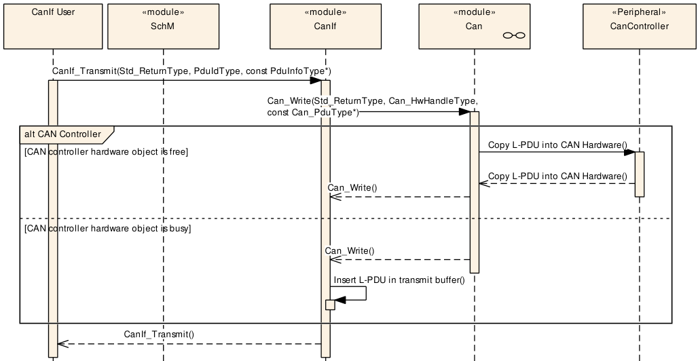

图 9.1：使用单个 CAN Driver 的发送请求

| Activity | 说明 |
| --- | --- |
| 发送请求 | 上层通过 CanIf_Transmit() 发起发送请求。参数 CanTxPduId 标识请求发送的 L-SDU。该服务执行以下操作： • 校验输入参数； • 确定要使用的 CAN Controller。 第二个参数 *PduInfoPtr 指向包含发送 L-SDU 相关信息的结构体，例如 SduLength 和 *SduDataPtr。 |
| 开始发送 | CanIf_Transmit() 解析 HTH，调用 CanDrv 的 Can_Write() 请求发送。 |
| 硬件请求 | 如果 CAN Hardware 空闲，Can_Write() 将全部 L-PDU 数据写入硬件，并置位硬件发送请求。 |
| Can_Write 服务返回 E_OK | Can_Write() 向 CanIf_Transmit() 返回 E_OK。 |
| Can_Write 服务返回 CAN_BUSY： | 若 CanDrv 检测到没有空闲 hardware object，则向 CanIf 返回 CAN_BUSY。 |
| 复制到 buffer | 被拒绝的发送请求所对应的 L-PDU 将存入 CanIf 的发送缓冲区，等待下一次发送确认。 |
| CanIf 返回 E_OK | CanIf_Transmit() 向上层返回 E_OK。 |

> 原文第 139 页

### 9.2 发送请求（多个 CAN Driver）

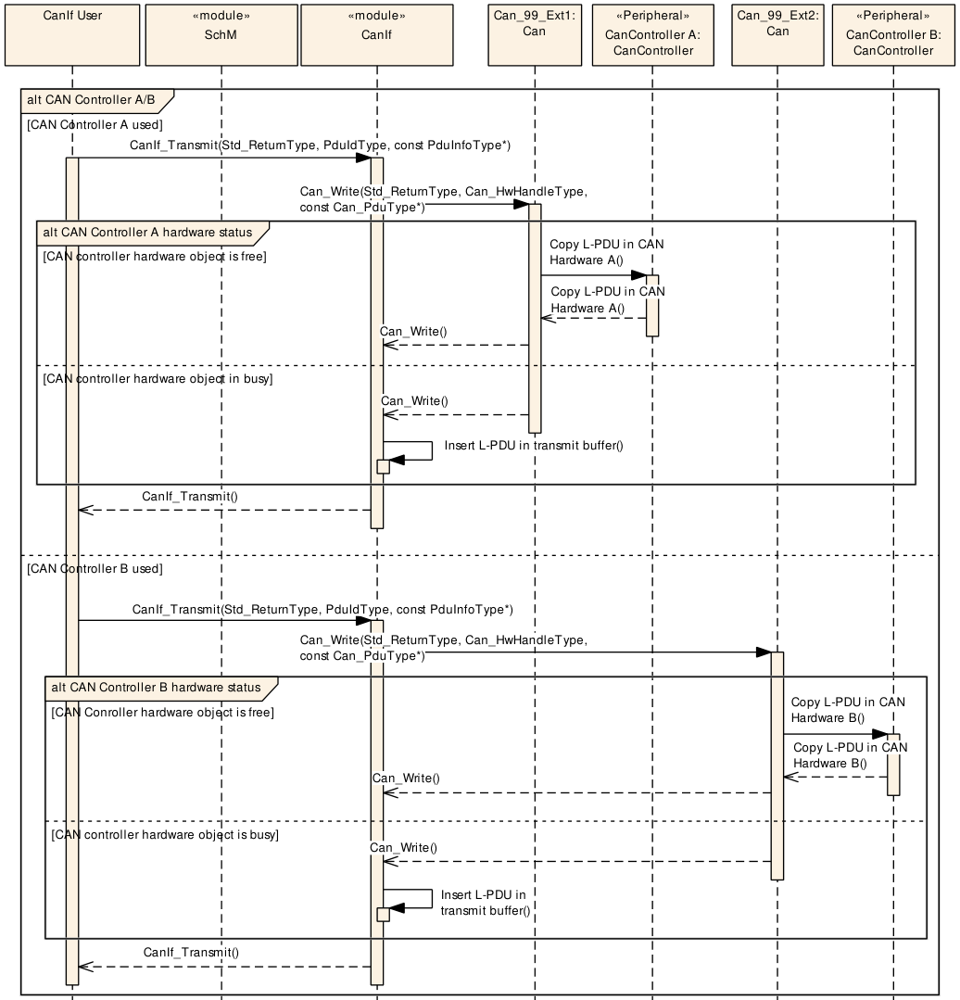

图 9.2：使用多个 CAN Driver 的发送请求

第一次发送请求：

| Activity | 说明 |
| --- | --- |
| 发送请求 A | 上层通过 CanIf_Transmit() 发起发送请求。参数 CanTxPduId 标识请求发送的 L-SDU。该服务执行以下操作： • 校验输入参数； • 确定要使用的 CAN Controller（此处为 Can_99_Ext1）。 第二个参数 *PduInfoPtr 指向包含发送 L-SDU 相关信息的结构体，例如 SduLength 和 *SduDataPtr。 |

> 原文第 140 页

| 开始发送 | CanIf_Transmit() 解析 HTH，调用 CanDrv Can_99_Ext1 的 Can_Write_99_Ext1() 发起发送。 |
| --- | --- |
| 硬件请求 | 若 Controller A 的硬件空闲，Can_Write_99_Ext1() 写入全部 L-PDU 数据并设置硬件发送请求。 |
| Can_Write 服务返回 E_OK | Can_Write_99_Ext1() 向 CanIf_Transmit() 返回 E_OK。 |
| Can_Write 服务返回 CAN_BUSY： | 若 CanDrv Can_99_Ext1 检测到没有空闲 hardware object，则向 CanIf 返回 CAN_BUSY。 |
| 复制到 buffer | 被拒绝请求的 L-PDU 存入 CanIf 发送 buffer，等待下一次 transmit confirmation。 |
| CanIf 返回 E_OK | CanIf_Transmit() 向上层返回 E_OK。 |

第二次发送请求：

| Activity | 说明 |
| --- | --- |
| 发送请求 B | 上层调用 CanIf_Transmit()，CanTxPduId 标识目标 L-SDU。服务校验输入参数，确定 Controller（此处为 Can_99_Ext2）。第二个参数 *PduInfoPtr 指向包含 SduLength、*SduDataPtr 等发送数据的结构。 |
| 开始发送 | CanIf_Transmit() 解析 HTH，调用 CanDrv Can_99_Ext2 的 Can_Write_99_Ext2() 发起发送。 |
| 硬件请求 | 若 Controller B 硬件空闲，Can_Write_99_Ext2() 写入全部 L-PDU 数据并设置发送请求。 |
| Can_Write 服务返回 E_OK | Can_Write_99_Ext2() 向 CanIf_Transmit() 返回 E_OK。 |
| Can_Write 服务返回 CAN_BUSY： | 若 CanDrv Can_99_Ext2 检测到没有空闲 hardware object，则向 CanIf 返回 CAN_BUSY。 |
| 复制到 buffer | 被拒绝请求的 L-PDU 存入 CanIf 发送 buffer，等待下一次 transmit confirmation。 |
| CanIf 返回 E_OK | CanIf_Transmit() 向上层返回 E_OK。 |

> 原文第 141 页

### 9.3 发送确认（Interrupt mode）

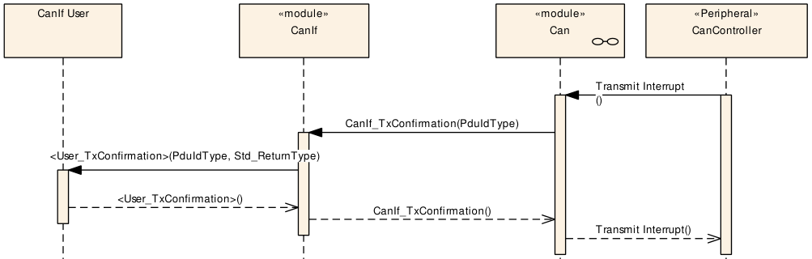

图 9.3：中断驱动的发送确认

| Activity | 说明 |
| --- | --- |
| 发送中断 | 得到确认的 CAN frame 向接收 CAN Controller 指示发送成功，并触发发送中断。（此处“接收”沿用原文，见文末译者说明。） |
| 向 CanIf 确认 | CanDrv 调用 CanIf_TxConfirmation()。参数 CanTxPduId 标识先前由 Can_Write() 发送的 L-PDU。CanDrv 必须将各 HTH 中所有待处理的 L-PDU ID 保存到按 HTH 组织的数组中，避免在调用 CanIf_TxConfirmation() 时重新查找 L-PDU ID。 |
| 向上层确认 | 调用对应上层 &lt;User_TxConfirmation&gt;(id, E_OK)，报告 L-SDU 发送成功。 |

> 原文第 142 页

### 9.4 发送确认（Polling mode）

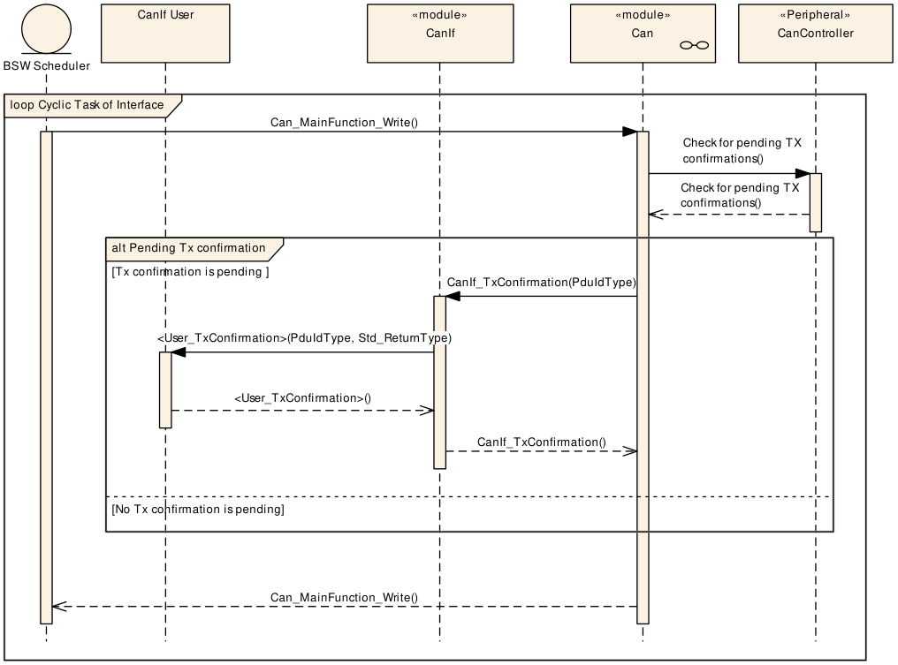

图 9.4：轮询驱动的发送确认

| Activity | 说明 |
| --- | --- |
| CanDrv 周期 Task | BSW Scheduler 调用 Can_MainFunction_Write()。 |
| 检查待处理的发送确认 | Can_MainFunction_Write() 检查底层 CAN Controller，确定先前已成功完成的发送事件是否存在待处理的发送确认。 |
| 发送确认 | 得到确认的 CAN frame 向发送 CAN Controller 指示发送成功。 |
| 向 CanIf 确认 | CanDrv 调用 CanIf_TxConfirmation()。参数 CanTxPduId 标识先前由 Can_Write() 发送的 L-PDU。CanDrv 必须将各 HTH 中所有待处理的 L-PDU ID 保存到按 HTH 组织的数组中，避免在调用 CanIf_TxConfirmation() 时重新查找 L-PDU ID。 |
| 向上层确认 | 调用对应上层 &lt;User_TxConfirmation&gt;(id, E_OK)，报告 L-SDU 发送成功。 |

> 原文第 143 页

### 9.5 发送确认（启用缓冲）

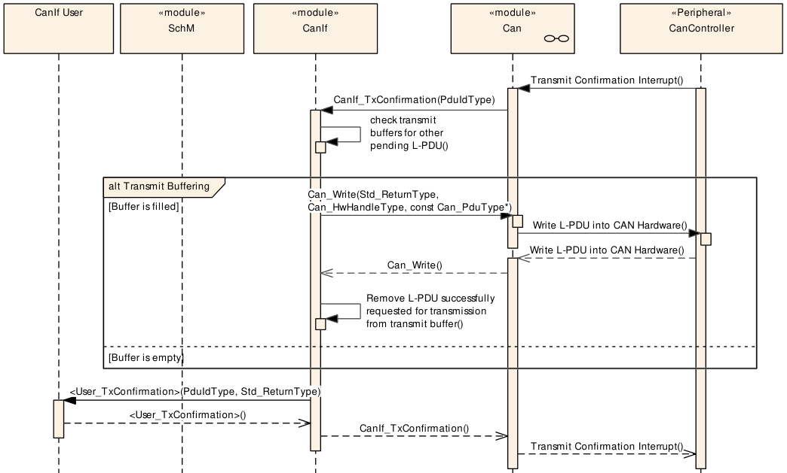

图 9.5：启用缓冲时的发送确认

| Activity | 说明 |
| --- | --- |
| 发送中断 | 得到确认的 CAN frame 向接收 CAN Controller 指示发送成功，并触发发送中断。（此处“接收”沿用原文，见文末译者说明。） |
| 向 CanIf 确认 | CanDrv 调用 CanIf_TxConfirmation()。参数 CanTxPduId 标识先前由 Can_Write() 发送的 L-PDU。CanDrv 必须将各 HTH 中所有待处理的 L-PDU ID 保存到按 HTH 组织的数组中，避免在调用 CanIf_TxConfirmation() 时重新查找 L-PDU ID。 |
| 检查发送缓冲区 | 检查 CanIf 的发送缓冲区中是否保存有待发送的 L-PDU。 |
| 将发送请求传递给 CanDrv | 若发送缓冲区中有待发送的 L-PDU，则按优先级选取最高优先级的最新 L-PDU，并通过 Can_Write() 请求发送。该流程向上层指示 L-PDU 发送成功。因此，Can_Write() 可能被重入调用。 |
| 从发送缓冲区移除已提交发送的 L-PDU | CanIf 从发送缓冲区中移除该待发送的 L-PDU。 |
| 向上层确认 | 调用对应上层 &lt;User_TxConfirmation&gt;(id, E_OK)，报告 L-SDU 发送成功。 |

> 原文第 144 页

### 9.6 Trigger Transmit Request

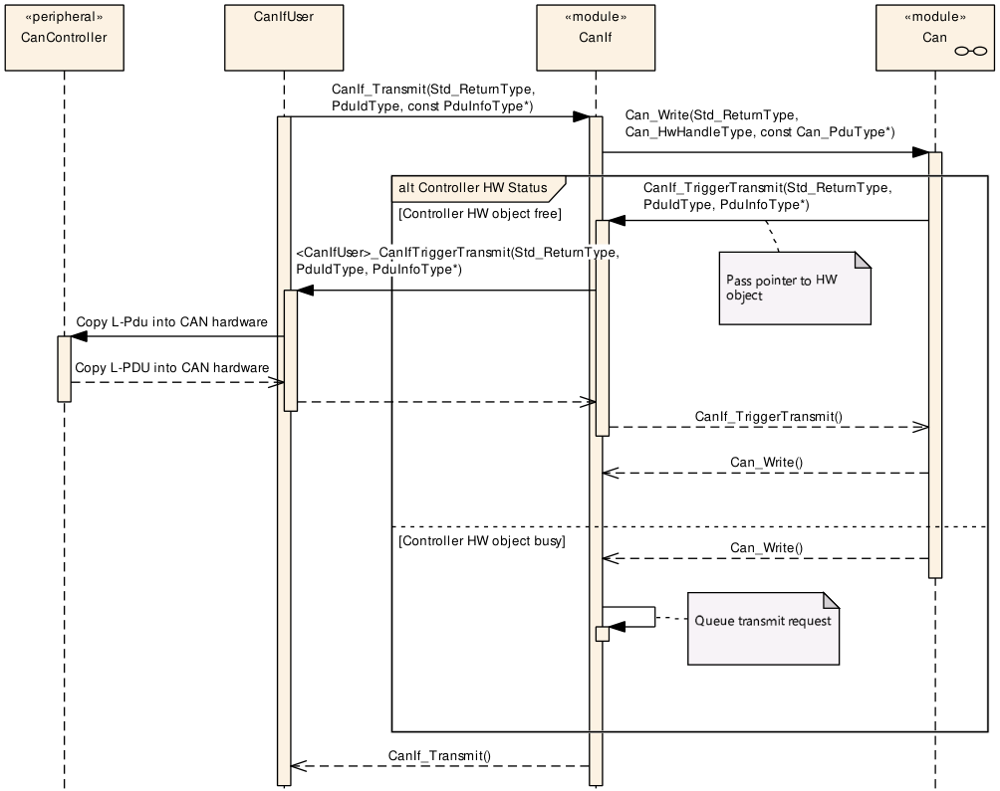

Figure 9.6：Trigger Transmit Request

> 原文第 145 页

| Activity | 说明 |
| --- | --- |
| 发送请求 | 上层调用 CanIf_Transmit()，CanTxPduId 指定 L-SDU。服务校验参数并确定 Controller。第二个参数 *PduInfoPtr 指向包含待发送 L-SDU 大小 SduLength 的结构；上层尚未提供实际 SDU 数据，因此 *SduDataPtr 为 NULL。 |
| 开始发送 | CanIf_Transmit() 解析 HTH，调用 CanDrv 的 Can_Write() 请求发送。 |
| 触发获取发送数据 | 若 CAN 硬件空闲，Can_Write() 调用 CanIf_TriggerTransmit()，传入 L-SDU ID 及硬件 buffer 指针以索取数据。CanIf 将请求和 CanDrv 提供的 buffer 指针转交对应上层 CanIfUser；后者将 SDU 数据复制到该 CAN hardware buffer，返回状态及实际写入字节数。 |
| Can_Write() 返回 E_OK | Can_Write() 向 CanIf_Transmit() 返回 E_OK。 |
| Can_Write() 返回 CAN_BUSY | 若 CanDrv 检测到没有空闲 hardware object，则向 CanIf 返回 CAN_BUSY。 |
| 将发送请求排队 | CanIf 将被 CanDrv 拒绝的 L-PDU Transmit Request 排队，等待下一次 transmit confirmation。 |
| CanIf 返回 E_OK | CanIf_Transmit() 向上层返回 E_OK。 |

> 原文第 146 页

### 9.7 接收通知（Interrupt mode）

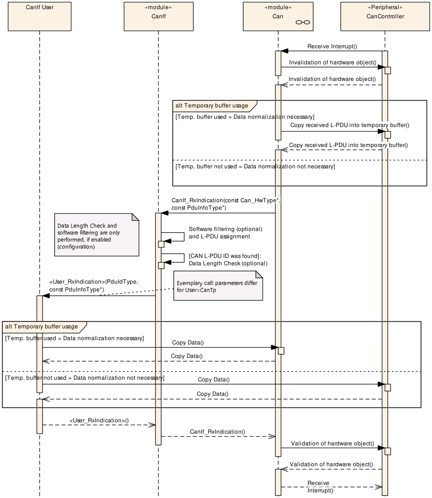

图 9.7：中断驱动的接收指示

| Activity | 说明 |
| --- | --- |
| Receive Interrupt | CAN Controller 指示接收成功，并触发接收中断。 |
| 使 CAN hardware object 暂不可供 Controller 使用，允许 CPU 访问 mailbox。 | CPU（CanDrv）获得 CAN mailbox，或至少获得存有新数据的 hardware object 的独占访问权。 |

> 原文第 147 页

| 缓冲、数据标准化 | 将 L-PDU 转换为标准化表示，保存在 CanDrv 临时 buffer 中。只有需要数据标准化时，CanDrv 才为每个 Physical Channel 提供该临时 buffer。 |
| --- | --- |
| 通知 CanIf | 调用 CanIf_RxIndication()。HRH 指定存有接收 L-PDU 的 CAN RAM Hardware Object 及 Controller，PduInfoPtr-&gt;SduDataPtr 向 CanIf 引用临时 buffer。 |
| Software Filtering | 判断本 ECU 是否需要处理收到的 L-PDU；若不需要，不通知上层，并停止后续处理。 |
| Data Length Check | 找到 L-PDU 后，将接收 Data Length 与其静态配置的预期值比较。 |
| 向上层发出 Receive Indication | 调用对应上层 receive indication service，报告成功接收。RxPduId 指定 L-SDU，第二个参数引用临时 buffer。服务执行期间，CAN hardware buffer 必须允许 CPU 访问，同时禁止 Controller 访问。 |
| 恢复 CAN hardware object 的有效性，允许 Controller 访问 mailbox。 | 数据已复制到上层 buffer 后，将 CAN mailbox 或对应 hardware object 的独占访问权交还 Controller。 |

> 原文第 148 页

### 9.8 接收通知（Polling mode）

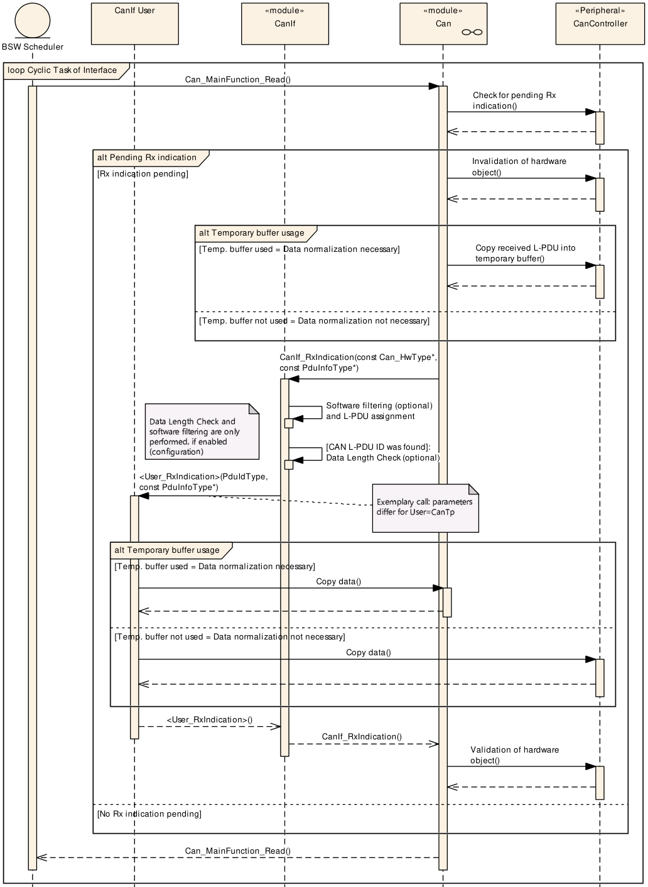

Figure 9.8：Polling 驱动的接收通知

> 原文第 149 页

| Activity | 说明 |
| --- | --- |
| CanDrv 周期 Task | BSW Scheduler 调用 Can_MainFunction_Read()。 |
| 检查新接收的 L-PDU | Can_MainFunction_Read() 检查底层 Controller 是否收到新 L-PDU。 |
| 使 CAN hardware object 暂不可供 Controller 使用，允许 CPU 访问 mailbox。 | 发生新接收事件时，CPU（CanDrv）获得 mailbox 或存有新数据的 hardware object 的独占访问权。 |
| 缓冲、数据标准化 | 发生新接收事件时，将 L-PDU 标准化并保存到 CanDrv 临时 buffer；只有需要标准化时，CanDrv 才为每个 Physical Channel 提供此 buffer。 |
| 通知 CanIf | 调用 CanIf_RxIndication()。HRH 指定存有接收 L-PDU 的 CAN RAM Hardware Object 及 Controller，PduInfoPtr-&gt;SduDataPtr 向 CanIf 引用临时 buffer。 |
| Software Filtering | 判断本 ECU 是否需要处理收到的 L-PDU；若不需要，不通知上层，并停止后续处理。 |
| Data Length Check | 找到 L-PDU 后，将接收 Data Length 与其静态配置的预期值比较。 |
| 向上层发出 Receive Indication | 若已配置，调用对应上层 receive indication service，报告成功接收。RxPduId 指定 L-SDU，第二个参数引用临时 buffer。执行期间，hardware buffer 必须允许 CPU 访问，同时禁止 Controller 访问。 |
| 恢复 CAN hardware object 的有效性，允许 Controller 访问 mailbox。 | 数据已复制到上层 buffer 后，将 CAN mailbox 或对应 hardware object 的独占访问权交还 Controller。 |

> 原文第 150 页

### 9.9 读取接收数据

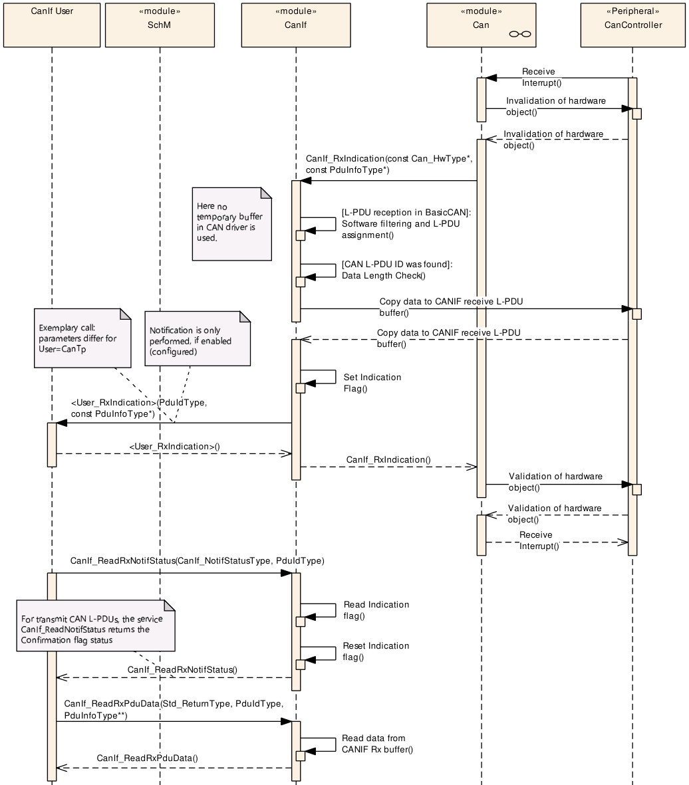

图 9.9：读取已接收的数据

| Activity | 说明 |
| --- | --- |
| Receive Interrupt | CAN Controller 指示接收成功，并触发接收中断。 |
| 使 CAN hardware object 暂不可供 Controller 使用，允许 CPU 访问 mailbox。 | CPU（CanDrv）获得 CAN mailbox，或至少获得存有新数据的 hardware object 的独占访问权。 |

> 原文第 151 页

| 缓冲、数据标准化 | 将 L-PDU 转换为标准化表示，保存在 CanDrv 临时 buffer 中。只有需要数据标准化时，CanDrv 才为每个 Physical Channel 提供该临时 buffer。 |
| --- | --- |
| 通知 CanIf | 调用 CanIf_RxIndication()。HRH 指定存有接收 L-PDU 的 CAN RAM Hardware Object 及 Controller，PduInfoPtr-&gt;SduDataPtr 向 CanIf 引用临时 buffer。 |
| Software Filtering | 判断本 ECU 是否需要处理收到的 L-PDU；若不需要，不通知上层，并停止后续处理。 |
| Data Length Check | 找到 L-PDU 后，将接收 Data Length 与其静态配置的预期值比较。 |
| 复制数据 | 将数据从 CAN hardware 复制到 CanIf receive L-PDU buffer。访问期间，hardware buffer 必须允许 CPU 访问，同时禁止 Controller 访问。 |
| Indication flag | 在 CanIf 中设置接收 L-PDU 的 indication status flag。 |
| 向上层发出 Receive Indication | 调用对应上层 receive indication service，报告成功接收。RxPduId 指定 L-SDU，第二个参数引用临时 buffer。 |
| 恢复 CAN hardware object 的有效性，允许 Controller 访问 mailbox。 | 数据已复制到上层 buffer 后，将 CAN mailbox 或对应 hardware object 的独占访问权交还 Controller。 |
| 读取 indication status | 上层随后可调用 CanIf_ReadRxNotifStatus() 读取 indication status。该服务也可用于 Transmit L-PDU，此时返回 confirmation status。 |
| 复位 indication status | CanIf_ReadRxNotifStatus() 返回前复位 indication status。 |
| 读取接收数据 | 上层随后可调用 CanIf_ReadRxPduData() 读取接收数据。 |
| 读取 CanIf Rx buffer | CanIf_ReadRxPduData() 从 CanIf Rx buffer 读取数据。 |
| CanIf 返回 E_OK | 若读取成功，返回 E_OK，并提供有效的 PduInfoPtr。 |

> 原文第 152 页

### 9.10 启动 CAN network

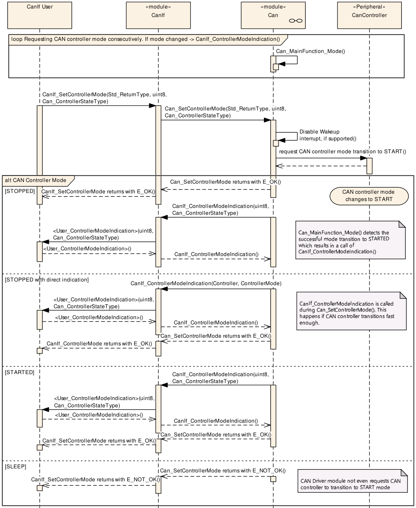

图 9.10：启动 CAN network

本时序图与“停止 CAN network”或“使 CAN network 进入 Sleep”的时序类似。

| Activity | 说明 |
| --- | --- |
| 循环依次请求 CAN Controller mode。 | Can_MainFunction_Mode() 被连续触发，以检查硬件中的 Controller mode 是否发生变化。如果发生变化，则调用 CanIf_ControllerModeIndication(Controller, ControllerMode) 进行通知。 |

> 原文第 153 页

| 上层请求目标 Controller 进入 STARTED。 | 上层调用 CanIf_SetControllerMode(ControllerId, CAN_CS_STARTED)，请求目标 Controller 进入 STARTED。 |
| --- | --- |
| 若支持，CanDrv 禁用 wakeup interrupt。 | 仅请求 STARTED 时禁用；请求 SLEEP 时在此启用 wakeup interrupt，请求 STOPPED 时不作处理。 |
| CanDrv 请求 Controller 切换到 CAN_CS_STARTED。 | Can_SetControllerMode(Controller, Can_ControllerStateType) 中，CanDrv 向硬件写入请求。Controller 可能立即切换，也可能几毫秒后才切换，取决于硬件。 |
| 后续行为取决于 Controller 及其当前运行模式。 |  |
| Controller 原处于 STOPPED。 | Can_SetControllerMode() 返回，通知 CanIf 请求成功；CanIf_SetControllerMode() 随后向上层返回。Can_MainFunction_Mode() 检测到切换成功后，通过 CanIf_ControllerModeIndication(Controller, CAN_CS_STARTED) 异步通知 CanIf。 |
| Controller 原处于 STOPPED，且切换很快，mode indication 在切换请求内部被调用。 | Can_SetControllerMode() 执行期间，调用 CanIf_ControllerModeIndication(Controller, CAN_CS_STARTED) 直接通知切换成功；通知返回后，Can_SetControllerMode() 返回请求成功，CanIf_SetControllerMode() 再向上层返回。 |
| Controller 原处于 STARTED。 | 由于原模式已为 STARTED，Can_SetControllerMode() 内调用 CanIf_ControllerModeIndication(Controller, CAN_CS_STARTED) 直接通知成功；通知返回后，Can_SetControllerMode() 返回请求成功，CanIf_SetControllerMode() 再向上层返回。 |
| Controller 原处于 SLEEP。 | 不允许该切换 → E_NOT_OK。 |

> 原文第 154 页

### 9.11 BusOff notification

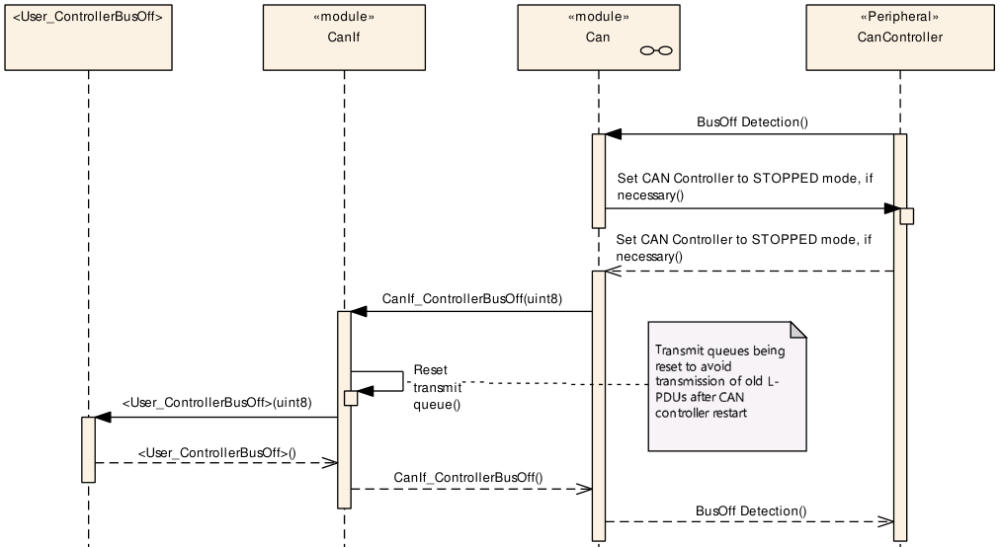

图 9.11：BusOff 通知

| Activity | 说明 |
| --- | --- |
| BusOff 检测中断 | Controller 指示 BusOff event。 |
| 停止 Controller | 必要时，CAN Driver 将 CAN Controller 设置为 STOPPED mode。 |
| 向 CAN Interface 指示 BusOff | 通过调用 CanIf_ControllerBusOff()，将 BusOff 通知给 CanIf。 |
| 向上层（CanSM）指示 BusOff | 调用 &lt;User_ControllerBusOff&gt;() 向上层报告 BusOff。 |

> 原文第 155 页

### 9.12 BusOff recovery

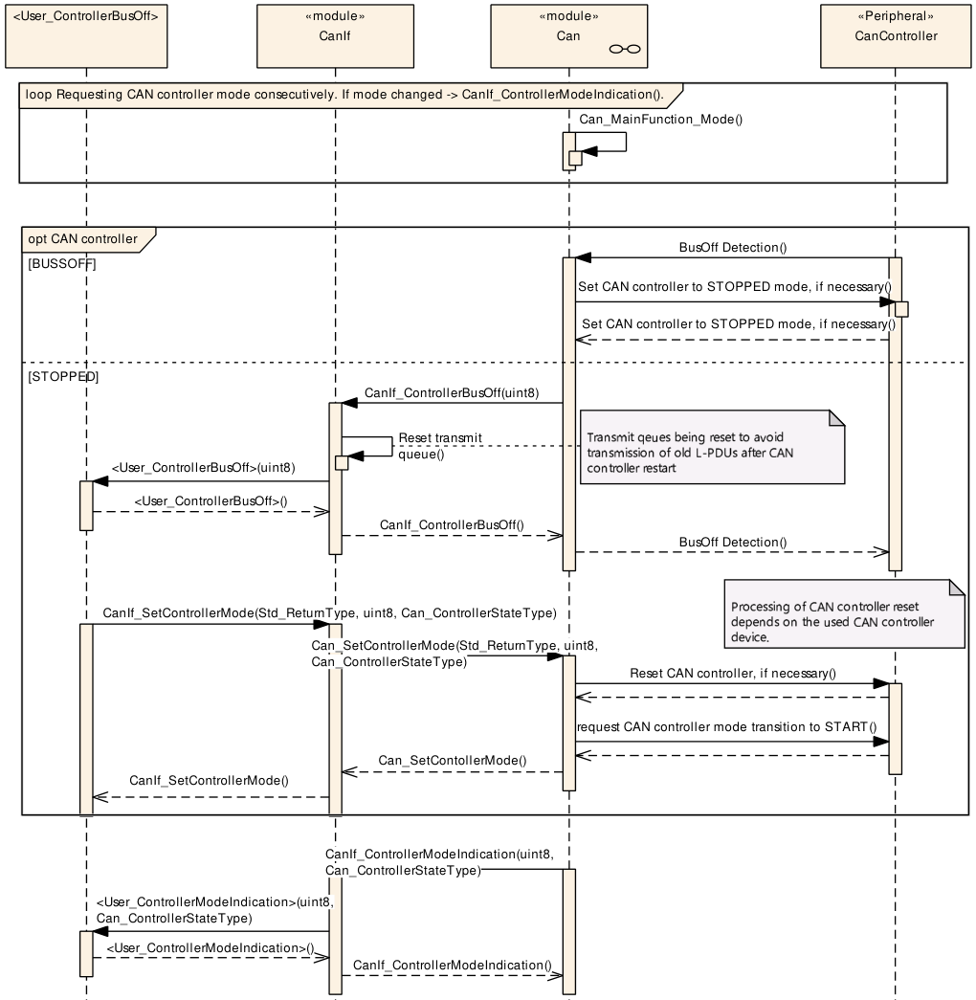

Figure 9.12：BusOff recovery

> 原文第 156 页

| Activity | 说明 |
| --- | --- |
| BusOff 检测中断 | Controller 指示 BusOff event。 |
| 停止 Controller | 必要时，CanDrv 将 Controller 设为 STOPPED。 |
| 向 CanIf 通知 BusOff | 调用 CanIf_ControllerBusOff()，同时复位 CanIf 内部发送 buffer。 |
| 向上层通知 BusOff | 调用 &lt;User_ControllerBusOff&gt;() 向上层报告 BusOff。 |
| 上层 CanSM 发起 BusOff Recovery | 经过 BusOff Recovery 算法规定的时间后，调用 CanIf_SetControllerMode(ControllerId, CAN_CS_STARTED) 启动恢复过程。 |
| 重启 Controller | Driver 通过 Can_SetControllerMode(Controller, CAN_CS_STARTED) 重启 Controller。 |
| Controller 已启动 | CanDrv 调用 CanIf_ControllerModeIndication() 通知成功启动，CanIf 再向上层报告模式变化。 |

> 原文第 157 页

## 10 配置规范

本章定义配置参数及其 container 分组。Container 和 parameter 的通用定义见 [9, SWS_BSWGeneral 第 10.1 章“Introduction to configuration specification”]。

### 10.1 定义 CanIf 的 container 结构及参数。

### 10.1 Container 与配置参数

以下各节汇总全部配置参数，详细含义见第 7 章“功能规范”和第 8 章“API 规范”。

这些配置项可从基于 EcuConfigurationTemplate 的 network description database 导出。配置工具应提取配置 CanIf 所需的全部信息。

CanIf 可访问 CanDrv 配置数据。全部 public CanDrv 配置见 [1, Specification of CAN Driver]。

> 原文第 158 页

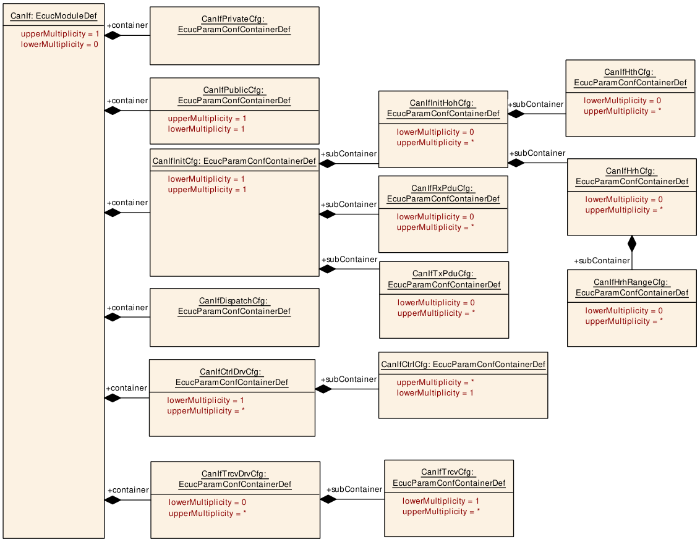

图 10.1：CAN Interface 配置容器总览

#### 10.1.1 CanIf

| 字段 | 内容 |
| --- | --- |
| SWS 条目 | [ECUC_CanIf_00244] |
| 模块名称 | CanIf |
| 说明 | 本容器按照 CAN Interface 的配置结构，包含所有必要的配置子容器。 |
| 是否支持 Post-Build Variant | true |
| 支持的配置 Variant | VARIANT-LINK-TIME, VARIANT-POST-BUILD, VARIANT-PRE-COMPILE |

| 包含的 Container |  |  |
| --- | --- | --- |
| Container 名称 | Multiplicity | 作用域 / 依赖关系 |
| CanIfCtrlDrvCfg | 1..* | 汇总底层 CAN Driver 模块的配置。每个 CAN Driver 必须提供独立 container 实例。 |
| CanIfDispatchCfg | 1 | CanIf 上层模块提供的 callback。本容器中定义的 callback 由所有已配置的 CAN Driver / CAN Transceiver Driver 模块共用。 |

> 原文第 159 页

| 包含的 Container |  |  |
| --- | --- | --- |
| Container 名称 | Multiplicity | 作用域 / 依赖关系 |
| CanIfInitCfg | 1 | 包含 CAN Interface 的初始化参数。 |
| CanIfPrivateCfg | 1 | 包含 CAN Interface 的 private configuration parameter。 |
| CanIfPublicCfg | 1 | 本容器包含 CAN Interface 的公共配置参数。 |
| CanIfTrcvDrvCfg | 0..* | 本容器包含各底层 CAN Transceiver Driver 所管理的全部 CAN transceiver 的配置参数。每个 CAN Transceiver Driver 都应具有一个独立的本容器实例。 |

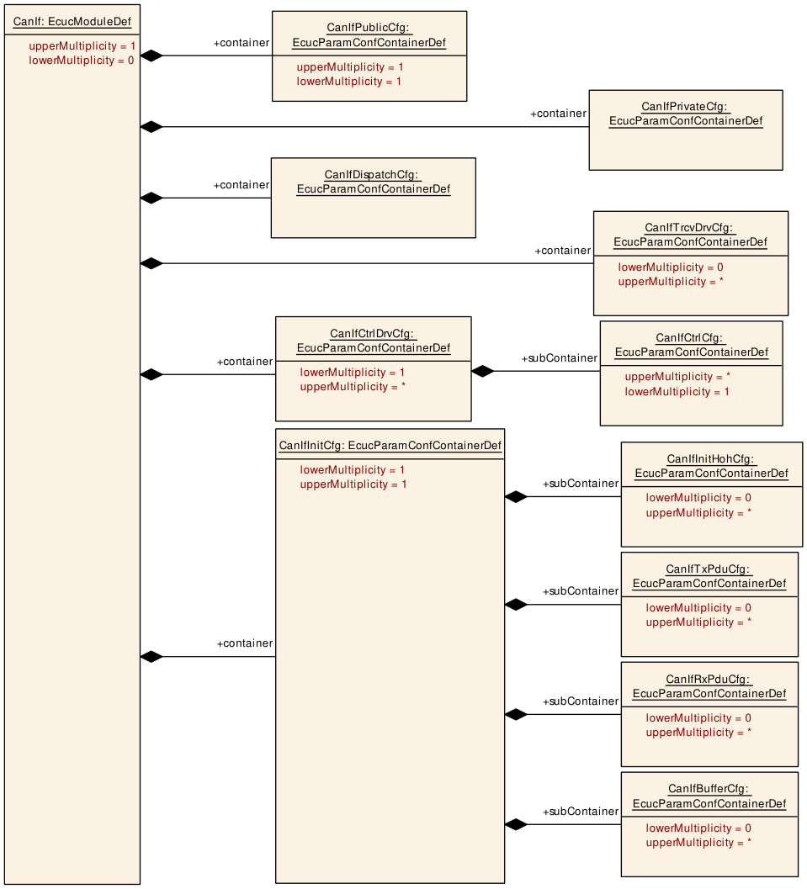

图 10.2： AR_EcucDef_CanIf

> 原文第 160 页

#### 10.1.2 CanIfPrivateCfg

| 字段 | 内容 |
| --- | --- |
| SWS 条目 | [ECUC_CanIf_00245] |
| Container 名称 | CanIfPrivateCfg |
| 父 Container | CanIf |
| 说明 | 包含 CAN Interface 的 private configuration parameter。 |
| 配置参数 |  |

| 字段 | 内容 |
| --- | --- |
| SWS 条目 | [ECUC_CanIf_00827] |
| 参数名称 | CanIfFixedBuffer |
| 父 Container | CanIfPrivateCfg |
| 说明 | 定义仅分配长度小于 8 字节 PDU 的 buffer，其元素长度是否固定为 8 字节。TRUE：最小元素长度固定为 8 字节。FALSE：长度由所引用 global PDU 的配置长度决定（见 ECUC_EcuC_00078）。 |
| Multiplicity | 1 |
| 类型 | EcucBooleanParamDef |
| 默认值 | false |
| Post-Build Variant Multiplicity | false |
| Post-Build Variant Value | false |
| Multiplicity 配置类别 | Pre-compile time · X · 全部 Variant Link time · – Post-build time · – |
| Value Configuration Class | Pre-compile time · X · 全部 Variant Link time · – Post-build time · – |
| 作用域 / 依赖关系 | 作用域：local。 |

| 字段 | 内容 |
| --- | --- |
| SWS 条目 | [ECUC_CanIf_00617] |
| 参数名称 | CanIfPrivateDataLengthCheck |
| 父 Container | CanIfPrivateCfg |
| 说明 | 是否支持 Data Length Check。True：启用；False：禁用。 |
| Multiplicity | 1 |
| 类型 | EcucBooleanParamDef |
| 默认值 | true |
| Post-Build Variant Value | false |
| Value Configuration Class | Pre-compile time · X · 全部 Variant Link time · – Post-build time · – |
| 作用域 / 依赖关系 | 作用域：local。 |

| 字段 | 内容 |
| --- | --- |
| SWS 条目 | [ECUC_CanIf_00619] |
| 参数名称 | CanIfPrivateSoftwareFilterType |
| 父 Container | CanIfPrivateCfg |

> 原文第 161 页

| 字段 | 内容 |
| --- | --- |
| 说明 | 选择仅用于接收的软件过滤机制。枚举值标识已实现的过滤方法，取值范围为实现所支持的软件过滤类型。 |
| Multiplicity | 1 |
| 类型 | EcucEnumerationParamDef |
| 取值范围 | BINARY · 选择 Binary Filter。 INDEX · 选择 Index Filter。 LINEAR · 选择 Linear Filter。 TABLE · 选择 Table Filter。 |
| Post-Build Variant Value | false |
| Value Configuration Class | Pre-compile time · X · 全部 Variant Link time · – Post-build time · – |
| 作用域 / 依赖关系 | 作用域：local。依赖：至少一个 HRH 必须通过 CanIfHrhIdSymRef 引用 CAN Driver 的 CanHandleType，启用 BasicCAN 接收。 |

| 字段 | 内容 |
| --- | --- |
| SWS 条目 | [ECUC_CanIf_00675] |
| 参数名称 | CanIfSupportTTCAN |
| 父 Container | CanIfPrivateCfg |
| 说明 | 是否支持 TTCAN。TRUE：支持 TTCAN。FALSE：不支持 TTCAN，仅允许普通 CAN 通信。 |
| Multiplicity | 1 |
| 类型 | EcucBooleanParamDef |
| 默认值 | false |
| Post-Build Variant Value | false |
| Value Configuration Class | Pre-compile time · X · 全部 Variant Link time · – Post-build time · – |
| 作用域 / 依赖关系 | 作用域：ECU。 |

| 包含的 Container |  |  |
| --- | --- | --- |
| Container 名称 | Multiplicity | 作用域 / 依赖关系 |
| CanIfTTGeneral | 0..1 | CanIfTTGeneral 在 TTCAN Interface SWS 中定义，用于指定是否及如何支持 TTCAN。仅当 Controller 支持、启用（见 CanIfSupportTTCAN、ECUC_CanIf_00675）且使用 TTCAN 时，该 container 才存在且有效。 |

> 原文第 162 页

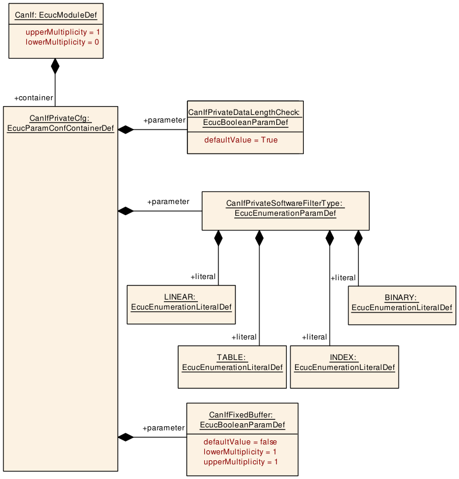

图 10.3：AR_EcucDef_CanIfPrivateCfg

#### 10.1.3 CanIfPublicCfg

| 字段 | 内容 |
| --- | --- |
| SWS 条目 | [ECUC_CanIf_00246] |
| Container 名称 | CanIfPublicCfg |
| 父 Container | CanIf |
| 说明 | 本容器包含 CAN Interface 的公共配置参数。 |
| 配置参数 |  |

| 字段 | 内容 |
| --- | --- |
| SWS 条目 | [ECUC_CanIf_00847] |
| 参数名称 | CanIfBusMirroringSupport |
| 父 Container | CanIfPublicCfg |
| 说明 | 启用 Bus Mirroring 支持。 |
| Multiplicity | 1 |
| 类型 | EcucBooleanParamDef |
| 默认值 | false |
| Post-Build Variant Value | false |
| Value Configuration Class | Pre-compile time · X · 全部 Variant Link time · – Post-build time · – |

> 原文第 163 页

| 字段 | 内容 |
| --- | --- |
| 作用域 / 依赖关系 | 作用域：local。 |

| 字段 | 内容 |
| --- | --- |
| SWS 条目 | [ECUC_CanIf_00614] |
| 参数名称 | CanIfDevErrorDetect |
| 父 Container | CanIfPublicCfg |
| 说明 | 开启或关闭 development error detection 和 notification。&lt;br&gt;• true：启用检测和通知。&lt;br&gt;• false：禁用检测和通知。 |
| Multiplicity | 1 |
| 类型 | EcucBooleanParamDef |
| 默认值 | false |
| Post-Build Variant Value | false |
| Value Configuration Class | Pre-compile time · X · 全部 Variant Link time · – Post-build time · – |
| 作用域 / 依赖关系 | 作用域：local。 |

| 字段 | 内容 |
| --- | --- |
| SWS 条目 | [ECUC_CanIf_00848] |
| 参数名称 | CanIfEnableSecurityEventReporting |
| 父 Container | CanIfPublicCfg |
| 说明 | 控制是否向 IdsM 上报 security event。&lt;br&gt;• true：启用上报。&lt;br&gt;• false：禁用上报。&lt;br&gt;Tags：atp.Status=draft。 |
| Multiplicity | 1 |
| 类型 | EcucBooleanParamDef |
| 默认值 | false |
| Post-Build Variant Value | false |
| Value Configuration Class | Pre-compile time · X · 全部 Variant Link time · – Post-build time · – |
| 作用域 / 依赖关系 | 作用域：ECU。 |

| 字段 | 内容 |
| --- | --- |
| SWS 条目 | [ECUC_CanIf_00854] |
| 参数名称 | CanIfGlobalTimeSupport |
| 父 Container | CanIfPublicCfg |
| 说明 | 启用/禁用硬件 timestamping 所使用的 Global Time API。Tags: atp.Status=draft |
| Multiplicity | 1 |
| 类型 | EcucBooleanParamDef |
| 默认值 | – |
| Post-Build Variant Value | false |
| Value Configuration Class | Pre-compile time · X · 全部 Variant Link time · – Post-build time · – |
| 作用域 / 依赖关系 | 作用域：local。 |

> 原文第 164 页

| 字段 | 内容 |
| --- | --- |
| SWS 条目 | [ECUC_CanIf_00824] |
| 参数名称 | CanIfMetaDataSupport |
| 父 Container | CanIfPublicCfg |
| 说明 | 启用通过 L-SDU MetaData 处理 dynamic ID 的支持。 |
| Multiplicity | 0..1 |
| 类型 | EcucBooleanParamDef |
| 默认值 | false |
| Post-Build Variant Multiplicity | false |
| Post-Build Variant Value | false |
| Multiplicity 配置类别 | Pre-compile time · X · 全部 Variant Link time · – Post-build time · – |
| Value Configuration Class | Pre-compile time · X · 全部 Variant Link time · – Post-build time · – |
| 作用域 / 依赖关系 | 作用域：ECU。 |

| 字段 | 内容 |
| --- | --- |
| SWS 条目 | [ECUC_CanIf_00671] |
| 参数名称 | CanIfPublicCddHeaderFile |
| 父 Container | CanIfPublicCfg |
| 说明 | 定义使用 CDD 时必须包含的 callback 头文件，字符长度范围为 1..32。 |
| Multiplicity | 0..* |
| 类型 | EcucStringParamDef |
| 默认值 | – |
| Length | 1-32 |
| 正则表达式 | – |
| Post-Build Variant Multiplicity | false |
| Post-Build Variant Value | false |
| Multiplicity 配置类别 | Pre-compile time · X · 全部 Variant Link time · – Post-build time · – |
| Value Configuration Class | Pre-compile time · X · 全部 Variant Link time · – Post-build time · – |
| 作用域 / 依赖关系 | 作用域：ECU。 |

| 字段 | 内容 |
| --- | --- |
| SWS 条目 | [ECUC_CanIf_00742] |
| 参数名称 | CanIfPublicHandleTypeEnum |
| 父 Container | CanIfPublicCfg |
| 说明 | 配置 Can_HwHandleType，用于表示 CAN Hardware Unit 的 hardware object handle。若 HW object 数量超过 255，应使用扩展范围 UINT16。 |
| Multiplicity | 1 |
| 类型 | EcucEnumerationParamDef |
| 取值范围 | UINT16 · – UINT8 · – |
| Post-Build Variant Value | false |

> 原文第 165 页

| 字段 | 内容 |
| --- | --- |
| Value Configuration Class | Pre-compile time · X · 全部 Variant Link time · – Post-build time · – |
| 作用域 / 依赖关系 | 作用域：ECU。依赖：Can_HwHandleType。 |

| 字段 | 内容 |
| --- | --- |
| SWS 条目 | [ECUC_CanIf_00612] |
| 参数名称 | CanIfPublicMultipleDrvSupport |
| 父 Container | CanIfPublicCfg |
| 说明 | 是否支持多个 CAN Driver。True：启用；False：禁用。 |
| Multiplicity | 1 |
| 类型 | EcucBooleanParamDef |
| 默认值 | true |
| Post-Build Variant Value | false |
| Value Configuration Class | Pre-compile time · X · 全部 Variant Link time · – Post-build time · – |
| 作用域 / 依赖关系 | 作用域：ECU。 |

| 字段 | 内容 |
| --- | --- |
| SWS 条目 | [ECUC_CanIf_00772] |
| 参数名称 | CanIfPublicPnSupport |
| 父 Container | CanIfPublicCfg |
| 说明 | 是否支持 CanIf Partial Network 功能。True：启用；False：禁用。 |
| Multiplicity | 1 |
| 类型 | EcucBooleanParamDef |
| 默认值 | false |
| Post-Build Variant Value | false |
| Value Configuration Class | Pre-compile time · X · 全部 Variant Link time · – Post-build time · – |
| 作用域 / 依赖关系 | 作用域：ECU。 |

| 字段 | 内容 |
| --- | --- |
| SWS 条目 | [ECUC_CanIf_00607] |
| 参数名称 | CanIfPublicReadRxPduDataApi |
| 父 Container | CanIfPublicCfg |
| 说明 | 启用/禁用读取接收 L-SDU 数据的 CanIf_ReadRxPduData()。True：启用；False：禁用。 |
| Multiplicity | 1 |
| 类型 | EcucBooleanParamDef |
| 默认值 | false |
| Post-Build Variant Value | false |
| Value Configuration Class | Pre-compile time · X · 全部 Variant Link time · – Post-build time · – |
| 作用域 / 依赖关系 | 作用域：ECU。 |

> 原文第 166 页

| 字段 | 内容 |
| --- | --- |
| SWS 条目 | [ECUC_CanIf_00608] |
| 参数名称 | CanIfPublicReadRxPduNotifyStatusApi |
| 父 Container | CanIfPublicCfg |
| 说明 | 启用/禁用读取接收 L-PDU notification status 的 API。True：启用；False：禁用。 |
| Multiplicity | 1 |
| 类型 | EcucBooleanParamDef |
| 默认值 | false |
| Post-Build Variant Value | false |
| Value Configuration Class | Pre-compile time · X · 全部 Variant Link time · – Post-build time · – |
| 作用域 / 依赖关系 | 作用域：ECU。 |

| 字段 | 内容 |
| --- | --- |
| SWS 条目 | [ECUC_CanIf_00609] |
| 参数名称 | CanIfPublicReadTxPduNotifyStatusApi |
| 父 Container | CanIfPublicCfg |
| 说明 | 启用/禁用读取发送 L-PDU notification status 的 API。True：启用；False：禁用。 |
| Multiplicity | 1 |
| 类型 | EcucBooleanParamDef |
| 默认值 | false |
| Post-Build Variant Value | false |
| Value Configuration Class | Pre-compile time · X · 全部 Variant Link time · – Post-build time · – |
| 作用域 / 依赖关系 | 作用域：ECU。 |

| 字段 | 内容 |
| --- | --- |
| SWS 条目 | [ECUC_CanIf_00610] |
| 参数名称 | CanIfPublicSetDynamicTxIdApi |
| 父 Container | CanIfPublicCfg |
| 说明 | 启用/禁用重新配置各 Transmit L-PDU CAN Identifier 的 API。True：启用；False：禁用。 |
| Multiplicity | 1 |
| 类型 | EcucBooleanParamDef |
| 默认值 | false |
| Post-Build Variant Value | false |
| Value Configuration Class | Pre-compile time · X · 全部 Variant Link time · – Post-build time · – |
| 作用域 / 依赖关系 | 作用域：ECU。 |

| 字段 | 内容 |
| --- | --- |
| SWS 条目 | [ECUC_CanIf_00618] |
| 参数名称 | CanIfPublicTxBuffering |
| 父 Container | CanIfPublicCfg |

> 原文第 167 页

| 字段 | 内容 |
| --- | --- |
| 说明 | 启用/禁用 CanIf 内对 CanDrv 拒绝的 Transmit L-PDU 进行缓冲。True：启用；False：禁用。 |
| Multiplicity | 1 |
| 类型 | EcucBooleanParamDef |
| 默认值 | false |
| Post-Build Variant Value | false |
| Value Configuration Class | Pre-compile time · X · 全部 Variant Link time · – Post-build time · – |
| 作用域 / 依赖关系 | 作用域：ECU。 |

| 字段 | 内容 |
| --- | --- |
| SWS 条目 | [ECUC_CanIf_00733] |
| 参数名称 | CanIfPublicTxConfirmPollingSupport |
| 父 Container | CanIfPublicCfg |
| 说明 | 启用/禁用轮询 Tx Confirmation state 的 API。 |
| Multiplicity | 1 |
| 类型 | EcucBooleanParamDef |
| 默认值 | – |
| Post-Build Variant Value | false |
| Value Configuration Class | Pre-compile time · X · 全部 Variant Link time · – Post-build time · – |
| 作用域 / 依赖关系 | 作用域：local。依赖：CAN State Manager 模块。 |

| 字段 | 内容 |
| --- | --- |
| SWS 条目 | [ECUC_CanIf_00741] |
| 参数名称 | CanIfPublicWakeupCheckValidByNM |
| 父 Container | CanIfPublicCfg |
| 说明 | 启用时，仅 NM message 可验证检测到的 wakeup event；禁用时，所有对应已配置 Rx PDU 的接收消息均可验证。仅 CanIfPublicWakeupCheckValidSupport 启用时，此参数才可配置。True：启用；False：禁用。 |
| Multiplicity | 0..1 |
| 类型 | EcucBooleanParamDef |
| 默认值 | false |
| Post-Build Variant Multiplicity | false |
| Post-Build Variant Value | false |
| Multiplicity 配置类别 | Pre-compile time · X · 全部 Variant Link time · – Post-build time · – |
| Value Configuration Class | Pre-compile time · X · 全部 Variant Link time · – Post-build time · – |
| 作用域 / 依赖关系 | 作用域：ECU。依赖：CanIfPublicWakeupCheckValidSupport。 |

> 原文第 168 页

| 字段 | 内容 |
| --- | --- |
| SWS 条目 | [ECUC_CanIf_00611] |
| 参数名称 | CanIfPublicWakeupCheckValidSupport |
| 父 Container | CanIfPublicCfg |
| 说明 | 是否支持 wakeup validation。True：启用；False：禁用。 |
| Multiplicity | 1 |
| 类型 | EcucBooleanParamDef |
| 默认值 | false |
| Post-Build Variant Value | false |
| Value Configuration Class | Pre-compile time · X · 全部 Variant Link time · – Post-build time · – |
| 作用域 / 依赖关系 | 作用域：ECU。 |

| 字段 | 内容 |
| --- | --- |
| SWS 条目 | [ECUC_CanIf_00838] |
| 参数名称 | CanIfSetBaudrateApi |
| 父 Container | CanIfPublicCfg |
| 说明 | 启用/禁用 CanIf_SetBaudrate，以改变 Controller baudrate。true 时应支持该 API，否则不支持。 |
| Multiplicity | 0..1 |
| 类型 | EcucBooleanParamDef |
| 默认值 | false |
| Post-Build Variant Multiplicity | false |
| Post-Build Variant Value | false |
| Multiplicity 配置类别 | Pre-compile time · X · 全部 Variant Link time · – Post-build time · – |
| Value Configuration Class | Pre-compile time · X · 全部 Variant Link time · – Post-build time · – |
| 作用域 / 依赖关系 | 作用域：ECU。 |

| 字段 | 内容 |
| --- | --- |
| SWS 条目 | [ECUC_CanIf_00844] |
| 参数名称 | CanIfTriggerTransmitSupport |
| 父 Container | CanIfPublicCfg |
| 说明 | 在 Pre-Compile-Time 启用 CanIf_TriggerTransmit API，决定是否支持 trigger transmit。TRUE：启用；FALSE：禁用。 |
| Multiplicity | 1 |
| 类型 | EcucBooleanParamDef |
| 默认值 | true |
| Post-Build Variant Multiplicity | false |
| Multiplicity 配置类别 | Pre-compile time · X · 全部 Variant Link time · – Post-build time · – |
| 作用域 / 依赖关系 | 作用域：ECU。 |

> 原文第 169 页

| 字段 | 内容 |
| --- | --- |
| SWS 条目 | [ECUC_CanIf_00837] |
| 参数名称 | CanIfTxOfflineActiveSupport |
| 父 Container | CanIfPublicCfg |
| 说明 | 是否支持 TxOffLineActive（见 SWS_CANIF_00072）。True：启用；False：禁用。 |
| Multiplicity | 1 |
| 类型 | EcucBooleanParamDef |
| 默认值 | false |
| Post-Build Variant Value | false |
| Value Configuration Class | Pre-compile time · X · 全部 Variant Link time · – Post-build time · – |
| 作用域 / 依赖关系 | 作用域：ECU。 |

| 字段 | 内容 |
| --- | --- |
| SWS 条目 | [ECUC_CanIf_00613] |
| 参数名称 | CanIfVersionInfoApi |
| 父 Container | CanIfPublicCfg |
| 说明 | 启用/禁用读取 CAN Interface 版本信息的 API。True：启用；False：禁用。 |
| Multiplicity | 1 |
| 类型 | EcucBooleanParamDef |
| 默认值 | false |
| Post-Build Variant Value | false |
| Value Configuration Class | Pre-compile time · X · 全部 Variant Link time · – Post-build time · – |
| 作用域 / 依赖关系 | 作用域：local。 |

| 字段 | 内容 |
| --- | --- |
| SWS 条目 | [ECUC_CanIf_00843] |
| 参数名称 | CanIfWakeupSupport |
| 父 Container | CanIfPublicCfg |
| 说明 | 在 Pre-Compile-Time 启用 CanIf_CheckWakeup，决定是否支持 wakeup。TRUE：启用；FALSE：禁用。 |
| Multiplicity | 1 |
| 类型 | EcucBooleanParamDef |
| 默认值 | true |
| Post-Build Variant Value | false |
| Value Configuration Class | Pre-compile time · X · 全部 Variant Link time · – Post-build time · – |
| 作用域 / 依赖关系 | 作用域：ECU。 |

> 原文第 170 页

| 包含的 Container |  |  |
| --- | --- | --- |
| Container 名称 | Multiplicity | 作用域 / 依赖关系 |
| CanIfSecurityEventRefs | 0..1 | 包含对 IdsMEvent 的引用。当发生相应安全事件且 CanIfEnableSecurityEventReporting = true 时，CanIf 应向 IdsM 报告这些事件。此 container 的标准 security event 可扩展为供应商专有事件。Tags: atp.Status=draft |

> 原文第 171 页

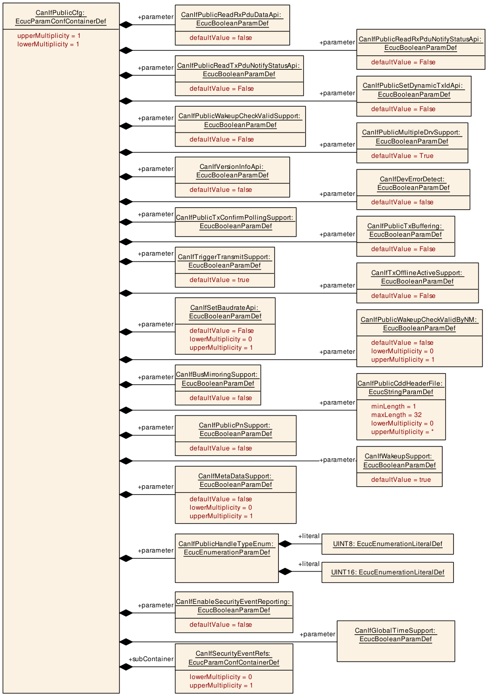

图 10.4： AR_EcucDef_CanIfPublicCfg

> 原文第 172 页

#### 10.1.4 CanIfInitCfg

| 字段 | 内容 |
| --- | --- |
| SWS 条目 | [ECUC_CanIf_00247] |
| Container 名称 | CanIfInitCfg |
| 父 Container | CanIf |
| 说明 | 包含 CAN Interface 的初始化参数。 |
| 配置参数 |  |

| 字段 | 内容 |
| --- | --- |
| SWS 条目 | [ECUC_CanIf_00623] |
| 参数名称 | CanIfInitCfgSet |
| 父 Container | CanIfInitCfg |
| 说明 | 选择 CAN Interface 专有 configuration set。该外部数据结构应包含面向全部底层 CAN Driver 的 CanIf post-build 初始化数据；对应 CanIf_ConfigType 常量。 |
| Multiplicity | 1 |
| 类型 | EcucStringParamDef |
| 默认值 | – |
| Length | 1-32 |
| 正则表达式 | – |
| Post-Build Variant Value | true |
| Value Configuration Class | Pre-compile time · X · VARIANT-PRE-COMPILE Link time · X · VARIANT-LINK-TIME Post-build time · X · VARIANT-POST-BUILD |
| 作用域 / 依赖关系 | 作用域：local。 |

| 字段 | 内容 |
| --- | --- |
| SWS 条目 | [ECUC_CanIf_00828] |
| 参数名称 | CanIfMaxBufferSize |
| 父 Container | CanIfInitCfg |
| 说明 | 全部 Tx buffer 的最大总大小。仅采用静态内存分配的 post-build loadable 实现需要该参数。 |
| Multiplicity | 0..1 |
| 类型 | EcucIntegerParamDef |
| 取值范围 | 0 .. 18446744073709551615 |
| 默认值 | – |
| Post-Build Variant Multiplicity | false |
| Post-Build Variant Value | false |
| Multiplicity 配置类别 | Pre-compile time · X · VARIANT-PRE-COMPILE Link time · X · VARIANT-LINK-TIME, VARIANT-POST-BUILD Post-build time · – |
| Value Configuration Class | Pre-compile time · X · VARIANT-PRE-COMPILE Link time · X · VARIANT-LINK-TIME, VARIANT-POST-BUILD Post-build time · – |
| 作用域 / 依赖关系 | 作用域：local。 |

> 原文第 173 页

| 字段 | 内容 |
| --- | --- |
| SWS 条目 | [ECUC_CanIf_00830] |
| 参数名称 | CanIfMaxRxPduCfg |
| 父 Container | CanIfInitCfg |
| 说明 | PDU 最大数量。仅采用静态内存分配的 post-build loadable 实现需要该参数。 |
| Multiplicity | 0..1 |
| 类型 | EcucIntegerParamDef |
| 取值范围 | 0 .. 18446744073709551615 |
| 默认值 | – |
| Post-Build Variant Multiplicity | false |
| Post-Build Variant Value | false |
| Multiplicity 配置类别 | Pre-compile time · X · VARIANT-PRE-COMPILE Link time · X · VARIANT-LINK-TIME, VARIANT-POST-BUILD Post-build time · – |
| Value Configuration Class | Pre-compile time · X · VARIANT-PRE-COMPILE Link time · X · VARIANT-LINK-TIME, VARIANT-POST-BUILD Post-build time · – |
| 作用域 / 依赖关系 | 作用域：local。 |

| 字段 | 内容 |
| --- | --- |
| SWS 条目 | [ECUC_CanIf_00829] |
| 参数名称 | CanIfMaxTxPduCfg |
| 父 Container | CanIfInitCfg |
| 说明 | PDU 最大数量。仅采用静态内存分配的 post-build loadable 实现需要该参数。 |
| Multiplicity | 0..1 |
| 类型 | EcucIntegerParamDef |
| 取值范围 | 0 .. 18446744073709551615 |
| 默认值 | – |
| Post-Build Variant Multiplicity | false |
| Post-Build Variant Value | false |
| Multiplicity 配置类别 | Pre-compile time · X · VARIANT-PRE-COMPILE Link time · X · VARIANT-LINK-TIME, VARIANT-POST-BUILD Post-build time · – |
| Value Configuration Class | Pre-compile time · X · VARIANT-PRE-COMPILE Link time · X · VARIANT-LINK-TIME, VARIANT-POST-BUILD Post-build time · – |
| 作用域 / 依赖关系 | 作用域：local。 |

| 包含的 Container |  |  |
| --- | --- | --- |
| Container 名称 | Multiplicity | 作用域 / 依赖关系 |
| CanIfBufferCfg | 0..* | 包含 Tx buffer 配置，可配置多个不同大小的 buffer。若 CanIfBufferSize（ECUC_CanIf_00834）为 0，Tx L-PDU 仅通过此 CanIfBufferCfg 引用对应 CanIfHthCfg。 |

> 原文第 174 页

| 包含的 Container |  |  |
| --- | --- | --- |
| Container 名称 | Multiplicity | 作用域 / 依赖关系 |
| CanIfInitHohCfg | 0..* | 包含对各底层 CAN Driver configuration set 的引用。 |
| CanIfRxPduCfg | 0..* | 包含每个接收 CAN L-PDU 的配置参数。“CanIfRxPduConfig” container 的 SHORT-NAME 表示 Receive L-PDU 符号名称。此 L-SDU 产生 CAN_ID_32 MetaData item，并根据 CanIfRxPduXLParams 产生 PRIORITYID_16、VLAN_16、SDUTYPE_8 和 ACCEPTANCEFIELD_32。 |
| CanIfTxPduCfg | 0..* | 包含一个发送 CAN L-PDU 的配置参数，每个所需 Transmit L-PDU 均应配置一个实例。“CanIfTxPduConfig”的 SHORT-NAME 表示其符号名称。此 L-SDU 使用 CAN_ID_32 MetaData item，并根据 CanIfTxPduXLParams 使用 PRIORITYID_16、VLAN_16、SDUTYPE_8 和 ACCEPTANCEFIELD_32。 |

> 原文第 175 页

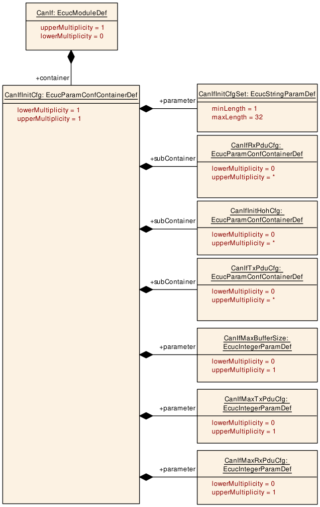

图 10.5：AR_EcucDef_CanIfInitCfg

#### 10.1.5 CanIfTxPduCfg

| 字段 | 内容 |
| --- | --- |
| SWS 条目 | [ECUC_CanIf_00248] |
| Container 名称 | CanIfTxPduCfg |
| 父 Container | CanIfInitCfg |
| 说明 | 本容器包含一个发送 CAN L-PDU 的配置参数。每需要一个发送 CAN L-PDU，就应配置一个本容器实例。CanIfTxPduConfig 容器的 SHORT-NAME 表示该发送 L-PDU 的符号名称。本 L-SDU 使用 CAN_ID_32 类型的 metadata；根据 CanIfTxPduXLParams 的配置，还会使用 PRIORITYID_16、VLAN_16、SDUTYPE_8 和 ACCEPTANCEFIELD_32 类型的 metadata。 |
| Post-Build Variant Multiplicity | true |
| Multiplicity 配置类别 | Pre-compile time · X · VARIANT-PRE-COMPILE |

> 原文第 176 页

|  | Link time | X | VARIANT-LINK-TIME |
| --- | --- | --- | --- |
|  | Post-build time | X | VARIANT-POST-BUILD |
| 配置参数 |  |  |  |

| 字段 | 内容 |
| --- | --- |
| SWS 条目 | [ECUC_CanIf_00592] |
| 参数名称 | CanIfTxPduCanId |
| 父 Container | CanIfTxPduCfg |
| 说明 | CAN Driver 发送 L-PDU 所使用的 CAN Identifier。Standard CAN 为 11 bit，Extended CAN 为 29 bit。动态 Transmit L-PDU 和 CAN XL PDU 可省略此参数。 |
| Multiplicity | 0..1 |
| 类型 | EcucIntegerParamDef |
| 取值范围 | 0 .. 536870911 |
| 默认值 | – |
| Post-Build Variant Multiplicity | true |
| Post-Build Variant Value | true |
| Multiplicity 配置类别 | Pre-compile time · X · VARIANT-PRE-COMPILE Link time · X · VARIANT-LINK-TIME Post-build time · X · VARIANT-POST-BUILD |
| Value Configuration Class | Pre-compile time · X · VARIANT-PRE-COMPILE Link time · X · VARIANT-LINK-TIME Post-build time · X · VARIANT-POST-BUILD |
| 作用域 / 依赖关系 | 作用域：ECU。依赖：若配置 CanIfTxPduXLParams 且 CanIfXLSduType 不为 3，此参数不适用。 |

| 字段 | 内容 |
| --- | --- |
| SWS 条目 | [ECUC_CanIf_00823] |
| 参数名称 | CanIfTxPduCanIdMask |
| 父 Container | CanIfTxPduCfg |
| 说明 | 指定 CAN Identifier 相关位的 mask，可使动态 Transmit L-PDU 的部分 CAN ID 位保持静态。Standard CAN 为 11 bit，Extended CAN 为 29 bit。 |
| Multiplicity | 0..1 |
| 类型 | EcucIntegerParamDef |
| 取值范围 | 0 .. 3758096383 |
| 默认值 | 3758096383 |
| Post-Build Variant Multiplicity | true |
| Post-Build Variant Value | true |
| Multiplicity 配置类别 | Pre-compile time · X · VARIANT-PRE-COMPILE Link time · X · VARIANT-LINK-TIME Post-build time · X · VARIANT-POST-BUILD |
| Value Configuration Class | Pre-compile time · X · VARIANT-PRE-COMPILE Link time · X · VARIANT-LINK-TIME Post-build time · X · VARIANT-POST-BUILD |
| 作用域 / 依赖关系 | 作用域：ECU。 |

> 原文第 177 页

| 字段 | 内容 |
| --- | --- |
| SWS 条目 | [ECUC_CanIf_00590] |
| 参数名称 | CanIfTxPduCanIdType |
| 父 Container | CanIfTxPduCfg |
| 说明 | CAN Driver 发送 CAN L-PDU 所使用的 CAN Identifier 类型。 |
| Multiplicity | 0..1 |
| 类型 | EcucEnumerationParamDef |
| 取值范围 | EXTENDED_CAN · 带 Extended Identifier（29 bit）的 CAN frame。 EXTENDED_FD_CAN · 带 Extended Identifier（29 bit）的 CAN FD frame。 STANDARD_CAN · 带 Standard Identifier（11 bit）的 CAN frame。 STANDARD_FD_CAN · 带 Standard Identifier（11 bit）的 CAN FD frame。 |
| Post-Build Variant Multiplicity | true |
| Post-Build Variant Value | true |
| Multiplicity 配置类别 | Pre-compile time · X · VARIANT-PRE-COMPILE Link time · X · VARIANT-LINK-TIME Post-build time · X · VARIANT-POST-BUILD |
| Value Configuration Class | Pre-compile time · X · VARIANT-PRE-COMPILE Link time · X · VARIANT-LINK-TIME Post-build time · X · VARIANT-POST-BUILD |
| 作用域 / 依赖关系 | 作用域：ECU。依赖：若配置 CanIfTxPduXLParams 且 CanIfXLSduType 不为 3，则不适用；否则必配。 |

| 字段 | 内容 |
| --- | --- |
| SWS 条目 | [ECUC_CanIf_00591] |
| 参数名称 | CanIfTxPduId |
| 父 Container | CanIfTxPduCfg |
| 说明 | ECU 范围内唯一的发送 CAN L-SDU 符号 handle。范围：0..CantTxPduId 最大数量。 |
| Multiplicity | 1 |
| 类型 | EcucIntegerParamDef（为此参数生成 Symbolic Name）。 |
| 取值范围 | 0 .. 4294967295 |
| 默认值 | – |
| Post-Build Variant Value | false |
| Value Configuration Class | Pre-compile time · X · 全部 Variant Link time · – Post-build time · – |
| 作用域 / 依赖关系 | 作用域：ECU。 |

| 字段 | 内容 |
| --- | --- |
| SWS 条目 | [ECUC_CanIf_00773] |
| 参数名称 | CanIfTxPduPnFilterPdu |
| 父 Container | CanIfTxPduCfg |
| 说明 | 若启用 CanIfPublicPnFilterSupport，可用此参数指定允许通过 CanIfPnFilter 的 PDU。若 Controller 未配置任何 CanIfTxPduPnFilterPdu，则不应用 CanIfPnFilter。 |
| Multiplicity | 0..1 |
| 类型 | EcucBooleanParamDef |
| 默认值 | false |

> 原文第 178 页

| 字段 | 内容 |
| --- | --- |
| Post-Build Variant Multiplicity | true |
| Post-Build Variant Value | true |
| Multiplicity 配置类别 | Pre-compile time · X · VARIANT-PRE-COMPILE Link time · X · VARIANT-LINK-TIME Post-build time · X · VARIANT-POST-BUILD |
| Value Configuration Class | Pre-compile time · X · VARIANT-PRE-COMPILE Link time · X · VARIANT-LINK-TIME Post-build time · X · VARIANT-POST-BUILD |
| 作用域 / 依赖关系 | 作用域：local。依赖：仅 CanIfPublicPnSupport = True 时可配置。 |

| 字段 | 内容 |
| --- | --- |
| SWS 条目 | [ECUC_CanIf_00589] |
| 参数名称 | CanIfTxPduReadNotifyStatus |
| 父 Container | CanIfTxPduCfg |
| 说明 | 按发送 CAN L-SDU 启用/禁用用于读取 notification status 的 transmit confirmation。True：启用；False：禁用。 |
| Multiplicity | 1 |
| 类型 | EcucBooleanParamDef |
| 默认值 | false |
| Post-Build Variant Value | true |
| Value Configuration Class | Pre-compile time · X · VARIANT-PRE-COMPILE Link time · X · VARIANT-LINK-TIME Post-build time · X · VARIANT-POST-BUILD |
| 作用域 / 依赖关系 | 作用域：local。依赖：必须启用 CanIfPublicReadTxPduNotifyStatusApi。 |

| 字段 | 内容 |
| --- | --- |
| SWS 条目 | [ECUC_CanIf_00840] |
| 参数名称 | CanIfTxPduTriggerTransmit |
| 父 Container | CanIfTxPduCfg |
| 说明 | 决定 CanIf 是否对该 PDU 使用 trigger transmit API。 |
| Multiplicity | 0..1 |
| 类型 | EcucBooleanParamDef |
| 默认值 | false |
| Post-Build Variant Value | true |
| Value Configuration Class | Pre-compile time · X · VARIANT-PRE-COMPILE Link time · X · VARIANT-LINK-TIME Post-build time · X · VARIANT-POST-BUILD |
| 作用域 / 依赖关系 | 作用域：ECU。依赖：CanIfTxPduTriggerTransmit 为 TRUE 时，CanIfTxPduUserTxConfirmationUL 必须为 PDUR 或 CDD，并配置相应 CanIfTxPduUserTriggerTransmitName。 |

| 字段 | 内容 |
| --- | --- |
| SWS 条目 | [ECUC_CanIf_00845] |
| 参数名称 | CanIfTxPduTruncation |
| 父 Container | CanIfTxPduCfg |

> 原文第 179 页

| 字段 | 内容 |
| --- | --- |
| 说明 | 启用/禁用对超出配置大小的 PDU 进行截断。 |
| Multiplicity | 1 |
| 类型 | EcucBooleanParamDef |
| 默认值 | true |
| Post-Build Variant Value | true |
| Value Configuration Class | Pre-compile time · X · VARIANT-PRE-COMPILE Link time · X · VARIANT-LINK-TIME Post-build time · X · VARIANT-POST-BUILD |
| 作用域 / 依赖关系 | 作用域：ECU。 |

| 字段 | 内容 |
| --- | --- |
| SWS 条目 | [ECUC_CanIf_00593] |
| 参数名称 | CanIfTxPduType |
| 父 Container | CanIfTxPduCfg |
| 说明 | 定义每个发送 CAN L-PDU 的类型。 |
| Multiplicity | 1 |
| 类型 | EcucEnumerationParamDef |
| 取值范围 | DYNAMIC · CAN ID 在 runtime 定义。 STATIC · CAN ID 在 compile-time 定义。 |
| Post-Build Variant Value | true |
| Value Configuration Class | Pre-compile time · X · VARIANT-PRE-COMPILE Link time · X · VARIANT-LINK-TIME Post-build time · X · VARIANT-POST-BUILD |
| 作用域 / 依赖关系 | 作用域：ECU。 |

| 字段 | 内容 |
| --- | --- |
| SWS 条目 | [ECUC_CanIf_00842] |
| 参数名称 | CanIfTxPduUserTriggerTransmitName |
| 父 Container | CanIfTxPduCfg |
| 说明 | 定义 &lt;User_TriggerTransmit&gt; 名称，依赖 CanIfTxPduUserTxConfirmationUL。若上层为 CAN_TP、CAN_NM、PDUR、XCP、CAN_TSYN、J1939NM 或 J1939TP，名称固定；若为 CDD，&lt;User_TxConfirmation&gt; 名称可选。此参数与 CanIfTxPduUserTxConfirmationName 依赖同一上层参数，必须明确该 PDU 由哪个上层负责。 |
| Multiplicity | 0..1 |
| 类型 | EcucFunctionNameDef |
| 默认值 | – |
| Length | 1-32 |
| 正则表达式 | – |
| Post-Build Variant Multiplicity | false |
| Post-Build Variant Value | false |
| Multiplicity 配置类别 | Pre-compile time · X · VARIANT-PRE-COMPILE Link time · X · VARIANT-LINK-TIME, VARIANT-POST-BUILD Post-build time · – |
| Value Configuration Class | Pre-compile time · X · VARIANT-PRE-COMPILE |

> 原文第 180 页

|  | Link time | X | VARIANT-LINK-TIME, VARIANT-POST-BUILD |
| --- | --- | --- | --- |
|  | Post-build time | – |  |
| 作用域 / 依赖关系 | 作用域：ECU。依赖：CanIfTxPduUserTriggerTransmitName 要求 CanIfTxPduUserTxConfirmationUL 为 PDUR 或 CDD。 |  |  |

| 字段 | 内容 |
| --- | --- |
| SWS 条目 | [ECUC_CanIf_00528] |
| 参数名称 | CanIfTxPduUserTxConfirmationName |
| 父 Container | CanIfTxPduCfg |
| 说明 | 定义 &lt;User_TxConfirmation&gt; 名称，依赖 CanIfTxPduUserTxConfirmationUL。上层为 CAN_TP、CAN_NM、PDUR、XCP、CAN_TSYN、J1939NM 或 J1939TP 时名称固定；为 CDD 时名称可选。 |
| Multiplicity | 0..1 |
| 类型 | EcucFunctionNameDef |
| 默认值 | – |
| Length | 1-32 |
| 正则表达式 | – |
| Post-Build Variant Multiplicity | false |
| Post-Build Variant Value | false |
| Multiplicity 配置类别 | Pre-compile time · X · VARIANT-PRE-COMPILE Link time · X · VARIANT-LINK-TIME, VARIANT-POST-BUILD Post-build time · – |
| Value Configuration Class | Pre-compile time · X · VARIANT-PRE-COMPILE Link time · X · VARIANT-LINK-TIME, VARIANT-POST-BUILD Post-build time · – |
| 作用域 / 依赖关系 | 作用域：ECU。 |

| 字段 | 内容 |
| --- | --- |
| SWS 条目 | [ECUC_CanIf_00527] |
| 参数名称 | CanIfTxPduUserTxConfirmationUL |
| 父 Container | CanIfTxPduCfg |
| 说明 | 定义成功发送 CanTxPduId 后，通过 &lt;User_TxConfirmation&gt; 通知的上层模块。CAN Driver 发出对应 Tx confirmation 时必须调用该 callback；若未配置上层，则不调用。 |
| Multiplicity | 0..1 |
| 类型 | EcucEnumerationParamDef |
| 取值范围 | CAN_NM · CAN NM CAN_TP · CAN TP CAN_TSYN · Global Time Synchronization over CAN CDD · Complex Driver J1939NM · J1939Nm J1939TP · J1939Tp PDUR · PDU Router |

> 原文第 181 页

|  | XCP | Extended Calibration Protocol |  |
| --- | --- | --- | --- |
| Post-Build Variant Multiplicity | false |  |  |
| Post-Build Variant Value | false |  |  |
| Multiplicity 配置类别 | Pre-compile time | X | VARIANT-PRE-COMPILE |
|  | Link time | X | VARIANT-LINK-TIME, VARIANT-POST-BUILD |
|  | Post-build time | – |  |
| Value Configuration Class | Pre-compile time | X | VARIANT-PRE-COMPILE |
|  | Link time | X | VARIANT-LINK-TIME, VARIANT-POST-BUILD |
|  | Post-build time | – |  |
| 作用域 / 依赖关系 | 作用域：ECU。 |  |  |

| 字段 | 内容 |
| --- | --- |
| SWS 条目 | [ECUC_CanIf_00831] |
| 参数名称 | CanIfTxPduBufferRef |
| 父 Container | CanIfTxPduCfg |
| 说明 | 对 CanIf buffer 配置的可配置引用。 |
| Multiplicity | 1 |
| 类型 | 引用 CanIfBufferCfg。 |
| Post-Build Variant Value | true |
| Value Configuration Class | Pre-compile time · X · VARIANT-PRE-COMPILE Link time · X · VARIANT-LINK-TIME Post-build time · X · VARIANT-POST-BUILD |
| 作用域 / 依赖关系 | 作用域：ECU。 |

| 字段 | 内容 |
| --- | --- |
| SWS 条目 | [ECUC_CanIf_00603] |
| 参数名称 | CanIfTxPduRef |
| 父 Container | CanIfTxPduCfg |
| 说明 | 引用 global Pdu 结构，以统一 COM stack 内的 handle ID。 |
| Multiplicity | 1 |
| 类型 | 引用 Pdu。 |
| Post-Build Variant Value | true |
| Value Configuration Class | Pre-compile time · X · VARIANT-PRE-COMPILE Link time · X · VARIANT-LINK-TIME Post-build time · X · VARIANT-POST-BUILD |
| 作用域 / 依赖关系 | 作用域：ECU。 |

| 包含的 Container |  |  |
| --- | --- | --- |
| Container 名称 | Multiplicity | 作用域 / 依赖关系 |
| CanIfTTTxFrameTriggering | 0..1 | CanIfTTTxFrameTriggering 由 TTCAN Interface SWS 定义，用于 TTCAN 发送 frame trigger。仅 Controller 支持并启用 TTCAN（CanIfSupportTTCAN、ECUC_CanIf_00675），且使用 joblist 时，该 container 才存在且有效。 |
| CanIfTxPduXLParams | 0..1 | CAN XL 参数，标识 CanIfTxPduCfg 为 CAN XL PDU。 |

> 原文第 182 页

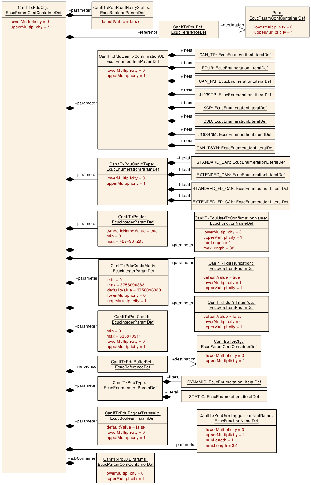

图 10.6： AR_EcucDef_CanIfTxPduCfg

> 原文第 183 页

#### 10.1.6 CanIfTxPduXLParams

| 字段 | 内容 |
| --- | --- |
| SWS 条目 | [ECUC_CanIf_00855] |
| Container 名称 | CanIfTxPduXLParams |
| 父 Container | CanIfTxPduCfg |
| 说明 | CAN XL 参数，标识 CanIfTxPduCfg 为 CAN XL PDU。 |
| Post-Build Variant Multiplicity | true |
| Multiplicity 配置类别 | Pre-compile time · X · VARIANT-PRE-COMPILE Link time · X · VARIANT-LINK-TIME Post-build time · X · VARIANT-POST-BUILD |
| 配置参数 |  |

| 字段 | 内容 |
| --- | --- |
| SWS 条目 | [ECUC_CanIf_00859] |
| 参数名称 | CanIfXLAcceptanceField |
| 父 Container | CanIfTxPduXLParams |
| 说明 | CAN XL message 的 Acceptance Field。 |
| Multiplicity | 0..1 |
| 类型 | EcucIntegerParamDef |
| 取值范围 | 0 .. 4294967295 |
| 默认值 | – |
| Post-Build Variant Multiplicity | true |
| Post-Build Variant Value | true |
| Multiplicity 配置类别 | Pre-compile time · X · VARIANT-PRE-COMPILE Link time · X · VARIANT-LINK-TIME Post-build time · X · VARIANT-POST-BUILD |
| Value Configuration Class | Pre-compile time · X · VARIANT-PRE-COMPILE Link time · X · VARIANT-LINK-TIME Post-build time · X · VARIANT-POST-BUILD |
| 作用域 / 依赖关系 | 作用域：local。依赖：CanIfXLSduType = 3 时不适用。 |

| 字段 | 内容 |
| --- | --- |
| SWS 条目 | [ECUC_CanIf_00856] |
| 参数名称 | CanIfXLPriorityId |
| 父 Container | CanIfTxPduXLParams |
| 说明 | CAN XL message 的 Priority ID。 |
| Multiplicity | 0..1 |
| 类型 | EcucIntegerParamDef |
| 取值范围 | 0 .. 2047 |
| 默认值 | – |
| Post-Build Variant Multiplicity | true |
| Post-Build Variant Value | true |
| Multiplicity 配置类别 | Pre-compile time · X · VARIANT-PRE-COMPILE Link time · X · VARIANT-LINK-TIME Post-build time · X · VARIANT-POST-BUILD |
| Value Configuration Class | Pre-compile time · X · VARIANT-PRE-COMPILE Link time · X · VARIANT-LINK-TIME Post-build time · X · VARIANT-POST-BUILD |

> 原文第 184 页

| 字段 | 内容 |
| --- | --- |
| 作用域 / 依赖关系 | 作用域：local。 |

| 字段 | 内容 |
| --- | --- |
| SWS 条目 | [ECUC_CanIf_00858] |
| 参数名称 | CanIfXLSduType |
| 父 Container | CanIfTxPduXLParams |
| 说明 | CAN XL message 的 SDU Type。 |
| Multiplicity | 0..1 |
| 类型 | EcucIntegerParamDef |
| 取值范围 | 0 .. 255 |
| 默认值 | – |
| Post-Build Variant Multiplicity | true |
| Post-Build Variant Value | true |
| Multiplicity 配置类别 | Pre-compile time · X · VARIANT-PRE-COMPILE Link time · X · VARIANT-LINK-TIME Post-build time · X · VARIANT-POST-BUILD |
| Value Configuration Class | Pre-compile time · X · VARIANT-PRE-COMPILE Link time · X · VARIANT-LINK-TIME Post-build time · X · VARIANT-POST-BUILD |
| 作用域 / 依赖关系 | 作用域：local。 |

| 字段 | 内容 |
| --- | --- |
| SWS 条目 | [ECUC_CanIf_00857] |
| 参数名称 | CanIfXLVcid |
| 父 Container | CanIfTxPduXLParams |
| 说明 | CAN XL message 的 Virtual CAN Network ID。 |
| Multiplicity | 0..1 |
| 类型 | EcucIntegerParamDef |
| 取值范围 | 0 .. 255 |
| 默认值 | – |
| Post-Build Variant Multiplicity | true |
| Post-Build Variant Value | true |
| Multiplicity 配置类别 | Pre-compile time · X · VARIANT-PRE-COMPILE Link time · X · VARIANT-LINK-TIME Post-build time · X · VARIANT-POST-BUILD |
| Value Configuration Class | Pre-compile time · X · VARIANT-PRE-COMPILE Link time · X · VARIANT-LINK-TIME Post-build time · X · VARIANT-POST-BUILD |
| 作用域 / 依赖关系 | 作用域：local。 |

无包含的 Container

> 原文第 185 页

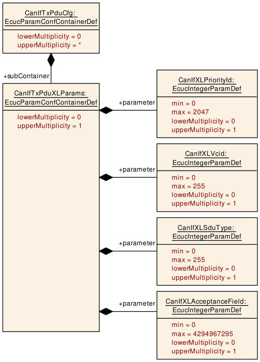

图 10.7：AR_EcucDef_CanIfTxPduXLParams

#### 10.1.7 CanIfRxPduCfg

| 字段 | 内容 |
| --- | --- |
| SWS 条目 | [ECUC_CanIf_00249] |
| Container 名称 | CanIfRxPduCfg |
| 父 Container | CanIfInitCfg |
| 说明 | 本容器包含各接收 CAN L-PDU 的配置参数。CanIfRxPduConfig 容器自身的 SHORT-NAME 表示接收 L-PDU 的符号名称。本 L-SDU 产生 CAN_ID_32 类型的 metadata；根据 CanIfRxPduXLParams 的配置，还会产生 PRIORITYID_16、VLAN_16、SDUTYPE_8 和 ACCEPTANCEFIELD_32 类型的 metadata。 |
| Post-Build Variant Multiplicity | true |
| Multiplicity 配置类别 | Pre-compile time · X · VARIANT-PRE-COMPILE Link time · X · VARIANT-LINK-TIME Post-build time · X · VARIANT-POST-BUILD |
| 配置参数 |  |

| 字段 | 内容 |
| --- | --- |
| SWS 条目 | [ECUC_CanIf_00598] |
| 参数名称 | CanIfRxPduCanId |
| 父 Container | CanIfRxPduCfg |

> 原文第 186 页

| 字段 | 内容 |
| --- | --- |
| 说明 | CanIf 使用的接收 CAN L-PDU Identifier，例如用于 Software Filtering。仅 PDU 对应一个 CanId 时使用；若对应一个范围，应使用 CanIfRxPduCanIdRange。Standard CAN 为 11 bit，Extended CAN 为 29 bit。 |
| Multiplicity | 0..1 |
| 类型 | EcucIntegerParamDef |
| 取值范围 | 0 .. 536870911 |
| 默认值 | – |
| Post-Build Variant Multiplicity | true |
| Post-Build Variant Value | true |
| Multiplicity 配置类别 | Pre-compile time · X · VARIANT-PRE-COMPILE Link time · X · VARIANT-LINK-TIME Post-build time · X · VARIANT-POST-BUILD |
| Value Configuration Class | Pre-compile time · X · VARIANT-PRE-COMPILE Link time · X · VARIANT-LINK-TIME Post-build time · X · VARIANT-POST-BUILD |
| 作用域 / 依赖关系 | 作用域：ECU。 |

| 字段 | 内容 |
| --- | --- |
| SWS 条目 | [ECUC_CanIf_00822] |
| 参数名称 | CanIfRxPduCanIdMask |
| 父 Container | CanIfRxPduCfg |
| 说明 | 指定 CAN ID 相关位的 mask，是 CanIfRxPduCanIdRange 之外定义范围的另一种方式。Mask 指明配置 CAN ID 中哪些位必须与接收 CAN ID 匹配。Standard CAN 为 11 bit，Extended CAN 为 29 bit。 |
| Multiplicity | 0..1 |
| 类型 | EcucIntegerParamDef |
| 取值范围 | 0 .. 536870911 |
| 默认值 | 536870911 |
| Post-Build Variant Multiplicity | true |
| Post-Build Variant Value | true |
| Multiplicity 配置类别 | Pre-compile time · X · VARIANT-PRE-COMPILE Link time · X · VARIANT-LINK-TIME Post-build time · X · VARIANT-POST-BUILD |
| Value Configuration Class | Pre-compile time · X · VARIANT-PRE-COMPILE Link time · X · VARIANT-LINK-TIME Post-build time · X · VARIANT-POST-BUILD |
| 作用域 / 依赖关系 | 作用域：ECU。 |

| 字段 | 内容 |
| --- | --- |
| SWS 条目 | [ECUC_CanIf_00596] |
| 参数名称 | CanIfRxPduCanIdType |
| 父 Container | CanIfRxPduCfg |
| 说明 | CAN Driver 接收 CAN L-PDU 时使用的 CAN Identifier。 |
| Multiplicity | 0..1 |
| 类型 | EcucEnumerationParamDef |
| 取值范围 | EXTENDED_CAN · 带 Extended Identifier（29 bit）的 CAN 2.0 或 CAN FD frame。 |

> 原文第 187 页

|  | EXTENDED_FD_CAN | 带 Extended Identifier（29 bit）的 CAN FD frame。 |  |
| --- | --- | --- | --- |
|  | EXTENDED_NO_FD_CAN | 带 Extended Identifier（29 bit）的 CAN 2.0 frame。 |  |
|  | STANDARD_CAN | 带 Standard Identifier（11 bit）的 CAN 2.0 或 CAN FD frame。 |  |
|  | STANDARD_FD_CAN | 带 Standard Identifier（11 bit）的 CAN FD frame。 |  |
|  | STANDARD_NO_FD_CAN | 带 Standard Identifier（11 bit）的 CAN 2.0 frame。 |  |
| Post-Build Variant Multiplicity | true |  |  |
| Post-Build Variant Value | true |  |  |
| Multiplicity 配置类别 | Pre-compile time | X | VARIANT-PRE-COMPILE |
|  | Link time | X | VARIANT-LINK-TIME |
|  | Post-build time | X | VARIANT-POST-BUILD |
| Value Configuration Class | Pre-compile time | X | VARIANT-PRE-COMPILE |
|  | Link time | X | VARIANT-LINK-TIME |
|  | Post-build time | X | VARIANT-POST-BUILD |
| 作用域 / 依赖关系 | 作用域：local。依赖：若配置 CanIfRxPduXLParams 且 CanIfXLSduType 不为 3，则不适用；否则必配。 |  |  |

| 字段 | 内容 |
| --- | --- |
| SWS 条目 | [ECUC_CanIf_00599] |
| 参数名称 | CanIfRxPduDataLength |
| 父 Container | CanIfRxPduCfg |
| 说明 | CanIf 使用的接收 CAN L-PDU 数据长度，用于 Data Length Check；对于超过 8 字节、采用离散 DLC 的 CAN FD L-PDU，也可指定有效数据范围。CAN L-PDU 数据区大小为 0..2048 字节。 |
| Multiplicity | 1 |
| 类型 | EcucIntegerParamDef |
| 取值范围 | 0 .. 2048 |
| 默认值 | – |
| Post-Build Variant Value | true |
| Value Configuration Class | Pre-compile time · X · VARIANT-PRE-COMPILE Link time · X · VARIANT-LINK-TIME Post-build time · X · VARIANT-POST-BUILD |
| 作用域 / 依赖关系 | 作用域：ECU。依赖：CanIfRxPduDataLength &gt; 8 时，CanIfRxPduCanIdType 不得为 STANDARD_NO_FD_CAN 或 EXTENDED_NO_FD_CAN；长度 &gt; 64 时，必须存在 CanIfRxPduXLParams。 |

| 字段 | 内容 |
| --- | --- |
| SWS 条目 | [ECUC_CanIf_00846] |
| 参数名称 | CanIfRxPduDataLengthCheck |
| 父 Container | CanIfRxPduCfg |
| 说明 | 控制单条消息的 Data Length Check。True：接收该 PDU 时检查长度。False：不检查。 |
| Multiplicity | 1 |
| 类型 | EcucBooleanParamDef |
| 默认值 | true |
| Post-Build Variant Value | true |

> 原文第 188 页

| 字段 | 内容 |
| --- | --- |
| Value Configuration Class | Pre-compile time · X · VARIANT-PRE-COMPILE Link time · X · VARIANT-LINK-TIME Post-build time · X · VARIANT-POST-BUILD |
| 作用域 / 依赖关系 | 作用域：local。 |

| 字段 | 内容 |
| --- | --- |
| SWS 条目 | [ECUC_CanIf_00597] |
| 参数名称 | CanIfRxPduId |
| 父 Container | CanIfRxPduCfg |
| 说明 | ECU 范围内唯一的接收 CAN L-SDU 符号 handle，应符合 ANSI / AUTOSAR 的常量定义要求。范围：0..已定义 CanRxPduId 的最大数量。 |
| Multiplicity | 1 |
| 类型 | EcucIntegerParamDef（为此参数生成 Symbolic Name）。 |
| 取值范围 | 0 .. 4294967295 |
| 默认值 | – |
| Post-Build Variant Value | false |
| Value Configuration Class | Pre-compile time · X · 全部 Variant Link time · – Post-build time · – |
| 作用域 / 依赖关系 | 作用域：ECU。依赖：若配置 CanIfRxPduXLParams 且 CanIfXLSduType 不为 3，此参数不适用。 |

| 字段 | 内容 |
| --- | --- |
| SWS 条目 | [ECUC_CanIf_00600] |
| 参数名称 | CanIfRxPduReadData |
| 父 Container | CanIfRxPduCfg |
| 说明 | 启用/禁用用于读取接收 L-SDU 数据的 Rx buffering。True：启用；False：禁用。 |
| Multiplicity | 1 |
| 类型 | EcucBooleanParamDef |
| 默认值 | false |
| Post-Build Variant Value | true |
| Value Configuration Class | Pre-compile time · X · VARIANT-PRE-COMPILE Link time · X · VARIANT-LINK-TIME Post-build time · X · VARIANT-POST-BUILD |
| 作用域 / 依赖关系 | 作用域：ECU。 |

| 字段 | 内容 |
| --- | --- |
| SWS 条目 | [ECUC_CanIf_00595] |
| 参数名称 | CanIfRxPduReadNotifyStatus |
| 父 Container | CanIfRxPduCfg |
| 说明 | 按接收 CAN L-SDU 启用/禁用用于读取 notification status 的 receive indication。True：启用；False：禁用。 |
| Multiplicity | 1 |
| 类型 | EcucBooleanParamDef |
| 默认值 | false |
| Post-Build Variant Value | true |

> 原文第 189 页

| 字段 | 内容 |
| --- | --- |
| Value Configuration Class | Pre-compile time · X · VARIANT-PRE-COMPILE Link time · X · VARIANT-LINK-TIME Post-build time · X · VARIANT-POST-BUILD |
| 作用域 / 依赖关系 | 作用域：local。依赖：必须启用 CanIfPublicReadRxPduNotifyStatusApi。 |

| 字段 | 内容 |
| --- | --- |
| SWS 条目 | [ECUC_CanIf_00530] |
| 参数名称 | CanIfRxPduUserRxIndicationName |
| 父 Container | CanIfRxPduCfg |
| 说明 | 定义 &lt;User_RxIndication&gt; 名称，依赖 CanIfRxPduUserRxIndicationUL。上层为 CAN_TP、CAN_NM、PDUR、XCP、CAN_TSYN、J1939NM 或 J1939TP 时名称固定；为 CDD 时可选。 |
| Multiplicity | 0..1 |
| 类型 | EcucFunctionNameDef |
| 默认值 | – |
| Length | 1-32 |
| 正则表达式 | – |
| Post-Build Variant Multiplicity | false |
| Post-Build Variant Value | false |
| Multiplicity 配置类别 | Pre-compile time · X · VARIANT-PRE-COMPILE Link time · X · VARIANT-LINK-TIME, VARIANT-POST-BUILD Post-build time · – |
| Value Configuration Class | Pre-compile time · X · VARIANT-PRE-COMPILE Link time · X · VARIANT-LINK-TIME, VARIANT-POST-BUILD Post-build time · – |
| 作用域 / 依赖关系 | 作用域：ECU。 |

| 字段 | 内容 |
| --- | --- |
| SWS 条目 | [ECUC_CanIf_00529] |
| 参数名称 | CanIfRxPduUserRxIndicationUL |
| 父 Container | CanIfRxPduCfg |
| 说明 | 定义通过 &lt;User_RxIndication&gt; 接收成功 CANRXPDUID 通知的上层模块。CAN Driver 发出配置 PDU 的 Rx indication 时必须调用该 callback；若未配置上层，则不调用。 |
| Multiplicity | 0..1 |
| 类型 | EcucEnumerationParamDef |
| 取值范围 | CAN_NM · CAN NM CAN_TP · CAN TP CAN_TSYN · Global Time Synchronization over CAN CDD · Complex Driver J1939NM · J1939Nm J1939TP · J1939Tp PDUR · PDU Router XCP · Extended Calibration Protocol |

> 原文第 190 页

| 字段 | 内容 |
| --- | --- |
| Post-Build Variant Multiplicity | false |
| Post-Build Variant Value | false |
| Multiplicity 配置类别 | Pre-compile time · X · VARIANT-PRE-COMPILE Link time · X · VARIANT-LINK-TIME, VARIANT-POST-BUILD Post-build time · – |
| Value Configuration Class | Pre-compile time · X · VARIANT-PRE-COMPILE Link time · X · VARIANT-LINK-TIME, VARIANT-POST-BUILD Post-build time · – |
| 作用域 / 依赖关系 | 作用域：ECU。 |

| 字段 | 内容 |
| --- | --- |
| SWS 条目 | [ECUC_CanIf_00602] |
| 参数名称 | CanIfRxPduHrhIdRef |
| 父 Container | CanIfRxPduCfg |
| 说明 | 引用该 Rx L-PDU 所属 HRH。 |
| Multiplicity | 1 |
| 类型 | 引用 CanIfHrhCfg。 |
| Post-Build Variant Value | true |
| Value Configuration Class | Pre-compile time · X · VARIANT-PRE-COMPILE Link time · X · VARIANT-LINK-TIME Post-build time · X · VARIANT-POST-BUILD |
| 作用域 / 依赖关系 | 作用域：local。依赖：此信息必须从 CAN Driver 配置导出。 |

| 字段 | 内容 |
| --- | --- |
| SWS 条目 | [ECUC_CanIf_00601] |
| 参数名称 | CanIfRxPduRef |
| 父 Container | CanIfRxPduCfg |
| 说明 | 引用 global Pdu 结构，以统一 COM stack 内的 handle ID。 |
| Multiplicity | 1 |
| 类型 | 引用 Pdu。 |
| Post-Build Variant Value | true |
| Value Configuration Class | Pre-compile time · X · VARIANT-PRE-COMPILE Link time · X · VARIANT-LINK-TIME Post-build time · X · VARIANT-POST-BUILD |
| 作用域 / 依赖关系 | 作用域：ECU。 |

| 包含的 Container |  |  |
| --- | --- | --- |
| Container 名称 | Multiplicity | 作用域 / 依赖关系 |
| CanIfRxPduCanIdRange | 0..1 | 可选 container，用于将一组 CAN ID 范围映射到一个 PduId。 |
| CanIfRxPduXLParams | 0..1 | CAN XL 参数，标识 CanIfRxPduCfg 为 CAN XL PDU。 |
| CanIfTTRxFrameTriggering | 0..1 | CanIfTTRxFrameTriggering 由 TTCAN Interface SWS 定义，用于 TTCAN 接收 frame trigger。仅 Controller 支持并启用 TTCAN（CanIfSupportTTCAN、ECUC_CanIf_00675），且接收使用 joblist 时，该 container 才存在且有效。 |

> 原文第 191 页

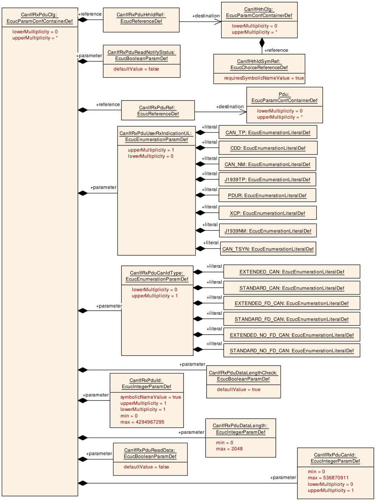

图 10.8： AR_EcucDef_CanIfRxPduCfg

> 原文第 192 页

#### 10.1.8 CanIfRxPduXLParams

| 字段 | 内容 |
| --- | --- |
| SWS 条目 | [ECUC_CanIf_00860] |
| Container 名称 | CanIfRxPduXLParams |
| 父 Container | CanIfRxPduCfg |
| 说明 | CAN XL 参数，标识 CanIfRxPduCfg 为 CAN XL PDU。 |
| Post-Build Variant Multiplicity | true |
| Multiplicity 配置类别 | Pre-compile time · X · VARIANT-PRE-COMPILE Link time · X · VARIANT-LINK-TIME Post-build time · X · VARIANT-POST-BUILD |
| 配置参数 |  |

| 字段 | 内容 |
| --- | --- |
| SWS 条目 | [ECUC_CanIf_00864] |
| 参数名称 | CanIfXLAcceptanceField |
| 父 Container | CanIfRxPduXLParams |
| 说明 | CAN XL message 的 Acceptance Field。 |
| Multiplicity | 0..1 |
| 类型 | EcucIntegerParamDef |
| 取值范围 | 0 .. 4294967295 |
| 默认值 | – |
| Post-Build Variant Multiplicity | true |
| Post-Build Variant Value | true |
| Multiplicity 配置类别 | Pre-compile time · X · VARIANT-PRE-COMPILE Link time · X · VARIANT-LINK-TIME Post-build time · X · VARIANT-POST-BUILD |
| Value Configuration Class | Pre-compile time · X · VARIANT-PRE-COMPILE Link time · X · VARIANT-LINK-TIME Post-build time · X · VARIANT-POST-BUILD |
| 作用域 / 依赖关系 | 作用域：local。依赖：CanIfXLSduType = 3 时不适用。 |

| 字段 | 内容 |
| --- | --- |
| SWS 条目 | [ECUC_CanIf_00861] |
| 参数名称 | CanIfXLPriorityId |
| 父 Container | CanIfRxPduXLParams |
| 说明 | CAN XL message 的 Priority ID。 |
| Multiplicity | 0..1 |
| 类型 | EcucIntegerParamDef |
| 取值范围 | 0 .. 2047 |
| 默认值 | – |
| Post-Build Variant Multiplicity | true |
| Post-Build Variant Value | true |
| Multiplicity 配置类别 | Pre-compile time · X · VARIANT-PRE-COMPILE Link time · X · VARIANT-LINK-TIME Post-build time · X · VARIANT-POST-BUILD |
| Value Configuration Class | Pre-compile time · X · VARIANT-PRE-COMPILE Link time · X · VARIANT-LINK-TIME Post-build time · X · VARIANT-POST-BUILD |

> 原文第 193 页

| 字段 | 内容 |
| --- | --- |
| 作用域 / 依赖关系 | 作用域：local。 |

| 字段 | 内容 |
| --- | --- |
| SWS 条目 | [ECUC_CanIf_00863] |
| 参数名称 | CanIfXLSduType |
| 父 Container | CanIfRxPduXLParams |
| 说明 | CAN XL message 的 SDU Type。 |
| Multiplicity | 0..1 |
| 类型 | EcucIntegerParamDef |
| 取值范围 | 0 .. 255 |
| 默认值 | – |
| Post-Build Variant Multiplicity | true |
| Post-Build Variant Value | true |
| Multiplicity 配置类别 | Pre-compile time · X · VARIANT-PRE-COMPILE Link time · X · VARIANT-LINK-TIME Post-build time · X · VARIANT-POST-BUILD |
| Value Configuration Class | Pre-compile time · X · VARIANT-PRE-COMPILE Link time · X · VARIANT-LINK-TIME Post-build time · X · VARIANT-POST-BUILD |
| 作用域 / 依赖关系 | 作用域：local。 |

| 字段 | 内容 |
| --- | --- |
| SWS 条目 | [ECUC_CanIf_00862] |
| 参数名称 | CanIfXLVcid |
| 父 Container | CanIfRxPduXLParams |
| 说明 | CAN XL message 的 Virtual CAN Network ID。 |
| Multiplicity | 0..1 |
| 类型 | EcucIntegerParamDef |
| 取值范围 | 0 .. 255 |
| 默认值 | – |
| Post-Build Variant Multiplicity | true |
| Post-Build Variant Value | true |
| Multiplicity 配置类别 | Pre-compile time · X · VARIANT-PRE-COMPILE Link time · X · VARIANT-LINK-TIME Post-build time · X · VARIANT-POST-BUILD |
| Value Configuration Class | Pre-compile time · X · VARIANT-PRE-COMPILE Link time · X · VARIANT-LINK-TIME Post-build time · X · VARIANT-POST-BUILD |
| 作用域 / 依赖关系 | 作用域：local。 |

无包含的 Container

> 原文第 194 页

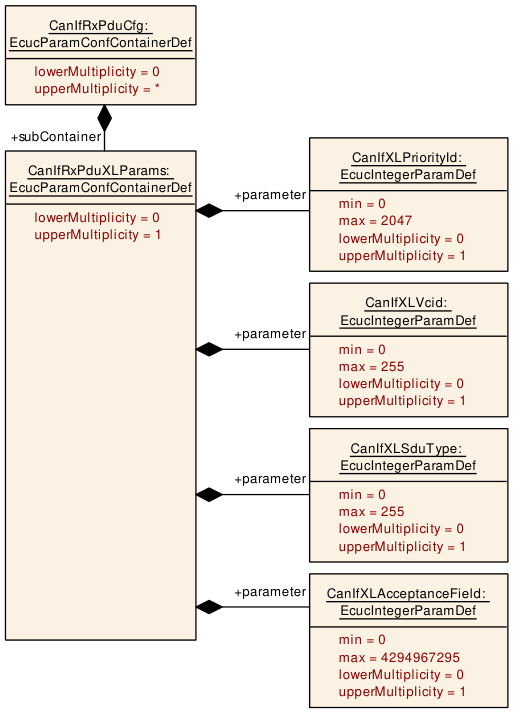

图 10.9：AR_EcucDef_CanIfRxPduXLParams

#### 10.1.9 CanIfRxPduCanIdRange

| 字段 | 内容 |
| --- | --- |
| SWS 条目 | [ECUC_CanIf_00743] |
| Container 名称 | CanIfRxPduCanIdRange |
| 父 Container | CanIfRxPduCfg |
| 说明 | 可选 container，用于将一组 CAN ID 范围映射到一个 PduId。 |
| 配置参数 |  |

| 字段 | 内容 |
| --- | --- |
| SWS 条目 | [ECUC_CanIf_00745] |
| 参数名称 | CanIfRxPduCanIdRangeLowerCanId |
| 父 Container | CanIfRxPduCanIdRange |
| 说明 | 接收 CAN L-PDU 的 CAN Identifier 范围下限。该范围内的所有 CAN ID 均映射到同一个 PduId。 |
| Multiplicity | 1 |
| 类型 | EcucIntegerParamDef |
| 取值范围 | 0 .. 536870911 |
| 默认值 | – |
| Post-Build Variant Value | true |
| Value Configuration Class | Pre-compile time · X · VARIANT-PRE-COMPILE Link time · X · VARIANT-LINK-TIME Post-build time · X · VARIANT-POST-BUILD |
| 作用域 / 依赖关系 | 作用域：local。 |

> 原文第 195 页

| 字段 | 内容 |
| --- | --- |
| SWS 条目 | [ECUC_CanIf_00744] |
| 参数名称 | CanIfRxPduCanIdRangeUpperCanId |
| 父 Container | CanIfRxPduCanIdRange |
| 说明 | 接收 CAN L-PDU ID 范围的上限；该范围内全部 CAN ID 映射到同一 PduId。 |
| Multiplicity | 1 |
| 类型 | EcucIntegerParamDef |
| 取值范围 | 0 .. 536870911 |
| 默认值 | – |
| Post-Build Variant Value | true |
| Value Configuration Class | Pre-compile time · X · VARIANT-PRE-COMPILE Link time · X · VARIANT-LINK-TIME Post-build time · X · VARIANT-POST-BUILD |
| 作用域 / 依赖关系 | 作用域：local。 |

无包含的 Container

#### 10.1.10 CanIfDispatchCfg

| 字段 | 内容 |
| --- | --- |
| SWS 条目 | [ECUC_CanIf_00250] |
| Container 名称 | CanIfDispatchCfg |
| 父 Container | CanIf |
| 说明 | CanIf 上层提供的 callback，此 container 中的 callback 由全部配置的 CAN Driver / CAN Transceiver Driver 共用。 |
| 配置参数 |  |

| 字段 | 内容 |
| --- | --- |
| SWS 条目 | [ECUC_CanIf_00791] |
| 参数名称 | CanIfDispatchUserCheckTrcvWakeFlagIndicationName |
| 父 Container | CanIfDispatchCfg |
| 说明 | 定义 &lt;User_CheckTrcvWakeFlagIndication&gt; 名称。CanIfDispatchUserCheckTrcvWakeFlagIndicationUL 为 CAN_SM 时名称固定，为 CDD 时可选。CanIfPublicPnSupport 为 False 时不得配置。 |
| Multiplicity | 0..1 |
| 类型 | EcucFunctionNameDef |
| 默认值 | – |
| 正则表达式 | – |
| Post-Build Variant Multiplicity | false |
| Post-Build Variant Value | false |
| Multiplicity 配置类别 | Pre-compile time · X · VARIANT-PRE-COMPILE Link time · X · VARIANT-LINK-TIME, VARIANT-POST-BUILD Post-build time · – |
| Value Configuration Class | Pre-compile time · X · VARIANT-PRE-COMPILE Link time · X · VARIANT-LINK-TIME, VARIANT-POST-BUILD |

> 原文第 196 页

|  | Post-build time | – |
| --- | --- | --- |
| 作用域 / 依赖关系 | 作用域：ECU。依赖：CanIfDispatchUserCheckTrcvWakeFlagIndicationUL、CanIfPublicPnSupport。 |  |

| 字段 | 内容 |
| --- | --- |
| SWS 条目 | [ECUC_CanIf_00792] |
| 参数名称 | CanIfDispatchUserCheckTrcvWakeFlagIndicationUL |
| 父 Container | CanIfDispatchCfg |
| 说明 | 定义 Driver 的 CheckTrcvWakeFlagIndication 应路由到的上层。CanIfPublicPnSupport 为 False 时不得配置。 |
| Multiplicity | 0..1 |
| 类型 | EcucEnumerationParamDef |
| 取值范围 | CAN_SM · CAN State Manager CDD · Complex Driver |
| Post-Build Variant Multiplicity | false |
| Post-Build Variant Value | false |
| Multiplicity 配置类别 | Pre-compile time · X · VARIANT-PRE-COMPILE Link time · X · VARIANT-LINK-TIME, VARIANT-POST-BUILD Post-build time · – |
| Value Configuration Class | Pre-compile time · X · VARIANT-PRE-COMPILE Link time · X · VARIANT-LINK-TIME, VARIANT-POST-BUILD Post-build time · – |
| 作用域 / 依赖关系 | 作用域：ECU。依赖：CanIfPublicPnSupport。 |

| 字段 | 内容 |
| --- | --- |
| SWS 条目 | [ECUC_CanIf_00789] |
| 参数名称 | CanIfDispatchUserClearTrcvWufFlagIndicationName |
| 父 Container | CanIfDispatchCfg |
| 说明 | 定义 &lt;User_ClearTrcvWufFlagIndication&gt; 名称。CanIfDispatchUserClearTrcvWufFlagIndicationUL 为 CAN_SM 时名称固定，为 CDD 时可选。CanIfPublicPnSupport 为 False 时不得配置。 |
| Multiplicity | 0..1 |
| 类型 | EcucFunctionNameDef |
| 默认值 | – |
| 正则表达式 | – |
| Post-Build Variant Multiplicity | false |
| Post-Build Variant Value | false |
| Multiplicity 配置类别 | Pre-compile time · X · VARIANT-PRE-COMPILE Link time · X · VARIANT-LINK-TIME, VARIANT-POST-BUILD Post-build time · – |
| Value Configuration Class | Pre-compile time · X · VARIANT-PRE-COMPILE Link time · X · VARIANT-LINK-TIME, VARIANT-POST-BUILD Post-build time · – |

> 原文第 197 页

| 字段 | 内容 |
| --- | --- |
| 作用域 / 依赖关系 | 作用域：ECU。依赖：CanIfDispatchUserClearTrcvWufFlagIndicationUL、CanIfPublicPnSupport。 |

| 字段 | 内容 |
| --- | --- |
| SWS 条目 | [ECUC_CanIf_00790] |
| 参数名称 | CanIfDispatchUserClearTrcvWufFlagIndicationUL |
| 父 Container | CanIfDispatchCfg |
| 说明 | 定义 Driver 的 ClearTrcvWufFlagIndication 应路由到的上层。CanIfPublicPnSupport 为 False 时不得配置。 |
| Multiplicity | 0..1 |
| 类型 | EcucEnumerationParamDef |
| 取值范围 | CAN_SM · CAN State Manager CDD · Complex Driver |
| Post-Build Variant Multiplicity | false |
| Post-Build Variant Value | false |
| Multiplicity 配置类别 | Pre-compile time · X · VARIANT-PRE-COMPILE Link time · X · VARIANT-LINK-TIME, VARIANT-POST-BUILD Post-build time · – |
| Value Configuration Class | Pre-compile time · X · VARIANT-PRE-COMPILE Link time · X · VARIANT-LINK-TIME, VARIANT-POST-BUILD Post-build time · – |
| 作用域 / 依赖关系 | 作用域：ECU。依赖：CanIfPublicPnSupport。 |

| 字段 | 内容 |
| --- | --- |
| SWS 条目 | [ECUC_CanIf_00819] |
| 参数名称 | CanIfDispatchUserConfirmPnAvailabilityName |
| 父 Container | CanIfDispatchCfg |
| 说明 | 定义 &lt;User_ConfirmPnAvailability&gt; 名称。CanIfDispatchUserConfirmPnAvailabilityUL 为 CAN_SM 时名称固定，为 CDD 时可选。CanIfPublicPnSupport 为 False 时不得配置。 |
| Multiplicity | 0..1 |
| 类型 | EcucFunctionNameDef |
| 默认值 | – |
| 正则表达式 | – |
| Post-Build Variant Multiplicity | false |
| Post-Build Variant Value | false |
| Multiplicity 配置类别 | Pre-compile time · X · VARIANT-PRE-COMPILE Link time · X · VARIANT-LINK-TIME, VARIANT-POST-BUILD Post-build time · – |
| Value Configuration Class | Pre-compile time · X · VARIANT-PRE-COMPILE Link time · X · VARIANT-LINK-TIME, VARIANT-POST-BUILD Post-build time · – |

> 原文第 198 页

| 字段 | 内容 |
| --- | --- |
| 作用域 / 依赖关系 | 作用域：ECU。依赖：CanIfDispatchUserConfirmPnAvailabilityUL、CanIfPublicPnSupport。 |

| 字段 | 内容 |
| --- | --- |
| SWS 条目 | [ECUC_CanIf_00820] |
| 参数名称 | CanIfDispatchUserConfirmPnAvailabilityUL |
| 父 Container | CanIfDispatchCfg |
| 说明 | 定义 Driver 的 ConfirmPnAvailability 通知应路由到的上层。CanIfPublicPnSupport 为 False 时不得配置。 |
| Multiplicity | 0..1 |
| 类型 | EcucEnumerationParamDef |
| 取值范围 | CAN_SM · CAN State Manager CDD · Complex Driver |
| Post-Build Variant Multiplicity | false |
| Post-Build Variant Value | false |
| Multiplicity 配置类别 | Pre-compile time · X · VARIANT-PRE-COMPILE Link time · X · VARIANT-LINK-TIME, VARIANT-POST-BUILD Post-build time · – |
| Value Configuration Class | Pre-compile time · X · VARIANT-PRE-COMPILE Link time · X · VARIANT-LINK-TIME, VARIANT-POST-BUILD Post-build time · – |
| 作用域 / 依赖关系 | 作用域：ECU。依赖：CanIfPublicPnSupport。 |

| 字段 | 内容 |
| --- | --- |
| SWS 条目 | [ECUC_CanIf_00525] |
| 参数名称 | CanIfDispatchUserCtrlBusOffName |
| 父 Container | CanIfDispatchCfg |
| 说明 | 定义 &lt;User_ControllerBusOff&gt; 名称，依赖 CanIfDispatchUserCtrlBusOffUL；值为 CAN_SM 时名称固定，为 CDD 时可选。 |
| Multiplicity | 0..1 |
| 类型 | EcucFunctionNameDef |
| 默认值 | – |
| Length | 1-32 |
| 正则表达式 | – |
| Post-Build Variant Multiplicity | false |
| Post-Build Variant Value | false |
| Multiplicity 配置类别 | Pre-compile time · X · VARIANT-PRE-COMPILE Link time · X · VARIANT-LINK-TIME, VARIANT-POST-BUILD Post-build time · – |
| Value Configuration Class | Pre-compile time · X · VARIANT-PRE-COMPILE Link time · X · VARIANT-LINK-TIME, VARIANT-POST-BUILD Post-build time · – |

> 原文第 199 页

| 字段 | 内容 |
| --- | --- |
| 作用域 / 依赖关系 | 作用域：ECU。依赖：CanIfDispatchUserCtrlBusOffUL。 |

| 字段 | 内容 |
| --- | --- |
| SWS 条目 | [ECUC_CanIf_00547] |
| 参数名称 | CanIfDispatchUserCtrlBusOffUL |
| 父 Container | CanIfDispatchCfg |
| 说明 | 定义全部 CAN Driver ControllerBusOff event 经 &lt;User_ControllerBusOff&gt; 通知的上层。此 callback 的提供者必须配置，不能不配置上层。 |
| Multiplicity | 1 |
| 类型 | EcucEnumerationParamDef |
| 取值范围 | CAN_SM · CAN State Manager CDD · Complex Driver |
| Post-Build Variant Value | false |
| Value Configuration Class | Pre-compile time · X · VARIANT-PRE-COMPILE Link time · X · VARIANT-LINK-TIME, VARIANT-POST-BUILD Post-build time · – |
| 作用域 / 依赖关系 | 作用域：ECU。 |

| 字段 | 内容 |
| --- | --- |
| SWS 条目 | [ECUC_CanIf_00683] |
| 参数名称 | CanIfDispatchUserCtrlModeIndicationName |
| 父 Container | CanIfDispatchCfg |
| 说明 | 定义 &lt;User_ControllerModeIndication&gt; 名称，依赖 CanIfDispatchUserCtrlModeIndicationUL；值为 CAN_SM 时名称固定，为 CDD 时可选。 |
| Multiplicity | 0..1 |
| 类型 | EcucFunctionNameDef |
| 默认值 | – |
| Length | 1-32 |
| 正则表达式 | – |
| Post-Build Variant Multiplicity | false |
| Post-Build Variant Value | false |
| Multiplicity 配置类别 | Pre-compile time · X · VARIANT-PRE-COMPILE Link time · X · VARIANT-LINK-TIME, VARIANT-POST-BUILD Post-build time · – |
| Value Configuration Class | Pre-compile time · X · VARIANT-PRE-COMPILE Link time · X · VARIANT-LINK-TIME, VARIANT-POST-BUILD Post-build time · – |
| 作用域 / 依赖关系 | 作用域：ECU。依赖：CanIfDispatchUserCtrlModeIndicationUL。 |

> 原文第 200 页

| 字段 | 内容 |
| --- | --- |
| SWS 条目 | [ECUC_CanIf_00684] |
| 参数名称 | CanIfDispatchUserCtrlModeIndicationUL |
| 父 Container | CanIfDispatchCfg |
| 说明 | 定义全部 CAN Driver ControllerTransition event 经 &lt;User_ControllerModeIndication&gt; 通知的上层。 |
| Multiplicity | 1 |
| 类型 | EcucEnumerationParamDef |
| 取值范围 | CAN_SM · CAN State Manager CDD · Complex Driver |
| Post-Build Variant Value | false |
| Value Configuration Class | Pre-compile time · X · VARIANT-PRE-COMPILE Link time · X · VARIANT-LINK-TIME, VARIANT-POST-BUILD Post-build time · – |
| 作用域 / 依赖关系 | 作用域：ECU。 |

| 字段 | 内容 |
| --- | --- |
| SWS 条目 | [ECUC_CanIf_00685] |
| 参数名称 | CanIfDispatchUserTrcvModeIndicationName |
| 父 Container | CanIfDispatchCfg |
| 说明 | 定义 &lt;User_TrcvModeIndication&gt; 名称，依赖 CanIfDispatchUserTrcvModeIndicationUL；值为 CAN_SM 时名称固定，为 CDD 时可选。 |
| Multiplicity | 0..1 |
| 类型 | EcucFunctionNameDef |
| 默认值 | – |
| Length | 1-32 |
| 正则表达式 | – |
| Post-Build Variant Multiplicity | false |
| Post-Build Variant Value | false |
| Multiplicity 配置类别 | Pre-compile time · X · VARIANT-PRE-COMPILE Link time · X · VARIANT-LINK-TIME, VARIANT-POST-BUILD Post-build time · – |
| Value Configuration Class | Pre-compile time · X · VARIANT-PRE-COMPILE Link time · X · VARIANT-LINK-TIME, VARIANT-POST-BUILD Post-build time · – |
| 作用域 / 依赖关系 | 作用域：ECU。依赖：CanIfDispatchUserTrcvModeIndicationUL。 |

| 字段 | 内容 |
| --- | --- |
| SWS 条目 | [ECUC_CanIf_00686] |
| 参数名称 | CanIfDispatchUserTrcvModeIndicationUL |
| 父 Container | CanIfDispatchCfg |
| 说明 | 定义 CAN Transceiver Driver 的全部 TransceiverTransition event 经 &lt;User_TrcvModeIndication&gt; 通知的上层。若未配置上层，不调用 callback。 |

> 原文第 201 页

| 字段 | 内容 |
| --- | --- |
| Multiplicity | 0..1 |
| 类型 | EcucEnumerationParamDef |
| 取值范围 | CAN_SM · CAN State Manager CDD · Complex Driver |
| Post-Build Variant Multiplicity | false |
| Post-Build Variant Value | false |
| Multiplicity 配置类别 | Pre-compile time · X · VARIANT-PRE-COMPILE Link time · X · VARIANT-LINK-TIME, VARIANT-POST-BUILD Post-build time · – |
| Value Configuration Class | Pre-compile time · X · VARIANT-PRE-COMPILE Link time · X · VARIANT-LINK-TIME, VARIANT-POST-BUILD Post-build time · – |
| 作用域 / 依赖关系 | 作用域：ECU。 |

| 字段 | 内容 |
| --- | --- |
| SWS 条目 | [ECUC_CanIf_00531] |
| 参数名称 | CanIfDispatchUserValidateWakeupEventName |
| 父 Container | CanIfDispatchCfg |
| 说明 | 定义 &lt;User_ValidateWakeupEvent&gt; 名称，依赖 CanIfDispatchUserValidateWakeupEventUL；值为 ECUM 时名称固定，为 CDD 时可选。 |
| Multiplicity | 0..1 |
| 类型 | EcucFunctionNameDef |
| 默认值 | – |
| Length | 1-32 |
| 正则表达式 | – |
| Post-Build Variant Multiplicity | false |
| Post-Build Variant Value | false |
| Multiplicity 配置类别 | Pre-compile time · X · VARIANT-PRE-COMPILE Link time · X · VARIANT-LINK-TIME, VARIANT-POST-BUILD Post-build time · – |
| Value Configuration Class | Pre-compile time · X · VARIANT-PRE-COMPILE Link time · X · VARIANT-LINK-TIME, VARIANT-POST-BUILD Post-build time · – |
| 作用域 / 依赖关系 | 作用域：ECU。依赖：CanIfDispatchUserValidateWakeupEventUL。 |

| 字段 | 内容 |
| --- | --- |
| SWS 条目 | [ECUC_CanIf_00549] |
| 参数名称 | CanIfDispatchUserValidateWakeupEventUL |
| 父 Container | CanIfDispatchCfg |
| 说明 | 定义通过 &lt;User_ValidateWakeupEvent&gt; 接收此前所请求 wakeup source 正向验证结果的上层。 |
| Multiplicity | 0..1 |

> 原文第 202 页

| 字段 | 内容 |
| --- | --- |
| 类型 | EcucEnumerationParamDef |
| 取值范围 | CDD · Complex Driver ECUM · ECU State Manager |
| Post-Build Variant Multiplicity | false |
| Post-Build Variant Value | false |
| Multiplicity 配置类别 | Pre-compile time · X · VARIANT-PRE-COMPILE Link time · X · VARIANT-LINK-TIME, VARIANT-POST-BUILD Post-build time · – |
| Value Configuration Class | Pre-compile time · X · VARIANT-PRE-COMPILE Link time · X · VARIANT-LINK-TIME, VARIANT-POST-BUILD Post-build time · – |
| 作用域 / 依赖关系 | 作用域：ECU。 |

无包含的 Container

> 原文第 203 页

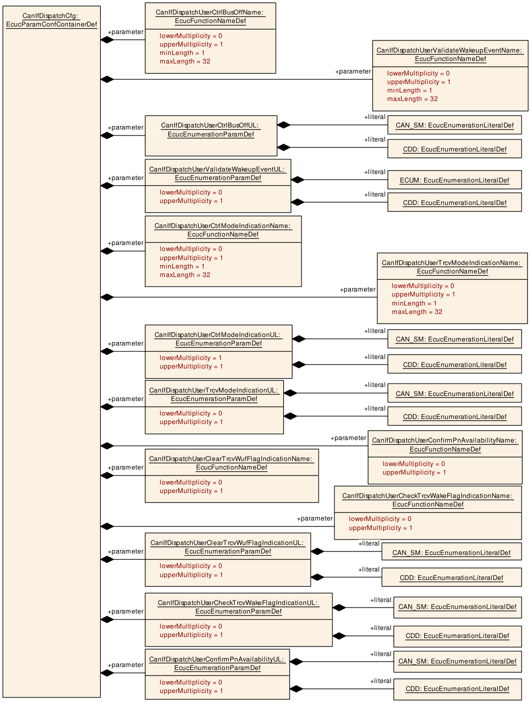

图 10.10： AR_EcucDef_CanIfDispatchCfg

> 原文第 204 页

#### 10.1.11 CanIfCtrlCfg

| 字段 | 内容 |
| --- | --- |
| SWS 条目 | [ECUC_CanIf_00546] |
| Container 名称 | CanIfCtrlCfg |
| 父 Container | CanIfCtrlDrvCfg |
| 说明 | 包含底层 CAN Driver 所管理的一个 Controller 的配置参数，可按 Controller 配置。 |
| Post-Build Variant Multiplicity | false |
| Multiplicity 配置类别 | Pre-compile time · X · VARIANT-PRE-COMPILE, VARIANT-LINK-TIME, VARIANT-POST-BUILD Link time · – Post-build time · – |
| 配置参数 |  |

| 字段 | 内容 |
| --- | --- |
| SWS 条目 | [ECUC_CanIf_00647] |
| 参数名称 | CanIfCtrlId |
| 父 Container | CanIfCtrlCfg |
| 说明 | 抽象 CAN Driver 专有的 Controller 参数。所有连接的 CAN Driver 的每个 Controller 都应分配一个独立 CanIf ControllerId。范围：0..所有 CAN Driver 已配置 Controller 的数量。 |
| Multiplicity | 1 |
| 类型 | EcucIntegerParamDef（为此参数生成 Symbolic Name）。 |
| 取值范围 | 0 .. 255 |
| 默认值 | – |
| Post-Build Variant Value | false |
| Value Configuration Class | Pre-compile time · X · 全部 Variant Link time · – Post-build time · – |
| 作用域 / 依赖关系 | 作用域：ECU。 |

| 字段 | 内容 |
| --- | --- |
| SWS 条目 | [ECUC_CanIf_00637] |
| 参数名称 | CanIfCtrlWakeupSupport |
| 父 Container | CanIfCtrlCfg |
| 说明 | 定义能否查询所引用 Driver 的对应 Controller 的 wakeup event。True：启用；False：禁用。 |
| Multiplicity | 1 |
| 类型 | EcucBooleanParamDef |
| 默认值 | false |
| Post-Build Variant Value | false |
| Value Configuration Class | Pre-compile time · X · VARIANT-PRE-COMPILE Link time · X · VARIANT-LINK-TIME, VARIANT-POST-BUILD Post-build time · – |
| 作用域 / 依赖关系 | 作用域：ECU。 |

> 原文第 205 页

| 字段 | 内容 |
| --- | --- |
| SWS 条目 | [ECUC_CanIf_00636] |
| 参数名称 | CanIfCtrlCanCtrlRef |
| 父 Container | CanIfCtrlCfg |
| 说明 | 本参数引用底层 CAN Driver 中由 CAN Interface 提供服务的 CAN Controller 的逻辑句柄。该引用应关联 CanController 配置容器中的以下参数：CanControllerId、CanWakeupSourceRef。范围：0..底层受支持的 CAN Controller 最大数量。 |
| Multiplicity | 1 |
| 类型 | 指向 CanController 的符号名称引用 |
| Post-Build Variant Value | false |
| Value Configuration Class | Pre-compile time · X · VARIANT-PRE-COMPILE Link time · X · VARIANT-LINK-TIME, VARIANT-POST-BUILD Post-build time · – |
| 作用域 / 依赖关系 | 作用域：ECU。依赖项：CAN Controller 的数量。 |

无包含的 Container

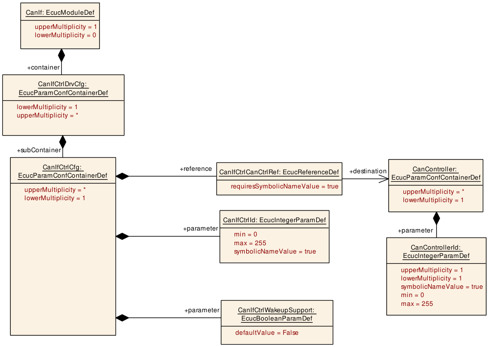

图 10.11： AR_EcucDef_CanIfCtrlCfg

> 原文第 206 页

#### 10.1.12 CanIfCtrlDrvCfg

| 字段 | 内容 |
| --- | --- |
| SWS 条目 | [ECUC_CanIf_00253] |
| Container 名称 | CanIfCtrlDrvCfg |
| 父 Container | CanIf |
| 说明 | 汇总底层 CAN Driver 模块的配置。每个 CAN Driver 必须提供独立 container 实例。 |
| Post-Build Variant Multiplicity | false |
| Multiplicity 配置类别 | Pre-compile time · X · VARIANT-PRE-COMPILE, VARIANT-LINK-TIME, VARIANT-POST-BUILD Link time · – Post-build time · – |
| 配置参数 |  |

| 字段 | 内容 |
| --- | --- |
| SWS 条目 | [ECUC_CanIf_00642] |
| 参数名称 | CanIfCtrlDrvInitHohConfigRef |
| 父 Container | CanIfCtrlDrvCfg |
| 说明 | 引用 Init Hoh Configuration。 |
| Multiplicity | 1 |
| 类型 | 引用 CanIfInitHohCfg。 |
| Post-Build Variant Value | false |
| Value Configuration Class | Pre-compile time · X · VARIANT-PRE-COMPILE Link time · X · VARIANT-LINK-TIME, VARIANT-POST-BUILD Post-build time · – |
| 作用域 / 依赖关系 | 作用域：local。 |

| 字段 | 内容 |
| --- | --- |
| SWS 条目 | [ECUC_CanIf_00638] |
| 参数名称 | CanIfCtrlDrvNameRef |
| 父 Container | CanIfCtrlDrvCfg |
| 说明 | CAN Interface 的 Driver 引用，可从 CAN Driver 获取 Driver Name、Vendor ID 等信息。CAN Driver 名称可由其模块 ShortName 导出。 |
| Multiplicity | 1 |
| 类型 | 引用 CanGeneral。 |
| Post-Build Variant Value | false |
| Value Configuration Class | Pre-compile time · X · 全部 Variant Link time · – Post-build time · – |
| 作用域 / 依赖关系 | 作用域：local。 |

| 包含的 Container |  |  |
| --- | --- | --- |
| Container 名称 | Multiplicity | 作用域 / 依赖关系 |
| CanIfCtrlCfg | 1..* | 包含底层 CAN Driver 所管理的一个 Controller 的配置参数，可按 Controller 配置。 |

> 原文第 207 页

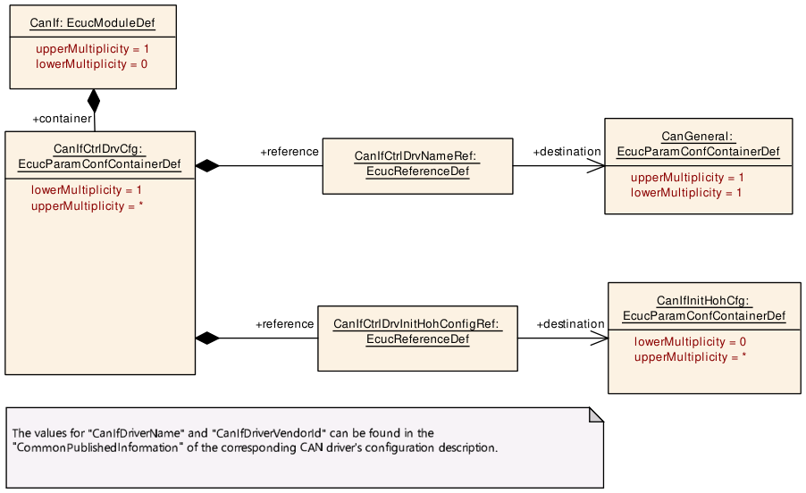

图 10.12：AR_EcucDef_CanIfCtrlDrvCfg

#### 10.1.13 CanIfTrcvDrvCfg

| 字段 | 内容 |
| --- | --- |
| SWS 条目 | [ECUC_CanIf_00273] |
| Container 名称 | CanIfTrcvDrvCfg |
| 父 Container | CanIf |
| 说明 | 本容器包含各底层 CAN Transceiver Driver 所管理的全部 CAN transceiver 的配置参数。每个 CAN Transceiver Driver 都应具有一个独立的本容器实例。 |
| Post-Build Variant Multiplicity | false |
| Multiplicity 配置类别 | Pre-compile time · X · VARIANT-PRE-COMPILE, VARIANT-LINK-TIME, VARIANT-POST-BUILD Link time · – Post-build time · – |
| 配置参数 |  |

| 包含的 Container |  |  |
| --- | --- | --- |
| Container 名称 | Multiplicity | 作用域 / 依赖关系 |
| CanIfTrcvCfg | 1..* | 本容器包含底层 CAN Transceiver Driver 所管理的一个 CAN transceiver 的配置参数。每个 CAN transceiver 都必须具有一个独立的本容器实例。 |

> 原文第 208 页

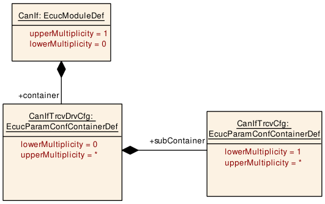

图 10.13：AR_EcucDef_CanIfTrcvDrvCfg

#### 10.1.14 CanIfTrcvCfg

| 字段 | 内容 |
| --- | --- |
| SWS 条目 | [ECUC_CanIf_00587] |
| Container 名称 | CanIfTrcvCfg |
| 父 Container | CanIfTrcvDrvCfg |
| 说明 | 本容器包含底层 CAN Transceiver Driver 所管理的一个 CAN transceiver 的配置参数。每个 CAN transceiver 都必须具有一个独立的本容器实例。 |
| Post-Build Variant Multiplicity | false |
| Multiplicity 配置类别 | Pre-compile time · X · VARIANT-PRE-COMPILE, VARIANT-LINK-TIME, VARIANT-POST-BUILD Link time · – Post-build time · – |
| 配置参数 |  |

| 字段 | 内容 |
| --- | --- |
| SWS 条目 | [ECUC_CanIf_00654] |
| 参数名称 | CanIfTrcvId |
| 父 Container | CanIfTrcvCfg |
| 说明 | 本参数对 CAN Transceiver Driver 特有的 Transceiver 参数进行抽象。所有已连接的 CAN Transceiver Driver 模块中的每个 transceiver，都应分配一个 CanIf 专用的 TransceiverId。取值范围：0..所有 CAN Transceiver Driver 模块中已配置的 transceiver 数量。 |
| Multiplicity | 1 |
| 类型 | EcucIntegerParamDef（为此参数生成 Symbolic Name）。 |
| 取值范围 | 0 .. 255 |
| 默认值 | – |
| Post-Build Variant Value | false |
| Value Configuration Class | Pre-compile time · X · 全部 Variant Link time · – Post-build time · – |
| 作用域 / 依赖关系 | 作用域：ECU。 |

> 原文第 209 页

| 字段 | 内容 |
| --- | --- |
| SWS 条目 | [ECUC_CanIf_00606] |
| 参数名称 | CanIfTrcvWakeupSupport |
| 父 Container | CanIfTrcvCfg |
| 说明 | 定义能否查询所引用 Driver 的对应 Transceiver 的 wakeup event。True：启用；False：禁用。 |
| Multiplicity | 1 |
| 类型 | EcucBooleanParamDef |
| 默认值 | false |
| Post-Build Variant Value | false |
| Value Configuration Class | Pre-compile time · X · VARIANT-PRE-COMPILE Link time · X · VARIANT-LINK-TIME, VARIANT-POST-BUILD Post-build time · – |
| 作用域 / 依赖关系 | 作用域：ECU。 |

| 字段 | 内容 |
| --- | --- |
| SWS 条目 | [ECUC_CanIf_00605] |
| 参数名称 | CanIfTrcvCanTrcvRef |
| 父 Container | CanIfTrcvCfg |
| 说明 | 引用 CanIf 所服务的底层 CAN Transceiver 在 CanTrcv 中的逻辑 handle。范围：0..受支持底层 Transceiver 的最大数量。 |
| Multiplicity | 1 |
| 类型 | 对 CanTrcvChannel 的 symbolic name reference。 |
| Post-Build Variant Value | false |
| Value Configuration Class | Pre-compile time · X · VARIANT-PRE-COMPILE Link time · X · VARIANT-LINK-TIME, VARIANT-POST-BUILD Post-build time · – |
| 作用域 / 依赖关系 | 作用域：ECU。依赖：CAN Transceiver 数量。 |

无包含的 Container

> 原文第 210 页

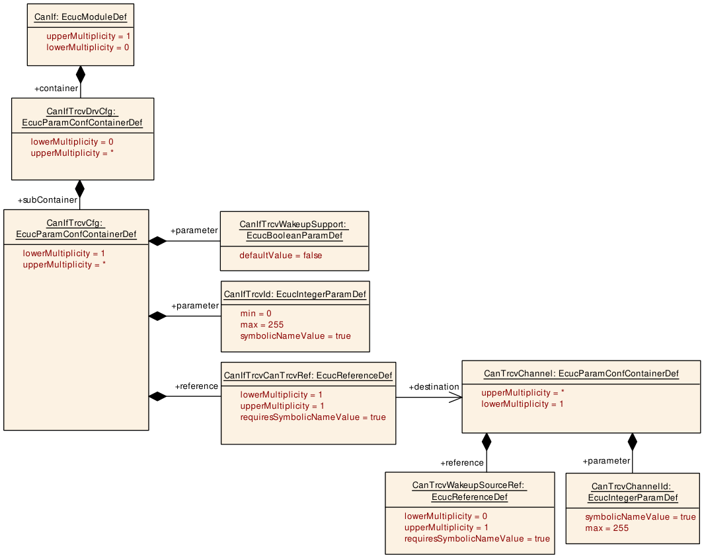

图 10.14：AR_EcucDef_CanIfTrcvCfg

#### 10.1.15 CanIfInitHohCfg

| 字段 | 内容 |
| --- | --- |
| SWS 条目 | [ECUC_CanIf_00257] |
| Container 名称 | CanIfInitHohCfg |
| 父 Container | CanIfInitCfg |
| 说明 | 包含对各底层 CAN Driver configuration set 的引用。 |
| Post-Build Variant Multiplicity | false |
| Multiplicity 配置类别 | Pre-compile time · X · VARIANT-PRE-COMPILE, VARIANT-LINK-TIME, VARIANT-POST-BUILD Link time · – Post-build time · – |
| 配置参数 |  |

| 包含的 Container |  |  |
| --- | --- | --- |
| Container 名称 | Multiplicity | 作用域 / 依赖关系 |
| CanIfHrhCfg | 0..* | 本容器包含各 hardware receive object（HRH）的配置参数。 |
| CanIfHthCfg | 0..* | 本容器包含与各 HTH 相关的参数。 |

> 原文第 211 页

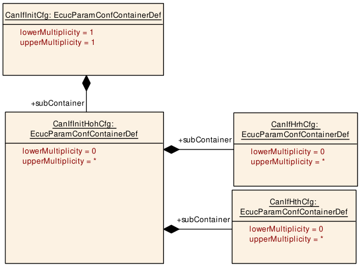

图 10.15：AR_EcucDef_CanIfInitHohCfg

#### 10.1.16 CanIfHthCfg

| 字段 | 内容 |
| --- | --- |
| SWS 条目 | [ECUC_CanIf_00258] |
| Container 名称 | CanIfHthCfg |
| 父 Container | CanIfInitHohCfg |
| 说明 | 本容器包含与各 HTH 相关的参数。 |
| Post-Build Variant Multiplicity | true |
| Multiplicity 配置类别 | Pre-compile time · X · VARIANT-PRE-COMPILE Link time · X · VARIANT-LINK-TIME Post-build time · X · VARIANT-POST-BUILD |
| 配置参数 |  |

| 字段 | 内容 |
| --- | --- |
| SWS 条目 | [ECUC_CanIf_00625] |
| 参数名称 | CanIfHthCanCtrlIdRef |
| 父 Container | CanIfHthCfg |
| 说明 | 引用该 HTH 所属的 Controller ID。一个 Controller 可以包含一个或多个 HTH。 |
| Multiplicity | 1 |
| 类型 | 引用 CanIfCtrlCfg。 |
| Post-Build Variant Value | true |
| Value Configuration Class | Pre-compile time · X · VARIANT-PRE-COMPILE Link time · X · VARIANT-LINK-TIME Post-build time · X · VARIANT-POST-BUILD |
| 作用域 / 依赖关系 | 作用域：ECU。 |

| 字段 | 内容 |
| --- | --- |
| SWS 条目 | [ECUC_CanIf_00627] |
| 参数名称 | CanIfHthIdSymRef |
| 父 Container | CanIfHthCfg |

> 原文第 212 页

| 字段 | 内容 |
| --- | --- |
| 说明 | 本参数引用 CanDrv 配置中的一个特定 HTH 对象（见 CanHardwareObject 或 CanXLHardwareObject）。CanIf 通过该引用获得 CanDrv 模块中的以下信息： • CanHandleType（仅适用于 CAN 2.0 和 CAN FD）； • CanObjectId。 |
| Multiplicity | 1 |
| 类型 | Choice symbolic name reference：[CanHardwareObject, CanXLHardwareObject]。 |
| Post-Build Variant Value | true |
| Value Configuration Class | Pre-compile time · X · VARIANT-PRE-COMPILE Link time · X · VARIANT-LINK-TIME Post-build time · X · VARIANT-POST-BUILD |
| 作用域 / 依赖关系 | 作用域：ECU。 |

无包含的 Container

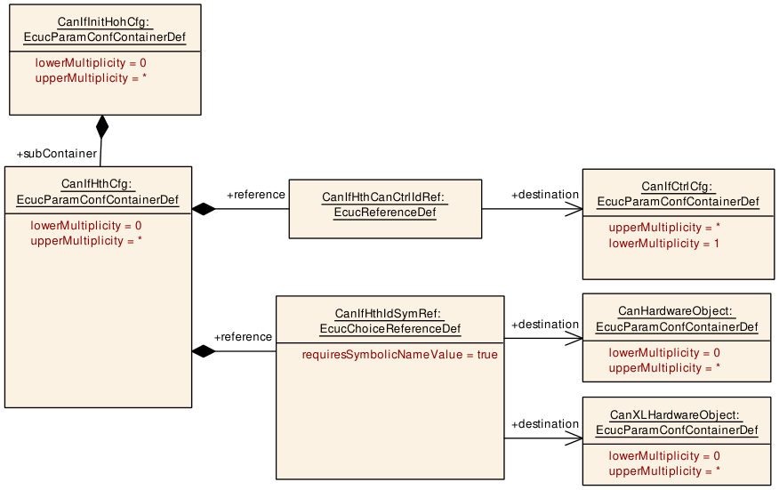

图 10.16：AR_EcucDef_CanIfHthCfg

#### 10.1.17 CanIfHrhCfg

| 字段 | 内容 |
| --- | --- |
| SWS 条目 | [ECUC_CanIf_00259] |
| Container 名称 | CanIfHrhCfg |
| 父 Container | CanIfInitHohCfg |
| 说明 | 本容器包含各 hardware receive object（HRH）的配置参数。 |
| Post-Build Variant Multiplicity | true |
| Multiplicity 配置类别 | Pre-compile time · X · VARIANT-PRE-COMPILE Link time · X · VARIANT-LINK-TIME |

> 原文第 213 页

|  | Post-build time | X | VARIANT-POST-BUILD |
| --- | --- | --- | --- |
| 配置参数 |  |  |  |

| 字段 | 内容 |
| --- | --- |
| SWS 条目 | [ECUC_CanIf_00632] |
| 参数名称 | CanIfHrhSoftwareFilter |
| 父 Container | CanIfHrhCfg |
| 说明 | 使用 CAN Driver 配置的 HRH range/list 选择 hardware receive object，定义接收处理时哪些 HRH 需要软件过滤。True：启用 software filtering。False：启用 software filtering。 |
| Multiplicity | 1 |
| 类型 | EcucBooleanParamDef |
| 默认值 | true |
| Post-Build Variant Value | false |
| Value Configuration Class | Pre-compile time · X · VARIANT-PRE-COMPILE Link time · X · VARIANT-LINK-TIME, VARIANT-POST-BUILD Post-build time · – |
| 作用域 / 依赖关系 | 作用域：local。 |

| 字段 | 内容 |
| --- | --- |
| SWS 条目 | [ECUC_CanIf_00631] |
| 参数名称 | CanIfHrhCanCtrlIdRef |
| 父 Container | CanIfHrhCfg |
| 说明 | 引用 HRH 所属 Controller ID。一个 Controller 可以包含一个或多个 HRH。 |
| Multiplicity | 1 |
| 类型 | 引用 CanIfCtrlCfg。 |
| Post-Build Variant Value | true |
| Value Configuration Class | Pre-compile time · X · VARIANT-PRE-COMPILE Link time · X · VARIANT-LINK-TIME Post-build time · X · VARIANT-POST-BUILD |
| 作用域 / 依赖关系 | 作用域：ECU。 |

| 字段 | 内容 |
| --- | --- |
| SWS 条目 | [ECUC_CanIf_00634] |
| 参数名称 | CanIfHrhIdSymRef |
| 父 Container | CanIfHrhCfg |
| 说明 | 引用 CanDrv 配置中的特定 HRH（见 CanHardwareObject 或 CanXLHardwareObject）。CanIf 通过该引用获取 CanHandleType（仅 CAN 2.0 / CAN FD）及 CanObjectId。 |
| Multiplicity | 1 |
| 类型 | Choice symbolic name reference：[CanHardwareObject, CanXLHardwareObject]。 |
| Post-Build Variant Value | true |
| Value Configuration Class | Pre-compile time · X · VARIANT-PRE-COMPILE Link time · X · VARIANT-LINK-TIME Post-build time · X · VARIANT-POST-BUILD |
| 作用域 / 依赖关系 | 作用域：ECU。 |

> 原文第 214 页

| 包含的 Container |  |  |
| --- | --- | --- |
| Container 名称 | Multiplicity | 作用域 / 依赖关系 |
| CanIfHrhRangeCfg | 0..* | 定义为同一个 HRH 配置多个 CAN ID 范围时所需的参数。 |

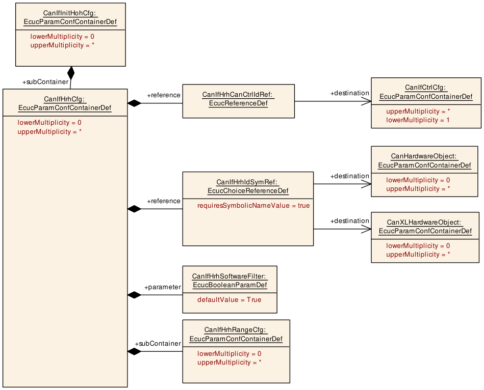

图 10.17：AR_EcucDef_CanIfHrhCfg

#### 10.1.18 CanIfHrhRangeCfg

| 字段 | 内容 |
| --- | --- |
| SWS 条目 | [ECUC_CanIf_00628] |
| Container 名称 | CanIfHrhRangeCfg |
| 父 Container | CanIfHrhCfg |
| 说明 | 定义为同一个 HRH 配置多个 CAN ID 范围时所需的参数。 |
| Post-Build Variant Multiplicity | true |
| Multiplicity 配置类别 | Pre-compile time · X · VARIANT-PRE-COMPILE Link time · X · VARIANT-LINK-TIME Post-build time · X · VARIANT-POST-BUILD |
| 配置参数 |  |

> 原文第 215 页

| 字段 | 内容 |
| --- | --- |
| SWS 条目 | [ECUC_CanIf_00825] |
| 参数名称 | CanIfHrhRangeBaseId |
| 父 Container | CanIfHrhRangeCfg |
| 说明 | 与 CanIfHrhRangeMask 配合定义 masked ID range 的 CAN Identifier 基值，该范围内全部 CAN ID 应通过软件过滤。参数位宽受 CanIfHrhRangeRxPduRangeCanIdType 限制。 |
| Multiplicity | 0..1 |
| 类型 | EcucIntegerParamDef |
| 取值范围 | 0 .. 536870911 |
| 默认值 | – |
| Post-Build Variant Multiplicity | true |
| Post-Build Variant Value | true |
| Multiplicity 配置类别 | Pre-compile time · X · VARIANT-PRE-COMPILE Link time · X · VARIANT-LINK-TIME Post-build time · X · VARIANT-POST-BUILD |
| Value Configuration Class | Pre-compile time · X · VARIANT-PRE-COMPILE Link time · X · VARIANT-LINK-TIME Post-build time · X · VARIANT-POST-BUILD |
| 作用域 / 依赖关系 | 作用域：local。 |

| 字段 | 内容 |
| --- | --- |
| SWS 条目 | [ECUC_CanIf_00826] |
| 参数名称 | CanIfHrhRangeMask |
| 父 Container | CanIfHrhRangeCfg |
| 说明 | 与 CanIfHrhRangeBaseId 配合定义 masked ID range 的 mask，该范围内全部 CAN ID 应通过软件过滤。参数位宽受 CanIfHrhRangeRxPduRangeCanIdType 限制。 |
| Multiplicity | 0..1 |
| 类型 | EcucIntegerParamDef |
| 取值范围 | 0 .. 536870911 |
| 默认值 | – |
| Post-Build Variant Multiplicity | true |
| Post-Build Variant Value | true |
| Multiplicity 配置类别 | Pre-compile time · X · VARIANT-PRE-COMPILE Link time · X · VARIANT-LINK-TIME Post-build time · X · VARIANT-POST-BUILD |
| Value Configuration Class | Pre-compile time · X · VARIANT-PRE-COMPILE Link time · X · VARIANT-LINK-TIME Post-build time · X · VARIANT-POST-BUILD |
| 作用域 / 依赖关系 | 作用域：local。 |

| 字段 | 内容 |
| --- | --- |
| SWS 条目 | [ECUC_CanIf_00629] |
| 参数名称 | CanIfHrhRangeRxPduLowerCanId |
| 父 Container | CanIfHrhRangeCfg |
| 说明 | 接收 CAN L-PDU ID 范围的下限，范围内全部 CAN ID 应通过软件过滤。 |
| Multiplicity | 0..1 |
| 类型 | EcucIntegerParamDef |
| 取值范围 | 0 .. 536870911 |

> 原文第 216 页

| 字段 | 内容 |
| --- | --- |
| 默认值 | – |
| Post-Build Variant Multiplicity | true |
| Post-Build Variant Value | true |
| Multiplicity 配置类别 | Pre-compile time · X · VARIANT-PRE-COMPILE Link time · X · VARIANT-LINK-TIME Post-build time · X · VARIANT-POST-BUILD |
| Value Configuration Class | Pre-compile time · X · VARIANT-PRE-COMPILE Link time · X · VARIANT-LINK-TIME Post-build time · X · VARIANT-POST-BUILD |
| 作用域 / 依赖关系 | 作用域：local。 |

| 字段 | 内容 |
| --- | --- |
| SWS 条目 | [ECUC_CanIf_00644] |
| 参数名称 | CanIfHrhRangeRxPduRangeCanIdType |
| 父 Container | CanIfHrhRangeCfg |
| 说明 | 指定配置的 CAN ID range 仅考虑 Standard CAN ID 还是 Extended CAN ID。 |
| Multiplicity | 1 |
| 类型 | EcucEnumerationParamDef |
| 取值范围 | EXTENDED · 全部 CAN ID 均仅为 Extended 类型，29 bit。 STANDARD · 全部 CAN ID 均仅为 Standard 类型，11 bit。 |
| Post-Build Variant Value | true |
| Value Configuration Class | Pre-compile time · X · VARIANT-PRE-COMPILE Link time · X · VARIANT-LINK-TIME Post-build time · X · VARIANT-POST-BUILD |
| 作用域 / 依赖关系 | 作用域：local。 |

| 字段 | 内容 |
| --- | --- |
| SWS 条目 | [ECUC_CanIf_00630] |
| 参数名称 | CanIfHrhRangeRxPduUpperCanId |
| 父 Container | CanIfHrhRangeCfg |
| 说明 | 接收 CAN L-PDU ID 范围的上限，范围内全部 CAN ID 应通过软件过滤。 |
| Multiplicity | 0..1 |
| 类型 | EcucIntegerParamDef |
| 取值范围 | 0 .. 536870911 |
| 默认值 | – |
| Post-Build Variant Multiplicity | true |
| Post-Build Variant Value | true |
| Multiplicity 配置类别 | Pre-compile time · X · VARIANT-PRE-COMPILE Link time · X · VARIANT-LINK-TIME Post-build time · X · VARIANT-POST-BUILD |
| Value Configuration Class | Pre-compile time · X · VARIANT-PRE-COMPILE Link time · X · VARIANT-LINK-TIME Post-build time · X · VARIANT-POST-BUILD |
| 作用域 / 依赖关系 | 作用域：local。 |

无包含的 Container

> 原文第 217 页

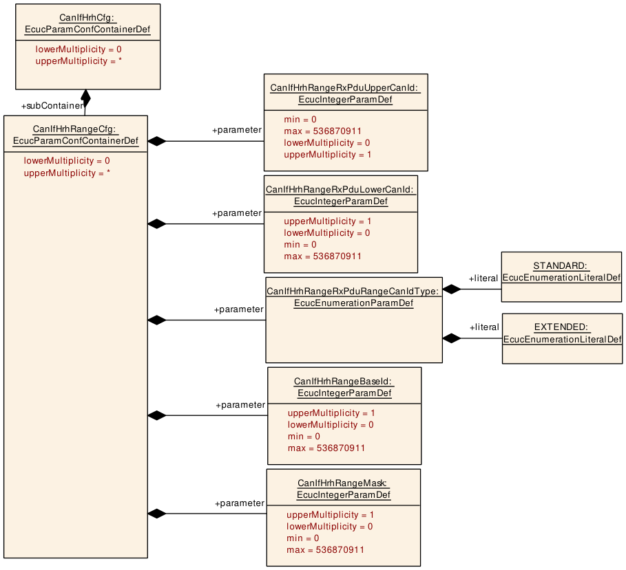

图 10.18：AR_EcucDef_CanIfHrhRangeCfg

#### 10.1.19 CanIfBufferCfg

| 字段 | 内容 |
| --- | --- |
| SWS 条目 | [ECUC_CanIf_00832] |
| Container 名称 | CanIfBufferCfg |
| 父 Container | CanIfInitCfg |
| 说明 | 本容器包含 Tx buffer 配置。可以配置多个不同容量的缓冲区。如果 CanIfBufferSize（ECUC_CanIf_00834）等于 0，则 CanIf Tx L-PDU 仅通过本 CanIfBufferCfg 引用相应的 CanIfHthCfg。 |
| Post-Build Variant Multiplicity | true |
| Multiplicity 配置类别 | Pre-compile time · X · VARIANT-PRE-COMPILE Link time · X · VARIANT-LINK-TIME Post-build time · X · VARIANT-POST-BUILD |
| 配置参数 |  |

| 字段 | 内容 |
| --- | --- |
| SWS 条目 | [ECUC_CanIf_00834] |
| 参数名称 | CanIfBufferSize |
| 父 Container | CanIfBufferCfg |

> 原文第 218 页

| 字段 | 内容 |
| --- | --- |
| 说明 | 本参数定义一个 Tx buffer 可缓冲的 CanIf Tx L-PDU 数量。若该值为 0，CanIf 不对分配到该 Tx buffer 的 Tx L-PDU 执行发送缓冲。若 CanIfPublicTxBuffering 等于 False，则所有 Tx buffer 的本参数均为 0。若所引用 HTH 的 CanHandleType 等于 FULL，则该 Tx buffer 的本参数为 0。 |
| Multiplicity | 1 |
| 类型 | EcucIntegerParamDef |
| 取值范围 | 0 .. 255 |
| 默认值 | 0 |
| Post-Build Variant Value | true |
| Value Configuration Class | Pre-compile time · X · VARIANT-PRE-COMPILE Link time · X · VARIANT-LINK-TIME Post-build time · X · VARIANT-POST-BUILD |
| 作用域 / 依赖关系 | 作用域：local。依赖项：CanIfPublicTxBuffering、CanHandleType。 |

| 字段 | 内容 |
| --- | --- |
| SWS 条目 | [ECUC_CanIf_00833] |
| 参数名称 | CanIfBufferHthRef |
| 父 Container | CanIfBufferCfg |
| 说明 | 引用一个 HTH，该 HTH 定义用于发送的 hardware object 或 hardware object pool。无论是否启用 TxBuffering，所有 CanIf Tx L-PDU 都通过 CanIfBufferCfg 和本参数引用 HTH。每个 HTH 最多只能分配给一个 buffer。 |
| Multiplicity | 1 |
| 类型 | 指向 CanIfHthCfg 的引用 |
| Post-Build Variant Value | true |
| Value Configuration Class | Pre-compile time · X · VARIANT-PRE-COMPILE Link time · X · VARIANT-LINK-TIME Post-build time · X · VARIANT-POST-BUILD |
| 作用域 / 依赖关系 | 作用域：local。 |

无包含的 Container

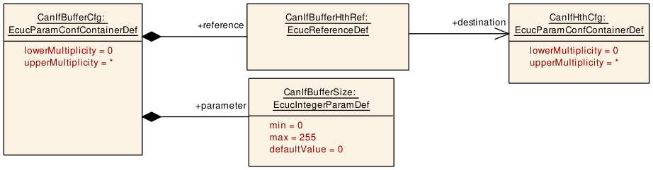

图 10.19： AR_EcucDef_CanIfBufferCfg

> 原文第 219 页

#### 10.1.20 CanIfSecurityEventRefs

| 字段 | 内容 |
| --- | --- |
| SWS 条目 | [ECUC_CanIf_00849] |
| Container 名称 | CanIfSecurityEventRefs |
| 父 Container | CanIfPublicCfg |
| 说明 | 包含对 IdsMEvent 的引用。当发生相应安全事件且 CanIfEnableSecurityEventReporting = true 时，CanIf 应向 IdsM 报告这些事件。此 container 的标准 security event 可扩展为供应商专有事件。Tags: atp.Status=draft |
| Post-Build Variant Multiplicity | false |
| Multiplicity 配置类别 | Pre-compile time · X · 全部 Variant Link time · – Post-build time · – |
| 配置参数 |  |

| 字段 | 内容 |
| --- | --- |
| SWS 条目 | [ECUC_CanIf_00853] |
| 参数名称 | CANIF_SEV_ERRORSTATE_BUSOFF |
| 父 Container | CanIfSecurityEventRefs |
| 说明 | Controller 转入 busoff 状态。Tags: atp.Status=draft |
| Multiplicity | 0..1 |
| 类型 | 对 IdsMEvent 的 symbolic name reference。 |
| Post-Build Variant Multiplicity | false |
| Post-Build Variant Value | false |
| Multiplicity 配置类别 | Pre-compile time · X · 全部 Variant Link time · – Post-build time · – |
| Value Configuration Class | Pre-compile time · X · 全部 Variant Link time · – Post-build time · – |
| 作用域 / 依赖关系 | 作用域：local。 |

| 字段 | 内容 |
| --- | --- |
| SWS 条目 | [ECUC_CanIf_00852] |
| 参数名称 | CANIF_SEV_ERRORSTATE_PASSIVE |
| 父 Container | CanIfSecurityEventRefs |
| 说明 | 检测到接收相关错误；根据 context data，可能表示可疑 CAN 活动。Tags: atp.Status=draft |
| Multiplicity | 0..1 |
| 类型 | 对 IdsMEvent 的 symbolic name reference。 |
| Post-Build Variant Multiplicity | false |
| Post-Build Variant Value | false |
| Multiplicity 配置类别 | Pre-compile time · X · 全部 Variant Link time · – Post-build time · – |
| Value Configuration Class | Pre-compile time · X · 全部 Variant |

> 原文第 220 页

|  | Link time | – |
| --- | --- | --- |
|  | Post-build time | – |
| 作用域 / 依赖关系 | 作用域：local。 |  |

| 字段 | 内容 |
| --- | --- |
| SWS 条目 | [ECUC_CanIf_00851] |
| 参数名称 | CANIF_SEV_RX_ERROR_DETECTED |
| 父 Container | CanIfSecurityEventRefs |
| 说明 | 检测到接收相关错误；根据 context data，可能表示可疑 CAN 活动。Tags: atp.Status=draft |
| Multiplicity | 0..1 |
| 类型 | 对 IdsMEvent 的 symbolic name reference。 |
| Post-Build Variant Multiplicity | false |
| Post-Build Variant Value | false |
| Multiplicity 配置类别 | Pre-compile time · X · 全部 Variant Link time · – Post-build time · – |
| Value Configuration Class | Pre-compile time · X · 全部 Variant Link time · – Post-build time · – |
| 作用域 / 依赖关系 | 作用域：local。 |

| 字段 | 内容 |
| --- | --- |
| SWS 条目 | [ECUC_CanIf_00850] |
| 参数名称 | CANIF_SEV_TX_ERROR_DETECTED |
| 父 Container | CanIfSecurityEventRefs |
| 说明 | 检测到发送相关错误；根据 context data，可能表示可疑 CAN 活动。Tags: atp.Status=draft |
| Multiplicity | 0..1 |
| 类型 | 对 IdsMEvent 的 symbolic name reference。 |
| Post-Build Variant Multiplicity | false |
| Post-Build Variant Value | false |
| Multiplicity 配置类别 | Pre-compile time · X · 全部 Variant Link time · – Post-build time · – |
| Value Configuration Class | Pre-compile time · X · 全部 Variant Link time · – Post-build time · – |
| 作用域 / 依赖关系 | 作用域：local。 |

无包含的 Container

> 原文第 221 页

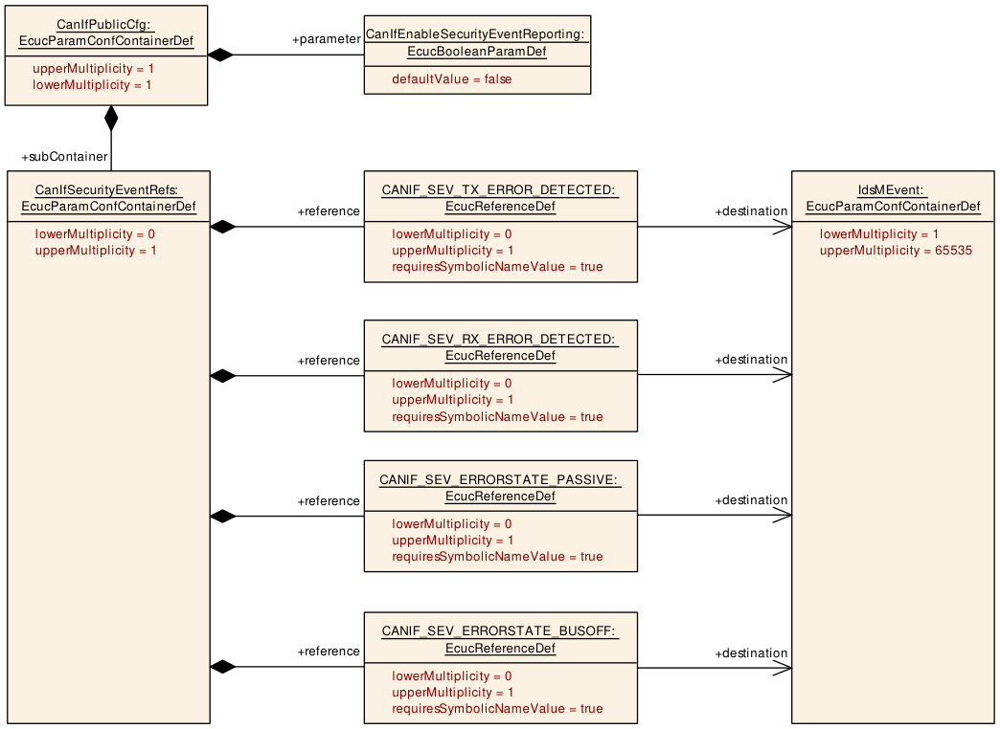

（来自 IdsM）

图 10.20： AR_EcucDef_CanIfSecurityEventRefs

### 10.2 配置约束

[SWS_CANIF_CONSTR_00001] ⌈ 每个包含 CanIfRxPduXLParams 的 CanIfRxPduCfg，其 Priority ID 应二选一配置：作为 CanIfRxPduRef 所引用 global PDU 的 PRIORITYID_16 MetaData item，或作为 CanIfRxPduXLParams.CanIfXLPriorityId。⌋ (SRS_Can_02003)

[SWS_CANIF_CONSTR_00002] ⌈ 每个包含 CanIfTxPduXLParams 的 CanIfTxPduCfg，其 Priority ID 应二选一配置：作为 CanIfTxPduRef 所引用 global PDU 的 PRIORITYID_16 MetaData item，或作为 CanIfTxPduXLParams.CanIfXLPriorityId。⌋ (SRS_Can_02003)

[SWS_CANIF_CONSTR_00003] ⌈ 每个包含 CanIfRxPduXLParams 的 CanIfRxPduCfg，其 SDU Type 应二选一配置：作为 CanIfRxPduRef 所引用 global PDU 的 SDUTYPE_8 MetaData item，或作为 CanIfRxPduXLParams.CanIfXLSduType。⌋ (SRS_Can_02003)

[SWS_CANIF_CONSTR_00004] ⌈ 每个包含 CanIfTxPduXLParams 的 CanIfTxPduCfg，其 SDU Type 应二选一配置：

> 原文第 222 页

作为 CanIfTxPduRef 所引用 global PDU 的 SDUTYPE_8 MetaData item，或作为 CanIfTxPduXLParams.CanIfXLSduType。⌋ (SRS_Can_02003)

[SWS_CANIF_CONSTR_00005] ⌈ 每个包含 CanIfRxPduXLParams 的 CanIfRxPduCfg，其 Virtual CAN Network ID 应二选一配置：作为 CanIfRxPduRef 所引用 global PDU 的 VLAN_16 MetaData item，或作为 CanIfRxPduXLParams.CanIfXLVcid。⌋ (SRS_Can_02003)

[SWS_CANIF_CONSTR_00006] ⌈ 每个包含 CanIfTxPduXLParams 的 CanIfTxPduCfg，其 Virtual CAN Network ID 应二选一配置：作为 CanIfTxPduRef 所引用 global PDU 的 VLAN_16 MetaData item，或作为 CanIfTxPduXLParams.CanIfXLVcid。⌋ (SRS_Can_02003)

[SWS_CANIF_CONSTR_00007] ⌈ 若 CanIfRxPduCfg 包含 CanIfRxPduXLParams，且 CanIfXLSduType 已配置但不是 03h，则 Acceptance Field 应二选一配置：作为 CanIfRxPduRef 所引用 global PDU 的 ACCEPTANCEFIELD_32 MetaData item，或作为 CanIfRxPduXLParams.CanIfXLAcceptanceField。⌋ (SRS_Can_02003)

[SWS_CANIF_CONSTR_00008] ⌈ 若 CanIfTxPduCfg 包含 CanIfTxPduXLParams，且 CanIfXLSduType 已配置但不是 03h，则 Acceptance Field 应二选一配置：作为 CanIfTxPduRef 所引用 global PDU 的 ACCEPTANCEFIELD_32 MetaData item，或作为 CanIfTxPduXLParams.CanIfXLAcceptanceField。⌋ (SRS_Can_02003)

[SWS_CANIF_CONSTR_00009] ⌈ 若 CanIfRxPduCfg 包含 CanIfRxPduXLParams，且 CanIfXLSduType = 03h，则既不得为 CanIfRxPduRef 所引用 global PDU 配置 ACCEPTANCEFIELD_32 MetaData item，也不得配置 CanIfRxPduXLParams.CanIfXLAcceptanceField。⌋ (SRS_Can_02003)

[SWS_CANIF_CONSTR_00010] ⌈ 若 CanIfTxPduCfg 包含 CanIfTxPduXLParams，且 CanIfXLSduType = 03h，则既不得为 CanIfTxPduRef 所引用 global PDU 配置 ACCEPTANCEFIELD_32 MetaData item，也不得配置 CanIfTxPduXLParams.CanIfXLAcceptanceField。⌋ (SRS_Can_02003)

[SWS_CANIF_CONSTR_00011] ⌈ 若 CanIfRxPduCfg 包含 CanIfRxPduXLParams，且 CanIfXLSduType 已配置但不是 03h，则不得配置 CanIfRxPduCanId、CanIfRxPduCanIdType 和 CanIfRxPduCanIdMask，也不得为 CanIfRxPduRef 所引用 global PDU 配置 CAN_ID_32 MetaData item。⌋ (SRS_Can_02003)

> 原文第 223 页

[SWS_CANIF_CONSTR_00012] ⌈ 若 CanIfTxPduCfg 包含 CanIfTxPduXLParams，且 CanIfXLSduType 已配置但不是 03h，则不得配置 CanIfTxPduCanId、CanIfTxPduCanIdType 和 CanIfTxPduCanIdMask，也不得为 CanIfTxPduRef 所引用 global PDU 配置 CAN_ID_32 MetaData item。⌋ (SRS_Can_02003)

[SWS_CANIF_CONSTR_00013] ⌈ 对包含 CanIfRxPduXLParams 的 CanIfRxPduCfg，若配置了 CanIfRxPduCanId 和/或 CanIfRxPduCanIdMask，或为 CanIfRxPduRef 所引用 global PDU 配置了 CAN_ID_32 MetaData item，则 CanIfTxPduXLParams.CanIfXLSduType 应配置为 03h。⌋ (SRS_Can_02003)

[SWS_CANIF_CONSTR_00014] ⌈ 对包含 CanIfTxPduXLParams 的 CanIfTxPduCfg，若配置了 CanIfTxPduCanId 和/或 CanIfTxPduCanIdMask，或为 CanIfTxPduRef 所引用 global PDU 配置了 CAN_ID_32 MetaData item，则 CanIfTxPduXLParams.CanIfXLSduType 应配置为 03h。⌋ (SRS_Can_02003)

> 原文第 224 页

## A 不适用的需求

[SWS_CANIF_NA_00999] ⌈ 以下需求不适用于本规范。⌋ (SRS_BSW_00159, SRS_BSW_00167, SRS_BSW_00170, SRS_BSW_00416, SRS_BSW_00168, SRS_BSW_00423, SRS_BSW_00424, SRS_BSW_00425, SRS_BSW_00426, SRS_BSW_00427, SRS_BSW_00428, SRS_BSW_00429, SRS_BSW_00432, SRS_BSW_00433, SRS_BSW_00336, SRS_BSW_00417, SRS_BSW_00164, SRS_BSW_00007, SRS_BSW_00307, SRS_BSW_00373, SRS_BSW_00328, SRS_BSW_00378, SRS_BSW_00306, SRS_BSW_00308, SRS_BSW_00309, SRS_BSW_00330, SRS_BSW_00172, SRS_BSW_00010, SRS_BSW_00341, SRS_BSW_00334, SRS_Can_01139, SRS_Can_01014)

---

## 译者说明：阅读时需留意的原文表述

以下内容不属于 AUTOSAR 规范正文，也不修改原文需求。它们用于区分原文措辞与工程解读；实际实现应结合上下文、适用版本及供应商实现确认。

| 位置 | 原文表述与阅读提示 |
| --- | --- |
| 7.9、7.11.1 与 CanIf_Transmit | 7.9 中 E_OK 的叙述容易被理解为总线发送已经完成。结合发送缓冲机制和 API 定义，应区分“发送请求已接受”与“实际发送完成”；E_OK 本身不能代替 TxConfirmation。 |
| SWS_CANIF_00317、SWS_CANIF_00324 | 条件中的 and 按原文保留为“且”。请结合 Controller mode、PDU mode 和其他需求整体阅读，勿孤立地据此推导完整状态判断。 |
| SWS_CANIF_00917 | 第二组条件使用 RxErrorCounter > 127 和 TxErrorCounter <= 255，原文混用了两个 counter，译文予以保留。 |
| 9.3、9.5 的发送中断说明 | 原文使用 receiving CAN Controller。发送完成及发送中断应从发送端 Controller 的行为理解，原文此处用词疑似有误。 |
| 9.9 | 原文将 CanIf_ReadRxNotifStatus 用于描述 Tx/Rx 通知状态读取。接口章节分别提供 CanIf_ReadTxNotifStatus 与 CanIf_ReadRxNotifStatus，应按各自 API 定义使用。 |
| CanIf_TrcvModeIndication 的说明 | 原文某处使用 CanDrv 描述调用来源；理解 transceiver mode indication 时应结合 CAN Transceiver Driver 的接口关系。 |
| CanIfHrhSoftwareFilter | 原文对 TRUE 和 FALSE 的说明均写成“启用”软件过滤。译文保留这一差异点；实现时应结合参数定义及软件过滤需求核对。 |
| SWS_CANIF_CONSTR_00013 | 该条讨论 CanIfRxPduCfg，却引用 CanIfTxPduXLParams.CanIfXLSduType。译文保留原标识符，未擅自改为 Rx 参数。 |
| CanIfTxPduUserTriggerTransmitName | 原文对 CDD 情形引用了 <User_TxConfirmation>。请结合 <User_TriggerTransmit> 的 API 定义核对；译文未替换原文所引用的接口。 |
| SWS_CANIF_00950 | 该条处于 CAN XL 接收相关上下文，却引用 CanIf_RxIndication。译文保留原 API 名称，建议结合 CanIf_XLRxIndication 的完整契约阅读。 |

专业术语、代码标识符、配置枚举和原图中的文字保留英文；PDF 换行造成的标识符断裂已尽量还原。{DRAFT} 等状态标记保留，不代表本译文对规范状态作出额外判断。
